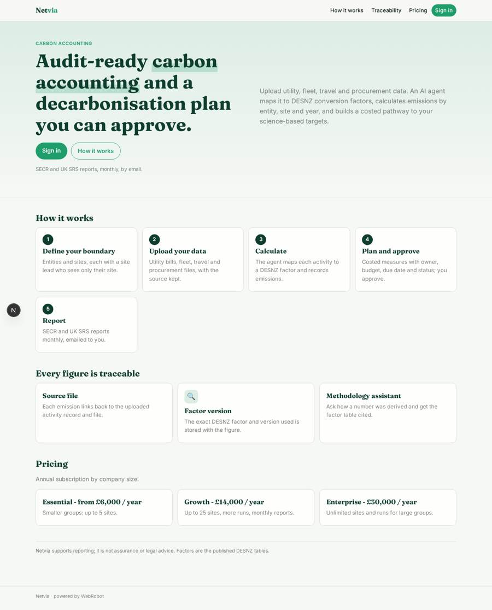
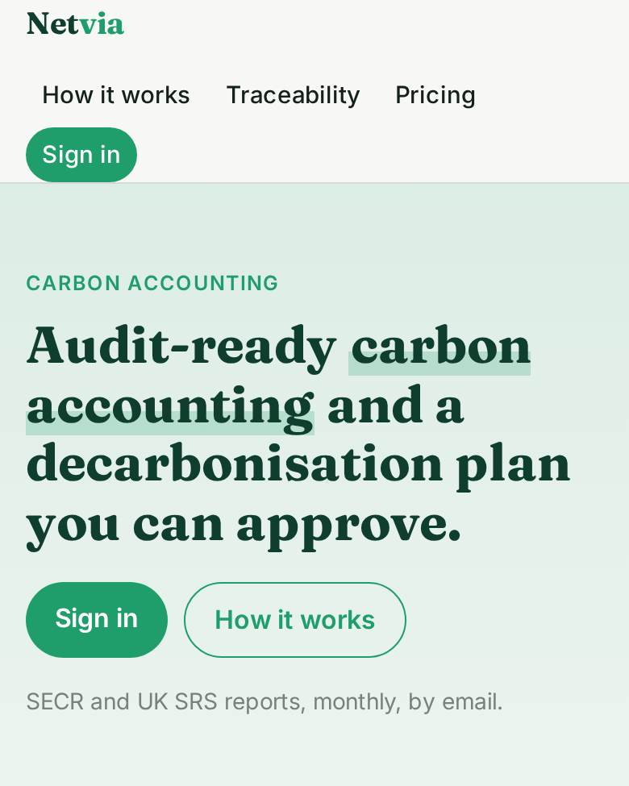
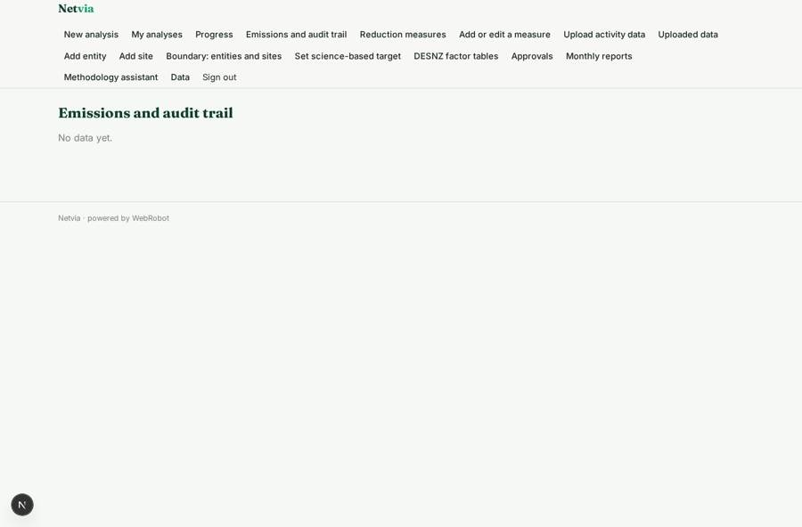
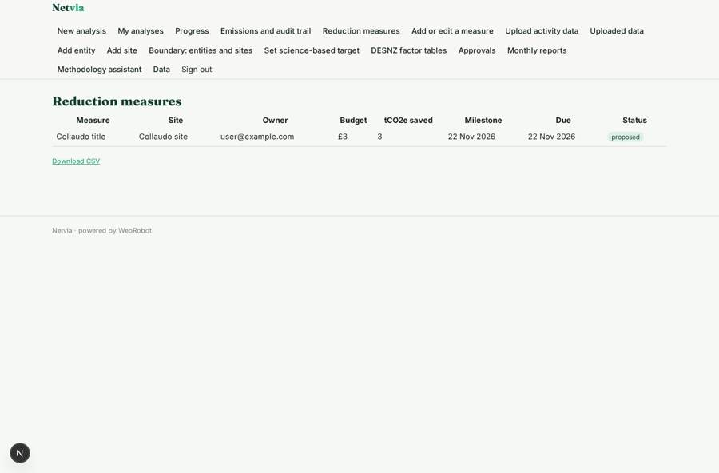
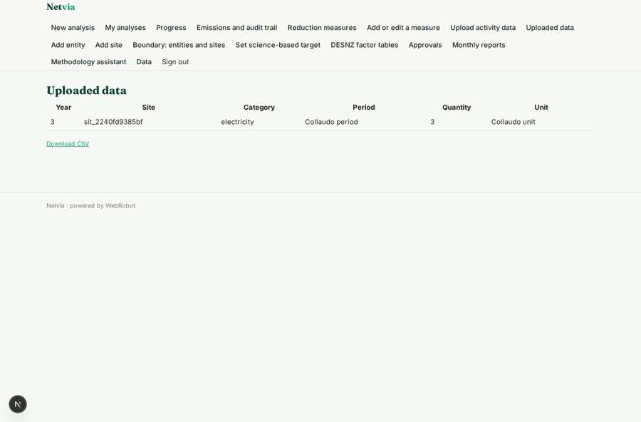
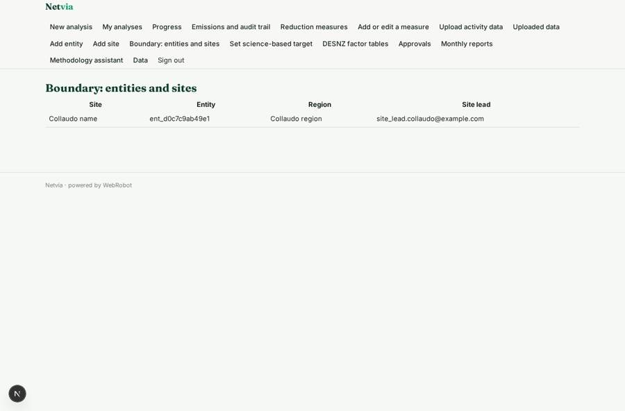

# Netvia

_Carbon accounting and decarbonisation for larger companies._

**Sector:** Sanità, istruzione, energia, gov · **Manifest:** valid (schema + runtime contract) · **Functional test:** passed (29 checks passed)

## Description given to the app builder

We need Netvia, a carbon accounting and decarbonisation platform for larger companies. The company creates its organisational boundary, entities and sites, and its team uploads utility, fleet, travel and procurement data. We want ERP connections through OAuth to pull data automatically. An agent maps data to the DESNZ conversion factors, calculates emissions, and builds a decarbonisation pathway with costed reduction measures, which the head of sustainability reviews and approves. Each site lead sees only their site; the head of sustainability sees the whole group. Dashboards show progress against science-based targets; reports for SECR and UK SRS are scheduled monthly and emailed to stakeholders. An assistant answers questions about the methodology, citing the factor tables. Pricing: annual subscription by company size, from £6,000. Each reduction measure has an owner, a budget, a due date and status, with email reminders to owners when a milestone is close. Group data can be filtered by entity, region and year, and every figure in a report links back to the uploaded source and factor version used, so auditors can trace it. English only.

## Navigation recording

Signed in as the app's admin, the recorder opened 7 menu page(s): New analysis, My analyses, Progress, Emissions and audit trail, Reduction measures, Add or edit a measure, Upload activity data.
- data page empty: emissions_table (table)

Empty data pages are mostly expected on the local runtime: agents are mocked there, so the collections they fill stay empty.

## Features not expressible today (spec.extensions)

- **erp_oauth**: ERP connections through OAuth to pull data automatically are not available yet. For now the team uploads files; an API-key connection can be added for ERPs that support keys.
- **stakeholder_distribution**: Monthly reports are emailed to the report owner, who forwards them. A distribution list of stakeholders per report is not available yet.
- **site_head_link**: Site leads enter the head of sustainability's email on their uploads so the head sees the whole group; automatic copying from the site record is not available yet.

## Screenshots (interpretive runtime, test data)

### home-anon

### home-mobile

### emissions_table

### measures

### uploads

### boundary

