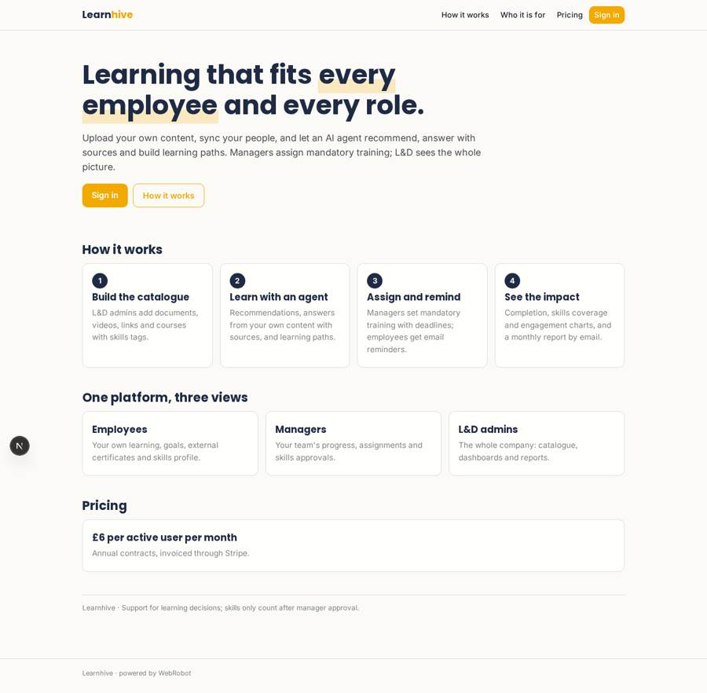
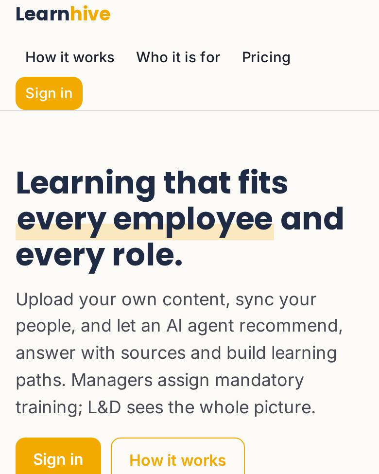
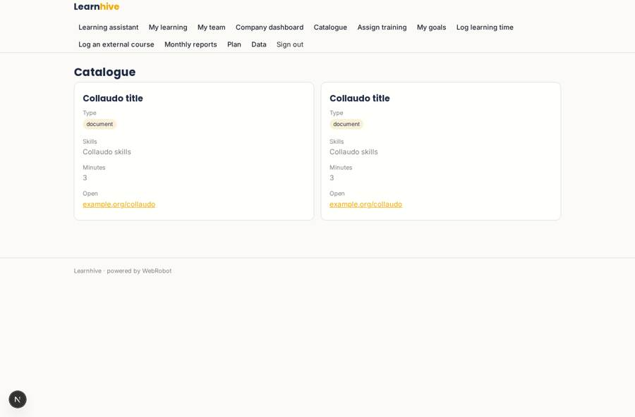
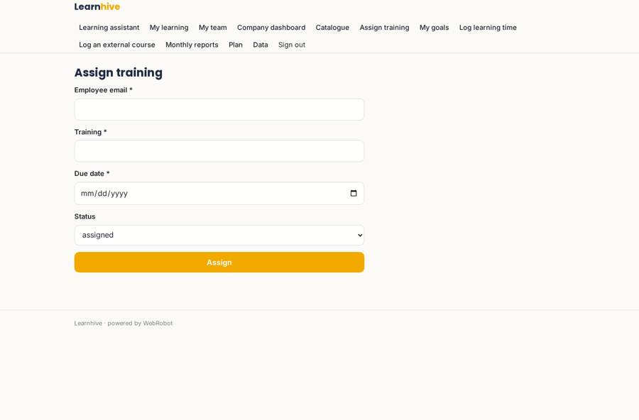
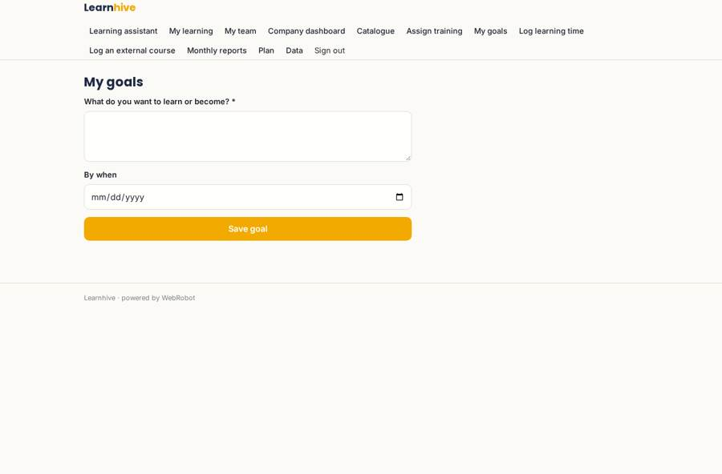
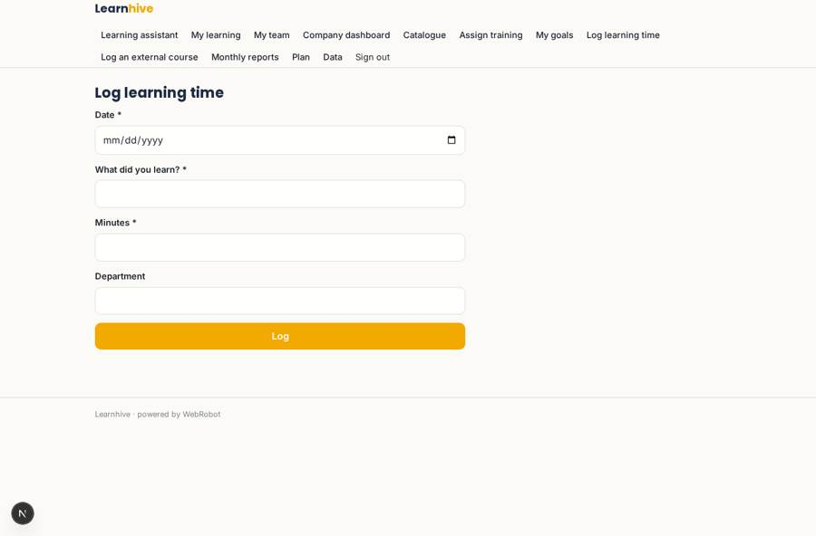

# Learnhive

_Corporate learning that knows your people, your skills gaps and your content._

**Sector:** Sanità, istruzione, energia, gov · **Manifest:** valid (schema + runtime contract) · **Functional test:** passed (29 checks passed)

## Description given to the app builder

We need Learnhive, a corporate learning-experience platform. A company signs up, connects single sign-on and its HR system so employees, departments and roles sync automatically. Admins upload and organise the company's own content (documents, videos, links, courses) into a catalogue with skills tags; we need video hosting. An agent recommends content to each employee based on role, skills gaps and goals, answers questions from the company's own content with sources, and builds learning paths. Managers assign mandatory training with deadlines; employees get email and in-app reminders. Employees see their own learning, managers their team, L&D admins the whole company, with charts of completion, skills coverage and engagement and a monthly report by email. Pricing per active user, £6 a month, annual contracts through Stripe invoices. English, with French and German laterEmployees can also log external courses and certificates with an upload, and the agent updates their skills profile; managers approve skills claims before they count towards dashboards. .

## Functional test: what did not pass

- **trigger has its effect** (trigger claim_pending): email to record.manager_email: no such recipient in the test (role nobody holds or empty field) _(warning)_

## Navigation recording

Signed in as the app's admin, the recorder opened 7 menu page(s): Learning assistant, My learning, My team, Company dashboard, Catalogue, Assign training, My goals.
No issue found.

Empty data pages are mostly expected on the local runtime: agents are mocked there, so the collections they fill stay empty.

## Features not expressible today (spec.extensions)

- **sso**: Single sign-on (SAML/OIDC) for the company is not available yet; employees sign in with email magic link.
- **hr_sync**: Automatic HR system sync (employees, departments, roles) is not available yet; admins import the directory as CSV on the data page. Managers are derived from the manager_email column.
- **video_hosting**: Video hosting and streaming are not available; videos are added to the catalogue as links (e.g. to the company's video platform). Uploaded files are limited to 15 MB and document types.
- **content_files**: Admins paste the text of documents into the catalogue's text field so the agent can answer from it with sources; automatic reading of uploaded catalogue files is not available.
- **per_active_user_pricing**: Billing per active user (£6 a month, annual contract invoiced through Stripe) is modelled as an annual plan of £72 per seat; counting active users and invoicing for the contract need to be set up in Stripe.
- **in_app_reminders**: In-app reminders are the due list on My learning; push and SMS reminders are not available yet.
- **languages**: English only for now; French and German to be added later.
- **directory_csv_export**: The CSV export of the people directory is available from the built-in data page (/admin/data), not from the dashboard table.
- **overdue_filter**: The overdue email is sent for every assignment one day after its due date; the date trigger cannot filter by status, so the wording asks the employee to ignore it if already completed.

## Screenshots (interpretive runtime, test data)

### home-anon

### home-mobile

### catalogue

### assign

### set_goal

### log_activity

