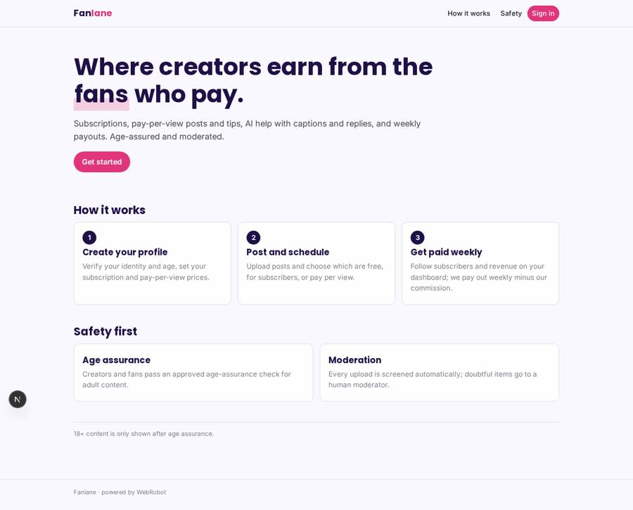
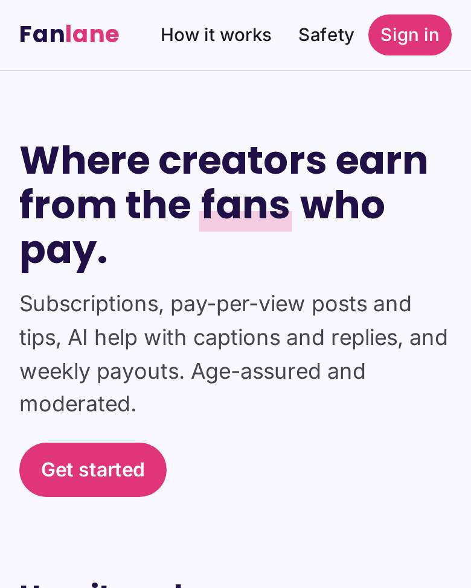
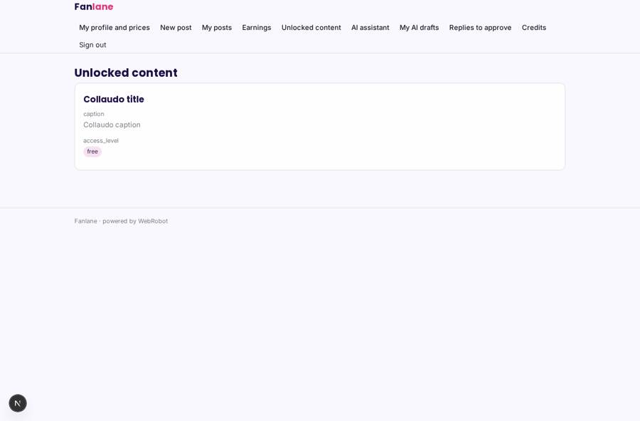
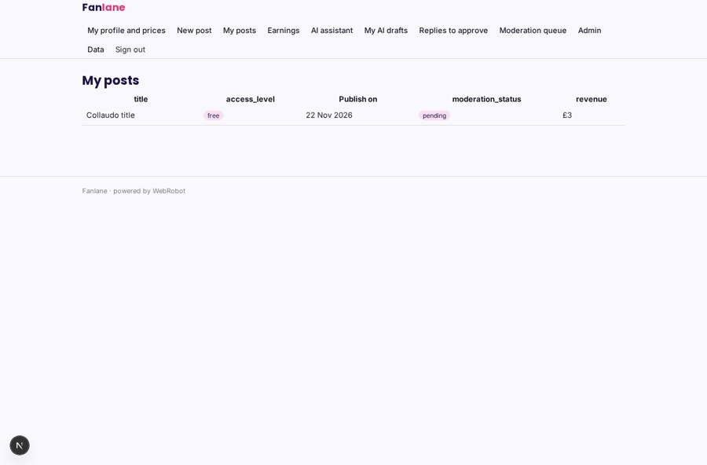
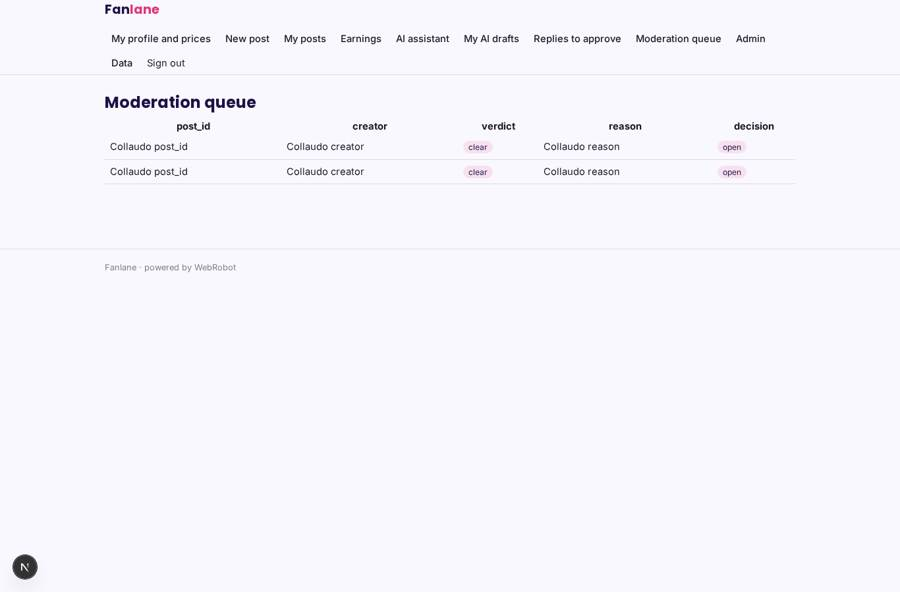
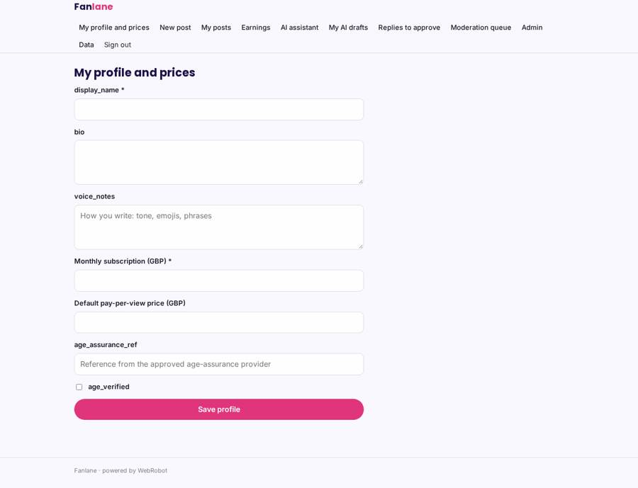

# Fanlane

_Creators earn from the fans who pay for their work._

**Sector:** Consumer, travel, retail · **Manifest:** valid (schema + runtime contract) · **Functional test:** passed (25 checks passed)

## Description given to the app builder

We need an app called Fanlane, a subscription platform where creators earn from paying fans, with AI tools. Payouts to many creators, video hosting, content moderation at scale and the network of creators are the product; I need the software for it. Creators sign up, verify identity and age with an approved age-assurance provider as the Online Safety Act requires, and set up a profile, subscription price and pay-per-view prices. They upload posts, photos and videos, schedule them, and choose which are free or paid. Fans sign up, pass age assurance for adult content, subscribe by card, unlock posts and send tips. An AI assistant helps creators write captions, suggests posting times and drafts replies to fan messages in the creator's voice; creators approve each reply before it goes. Every upload is screened by automated moderation and doubtful items go to a human moderator. Creators see their earnings dashboard (subscribers, revenue, top posts) and get paid out weekly minus our commission. Fans see only what they paid for; moderators see the queue; admins see everything. English.

## Navigation recording

Signed in as the app's admin, the recorder opened 7 menu page(s): My profile and prices, New post, My posts, Earnings, AI assistant, My AI drafts, Replies to approve.
No issue found.

Empty data pages are mostly expected on the local runtime: agents are mocked there, so the collections they fill stay empty.

## Features not expressible today (spec.extensions)

- **age_assurance**: Integration with an approved age-assurance provider (Online Safety Act) for creators and fans is not available yet; the flag age_verified must be set by the provider's callback.
- **video_hosting**: Video upload, transcoding and streaming at scale are not available; files are limited to 15 MB images and documents.
- **weekly_payouts**: Weekly Stripe Connect payouts with 20% commission, subscription renewals and tips need a payment integration that writes unlocked_by and earnings; the webhook trigger stores the events.
- **fan_messaging**: Direct fan-to-creator messages and a public creator directory are not available yet.

## Screenshots (interpretive runtime, test data)

### home-anon

### home-mobile

### feed

### my_posts

### moderation

### profile

