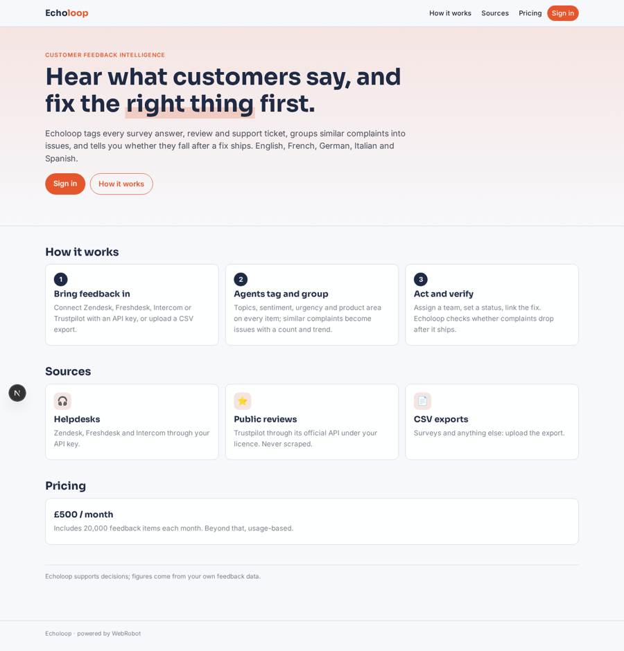
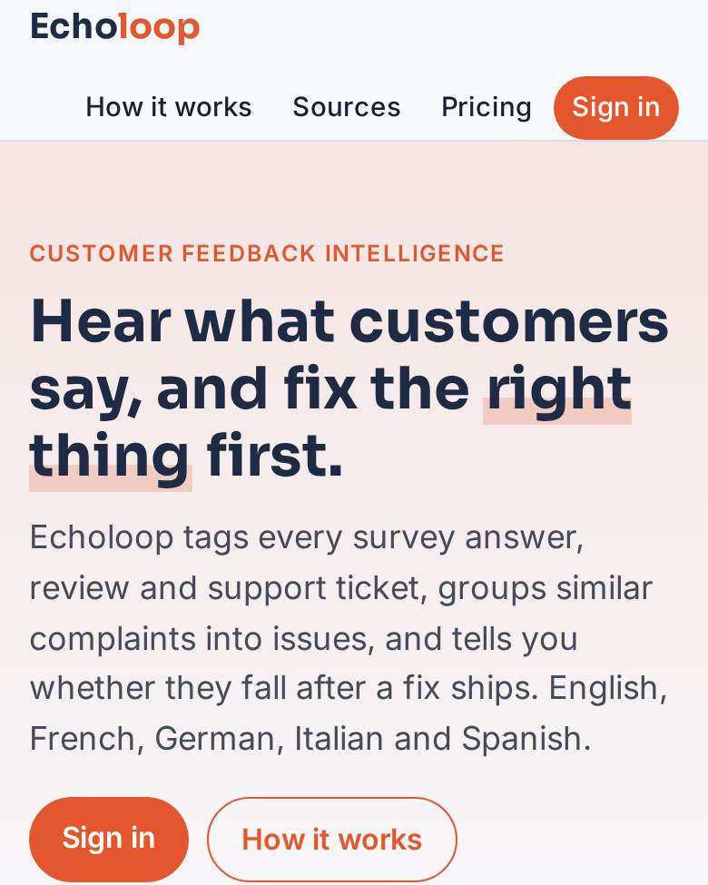
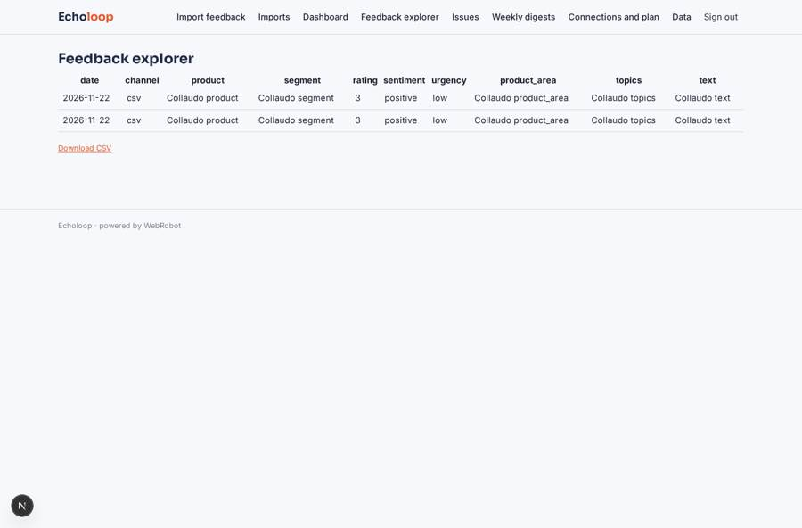
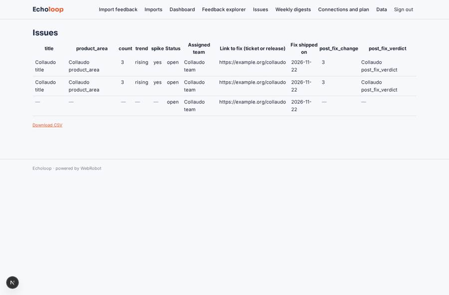
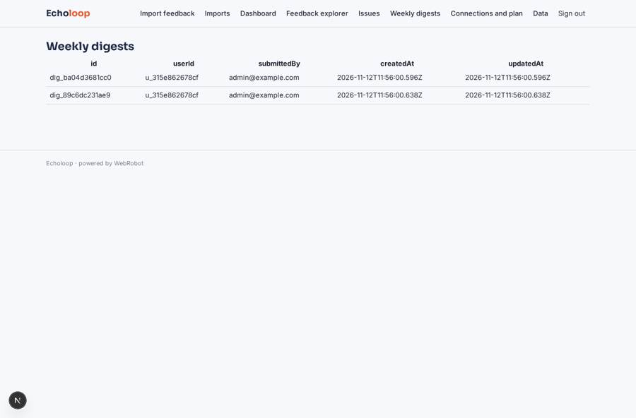
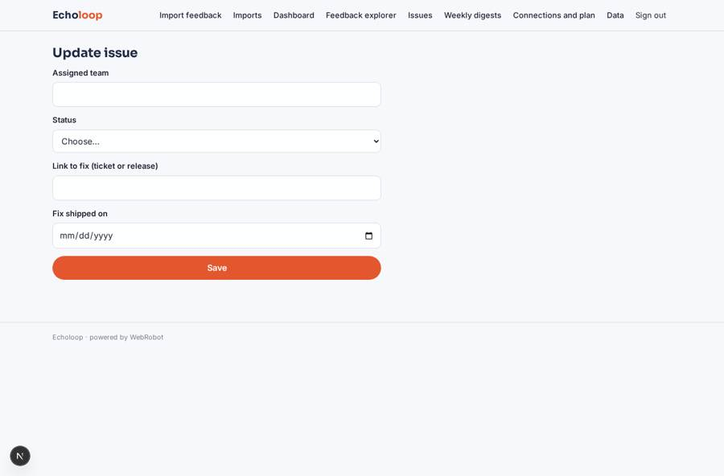

# Echoloop

_Turn customer feedback into the issues your team should fix next._

**Sector:** Data, media, cyber, devtools · **Manifest:** valid (schema + runtime contract) · **Functional test:** passed (22 checks passed)

## Description given to the app builder

I want an app called Echoloop that analyses customer feedback from surveys, reviews and support tickets. A company signs up and connects its sources through OAuth to Zendesk, Intercom, Freshdesk and Salesforce, as the real product does, or uploads CSV exports. Public reviews from Trustpilot or Google come in only through their official APIs or a licence, never scraping. Each item stores channel, date, product, customer segment, rating and text. An agent tags every item with topics, sentiment, urgency and the product area, and groups similar complaints into issues with a count and trend. Product managers see a dashboard of top issues, rising topics, sentiment over time and verbatim examples, and can filter by segment or channel. When a topic spikes, the owner of that product area gets an email alert. Each issue can be assigned to a team, given a status and linked to a fix; the agent tracks whether complaints fall after the fix ships. A weekly digest goes to managers every Monday. Roles: admin, analyst, product owner, viewer; teams see only their product areas if the admin restricts them. Pricing: £500 a month up to 20,000 items, then usage-based. Interface in English, analysis of feedback in English, French, German, Italian and Spanish.

## Functional test: what did not pass

- **saved record shown where its collection is read** (view digests): a record was saved in digests (by admin-data, admin-data) but the page does not show it (as admin) _(warning)_

## Navigation recording

Signed in as the app's admin, the recorder opened 7 menu page(s): Import feedback, Imports, Dashboard, Feedback explorer, Issues, Weekly digests, Connections and plan.
No issue found.

Empty data pages are mostly expected on the local runtime: agents are mocked there, so the collections they fill stay empty.

## Features not expressible today (spec.extensions)

- **oauth_connectors**: OAuth sign-in to Zendesk, Intercom, Freshdesk and Salesforce is not available yet: sources connect with API keys, and Salesforce and Google reviews (OAuth-only) come in through CSV export until OAuth exists.
- **interactive_filters**: Interactive segment and channel filters on the dashboard blocks: for now use the feedback explorer table; fixed filters are set per block.
- **area_restriction**: Product owners see only their own areas; analysts and viewers see all. Restricting a viewer to chosen areas needs a per-user area assignment, not available yet.
- **usage_pricing_note**: Plan credits count one per item (20,000 a month); overage pack price (£0.025 per item) is an assumption to confirm.

## Screenshots (interpretive runtime, test data)

### home-anon

### home-mobile

### explorer

### issues

### digests

### issue_edit

