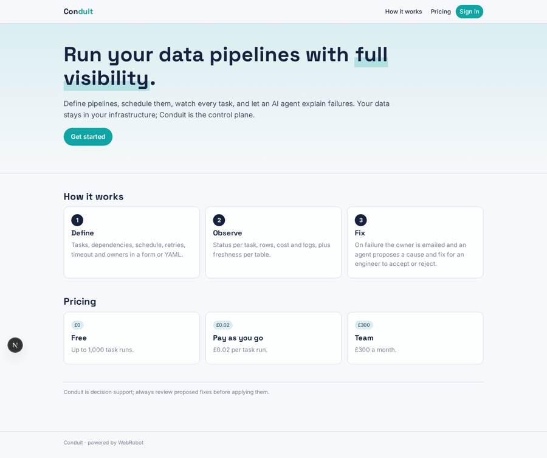
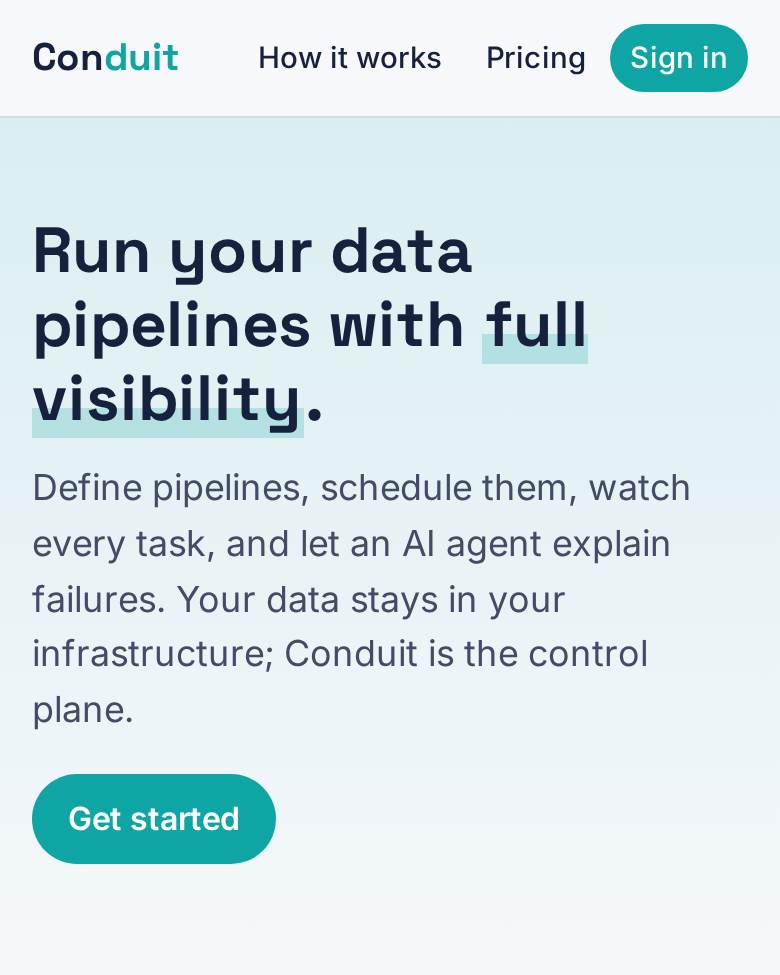
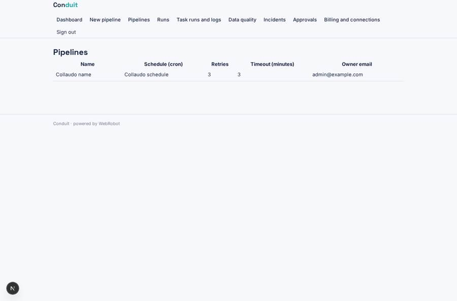
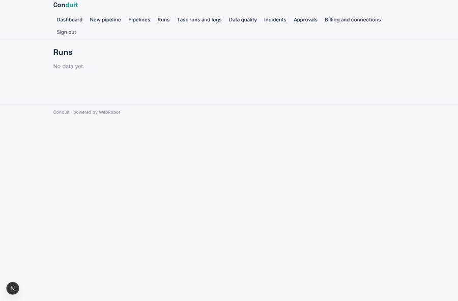
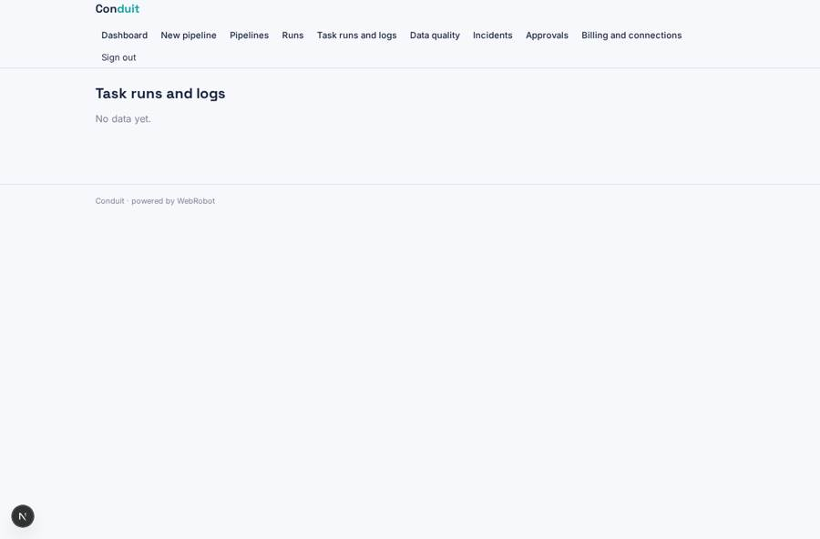
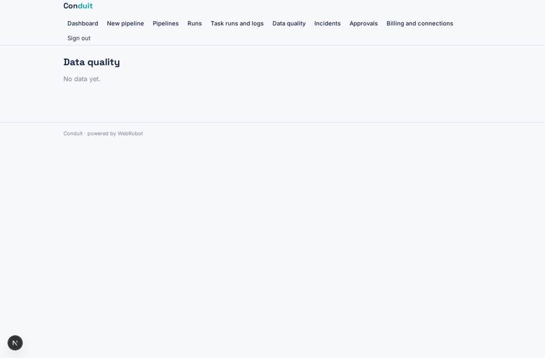

# Conduit

_Orchestrate and observe your data pipelines._

**Sector:** Data, media, cyber, devtools · **Manifest:** valid (schema + runtime contract) · **Functional test:** passed (12 checks passed)

## Description given to the app builder

We need an app called Conduit for orchestrating and observing data pipelines. A data team signs up and connects its Git repository and warehouse through OAuth, plus tools such as dbt, Fivetran, Airbyte and Snowflake, as the real product does. In a form or YAML editor they define pipelines: tasks, dependencies, schedule, retries, timeout and owners. The real product triggers runs inside the customer's own infrastructure with a lightweight agent installed there; that agent is ours, and I need the control plane, scheduling, status and alerting around it. Each run records start, end, status per task, rows processed, cost and logs. A dashboard shows pipeline health, failure rate, slowest tasks and data freshness per table. When a task fails, the owner gets an email and a Slack message, and an agent reads the logs and proposes a likely cause and fix, which an engineer can accept or reject. Data-quality checks such as row counts and null rates run after each load and can block downstream tasks until someone approves. Roles: admin, engineer, viewer; each workspace sees only its own pipelines. Pricing: free tier up to 1,000 task runs a month, then £0.02 per run, team plan £300 a month. English only.

## Navigation recording

Signed in as the app's admin, the recorder opened 7 menu page(s): Dashboard, New pipeline, Pipelines, Runs, Task runs and logs, Data quality, Incidents.
- data page empty: runs (table)
- data page empty: failures (table)
- data page empty: quality (table)
- data page empty: incidents_view (table)

Empty data pages are mostly expected on the local runtime: agents are mocked there, so the collections they fill stay empty.

## Features not expressible today (spec.extensions)

- **oauth_connections**: Connecting Git and warehouse through OAuth is not available yet; API keys/tokens are pasted on the account page instead.
- **slack_alerts**: Slack messages are not available yet; failures are alerted by email only.
- **customer_agent_dispatch**: The lightweight agent in the customer's infrastructure posts run, task, freshness and data-quality events to the app webhooks (run_event, task_event, freshness_event, dq_event) with the workspace members' emails in each payload. Cron dispatch of runs to that agent and blocking downstream tasks on a failed check must be implemented on the agent side; the control plane records and approves.
- **yaml_validation**: The pipeline definition is stored as YAML text; dependency-graph validation is not available yet.
- **free_tier_monthly_reset**: The free tier is granted as 1,000 signup credits (one per task run), not a monthly reset.

## Screenshots (interpretive runtime, test data)

### home-anon

### home-mobile

### pipelines

### runs

### failures

### quality

