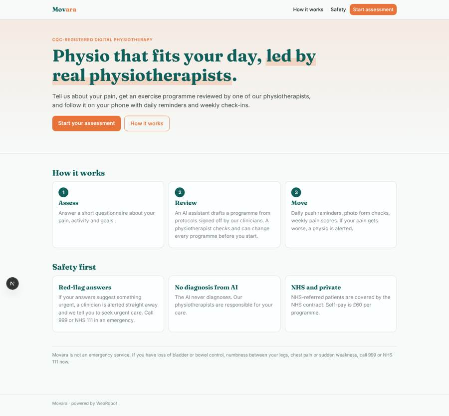
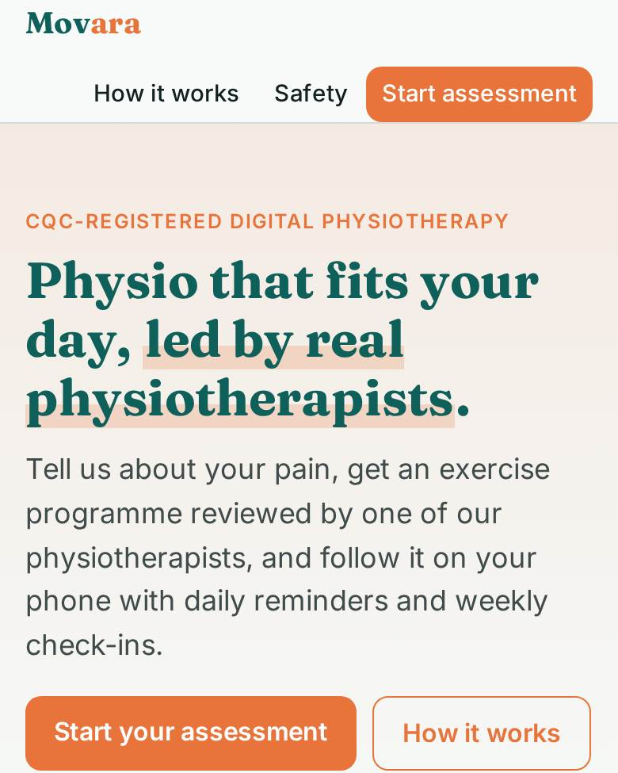
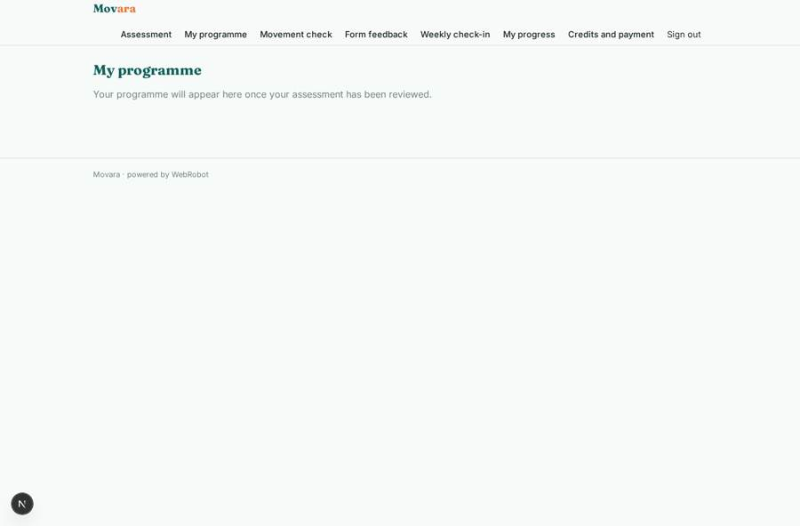
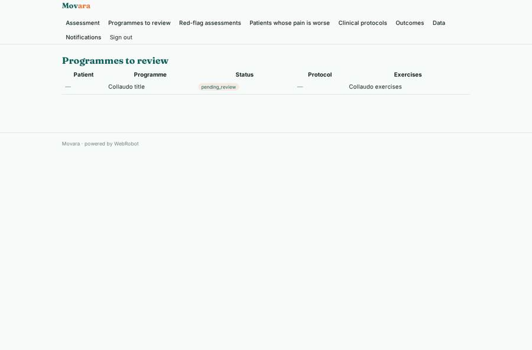
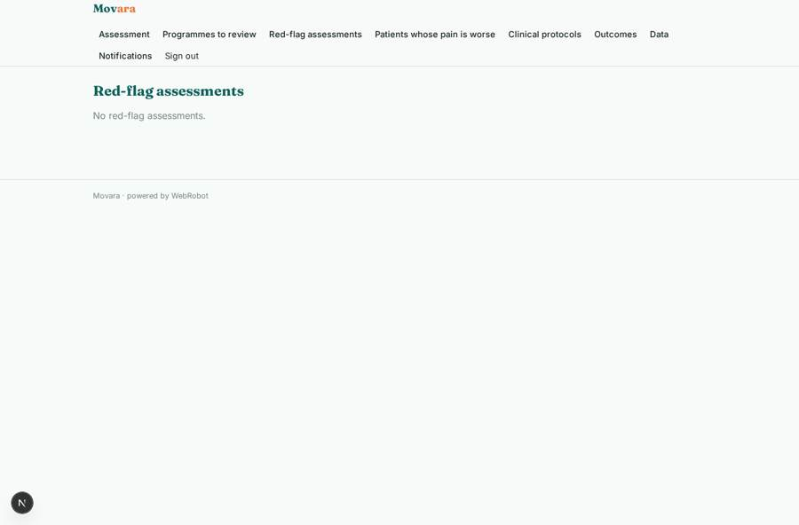
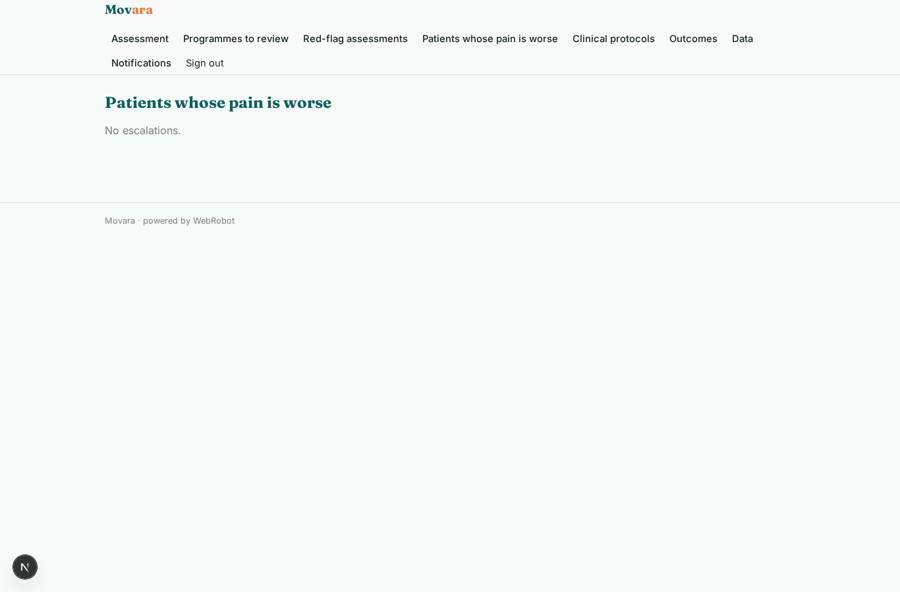

# Movara

_Digital physiotherapy for musculoskeletal pain and pelvic health._

**Sector:** Sanità, istruzione, energia, gov · **Manifest:** valid (schema + runtime contract) · **Functional test:** passed (25 checks passed)

## Description given to the app builder

I want Movara, a digital physiotherapy clinic for musculoskeletal pain and pelvic health. Patients self-refer or come through an NHS referral, complete an assessment form (pain area, duration, severity, red-flag questions, activity level, goals) and do a video movement check. The clinic is CQC-registered and the physiotherapists are ours; I need the software around them. Red-flag answers immediately route to a clinician and the patient is told to seek urgent care. An AI physio follows protocols written and signed off by our clinicians to deliver exercise programmes; we need video and motion analysis of exercises from the phone camera to give feedback on form. Physiotherapists review every new programme before it starts and can change it; the agent never diagnoses. Patients get daily exercise reminders by push, weekly progress check-ins and pain scores, with escalation to a physio if pain worsens. NHS commissioners see anonymised outcomes dashboards. Roles: patient, physiotherapist, clinical lead, commissioner. Pricing: NHS contracts per patient, and private self-pay at £60 per programme via Stripe. English only, mobile app.

## Functional test: what did not pass

- **trigger has its effect** (trigger programme_to_review): email to role:physio: no such recipient in the test (role nobody holds or empty field) _(warning)_
- **saved record shown where its collection is read** (view my_programme): a record was saved in programmes (by admin) but the page does not show it (as patient) _(warning)_

## Navigation recording

Signed in as the app's admin, the recorder opened 6 menu page(s): Assessment, Programmes to review, Red-flag assessments, Patients whose pain is worse, Clinical protocols, Outcomes.
No issue found.

Empty data pages are mostly expected on the local runtime: agents are mocked there, so the collections they fill stay empty.

## Features not expressible today (spec.extensions)

- **video_motion_analysis**: Video upload and automatic motion analysis from the phone camera are not available yet. The movement check uses photos (start and end position) read by the AI, and a physiotherapist can see them.
- **nhs_contract_billing**: NHS contracts per patient are invoiced outside the app. Admins give NHS-referred patients credits so the programme is free to them. Self-pay is £60 per programme through Stripe.
- **clinical_governance**: CQC and clinical safety (DCB0129/DCB0160) documents, a DPIA, and record retention rules must be completed by the clinic. Protocols are entered by admins on the data page, with the clinical lead's sign-off recorded in the signed_off_by field.

## Screenshots (interpretive runtime, test data)

### home-anon

### home-mobile

### my_programme

### review_queue

### red_flags

### escalations

