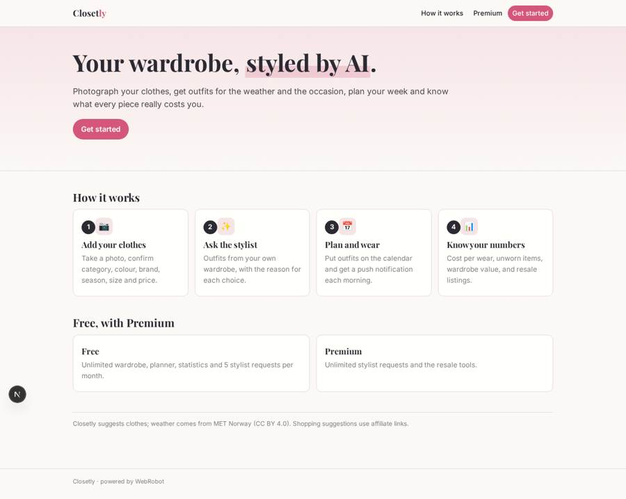
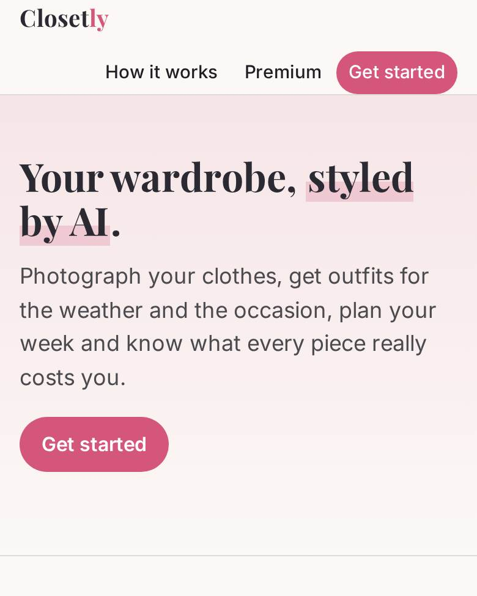
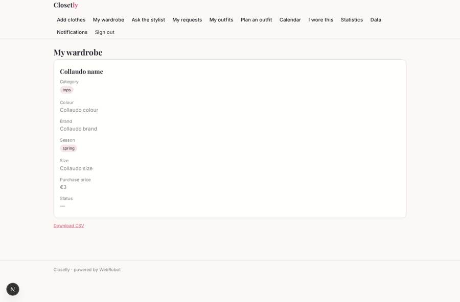
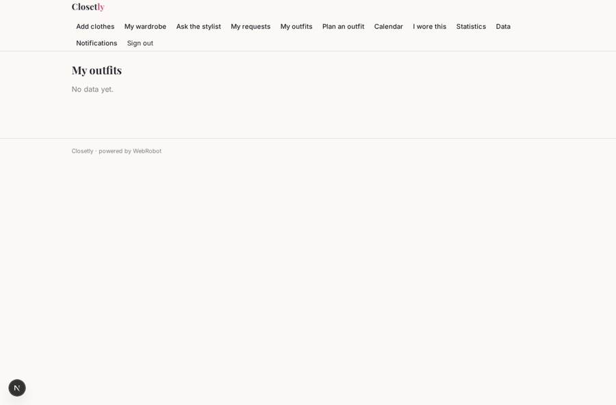
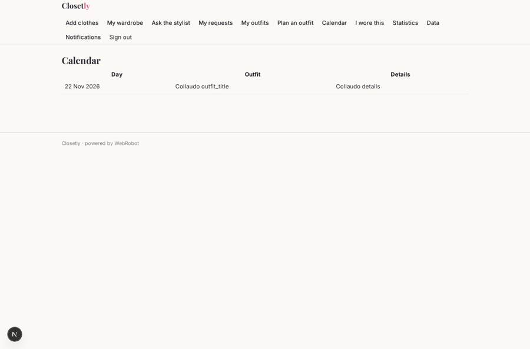
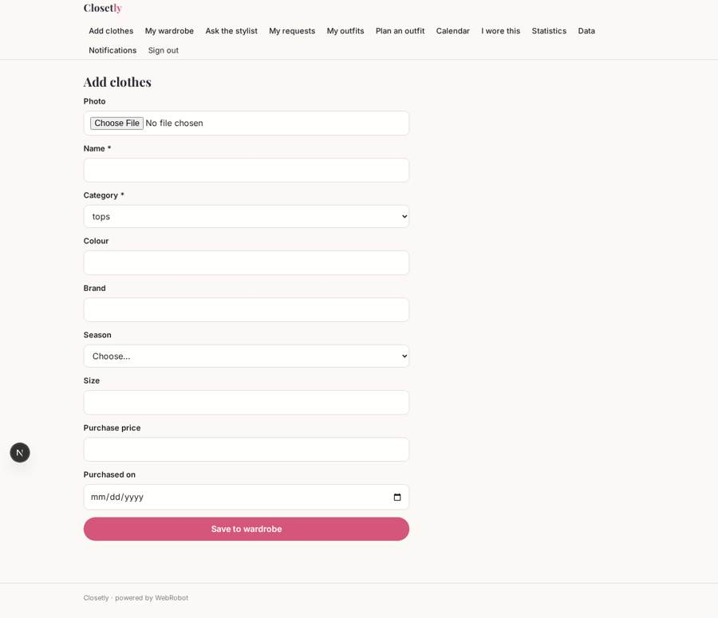

# Closetly

_Your digital wardrobe with an AI stylist._

**Sector:** Consumer, travel, retail · **Manifest:** valid (schema + runtime contract) · **Functional test:** passed (17 checks passed)

## Description given to the app builder

We want a phone app, also on the web, called Closetly: a digital wardrobe with an AI stylist. Users sign up and add clothes by taking photos with the phone camera; the app removes the background and the user fills in or confirms category, colour, brand, season, size and purchase price. An AI stylist agent creates outfits from the user's wardrobe for the weather, occasion and calendar, explaining each choice, and the user can plan outfits on a calendar, getting a push notification each morning with the day's look. Virtual try-on of new items is part of the product. The agent also suggests items to fill gaps, using retailer product feeds via affiliate programmes only. Users can mark items for resale; the app writes the listing and should publish it to eBay through its API with OAuth (and other resale platforms where allowed). Statistics show cost per wear, unworn items and wardrobe value. Users see only their own wardrobe; they can share an outfit with friends by link. Free app with a premium subscription for unlimited stylist requests and resale tools. English.

## Navigation recording

Signed in as the app's admin, the recorder opened 7 menu page(s): Add clothes, My wardrobe, Ask the stylist, My requests, My outfits, Plan an outfit, Calendar.
- data page empty: outfits_list (table)

Empty data pages are mostly expected on the local runtime: agents are mocked there, so the collections they fill stay empty.

## Features not expressible today (spec.extensions)

- **background_removal**: Automatic background removal from item photos is not available yet; photos are stored as taken.
- **virtual_try_on**: Virtual try-on of new items needs image generation, not available yet.
- **ebay_publish**: Publishing listings to eBay (and other marketplaces) needs OAuth sign-in to another service, not available yet. The app writes the listing and the user copies it.
- **calendar_sync**: Reading the user's Google/Apple calendar needs OAuth, not available yet; the user enters plans in the planner or in the request notes.
- **affiliate_feeds**: Retailer product feeds are loaded by the admins into feed_items on the data page (CSV) from affiliate programmes; live API feeds can be added per retailer later.

## Screenshots (interpretive runtime, test data)

### home-anon

### home-mobile

### wardrobe

### outfits_list

### planner

### add_item

