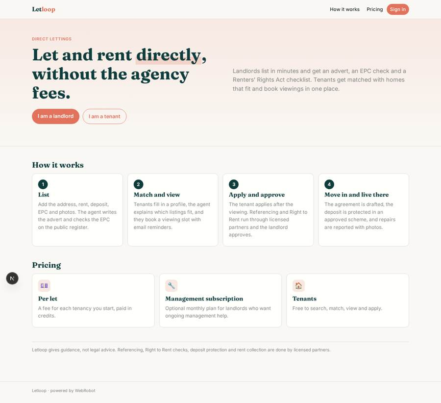
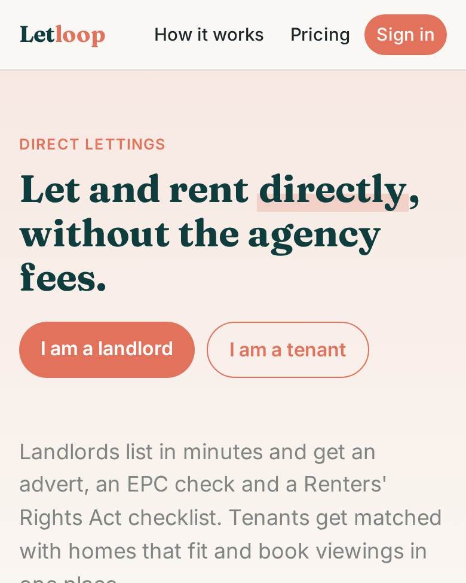
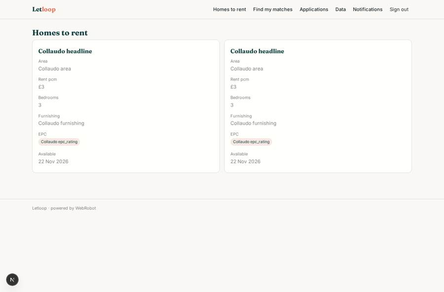
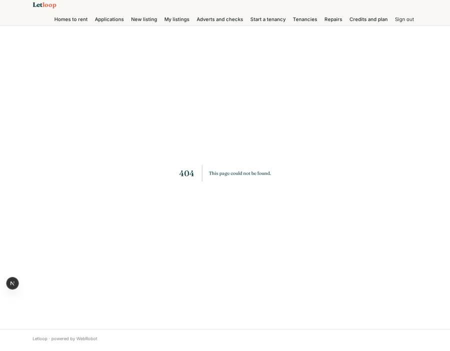
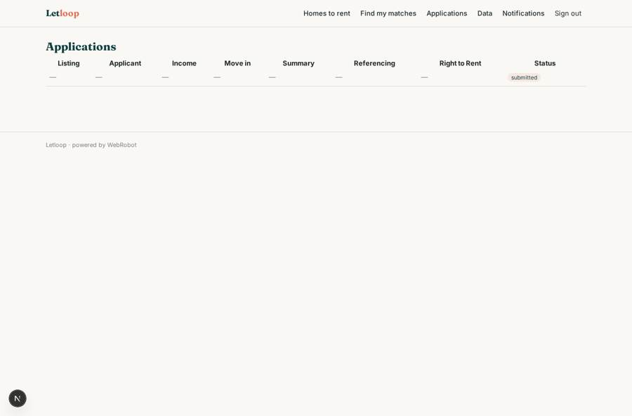
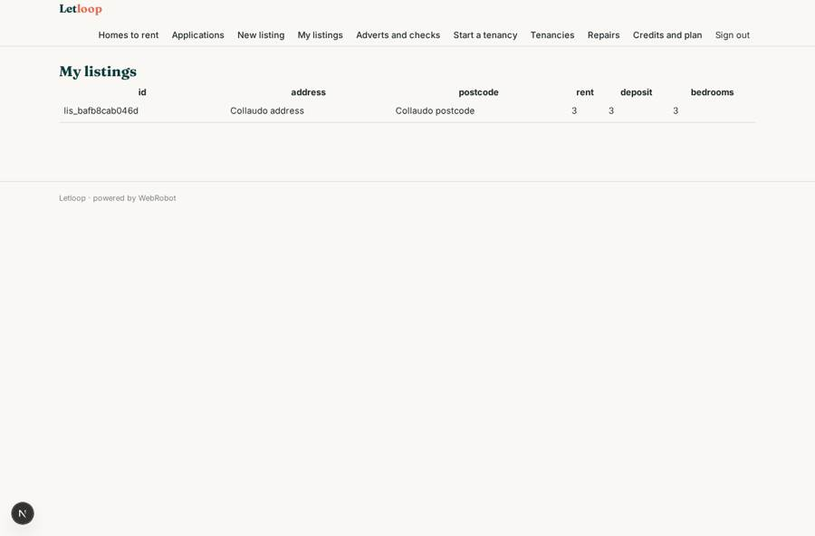

# Letloop

_Direct lettings between landlords and tenants, with an AI agent at every step._

**Sector:** Fintech, proptech, insurtech · **Manifest:** valid (schema + runtime contract) · **Functional test:** passed (28 checks passed)

## Description given to the app builder

We need Letloop, a platform for direct lettings between landlords and tenants. Landlords sign up and create a listing with a form: address, rent, deposit, bedrooms, furnishing, bills, EPC rating, photos, availability. An agent writes the advert, checks the EPC on the public register and reminds the landlord of obligations under the Renters' Rights Act. Tenants sign up with a profile (budget, move date, employment, household, pets) and the agent matches them with suitable listings and explains why. Tenants book viewings in available slots, with email confirmations and reminders. After a viewing the tenant applies; referencing with credit checks is done through a licensed referencing partner, and Right to Rent checks follow gov.uk guidance with a certified ID partner. The landlord reviews the application and approves. The tenancy agreement is generated and signed electronically, the deposit is registered with a government-approved deposit protection scheme, and rent is collected monthly through a regulated payment partner holding client money. Afterwards tenants report repairs with photos. Roles: landlord, tenant, admin. Pricing: landlord fee per let plus optional monthly management subscription. English.

## Functional test: what did not pass

- **form saves a record** (form my_profile): only role tenant may fill it, and the test cannot hold that role _(warning)_
- **form saves a record** (form apply): only role tenant may fill it, and the test cannot hold that role _(warning)_
- **form saves a record** (form report_repair): only role tenant may fill it, and the test cannot hold that role _(warning)_
- **page opened by a role allowed to** (view my_profile): only role tenant may open it, the test cannot hold it _(warning)_
- **page opened by a role allowed to** (view matches): only role tenant may open it, the test cannot hold it _(warning)_
- **page opened by a role allowed to** (view book_viewing): only role tenant may open it, the test cannot hold it _(warning)_
- **page opened by a role allowed to** (view my_viewings): only role tenant may open it, the test cannot hold it _(warning)_
- **page opened by a role allowed to** (view apply): only role tenant may open it, the test cannot hold it _(warning)_
- **page opened by a role allowed to** (view report_repair): only role tenant may open it, the test cannot hold it _(warning)_

## Navigation recording

Signed in as the app's admin, the recorder opened 3 menu page(s): Homes to rent, Find my matches, Applications.
No issue found.

Empty data pages are mostly expected on the local runtime: agents are mocked there, so the collections they fill stay empty.

## Features not expressible today (spec.extensions)

- **licensed_partners**: Referencing with credit checks, Right to Rent ID checks, e-signature of the tenancy agreement, deposit registration with an approved scheme, and rent collection through a regulated client-money partner have no built-in connector yet. Partners can post results to the partner_events webhook and an admin sets the statuses on the applications and tenancies. Connection through the partners' APIs is still to be built.
- **landlord_viewing_visibility**: Landlords are not yet shown the viewings booked on their listings, and photos uploaded by landlords are not yet shown to tenants on the public listing.
- **rent_ledger**: Monthly rent status and arrears per tenancy need the payment partner's data; not available yet.

## Screenshots (interpretive runtime, test data)

### home-anon

### home-mobile

### listings_browse

### my_viewings

### applications

### my_listings

