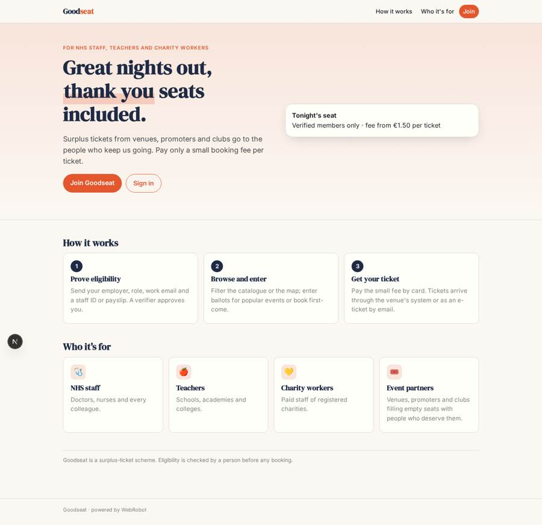
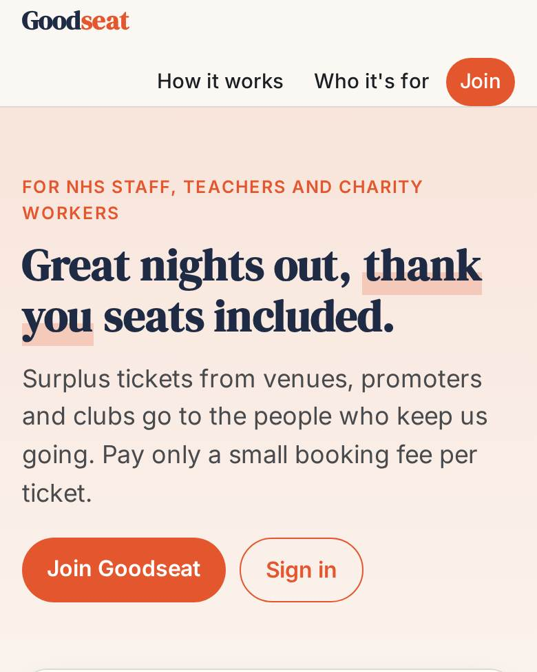
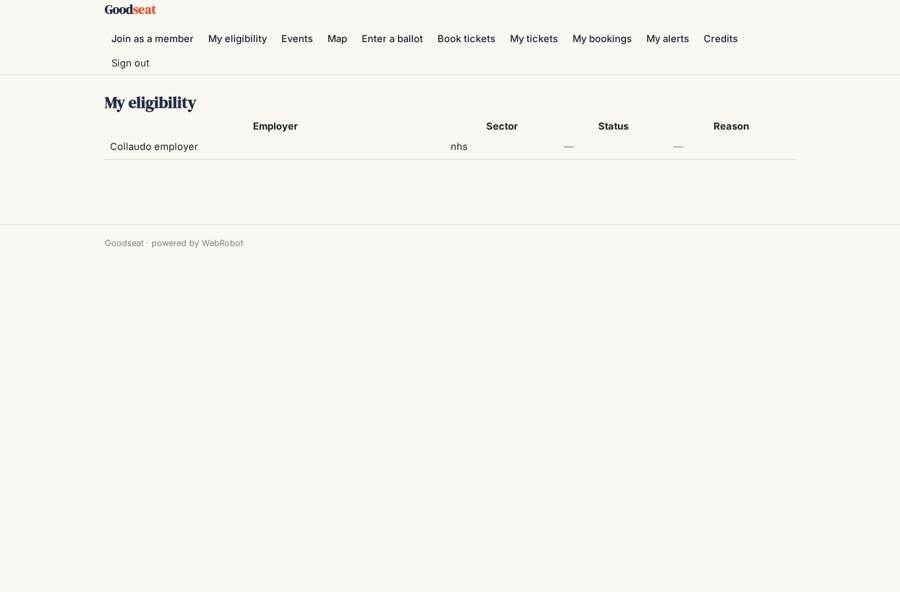
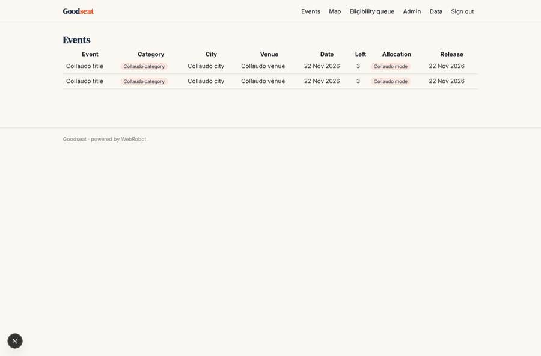
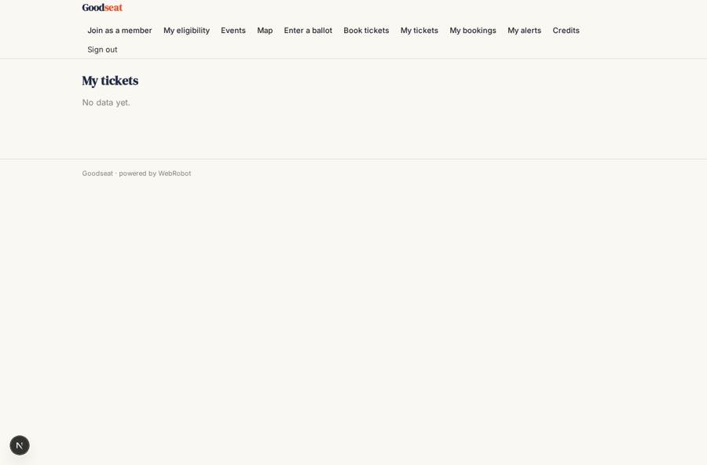
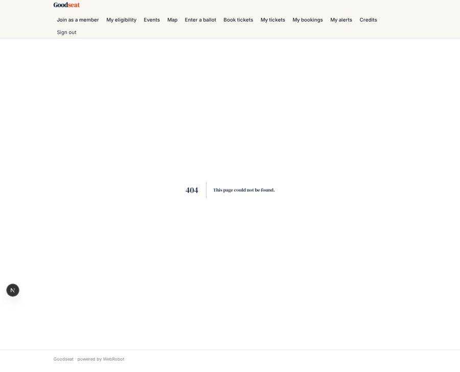

# Goodseat

_Surplus event tickets for the people who keep us going._

**Sector:** Consumer, travel, retail · **Manifest:** valid (schema + runtime contract) · **Functional test:** passed (32 checks passed)

## Description given to the app builder

I want an app called Goodseat that gives surplus event tickets to NHS staff, teachers and charity workers, who pay a small booking fee per ticket. Members sign up and prove eligibility through a form (employer, role, work email) and upload a document such as a staff ID or payslip; an agent checks the document and work-email domain, and a human verifier approves or rejects with a reason. Event partners (venues, promoters, clubs) have their own role and add events with date, venue, category, number of free tickets and release time; they see only their own events. Members browse a shared catalogue with filters and a map, enter ballots for popular events or book first-come, and pay the fee by card. Tickets reach members through each partner's ticketing integration or as e-tickets we email. Members get emails when new events in their area and interests go live, and reminders before the event. Partners get a report after each event on how many seats were filled and which sectors attended. Admins see dashboards of members, eligibility queue, tickets issued and fees. English.

## Functional test: what did not pass

- **form saves a record** (form add_event): only role partner may fill it, and the test cannot hold that role _(warning)_
- **trigger has its effect** (trigger verifier_new): email to role:verifier: no such recipient in the test (role nobody holds or empty field) _(warning)_
- **page opened by a role allowed to** (view add_event): only role partner may open it, the test cannot hold it _(warning)_
- **page opened by a role allowed to** (view my_events): only role partner may open it, the test cannot hold it _(warning)_
- **page opened by a role allowed to** (view partner_tickets): only role partner may open it, the test cannot hold it _(warning)_
- **page opened by a role allowed to** (view my_reports): only role partner may open it, the test cannot hold it _(warning)_

## Navigation recording

Signed in as the app's admin, the recorder opened 4 menu page(s): Events, Map, Eligibility queue, Admin.
No issue found.

Empty data pages are mostly expected on the local runtime: agents are mocked there, so the collections they fill stay empty.

## Features not expressible today (spec.extensions)

- **eligibility_gate**: Only approved members should book or enter ballots. The booking agent refuses members who are not approved, but the runtime cannot hide the browse, ballot or book views until approval.
- **ticketing_integrations**: Pushing tickets into each partner's own ticketing system needs per-partner API credentials and tools. Today delivery is an e-ticket by email with a code; partners flagged integration must be fulfilled by hand.
- **ballot_claim**: The ballot draw and winner emails work; winner validation at booking reads the back-office results table through the booking agent. Strict verification and automatic expiry of unclaimed places are not available yet.
- **filters_and_geocoding**: Catalogue filters beyond the table's sort are not interactive yet; partners enter latitude and longitude for the map.
- **sms_push**: SMS and WhatsApp notices are not available; members get email only.

## Screenshots (interpretive runtime, test data)

### home-anon

### home-mobile

### my_status

### catalogue_list

### my_tickets

### my_events

