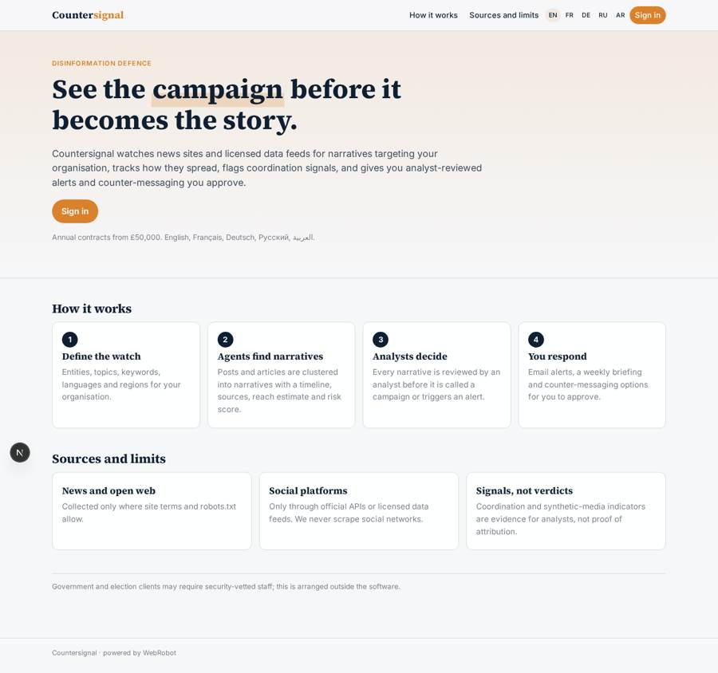
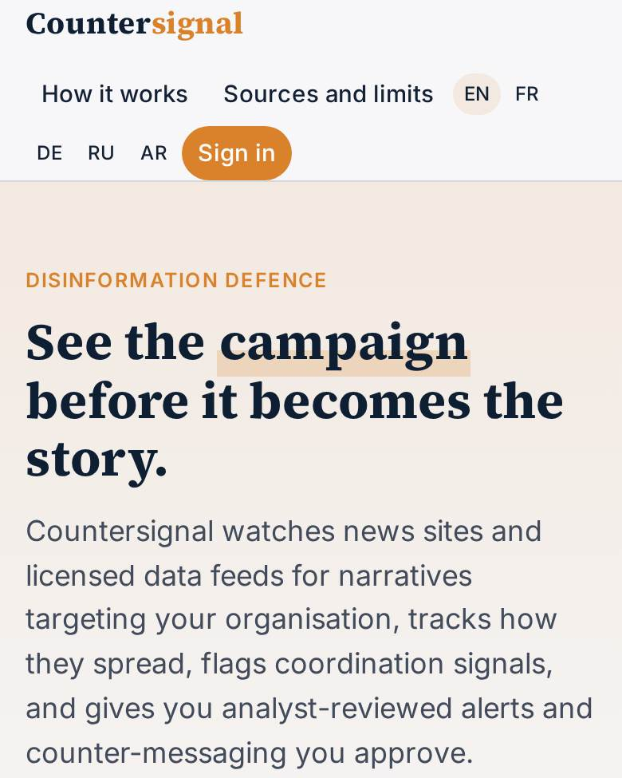
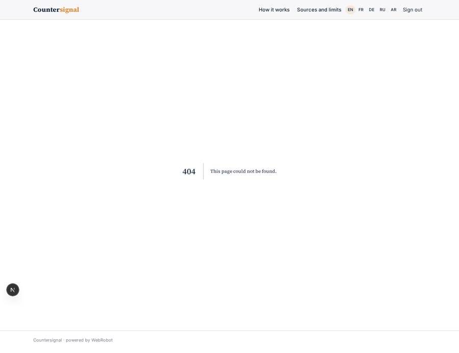
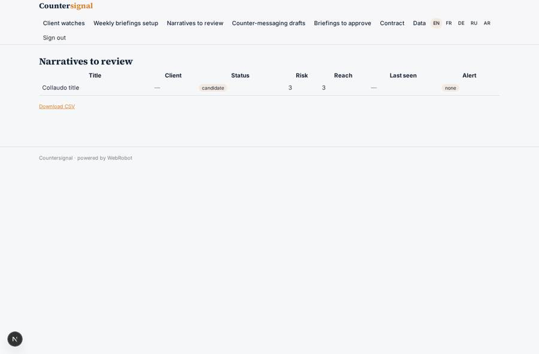

# Countersignal

_Detect disinformation campaigns against your organisation, and answer them._

**Sector:** Data, media, cyber, devtools · **Manifest:** valid (schema + runtime contract) · **Functional test:** passed (29 checks passed)

## Description given to the app builder

I want an app called Countersignal that detects and helps counter disinformation campaigns against organisations. A client such as a company, public body or NGO signs up and defines what to watch: entities, topics, keywords, languages and regions. Agents monitor news sites and the open web where their terms allow, and social platforms only through official APIs or licensed data feeds, which the real product relies on; we must not scrape social networks. The real product also analyses video, including AI-generated or inauthentic video, and I want that included. Agents cluster posts and articles into narratives, track spread over time, and look for coordination signals such as many new accounts sharing the same text at the same time. Each narrative has a page with timeline, sources, reach estimate and a risk score. An analyst must review a narrative before it is marked as a campaign and before any alert goes to the client. The client receives email alerts and a weekly briefing, and an agent drafts counter-messaging options that the client approves. Government and election clients need security-vetted staff, which is outside the software. Roles: admin, analyst, client viewer. Pricing: annual contracts from £50,000. English, French, German, Russian and Arabic.

## Functional test: what did not pass

- **form saves a record** (form counter_decide): only role client may fill it, and the test cannot hold that role _(warning)_
- **template instance created and run** (template watch): reserved to analyst/admin _(warning)_
- **template instance created and run** (template weekly_briefing): reserved to analyst/admin _(warning)_
- **page opened by a role allowed to** (view my_narratives): only role client may open it, the test cannot hold it _(warning)_
- **page opened by a role allowed to** (view my_counter): only role client may open it, the test cannot hold it _(warning)_
- **page opened by a role allowed to** (view counter_decide): only role client may open it, the test cannot hold it _(warning)_
- **page opened by a role allowed to** (view my_briefings): only role client may open it, the test cannot hold it _(warning)_

## Navigation recording

Signed in as the app's admin, the recorder opened 6 menu page(s): Client watches, Weekly briefings setup, Narratives to review, Counter-messaging drafts, Briefings to approve, Contract.
No issue found.

Empty data pages are mostly expected on the local runtime: agents are mocked there, so the collections they fill stay empty.

## Features not expressible today (spec.extensions)

- **video_forensics**: Analysing video, including AI-generated or inauthentic video, is not available in the platform yet: agents cannot run forensic or deepfake detection and the run form accepts no video files. This version uses only the transcript, metadata and synthetic-media scores supplied by a licensed feed vendor, flags the narrative for manual analyst video checks, and never asserts that a video is fake. A video-analysis service would have to be integrated separately.
- **licensed_social_feeds**: The licensed social data feed or official API relay is not connected yet: pick the vendor and have it POST posts to the app webhook /api/hooks/social_feed with the hook secret (or load them by CSV on the admin data page). Each vendor integration with its own API key needs its host added to egress and a credential. No social network is ever scraped.
- **security_vetting**: Security vetting of staff for government and election clients is an organisational process outside the software. Limit the analyst role invitations accordingly.
- **ui_translations**: Page copy is written in English; titles of the main views are given in five languages. Full French, German, Russian and Arabic translations of the home page and field labels should be added in the studio. Arabic needs right-to-left layout review.
- **sms_push**: SMS, WhatsApp and push alerts are not available; alerts and briefings go by email only.

## Screenshots (interpretive runtime, test data)

### home-anon

### home-mobile

### my_narratives

### my_counter

### my_briefings

### narratives_review

