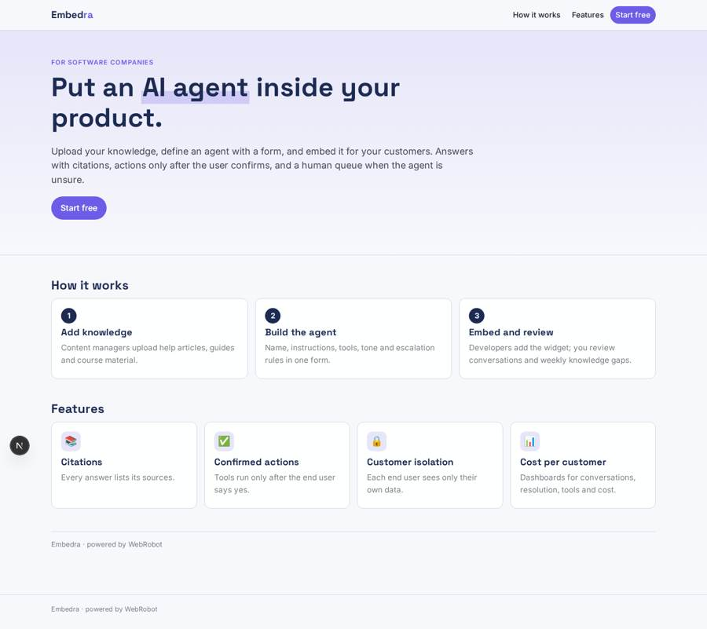
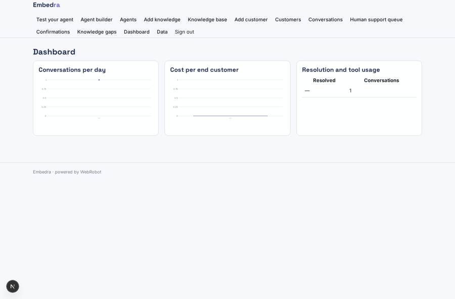
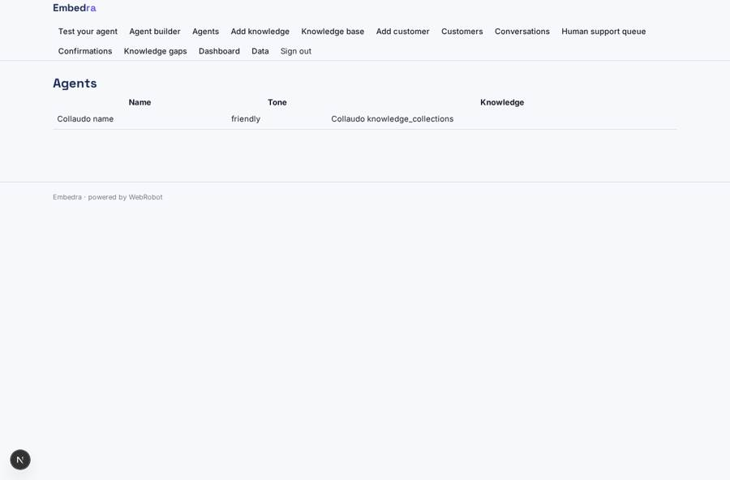
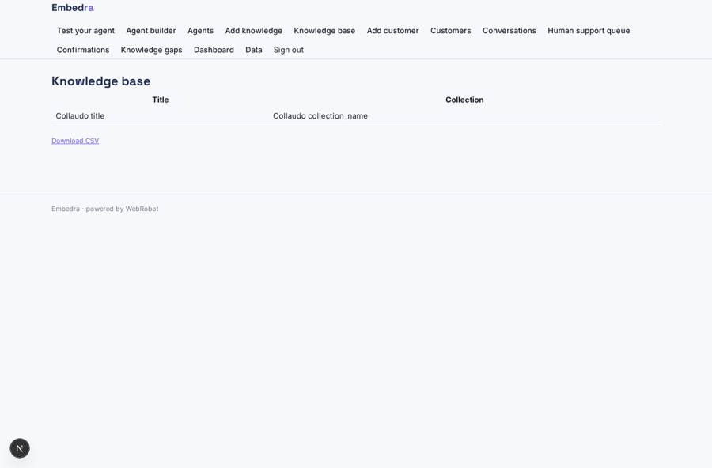
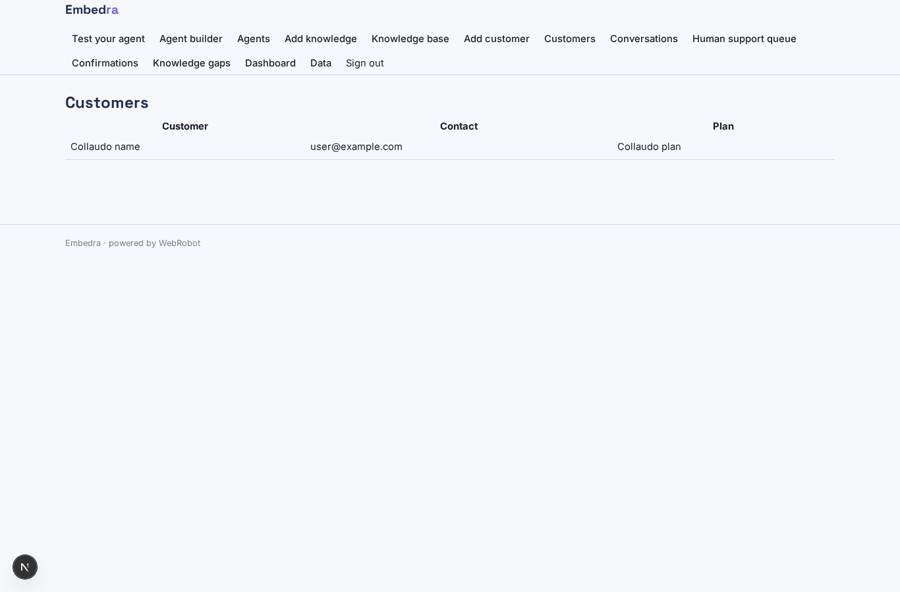

# Embedra

_Embed AI agents inside your own product._

**Sector:** B2B AI and SaaS · **Manifest:** valid (schema + runtime contract) · **Functional test:** passed (22 checks passed)

## Description given to the app builder

I want Embedra, a platform that lets software companies embed AI agents inside their own products. A SaaS company signs up as a tenant, invites its developers and content managers, and each of its own customers becomes a sub-organisation whose users see only their data. The content manager uploads knowledge (help articles, guides, course material) and the agent builder defines agents through a form: name, instructions, knowledge collections, tools (HTTP calls to the tenant's API or MCP servers), tone and escalation rules. Developers get an embeddable chat widget and an API key; the widget passes the logged-in user's identity so the agent sees only that end user's data. Agents answer with citations, perform actions through tools only after the user confirms, and hand over to a human support queue when unsure. The tenant reviews conversations, rates answers and edits knowledge gaps that an agent proposes each week. Dashboards show conversations, resolution, tool usage and cost per end customer. Emails alert tenants when usage nears limits. Pricing: platform subscription plus usage credits per conversation, billed via Stripe; tenants can resell to their customers. English.

## Functional test: what did not pass

- **saved record shown where its collection is read** (view conversations_list): a record was saved in conversations (by user) but the page does not show it (as user) _(warning)_
- **saved record shown where its collection is read** (view by_day): a record was saved in conversations (by user) but the page does not show it (as user) _(warning)_
- **saved record shown where its collection is read** (view cost_by_customer): a record was saved in conversations (by user) but the page does not show it (as user) _(warning)_
- **saved record shown where its collection is read** (view resolution): a record was saved in conversations (by user) but the page does not show it (as user) _(warning)_

## Navigation recording

Signed in as the app's admin, the recorder opened 7 menu page(s): Test your agent, Agent builder, Agents, Add knowledge, Knowledge base, Add customer, Customers.
No issue found.

Empty data pages are mostly expected on the local runtime: agents are mocked there, so the collections they fill stay empty.

## Design checks (linter)

- collection end_user_records: tool read_end_user_data of assistant reads it, but nothing writes it — add a form view on it (the users fill their own records), an agent tool that writes or appends to it, or a trigger write; or, for a list the admins keep, make it ownedBy shared (admins fill it on the data page)

## Features not expressible today (spec.extensions)

- **embed_widget**: Embeddable chat widget and API key for developers, passing the logged-in end user's identity so the agent sees only that user's data. Not available yet: the app offers the chat view for testing, and end-user data is loaded into end_user_records.
- **sub_organisations**: True sub-organisations per tenant customer with their own users. Modelled for now as the customers collection and end_user_records filtered by end user email; team sharing via the members list.
- **tenant_tools**: Per-tenant HTTP tools to the tenant's own API and tenant MCP servers configured in the agent form. Not available yet as free-form tools; they need egress hosts and credentials declared per tenant.
- **resale**: Tenants reselling credits and plans to their own customers through Stripe Connect (per_transaction billing with sellers). Not configured in this first version.
- **ratings_widget**: End users rating answers directly in the widget; for now tenants rate in the conversations review.

## Screenshots (interpretive runtime, test data)

### home-anon

### home-mobile

### usage

### agents

### knowledge_list

### customer_list

