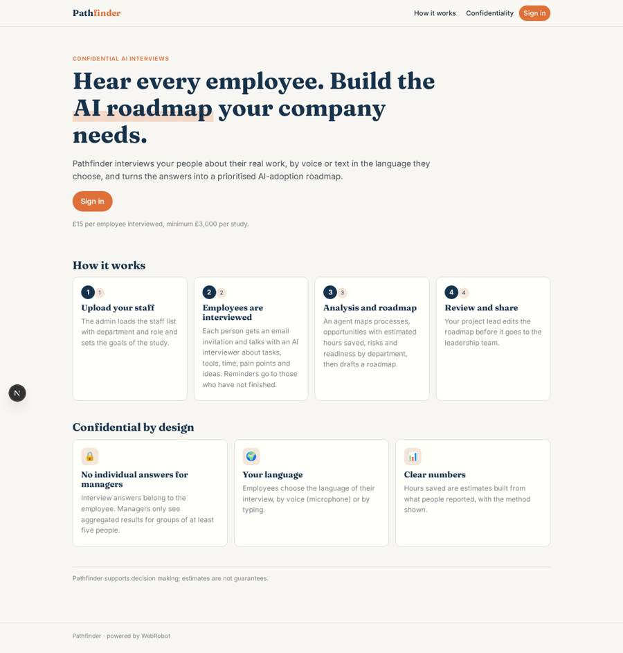
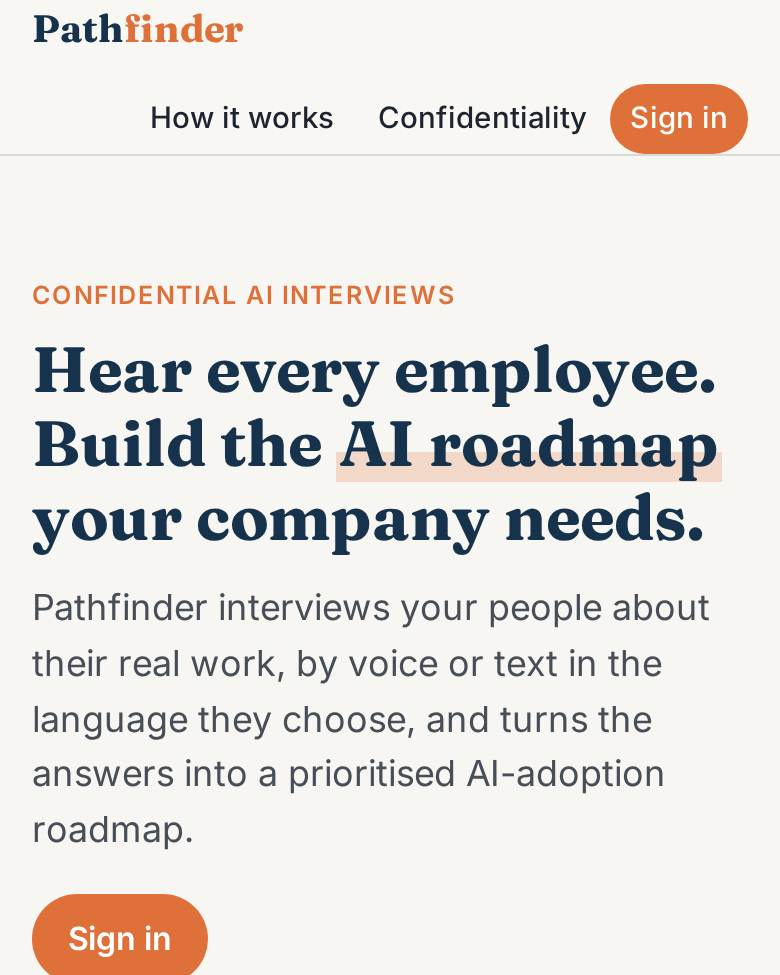
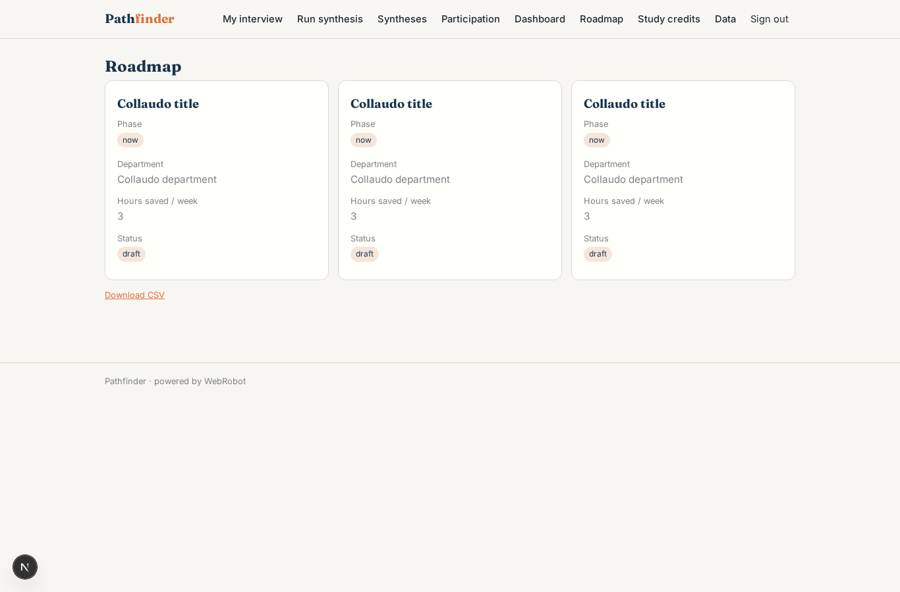
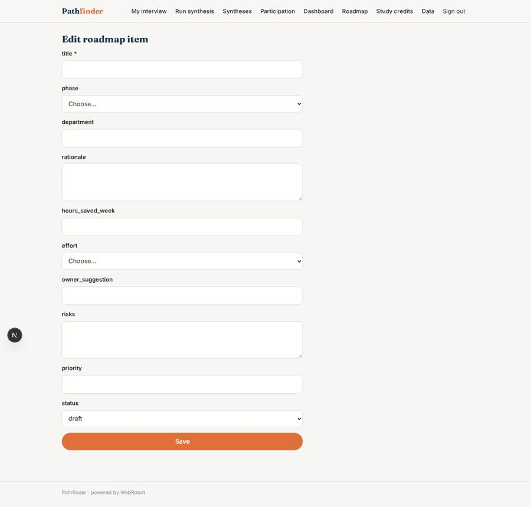
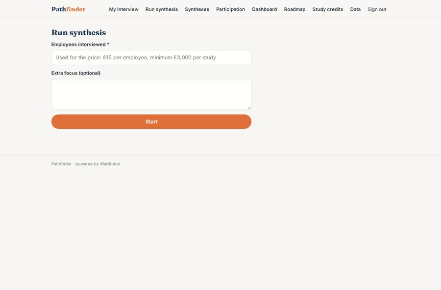
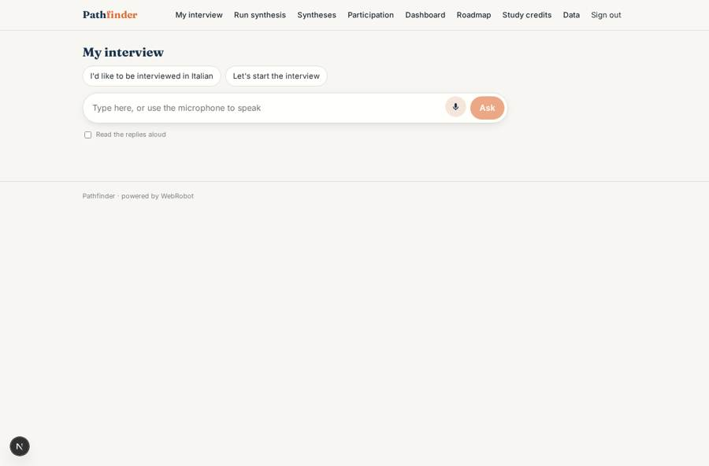

# Pathfinder

_Confidential AI interviews that turn into your AI-adoption roadmap._

**Sector:** Data, media, cyber, devtools · **Manifest:** valid (schema + runtime contract) · **Functional test:** passed (23 checks passed)

## Description given to the app builder

I want an app called Pathfinder that interviews a company's employees confidentially about their work and produces an AI-adoption roadmap. A company signs up and an admin uploads the staff list with department and role, and sets study goals. Each employee gets an invitation by email to an interview with an AI interviewer about their tasks, tools, time spent, pain points and ideas; the real product does this by voice in more than 70 languages, and I want voice included, with text as an alternative. Answers are confidential: managers never see individual answers, only aggregated results for groups of at least five people. Reminders go to people who have not finished. An agent synthesises the interviews into a map of processes, automation opportunities with estimated hours saved, risks and readiness by department, then drafts a prioritised roadmap. A project lead reviews and edits the roadmap before it goes to the leadership team. Roles: admin, project lead, leadership viewer, employee. Dashboards show participation, top opportunities and department scores. Pricing: per study, £15 per employee interviewed, minimum £3,000. Interface in English; interviews in any language the employee chooses.

## Navigation recording

Signed in as the app's admin, the recorder opened 7 menu page(s): My interview, Run synthesis, Syntheses, Participation, Dashboard, Roadmap, Study credits.
No issue found.

Empty data pages are mostly expected on the local runtime: agents are mocked there, so the collections they fill stay empty.

## Features not expressible today (spec.extensions)

- **voice_replies**: Voice input is available through the microphone in the chat view; a spoken (text-to-speech) interviewer and dedicated 70+ language voice models are not available yet, so replies are in text.
- **small_group_rule**: The minimum group of five is enforced by the synthesis agent's instructions and by the department roll-up; there is no automatic suppression on raw anonymous findings, which only admins can open. Individual interviews stay private to the employee.
- **multi_company**: One app instance serves one company. Several companies on one instance, each with a separate staff list and study, are not supported yet.

## Screenshots (interpretive runtime, test data)

### home-anon

### home-mobile

### roadmap_view

### roadmap_edit

### new_synthesis

### interview

