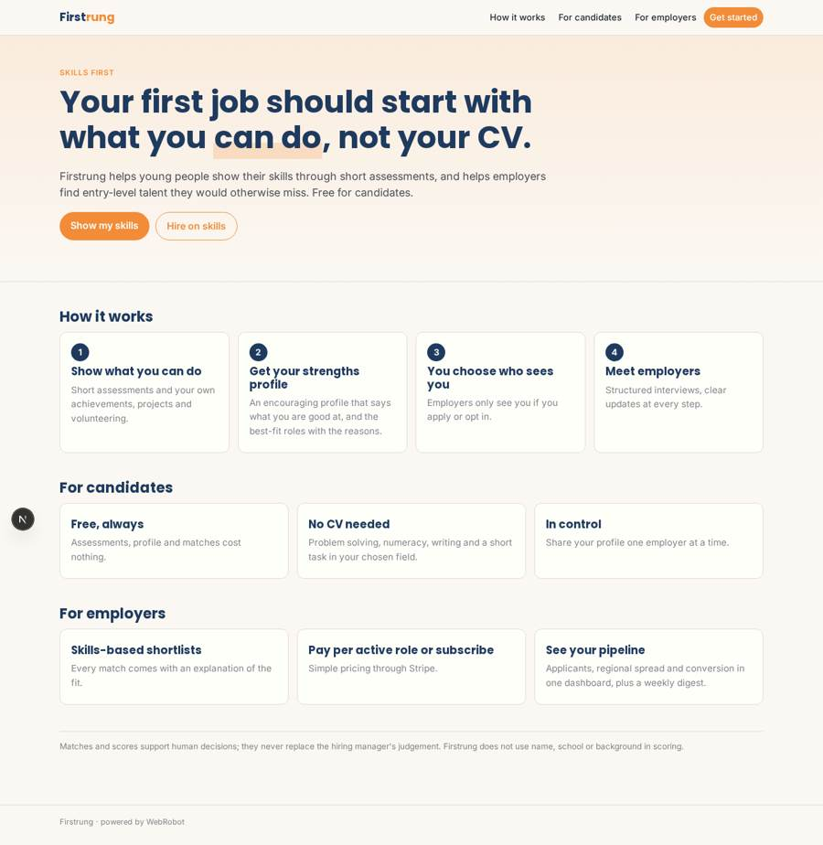
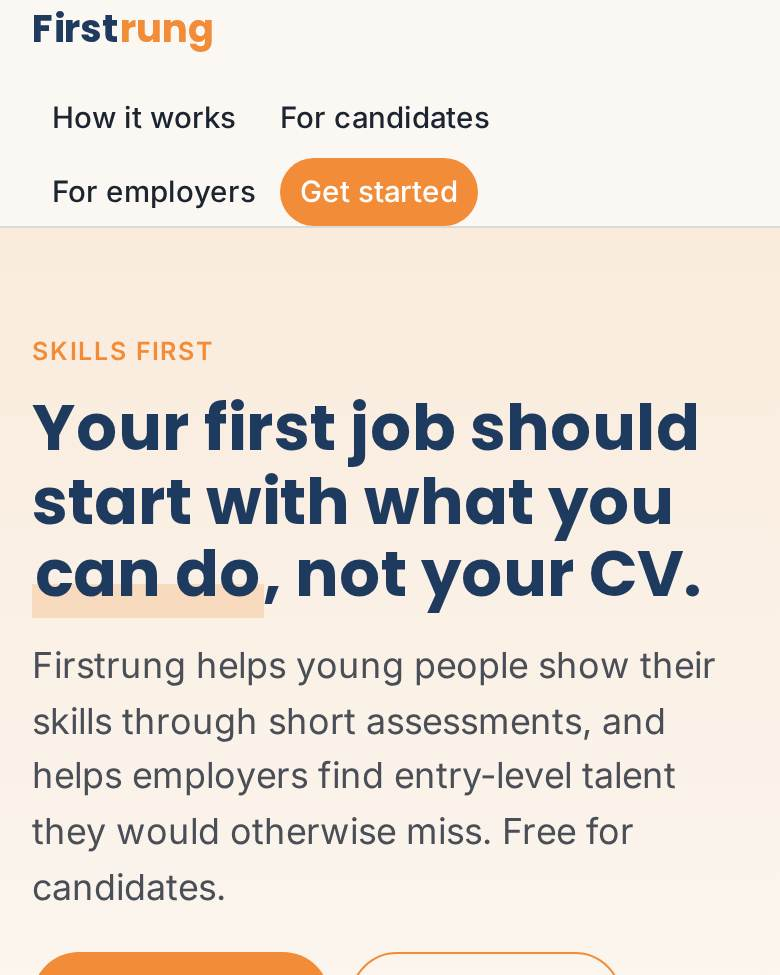
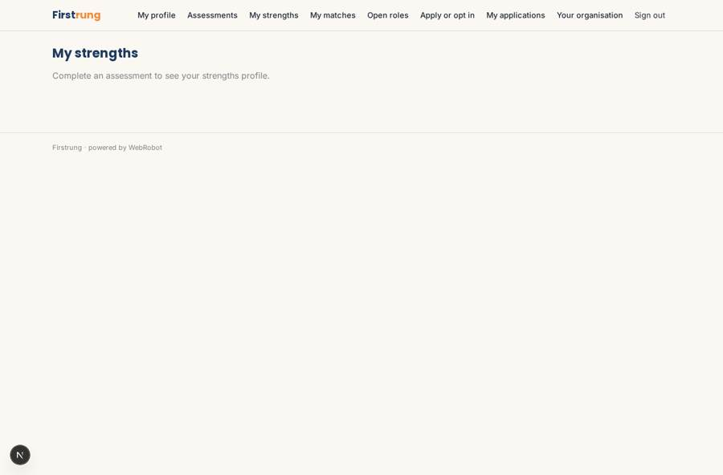
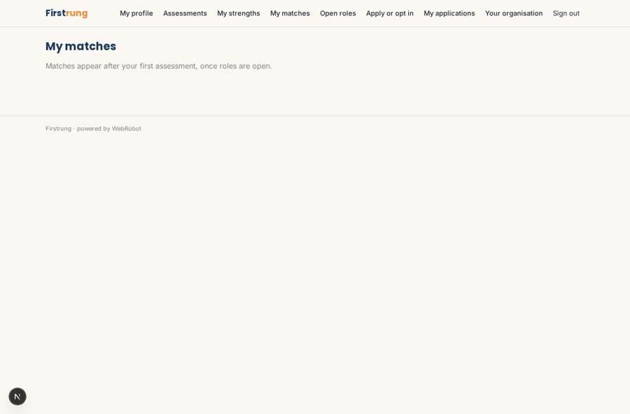
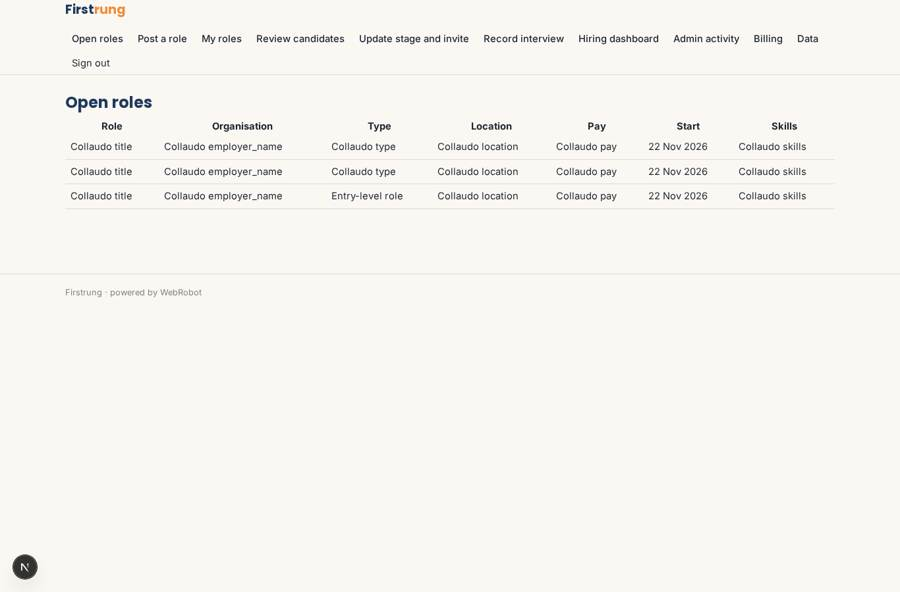
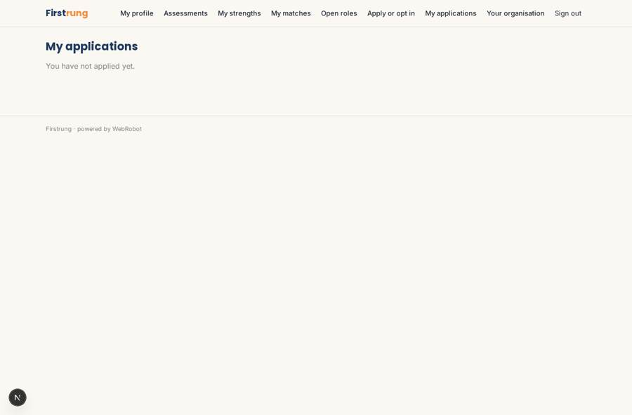

# Firstrung

_Entry-level hiring built on skills, not CVs._

**Sector:** B2B AI and SaaS · **Manifest:** valid (schema + runtime contract) · **Functional test:** passed (50 checks passed)

## Description given to the app builder

I want Firstrung, which rebuilds entry-level hiring around skills instead of CVs. Young candidates sign up and complete short assessments built as forms: problem-solving, numeracy, written communication, work preferences and a short task related to the field they choose. They can also add school or college achievements, projects and volunteering. Employers sign up and post entry-level roles and apprenticeships with skills needed, location, pay and start date. An agent scores assessments, writes a strengths profile in encouraging language, and matches candidates to roles, explaining the fit; candidates choose which employers can see them, and employers see only candidates who applied or opted in. The hiring manager reviews matches, invites candidates to a short structured interview and records the outcome. Emails keep candidates updated at every step and remind them of interview times, and employers get a weekly digest. A dashboard for employers shows applicants, diversity by region and conversion; an admin dashboard shows overall activity. We know the value depends on getting enough employers and candidates, which is our job, not the software's. Pricing: free for candidates, employers pay per active role or a subscription via Stripe. English.

## Functional test: what did not pass

- **template instance created and run** (template weekly_digest): reserved to employer _(warning)_
- **trigger has its effect** (trigger notify_new_applicant): email to record.employer_email: no such recipient in the test (role nobody holds or empty field) _(warning)_
- **saved record shown where its collection is read** (view my_roles): a record was saved in role_posts (by admin) but the page does not show it (as employer) _(warning)_

## Navigation recording

Signed in as the app's admin, the recorder opened 7 menu page(s): Open roles, Post a role, My roles, Review candidates, Update stage and invite, Record interview, Hiring dashboard.
No issue found.

Empty data pages are mostly expected on the local runtime: agents are mocked there, so the collections they fill stay empty.

## Features not expressible today (spec.extensions)

- **candidate_discovery**: Employers see only candidates who applied or opted in to one of their roles. Browsing a pool of discoverable candidates is not offered.
- **sms_notifications**: Updates are sent by email only; SMS and WhatsApp are not available yet.

## Screenshots (interpretive runtime, test data)

### home-anon

### home-mobile

### my_strengths

### my_matches

### roles_board

### my_applications

