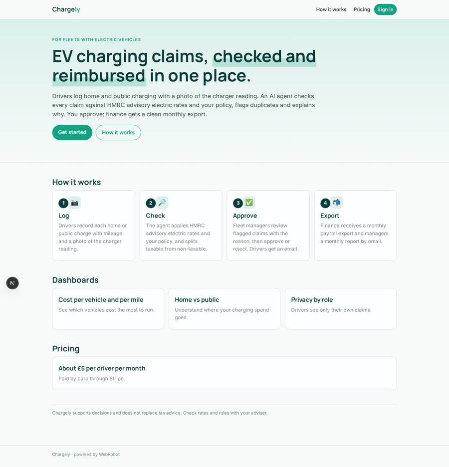
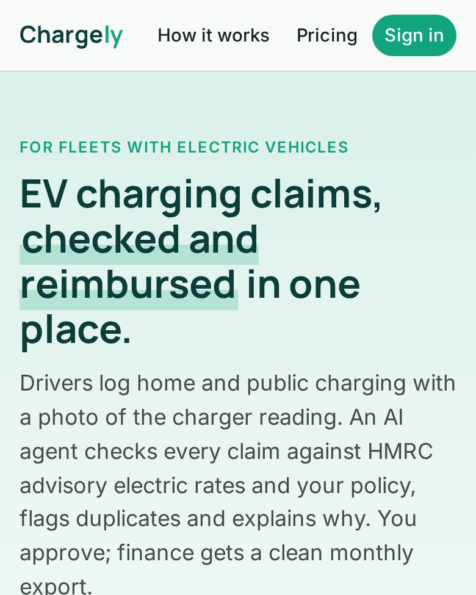
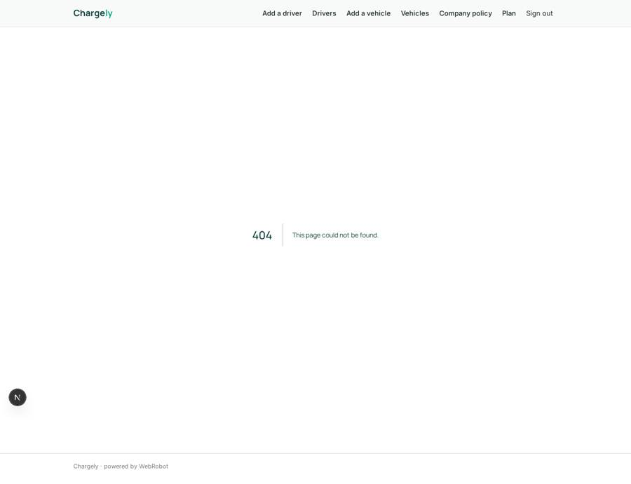
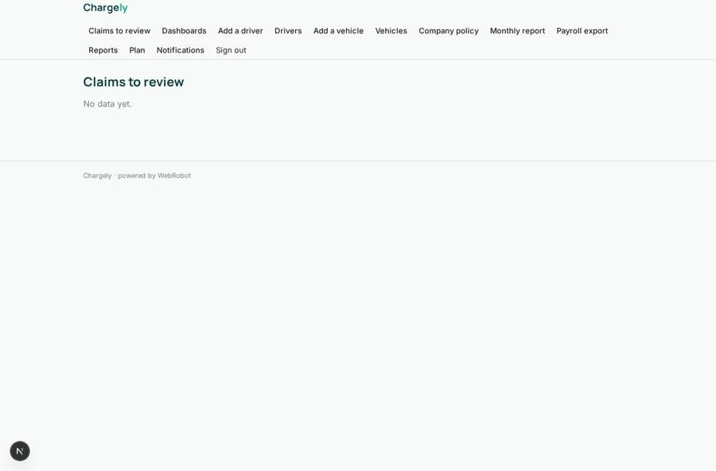
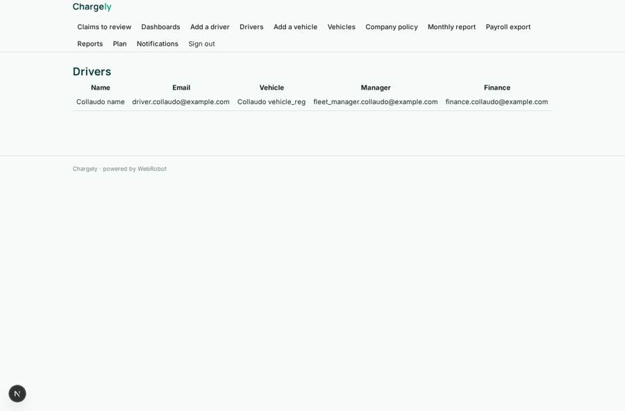
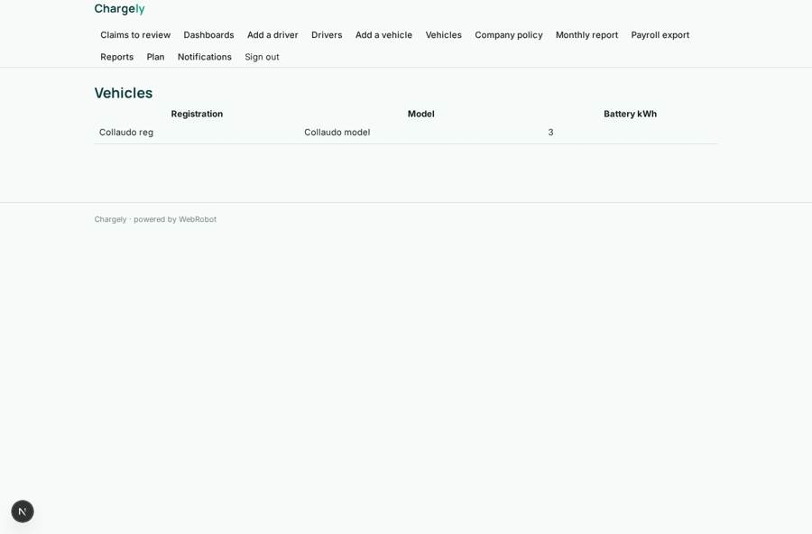

# Chargely

_One place for EV charging claims, checks and reimbursements._

**Sector:** Sanità, istruzione, energia, gov · **Manifest:** valid (schema + runtime contract) · **Functional test:** passed (26 checks passed)

## Description given to the app builder

I want Chargely, consolidated EV charging payments and reimbursement for fleets. Companies sign up, add drivers and vehicles; drivers upload home charging receipts and public charging records. An agent reconciles them against HMRC advisory electric rates and company policy; a fleet manager approves reimbursements, paid via Stripe. We want charging-network roaming APIs and fuel cards. Monthly reports by email. Drivers record home charging sessions with mileage and a photo of the charger reading. We also want company charging cards issued to drivers, which need a card-issuing partner. Roles are driver, fleet manager, finance and admin; drivers see only their own claims. An agent flags duplicate or suspicious claims and explains why. Finance gets a monthly export for payroll with taxable and non-taxable amounts separated. Drivers get email when a claim is approved or rejected. Dashboards show charging cost per vehicle and per mile, and home versus public charging split. Pricing per driver per month, about £5, through Stripe. English only.

## Functional test: what did not pass

- **form saves a record** (form submit_claim): only role driver may fill it, and the test cannot hold that role _(warning)_
- **form saves a record** (form decide): only role fleet_manager may fill it, and the test cannot hold that role _(warning)_
- **template instance created and run** (template monthly_report): reserved to fleet_manager/admin _(warning)_
- **template instance created and run** (template payroll_month): reserved to finance/admin _(warning)_

## Navigation recording

Signed in as the app's admin, the recorder opened 7 menu page(s): Claims to review, Dashboards, Add a driver, Drivers, Add a vehicle, Vehicles, Company policy.
- data page empty: review (table)

Empty data pages are mostly expected on the local runtime: agents are mocked there, so the collections they fill stay empty.

## Features not expressible today (spec.extensions)

- **stripe_reimbursement_payouts**: Paying approved reimbursements to drivers through Stripe is not available yet: Stripe here only collects the app's subscription. Approved claims and the payroll export are available for payment.
- **per_driver_seat_billing**: The plan is a flat £5 per month; billing quantity per driver is not available yet.
- **roaming_apis**: Charging-network roaming APIs need partner agreements and keys; public charging is entered by drivers with receipts for now.
- **fuel_cards**: Fuel card import needs provider integrations not available yet.
- **company_charging_cards**: Issuing company charging cards to drivers needs a card-issuing partner and is not available yet.
- **company_isolation**: Claims name the manager and finance emails; the driver form takes them from the driver, so a stricter company link is a later improvement.

## Screenshots (interpretive runtime, test data)

### home-anon

### home-mobile

### my_claims

### review

### drivers

### vehicles

