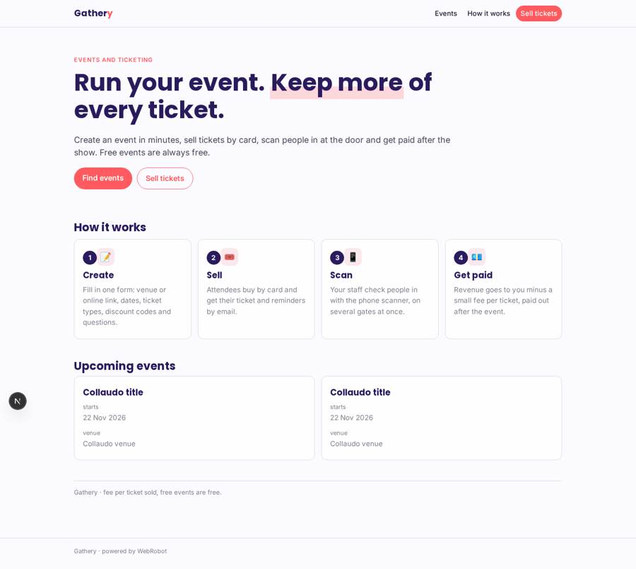
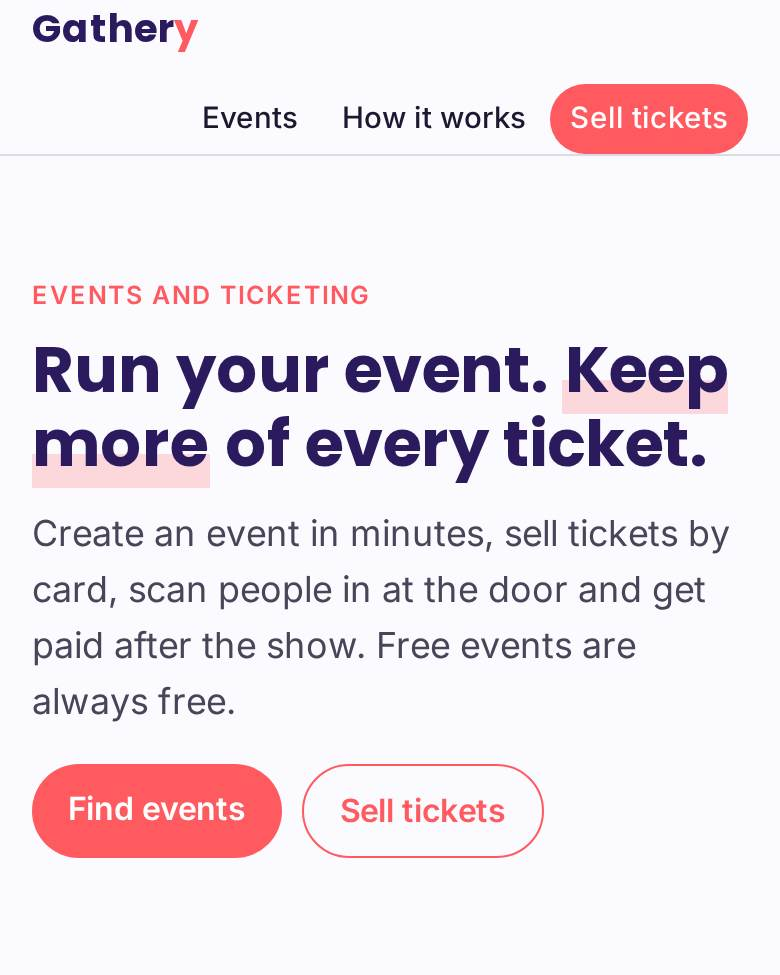
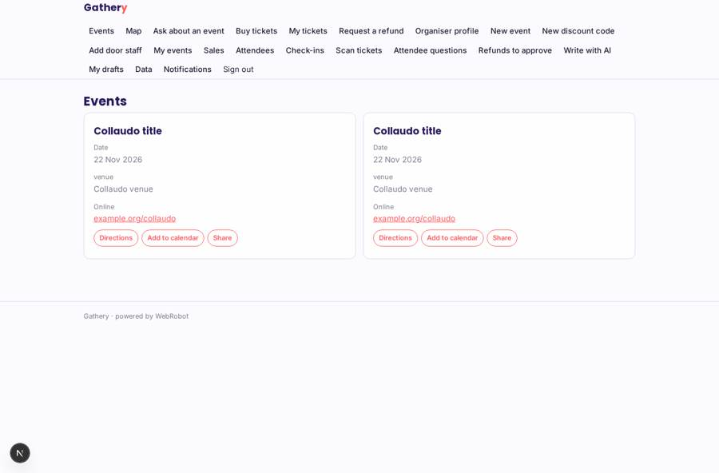
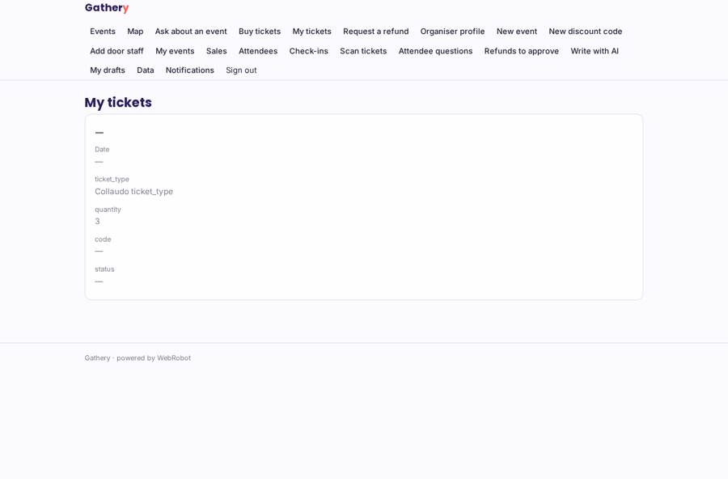
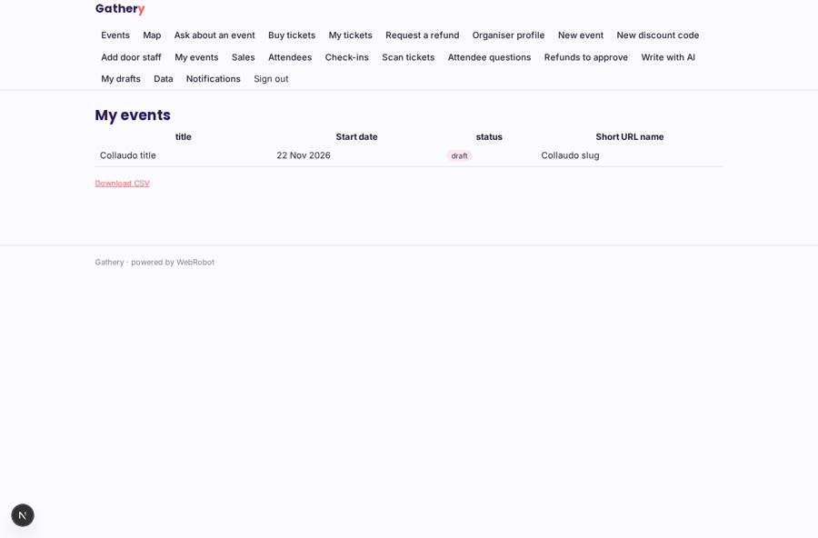
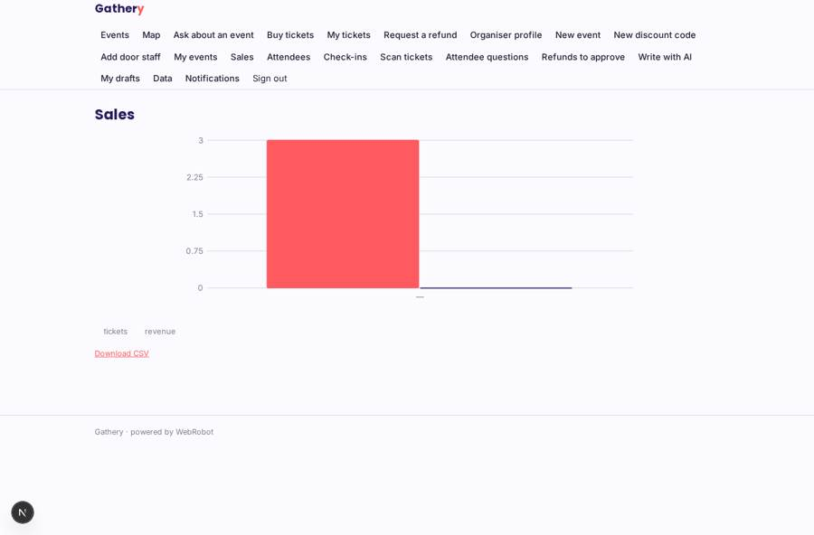

# Gathery

_Events and ticketing, without the big-platform fees._

**Sector:** Consumer, travel, retail · **Manifest:** valid (schema + runtime contract) · **Functional test:** passed (43 checks passed)

## Description given to the app builder

We need an app called Gathery for event management and ticketing, as an alternative to the big ticketing sites. Organisers sign up and create events through a form: title, description, venue on a map or online link, dates, ticket types with prices and quantities, discount codes and custom questions for attendees. Attendees buy tickets by card, get an email with a QR ticket and calendar invite, and reminders the week and the day before. On the door, organiser staff scan tickets with a phone scanner app that works for several gates at once. An agent helps organisers write event pages and promotional emails, and answers attendee questions from the event details, handing over to the organiser when unsure. Refund requests go to the organiser for approval. Ticket revenue goes to each organiser minus our fee, paid out after the event, so we need payouts to many organisers. Organisers see their own events, sales, attendees and check-ins on a dashboard with CSV export; staff see only check-in; admins see everything. Pricing: a small fee per ticket sold, free events free. English.

## Functional test: what did not pass

- **saved record shown where its collection is read** (view my_events): a record was saved in events (by admin) but the page does not show it (as organiser) _(warning)_
- **saved record shown where its collection is read** (view sales): a record was saved in tickets (by user) but the page does not show it (as organiser) _(warning)_
- **saved record shown where its collection is read** (view attendees): a record was saved in tickets (by user) but the page does not show it (as organiser) _(warning)_
- **saved record shown where its collection is read** (view checkin_log): a record was saved in checkins (by admin) but the page does not show it (as organiser) _(warning)_

## Navigation recording

Signed in as the app's admin, the recorder opened 7 menu page(s): Events, Map, Ask about an event, Buy tickets, My tickets, Request a refund, Organiser profile.
No issue found.

Empty data pages are mostly expected on the local runtime: agents are mocked there, so the collections they fill stay empty.

## Design checks (linter)

- mobile.capabilities: an add-to-calendar button (view browse) needs 'calendar' in the phone app
- mobile.capabilities: a share button (view browse) needs 'share' in the phone app

## Features not expressible today (spec.extensions)

- **card_checkout**: Card checkout at ticket purchase (price, discount code, stock per ticket type, then marking the ticket paid with its code, amount, event title, date and organiser email) is not expressed by this manifest; the buy form is an interim step.
- **qr_ticket_email**: The ticket email is plain text with the ticket code. A QR image and a calendar invite attachment in the email are not available yet; the calendar button on the events list and the barcode code cover this in the app.
- **payout_timing**: Per-organiser payouts through Connect are declared via sellers, but holding the money until after the event is not configurable here.
- **door_validation**: Rejecting duplicate or foreign tickets across several gates in real time needs a custom check on the scan form; the check-in log shows all scans per gate.
- **free_events**: Free events (price 0) should skip the fee and checkout; this needs custom handling.

## Screenshots (interpretive runtime, test data)

### home-anon

### home-mobile

### browse

### my_tickets

### my_events

### sales

