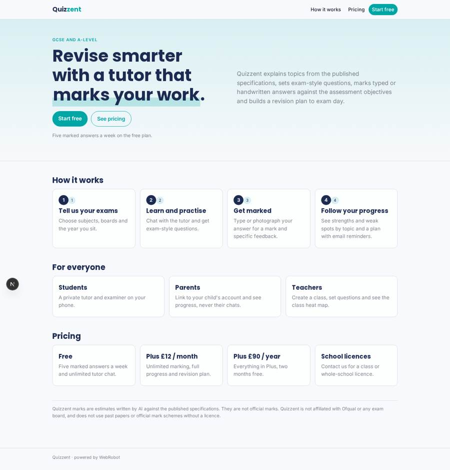
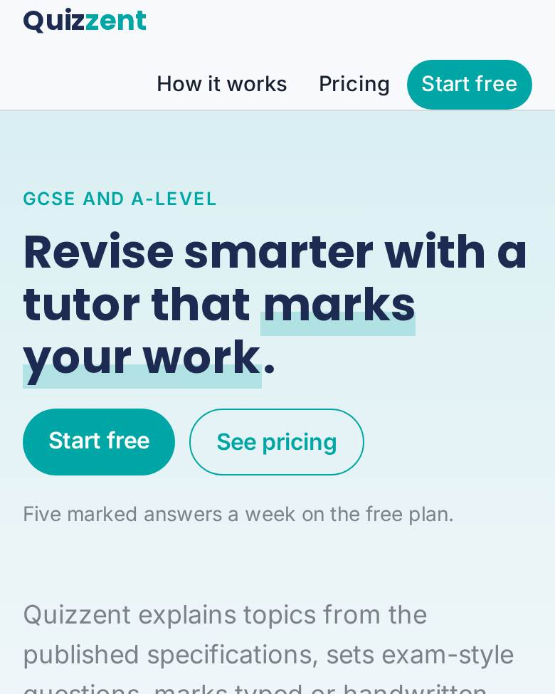
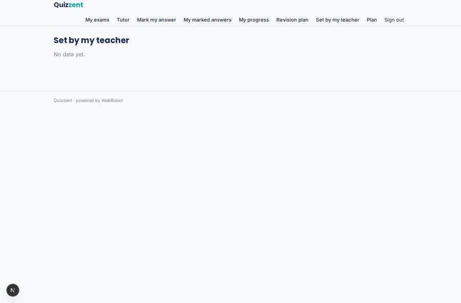
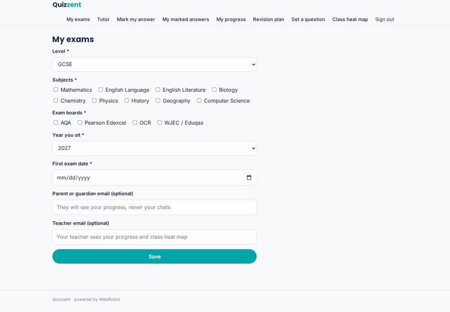
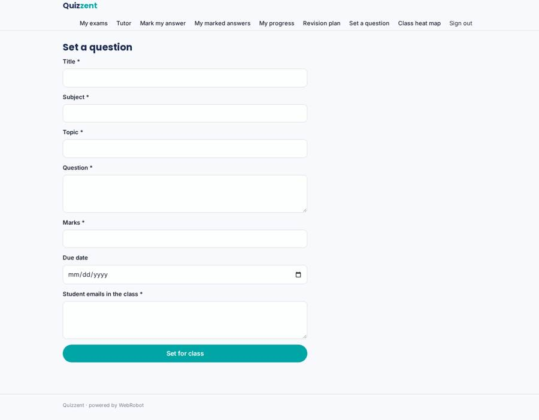
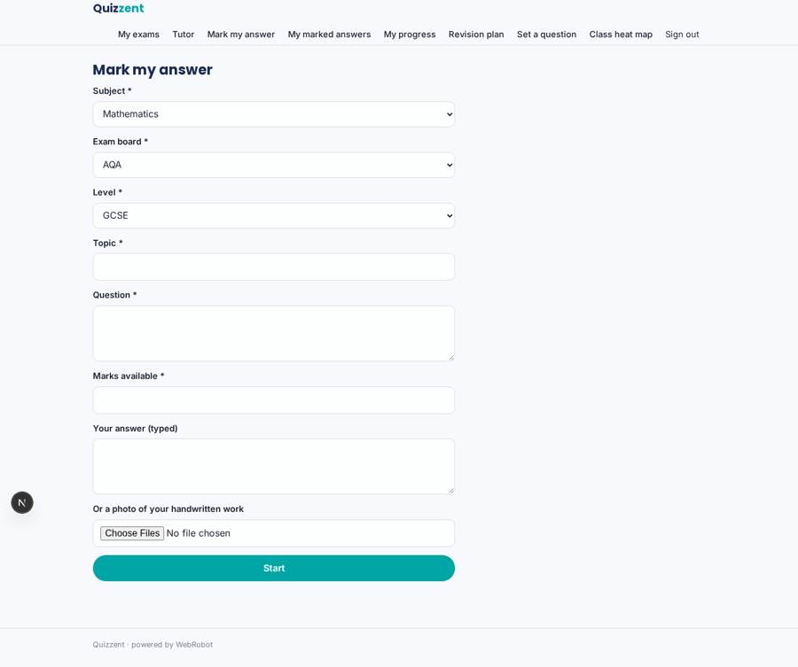

# Quizzent

_Your AI tutor for GCSE and A-level exams._

**Sector:** Sanità, istruzione, energia, gov · **Manifest:** valid (schema + runtime contract) · **Functional test:** passed (18 checks passed)

## Description given to the app builder

I want Quizzent, an AI tutor for GCSE and A-level exam preparation. Students sign up, choose their subjects and exam boards and the year they sit. The tutor explains topics in chat, grounded in the published Ofqual and exam-board specifications, and sets exam-style questions. Students type an answer or upload a photo of handwritten work; an agent marks it against the specification's assessment objectives, gives a mark and specific feedback, and suggests what to revise next. Past papers and official mark schemes are used only if we have a licence from the exam boards. Each student has a progress record by topic with charts showing strengths and weak spots, and a revision plan up to exam day with email reminders. Parents can link to a child's account and see progress but not chats. Teachers can create a class, set questions and see the class heat map. Pricing: free tier with five marked answers a week, £12 a month or £90 a year through Stripe, and school licences. English only.

## Functional test: what did not pass

- **saved record shown where its collection is read** (view homework): a record was saved in assignments (by admin) but the page does not show it (as user) _(warning)_

## Navigation recording

Signed in as the app's admin, the recorder opened 7 menu page(s): My exams, Tutor, Mark my answer, My marked answers, My progress, Revision plan, Set a question.
- form not sent: profile: Subjects is required

Empty data pages are mostly expected on the local runtime: agents are mocked there, so the collections they fill stay empty.

## Features not expressible today (spec.extensions)

- **weekly_free_limit**: The free tier is five marked answers a WEEK, but quotas only support minute/hour/day/month/total windows. The manifest approximates it with 20 per month on the free plan; a weekly window is needed.
- **school_licences**: School licences (seat-based billing, teachers invited by the school admin) are not available as a billing mode yet. Teachers are invited by the app admin; invoicing is handled outside the app.
- **parent_link_consent**: Parent linking works by the student entering the parent's email in their profile. A parent-initiated invite with student confirmation is not available yet. Review consent rules for under-13s and under-16s before launch.
- **past_papers_licence**: Past papers and official mark schemes are deliberately not used. Add them only after an exam-board licence is signed.

## Screenshots (interpretive runtime, test data)

### home-anon

### home-mobile

### homework

### profile

### new_assignment

### mark

