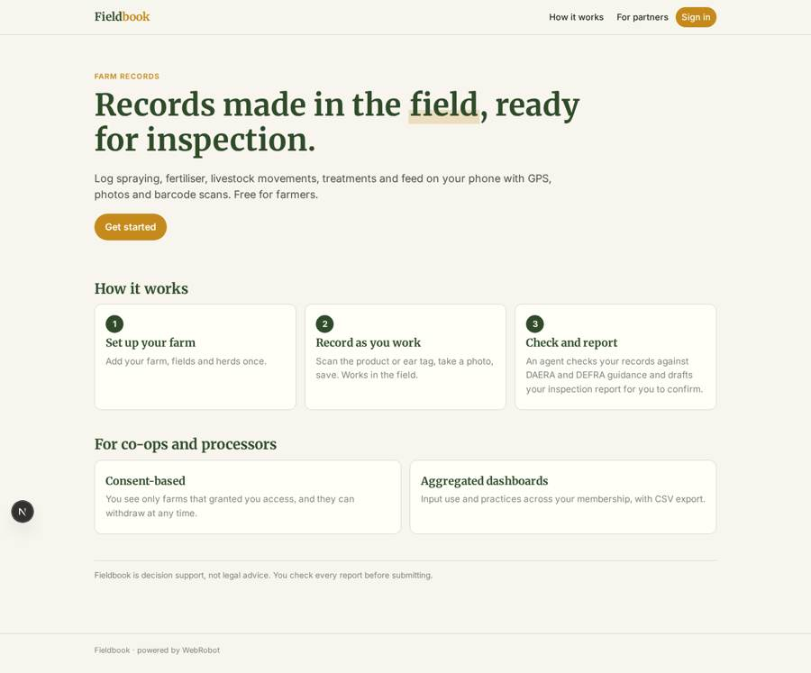
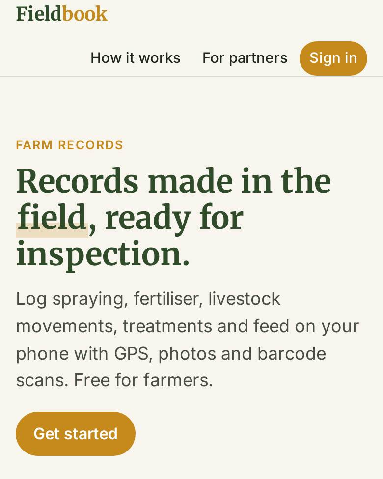
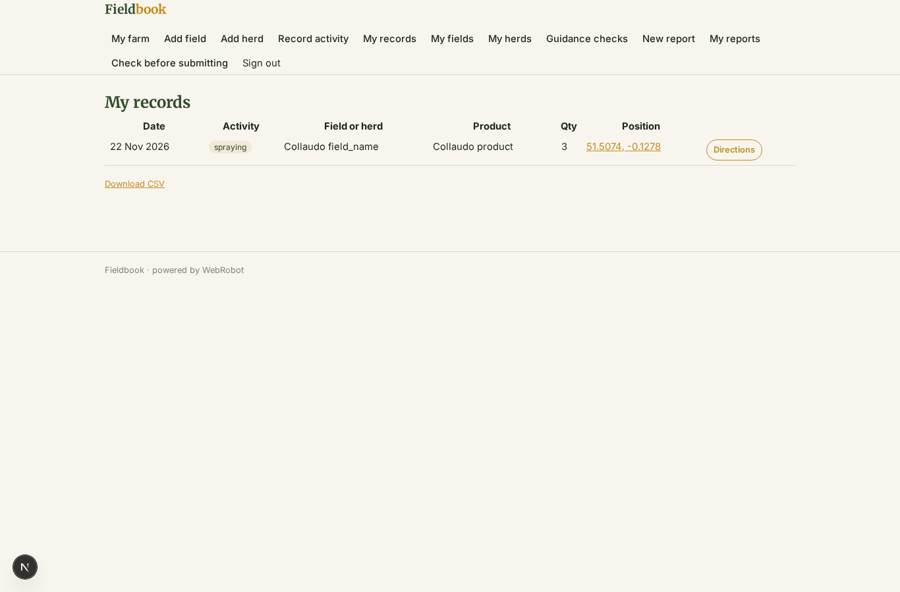
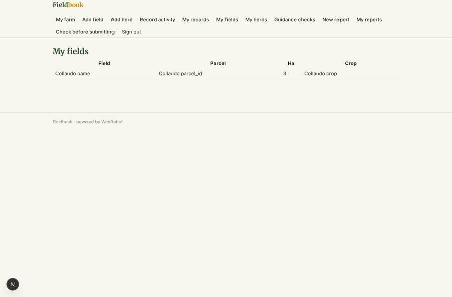
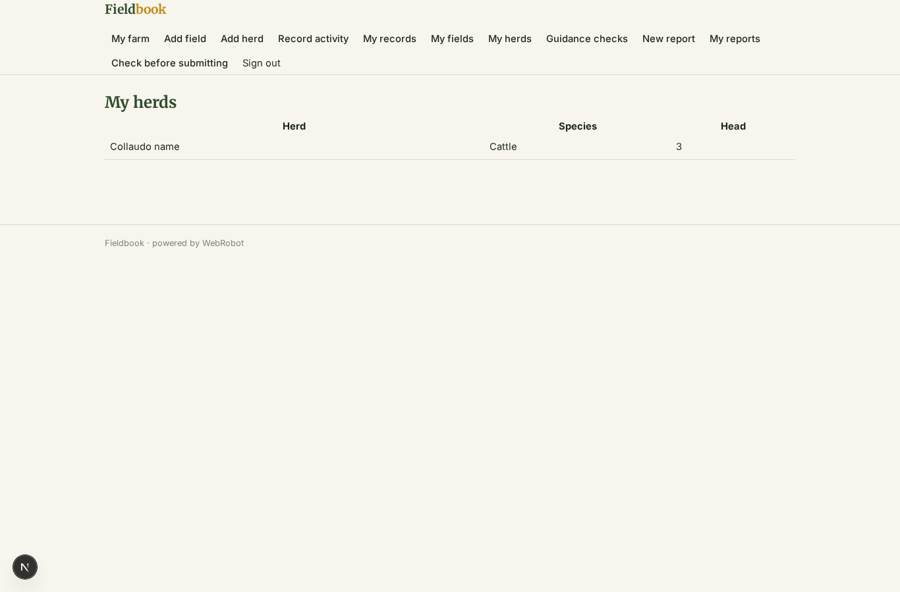
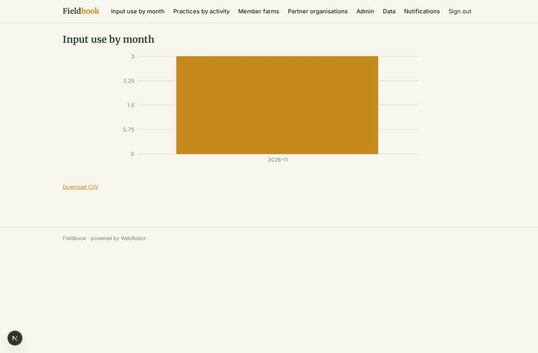

# Fieldbook

_Farm records made in the field, ready for inspection._

**Sector:** Sanità, istruzione, energia, gov · **Manifest:** valid (schema + runtime contract) · **Functional test:** passed (32 checks passed)

## Description given to the app builder

I want Fieldbook, a farm record-keeping app with an enterprise view for partners. Farmers sign up, set up their farm, fields and herds, and record activities on mobile: spraying, fertiliser, livestock movements, treatments and feed, using GPS, photos and barcode scanning for inputs and ear tags. An agent checks records against DAERA and DEFRA guidance and the farm scheme rules in each nation, and reminds farmers of deadlines. Partners such as co-ops and processors see aggregated data from farms that consent; we want partner data feeds via OAuth. Admins import data by CSV. Free for farmers, partners pay per farm. Farmers see only their farm; partner organisations see only farms that have granted them consent, and can withdraw it at any time. An agent turns records into the reports farmers need for inspections and assurance schemes, which the farmer checks before submitting. The app must work offline in fields and sync later. Partners get dashboards of input use and practices across their membership, with CSV export. English only.

## Functional test: what did not pass

- **saved record shown where its collection is read** (view partner_inputs): a record was saved in activities (by user) but the page does not show it (as admin) _(warning)_

## Navigation recording

Signed in as the app's admin, the recorder opened 5 menu page(s): Input use by month, Practices by activity, Member farms, Partner organisations, Admin.
No issue found.

Empty data pages are mostly expected on the local runtime: agents are mocked there, so the collections they fill stay empty.

## Features not expressible today (spec.extensions)

- **offline_sync**: Offline capture in fields with later sync is not available yet; records are saved when the phone has a connection.
- **partner_oauth_feeds**: OAuth-secured partner data feeds are not available yet; partners use the dashboards and CSV export.
- **partner_per_farm_billing**: Partners pay per consenting farm: Stripe per-farm invoicing is not available yet and must be agreed and billed outside the app. Farmers are free.
- **deadline_rules**: Scheme and nation deadlines come from the guidance collection loaded by admins by CSV; farm reminders use the next inspection date on the farm.

## Screenshots (interpretive runtime, test data)

### home-anon

### home-mobile

### activities

### my_fields

### my_herds

### partner_inputs

