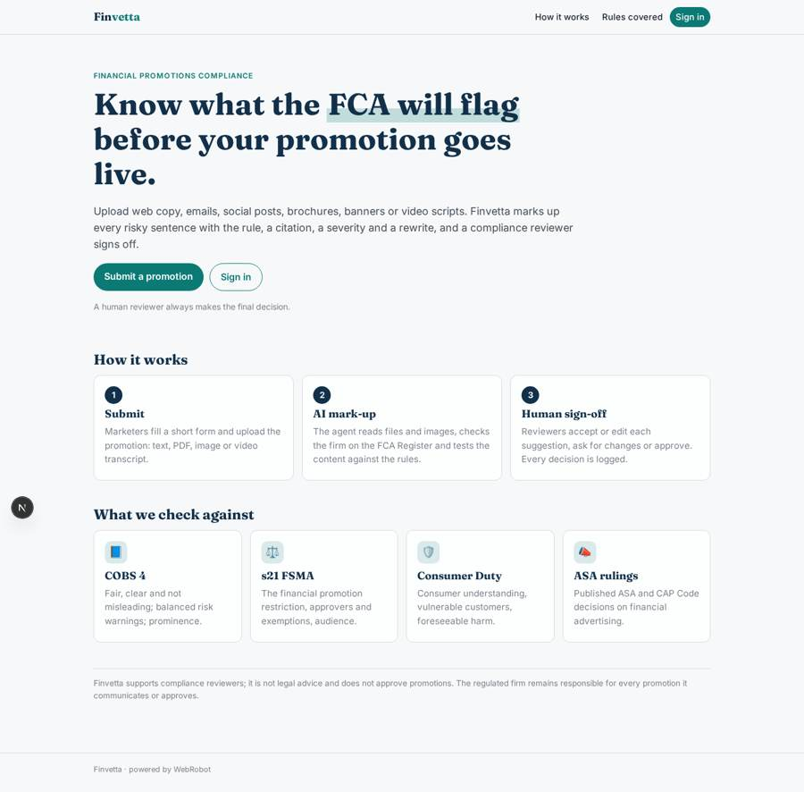
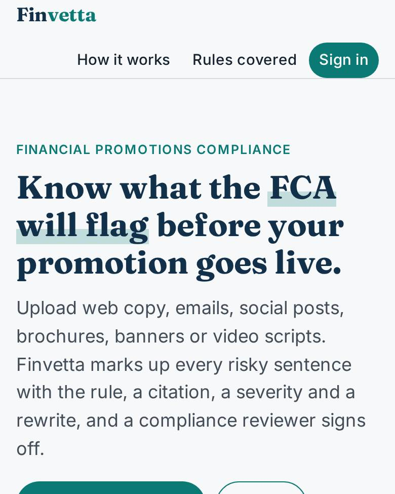
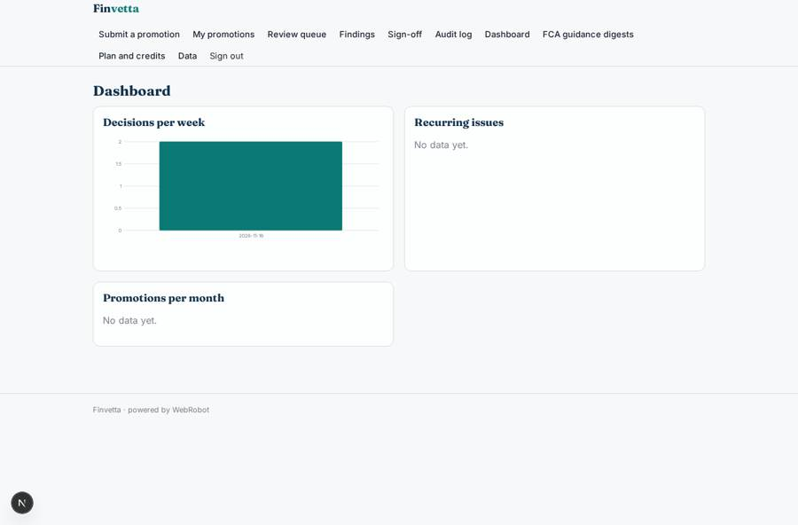
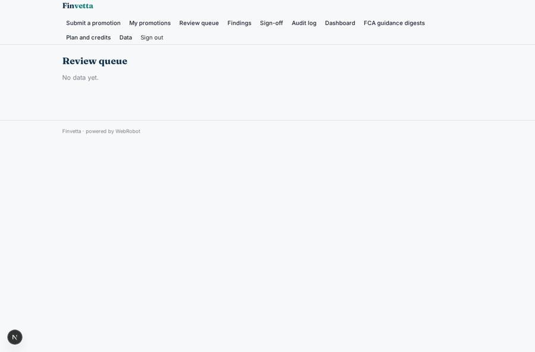
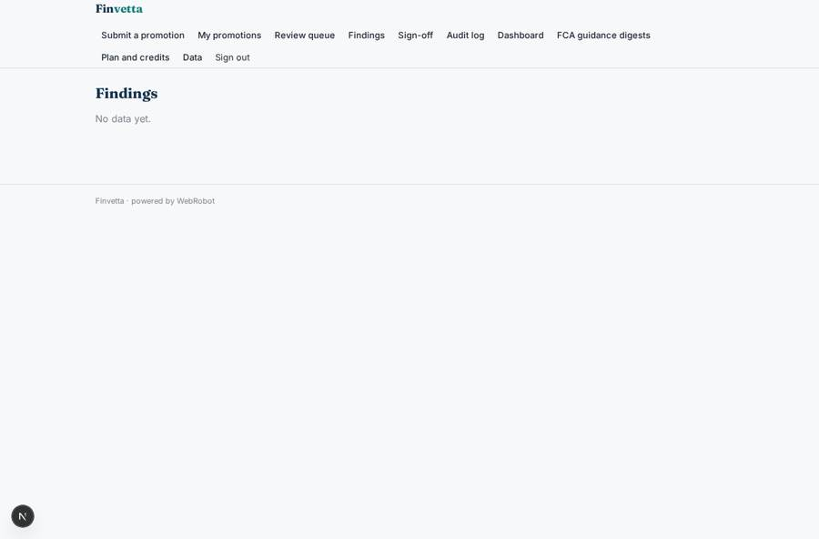
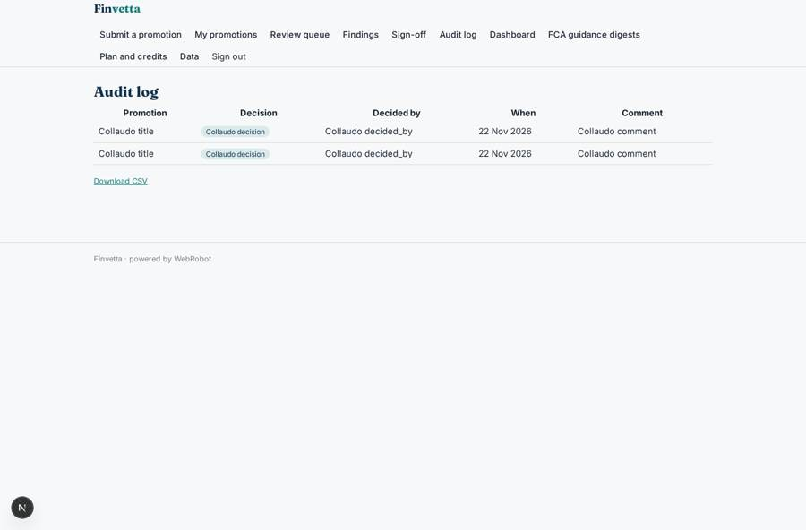

# Finvetta

_Financial promotions reviewed against the FCA rules before they go live._

**Sector:** Fintech, proptech, insurtech · **Manifest:** valid (schema + runtime contract) · **Functional test:** passed (19 checks passed)

## Description given to the app builder

I want an app called Finvetta that reviews financial promotions before they go live. Regulated firms sign up as an organisation with three roles: marketers who submit, compliance reviewers who approve, and an admin who manages users and plan. A marketer uploads a promotion (web copy, email, social post, PDF brochure, banner image or short video ad) with a form: product type, channel, target audience, risk warnings included, intended launch date. An agent extracts the text, reads images with OCR and transcribes the video audio, then checks everything against the FCA Handbook (COBS 4, the s21 FSMA regime, Consumer Duty) and published ASA rulings, and returns a marked-up version: each flagged sentence, the rule it breaches with a citation, a severity and a suggested rewrite. The reviewer sees the queue, accepts or edits the suggestions, asks the marketer for changes or approves; nothing is marked approved without a human sign-off, and every decision is kept in an audit log. The app checks the FCA Register to confirm the firm's permissions. Each week it emails a digest of new FCA guidance and the promotions affected. Dashboards show turnaround time and recurring issues. Pricing: monthly plans by number of reviews, extra reviews as credits. English only.

## Functional test: what did not pass

- **form saves a record** (form finding_edit): only role reviewer may fill it, and the test cannot hold that role _(warning)_
- **page opened by a role allowed to** (view finding_edit): only role reviewer may open it, the test cannot hold it _(warning)_
- **saved record shown where its collection is read** (view turnaround): a record was saved in audit_log (by admin-data, admin-data) but the page does not show it (as marketer) _(warning)_

## Navigation recording

Signed in as the app's admin, the recorder opened 7 menu page(s): Submit a promotion, My promotions, Review queue, Findings, Sign-off, Audit log, Dashboard.
- data page empty: queue (table)
- data page empty: finding_list (table)
- data page empty: dashboard (dashboard)

Empty data pages are mostly expected on the local runtime: agents are mocked there, so the collections they fill stay empty.

## Features not expressible today (spec.extensions)

- **organisations**: Each regulated firm needs its own deployment of this app (one tenant per firm). Multiple firms inside one app, with each firm's marketers and reviewers kept apart, are not expressible yet.
- **video_audio_transcription**: Automatic transcription of video audio is not available yet. Marketers paste the transcript of a video ad; image OCR works through the read_upload tool.
- **fca_register_headers**: The FCA Register API also expects an X-Auth-Email header. The key is sent by the runtime; the account email must be configured by the platform team.
- **turnaround_time**: Turnaround time (submission to decision) needs both timestamps in one record. The dashboard shows decisions per week and findings by rule; an exact turnaround figure needs a computed field.
- **digest_affected_promotions**: The weekly digest lists the promotion types and channels each new guidance item affects. Matching it to individual promotions across all users is not possible without a cross-user read tool.
- **sign_off_status**: The sign-off decision lives in the approvals view and the audit log. A trigger cannot update the review record, so the queue shows the AI verdict, not the human decision.

## Screenshots (interpretive runtime, test data)

### home-anon

### home-mobile

### dashboard

### queue

### finding_list

### audit

