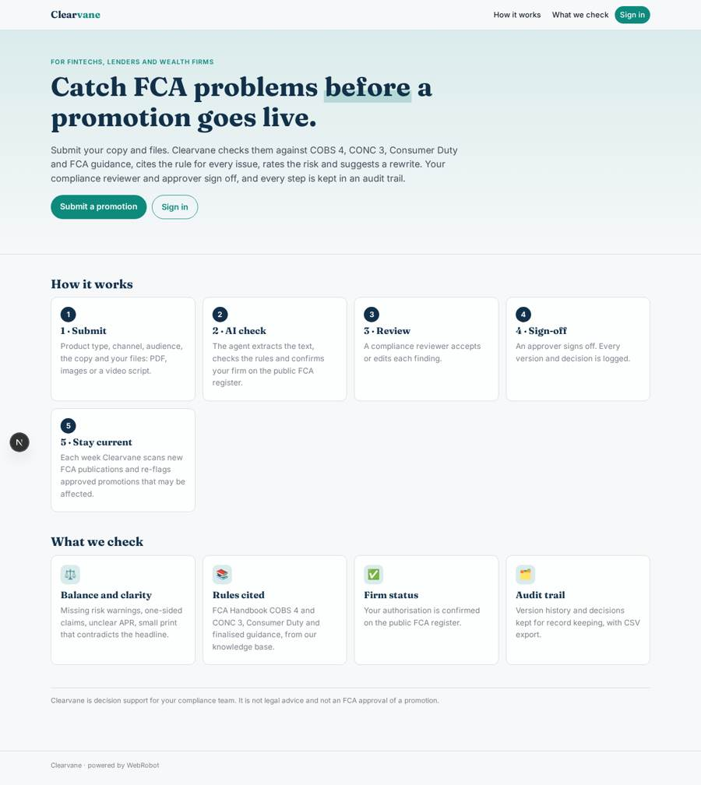
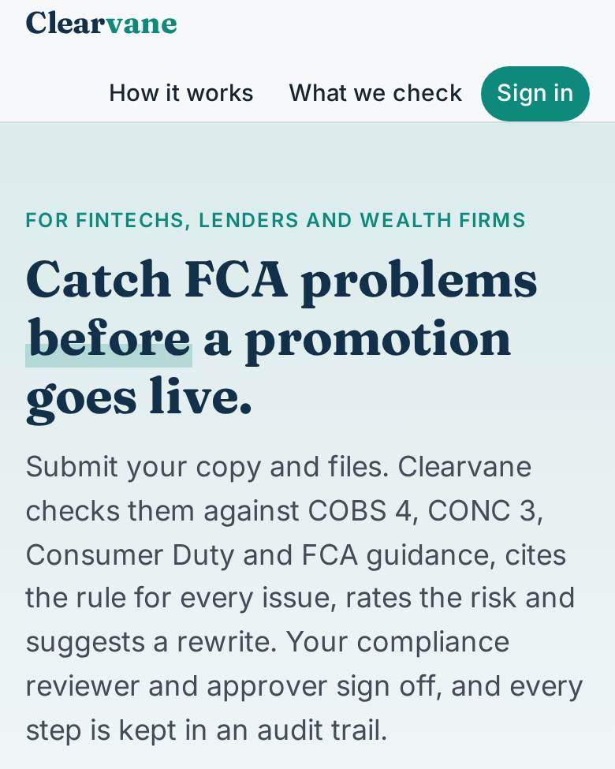
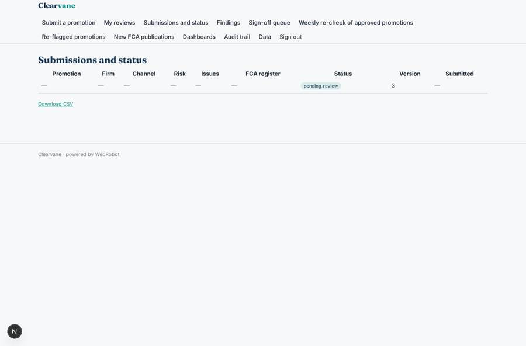
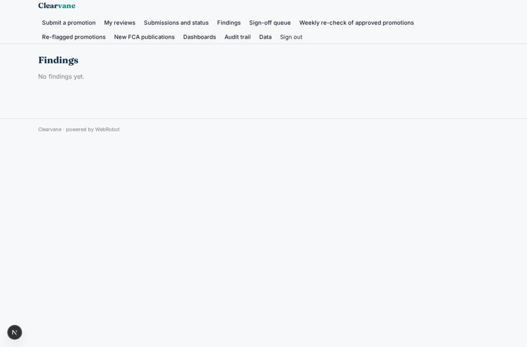
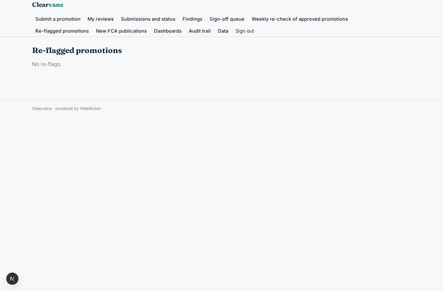
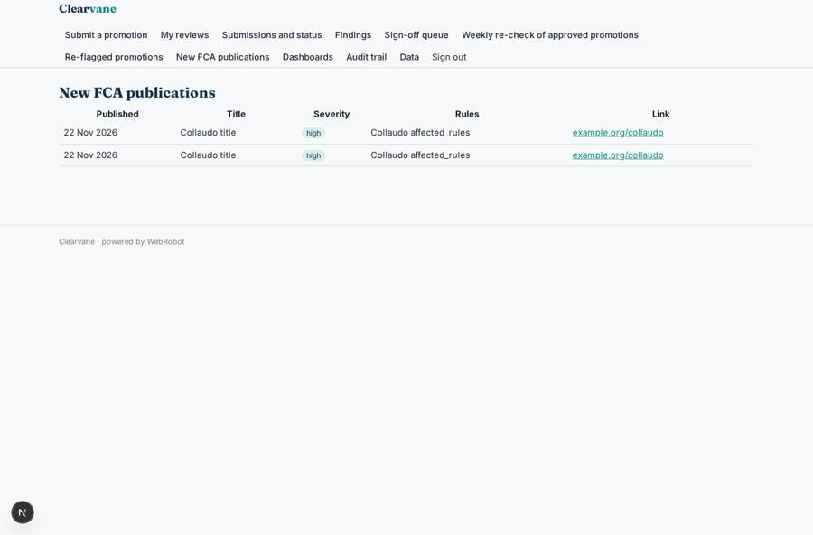

# Clearvane

_Check financial promotions against FCA rules before they go live._

**Sector:** B2B AI and SaaS · **Manifest:** valid (schema + runtime contract) · **Functional test:** passed (22 checks passed)

## Description given to the app builder

We need Clearvane, which checks financial promotions against FCA rules before they go live. Fintechs, lenders and wealth firms sign up; roles are marketer, compliance reviewer and approver, and a marketer sees only their own submissions. A marketer submits a form with product type, channel (social, email, web page, leaflet), target audience, the copy and the uploaded files (PDF, image, video script). An agent extracts the text, checks it against the FCA Handbook (COBS 4, CONC 3), Consumer Duty and the relevant finalised guidance indexed in a knowledge base, and returns each issue with the rule cited, a risk level and a suggested rewrite: missing risk warnings, unbalanced claims, unclear APR, small-print problems. It also confirms the firm's status on the public FCA register. The compliance reviewer accepts or edits the findings, the approver signs off, and the system keeps an audit trail with version history for record keeping. A scheduled agent checks weekly for new FCA publications and re-flags approved promotions affected. Emails at each workflow step; dashboards of approval times and recurring issues. Pricing: monthly subscription by number of promotions reviewed, with extra credits per review. English.

## Functional test: what did not pass

- **trigger has its effect** (trigger new_submission): email to role:reviewer: no such recipient in the test (role nobody holds or empty field) _(warning)_
- **saved record shown where its collection is read** (view submissions): a record was saved in reviews (by admin) but the page does not show it (as marketer) _(warning)_

## Navigation recording

Signed in as the app's admin, the recorder opened 7 menu page(s): Submit a promotion, My reviews, Submissions and status, Findings, Sign-off queue, Weekly re-check of approved promotions, Re-flagged promotions.
- agent run did not open: new_review: the run did not open
- data page empty: my_reviews (history)

Empty data pages are mostly expected on the local runtime: agents are mocked there, so the collections they fill stay empty.

## Features not expressible today (spec.extensions)

- **fca_register_auth**: The FCA Register API also expects an X-Auth-Email header next to the key; the manifest only carries the key, so the connection may need the platform team to add the email header.
- **reviewer_findings_editing**: Reviewers edit findings as one text field per review plus the issues table; per-finding accept/reject buttons are not available yet.
- **video_files**: Videos themselves are not read; submit the video script as PDF, Word or text.

## Screenshots (interpretive runtime, test data)

### home-anon

### home-mobile

### submissions

### findings

### reflag_list

### fca_news

