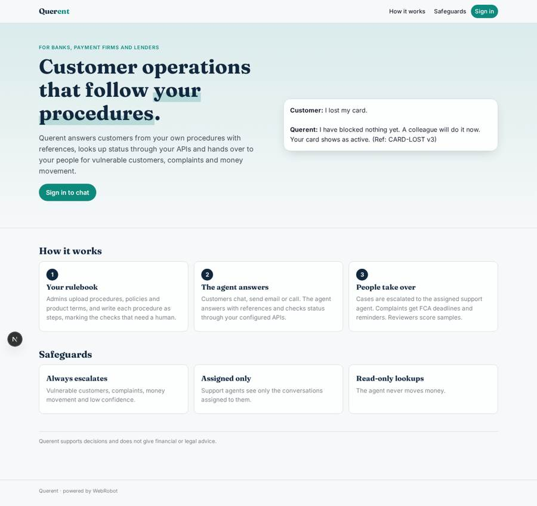
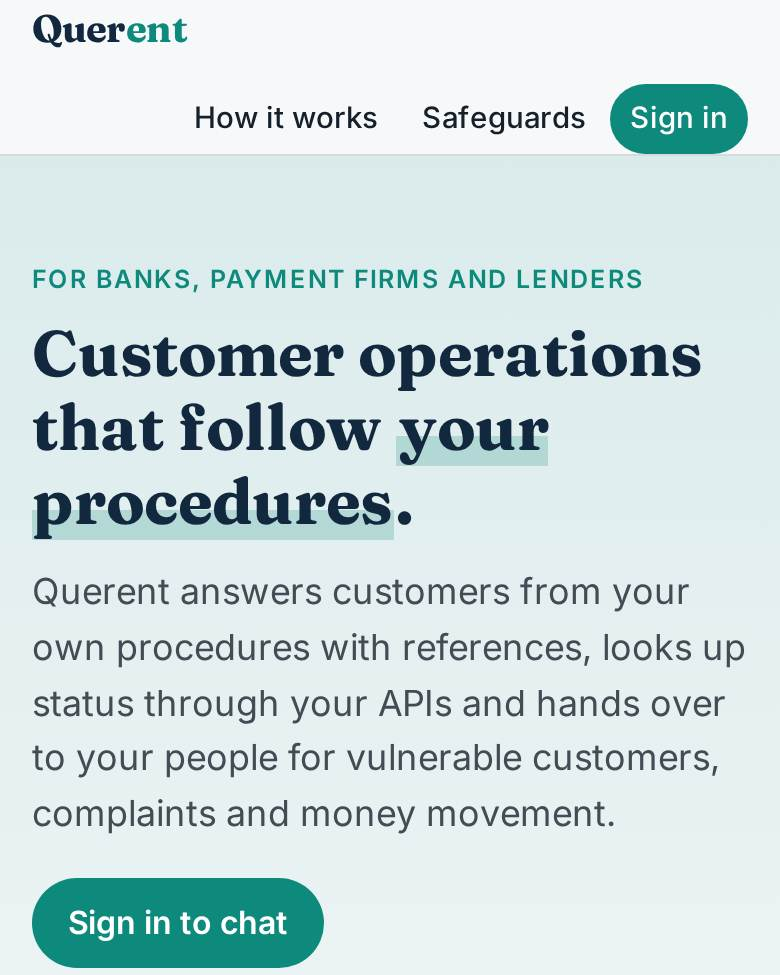
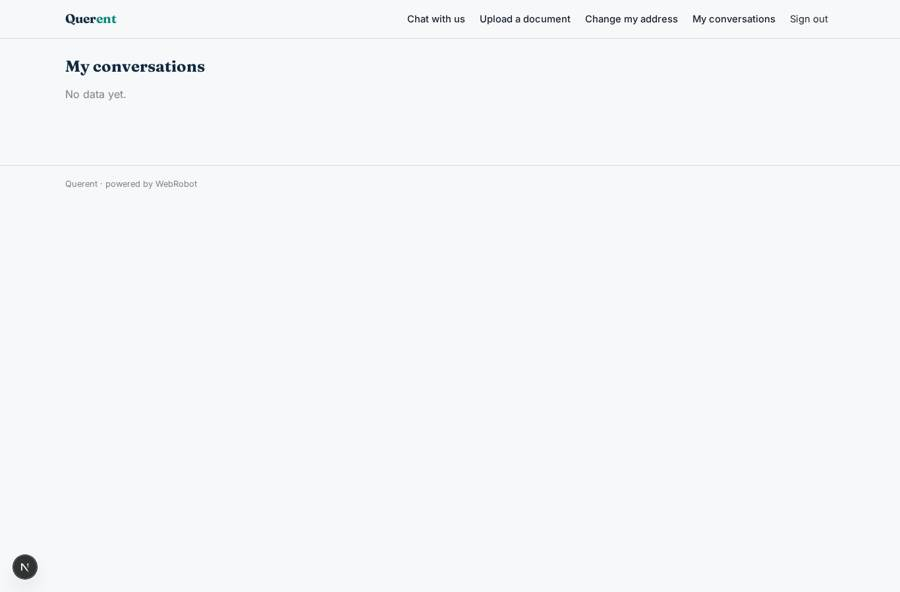
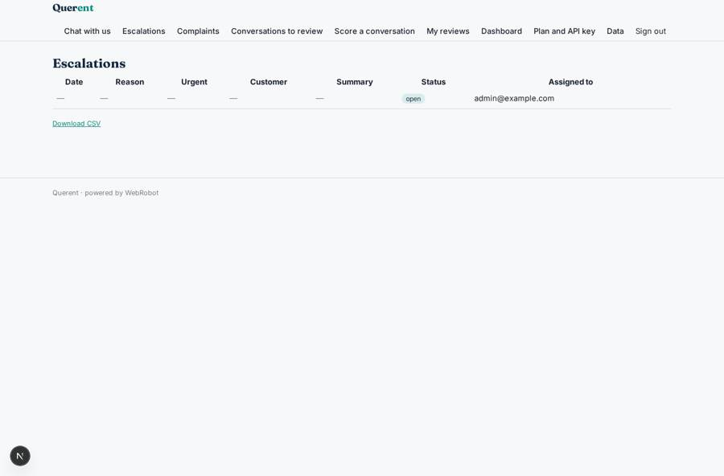
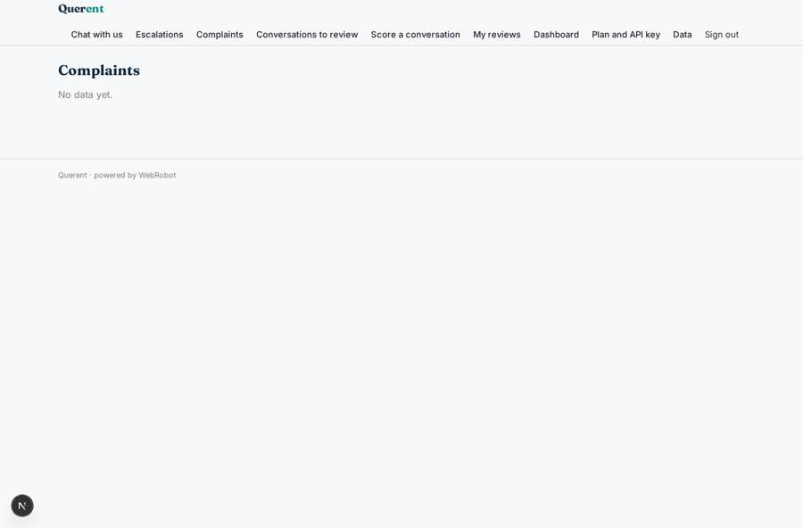
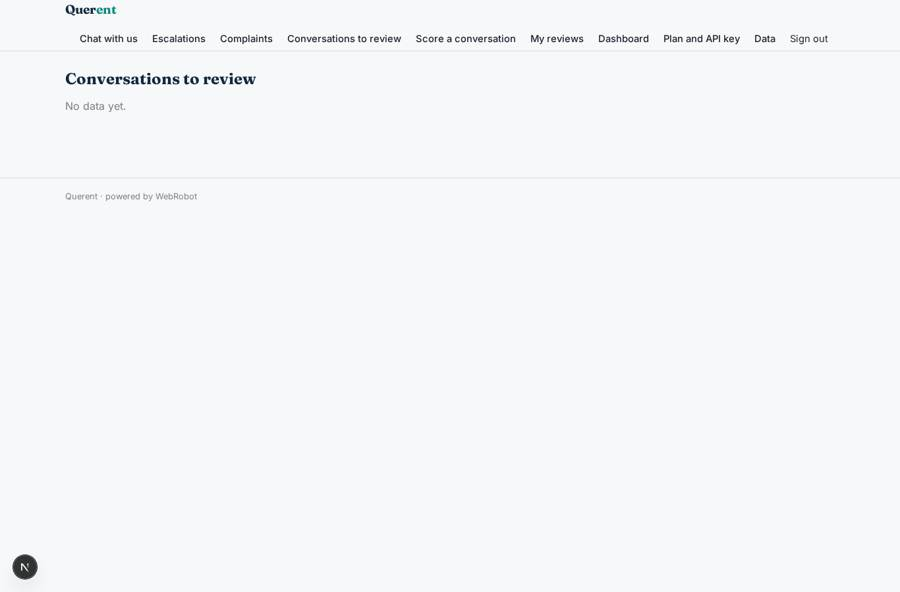

# Querent

_AI customer operations for banks, payment firms and lenders._

**Sector:** B2B AI and SaaS · **Manifest:** valid (schema + runtime contract) · **Functional test:** passed (28 checks passed)

## Description given to the app builder

We need Querent, an AI customer operations agent for banks, payment firms and lenders. The firm signs up; roles are operations admin, support agent, quality reviewer and compliance, and support agents see only conversations assigned to them. The admin uploads procedures, policies, product terms and complaint handling rules, and writes each procedure as steps with which checks need a human. End customers chat with the agent on the firm's website; the agent answers from the procedures with references, handles common requests (card lost, disputed payment, address change, KYC document upload) and calls the firm's APIs through configured HTTP tools to look up status. It escalates to a human for vulnerable customers, complaints, anything involving money movement, or low confidence, and complaint cases follow FCA timelines with reminders. Quality reviewers sample conversations and score them. The real product also handles email support including inbound customer emails, telephone calls, and deep integration with the core banking system, so I want those included. Dashboards show resolution rate, escalations, complaint deadlines and customer satisfaction. Pricing: platform fee plus a charge per resolved conversation. English.

## Functional test: what did not pass

- **trigger has its effect** (trigger kyc_received): email to role:compliance: no such recipient in the test (role nobody holds or empty field) _(warning)_

## Navigation recording

Signed in as the app's admin, the recorder opened 7 menu page(s): Chat with us, Escalations, Complaints, Conversations to review, Score a conversation, My reviews, Dashboard.
- data page empty: complaints_list (table)
- data page empty: review_queue (table)

Empty data pages are mostly expected on the local runtime: agents are mocked there, so the collections they fill stay empty.

## Features not expressible today (spec.extensions)

- **per_resolved_charge**: The charge per resolved conversation billed to the firm is not available: runtime charges bill the record's owner (the end customer), not the firm. Today only the monthly platform plan is set; usage-based billing per resolved conversation needs organisation-level metering.
- **core_banking_depth**: Core banking integration is limited to read-only HTTP lookups with one API key (card, payment, KYC status). Writes such as blocking a card, reversing a payment or two-way sync need a dedicated connector and stay with human staff.
- **email_phone_setup**: Inbound email and telephone channels are declared; the inbox address and phone number are set when the channels are activated. Callers and senders who have not signed up cannot reach per-customer records, so identity must be matched to a signed-in customer first.
- **anonymous_website_chat**: Chat needs the customer to sign in by magic link, because conversations, escalations and complaints are stored in the customer's own records. Anonymous visitors cannot start a regulated case.
- **sample_selection**: Quality reviewers pick conversations from the review queue by hand. Automatic random sampling is not available yet.

## Screenshots (interpretive runtime, test data)

### home-anon

### home-mobile

### my_conversations

### inbox

### complaints_list

### review_queue

