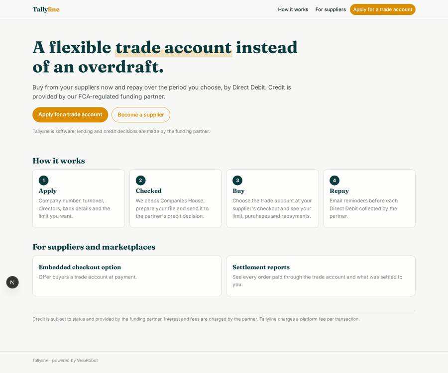
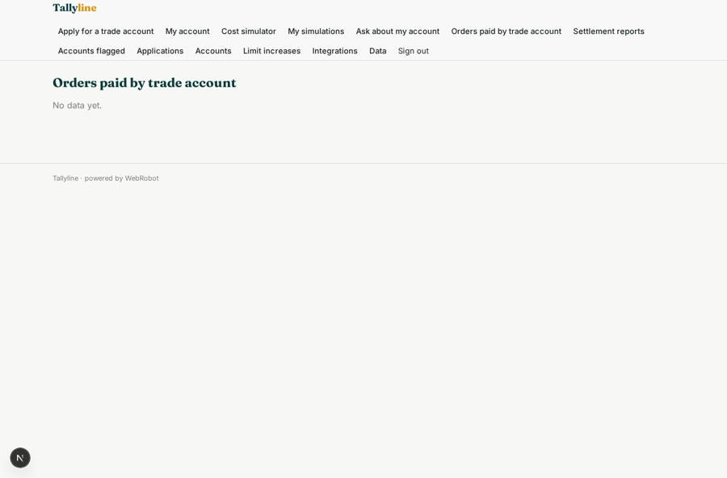
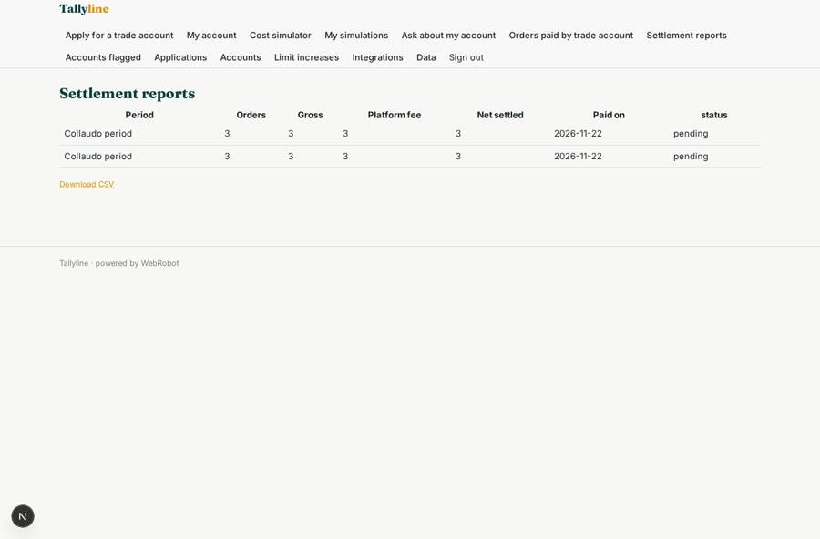
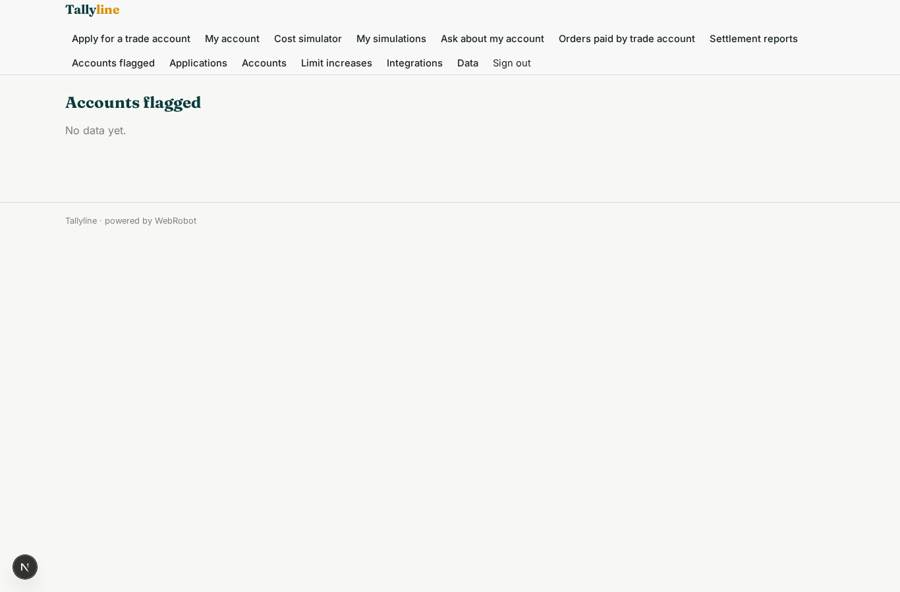
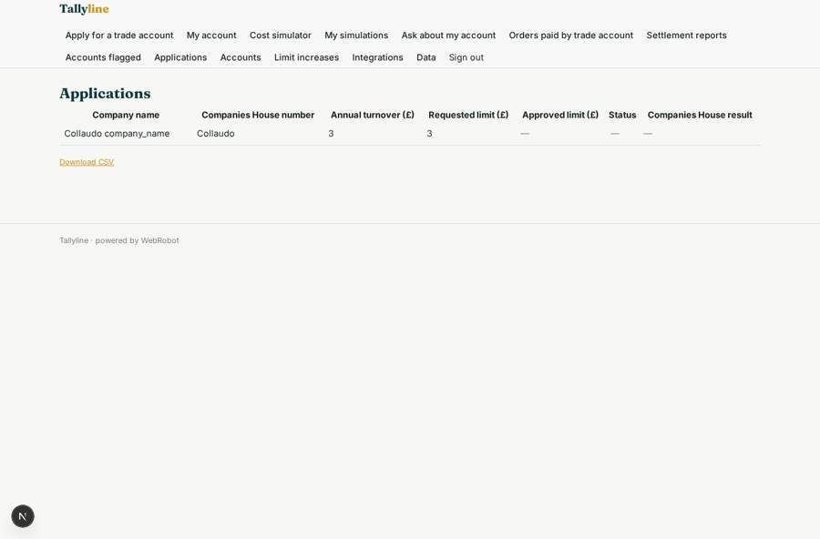

# Tallyline

_A flexible trade account for businesses, instead of an overdraft._

**Sector:** Fintech, proptech, insurtech · **Manifest:** valid (schema + runtime contract) · **Functional test:** passed (28 checks passed)

## Description given to the app builder

We want Tallyline, an embedded flexible trade account that businesses use instead of an overdraft when buying from suppliers. The lending itself, the credit risk and the balance sheet are with our FCA-regulated funding partner; I need the software around it. Suppliers and marketplaces sign up and embed a checkout option; a business buyer applies with a form: company number, turnover, directors, bank details, requested limit. The software checks Companies House, prepares the application file and passes it to the partner's credit decision API, then shows the approved limit and terms. Buyers get a dashboard with available limit, purchases, repayment schedule and statements, and email reminders before each repayment collected by Direct Debit through the partner. Suppliers see orders paid through the trade account and their settlement reports. An agent answers buyer questions about terms and flags accounts nearing their limit to the partner's credit team, who approve any limit increase. A simulator lets buyers see costs for different repayment periods before they commit. Roles: buyer, supplier, partner credit team, admin. Pricing: the partner charges interest and fees; we take a platform fee per transaction. English.

## Navigation recording

Signed in as the app's admin, the recorder opened 7 menu page(s): Apply for a trade account, My account, Cost simulator, My simulations, Ask about my account, Orders paid by trade account, Settlement reports.
- data page empty: supplier_orders (table)

Empty data pages are mostly expected on the local runtime: agents are mocked there, so the collections they fill stay empty.

## Features not expressible today (spec.extensions)

- **partner_api_contract**: The funding partner's real credit decision, limit increase and webhook payloads (account, order, repayment, statement, settlement events, each carrying the buyer or supplier email) must be mapped to the placeholder endpoints and webhook field paths; partner webhooks must be configured to POST to /api/hooks/<trigger key>.
- **platform_fee**: The per-transaction platform fee is recorded on each purchase and on supplier settlements (set by the partner's settlement flow); automatic collection of the fee through Stripe per_transaction billing is not configured.
- **embedded_checkout**: The embeddable checkout button or widget for supplier and marketplace sites, and the Direct Debit mandate set-up, are provided by the funding partner's API and are not part of this manifest.
- **sms_notifications**: Repayment reminders are by email only; SMS is not available yet.

## Screenshots (interpretive runtime, test data)

### home-anon

### home-mobile

### supplier_orders

### supplier_settlements

### credit_flags

### credit_applications

