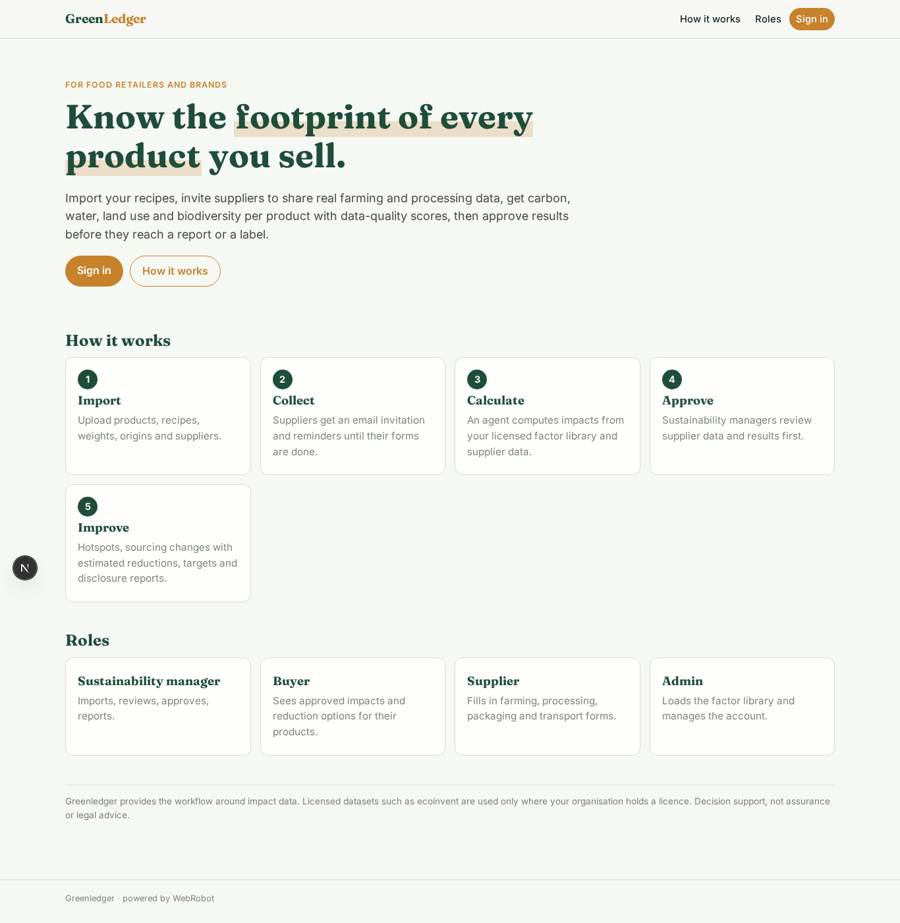
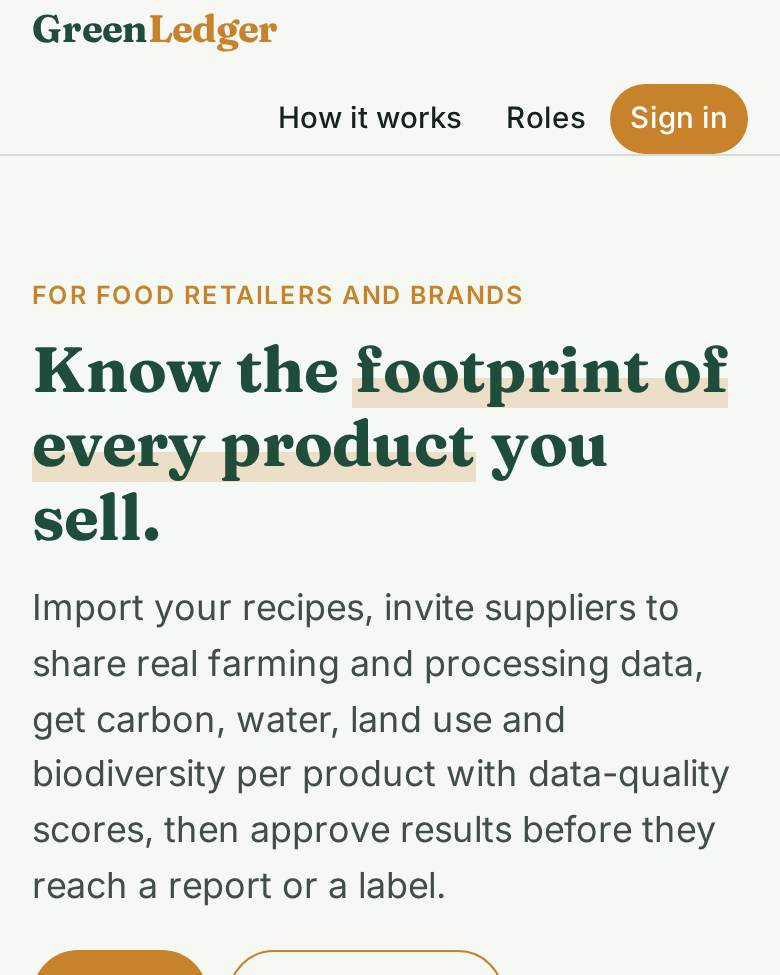
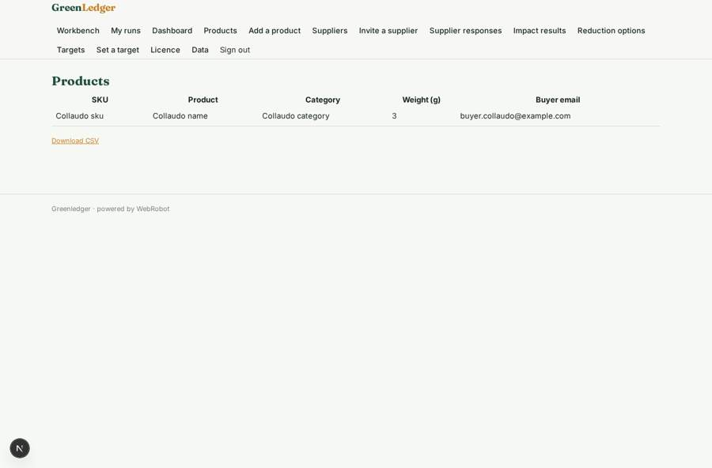
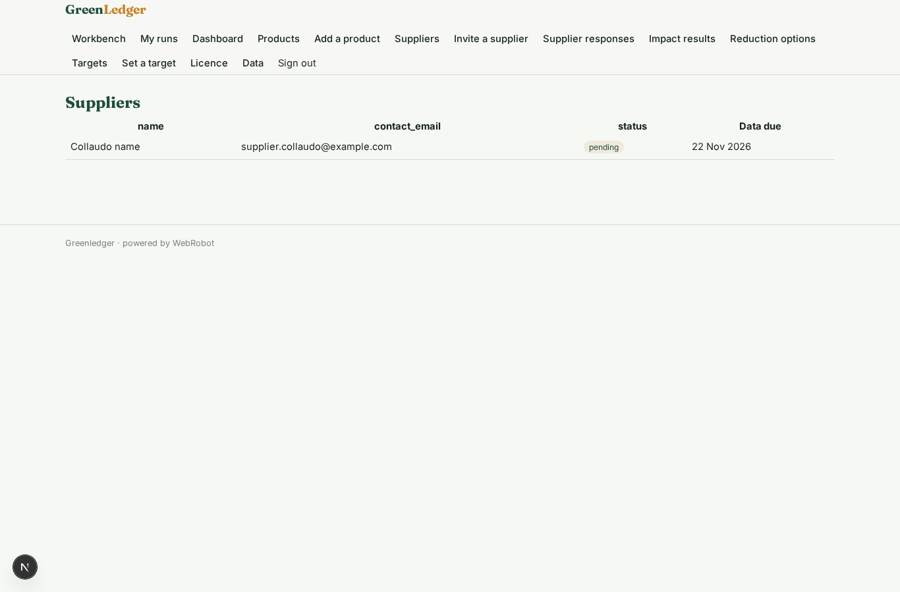
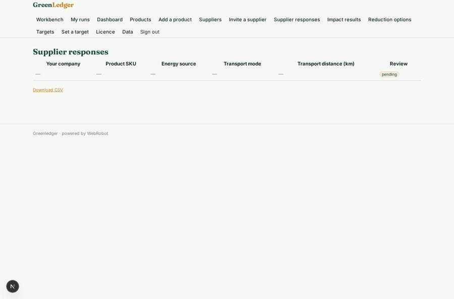
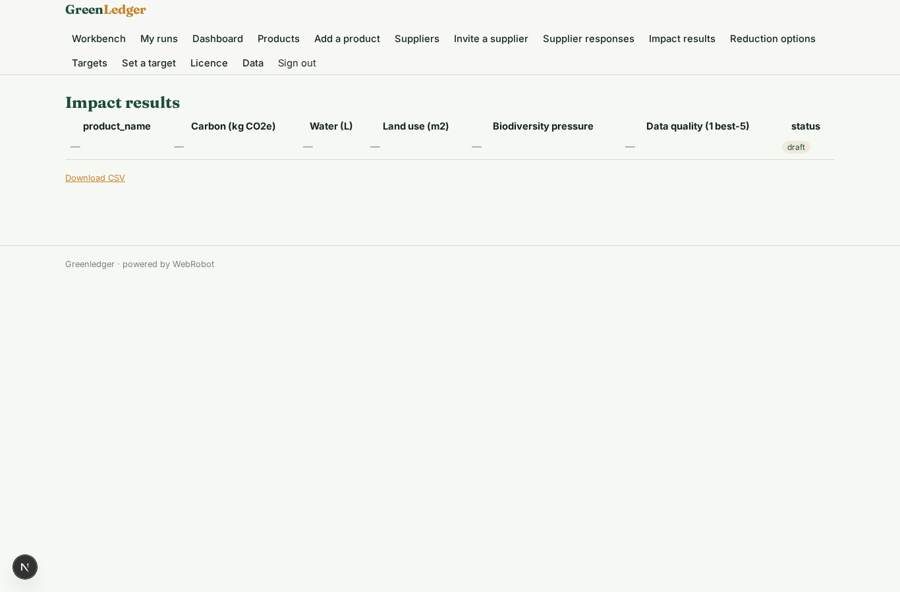

# Greenledger

_Product-level supply-chain and environmental-impact intelligence for food retailers and brands._

**Sector:** Data, media, cyber, devtools · **Manifest:** valid (schema + runtime contract) · **Functional test:** passed (28 checks passed)

## Description given to the app builder

We need an app called Greenledger for product-level supply-chain and environmental-impact intelligence for food retailers and brands. The core of the real product is proprietary and licensed life-cycle-assessment and agri-food datasets, such as ecoinvent, which we would use only if we have a licence; those datasets and impact models are outside a normal software app, and I need the workflow around them. A retailer signs up and imports its product list with recipes, ingredients, weights, origin countries and suppliers. Suppliers receive an email invitation to a portal where they fill in forms about farming practice, processing, packaging and transport for their products, with reminders until they finish. The impact engine calculates carbon, water, land use and biodiversity per product, with data quality scores. An agent finds the hotspots and suggests changes, such as a different sourcing region, and estimates the reduction. Sustainability managers review supplier data and approve results before they are used in reports or on-pack claims. Dashboards show impact per category, supplier and product and progress against targets. Reports support net-zero disclosures. Roles: admin, sustainability manager, buyer, supplier. Pricing: annual licence from £50,000. English only.

## Functional test: what did not pass

- **form saves a record** (form supplier_form): only role supplier may fill it, and the test cannot hold that role _(warning)_
- **trigger has its effect** (trigger response_received): email to record.retailer_email: no such recipient in the test (role nobody holds or empty field) _(warning)_
- **saved record shown where its collection is read** (view results): a record was saved in impact_results (by manager) but the page does not show it (as manager) _(warning)_

## Navigation recording

Signed in as the app's admin, the recorder opened 7 menu page(s): Workbench, My runs, Dashboard, Products, Add a product, Suppliers, Invite a supplier.
No issue found.

Empty data pages are mostly expected on the local runtime: agents are mocked there, so the collections they fill stay empty.

## Features not expressible today (spec.extensions)

- **licensed_lca_datasets**: The proprietary datasets and impact models (ecoinvent and agri-food LCA databases) are not part of the app. With a licence, admins load the factors into the emission_factors library on /admin/data; the agent only computes with what is there and flags gaps.
- **onpack_claims**: On-pack claims are not generated: the app supports approval of results and disclosure reports only; claim substantiation needs external verification.
- **multi_user_retailer_teams**: Several managers of one retailer sharing the same records, and enterprise SSO, are not available yet.

## Screenshots (interpretive runtime, test data)

### home-anon

### home-mobile

### products

### suppliers

### responses

### results

