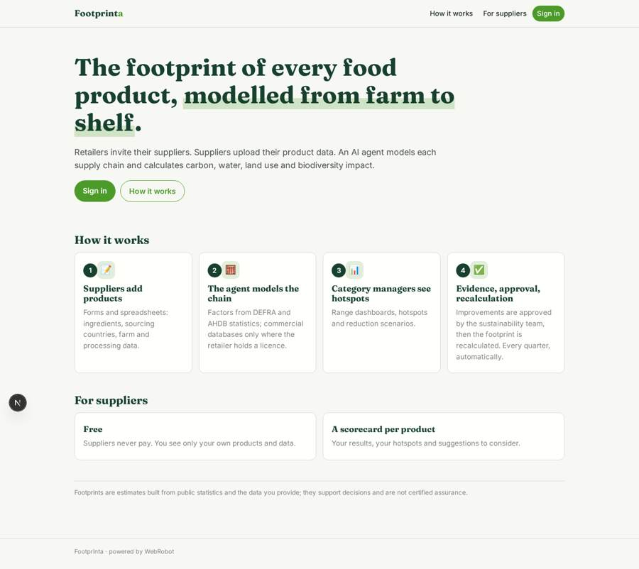
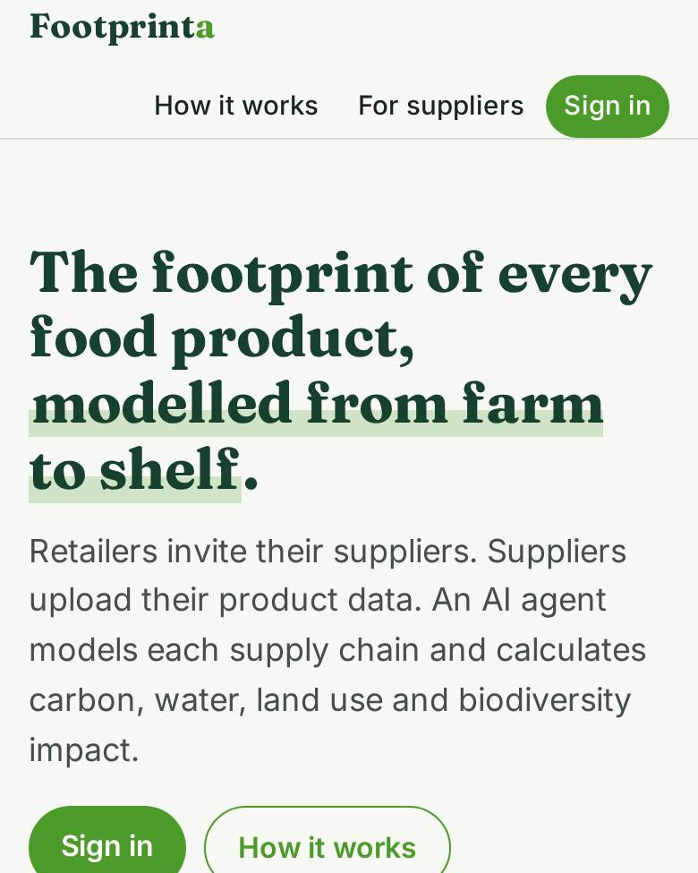
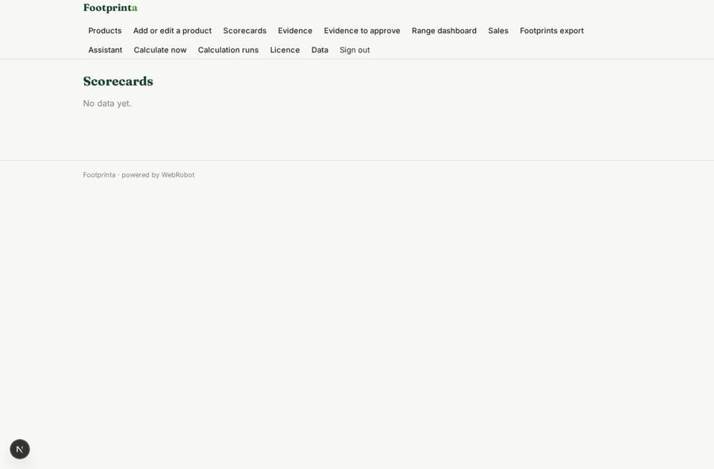
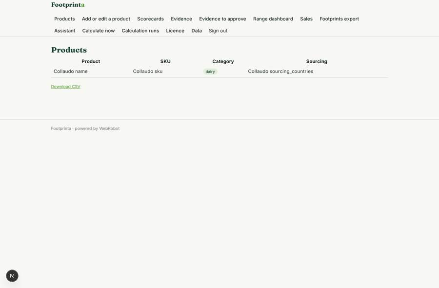
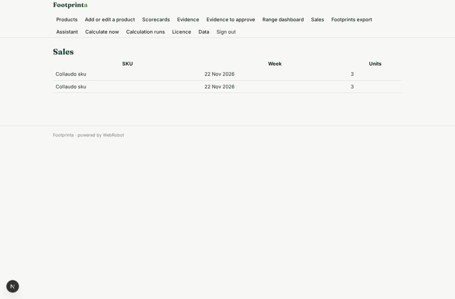

# Footprinta

_The environmental footprint of every food product, from farm to shelf._

**Sector:** Sanità, istruzione, energia, gov · **Manifest:** valid (schema + runtime contract) · **Functional test:** passed (31 checks passed)

## Description given to the app builder

I want Footprinta, a platform that calculates the environmental footprint of each food product for retailers and their suppliers, by modelling the supply chain. A retailer signs up and invites suppliers; each supplier sees only its own products and data. Suppliers upload product specifications, ingredient lists, sourcing countries, farm and processing data through forms and spreadsheets. An agent builds a model of each product's supply chain and calculates carbon, water, land use and biodiversity impact, using DEFRA and AHDB statistics and, only if we have a licence, commercial life-cycle assessment databases. We want integrations with retailers' product and sales systems. Retailer category managers see dashboards across their range, hotspots and reduction scenarios, and an assistant suggests reformulations or sourcing changes for the supplier to consider. Updates trigger email notifications. Pricing: retailer annual licence, suppliers free. Suppliers get a scorecard per product and can submit improvement evidence through a form, which the retailer's sustainability team approves before the footprint is recalculated. Footprints are recalculated quarterly on a schedule and exported to CSV for reporting. English only.

## Functional test: what did not pass

- **form saves a record** (form evidence_form): only role supplier may fill it, and the test cannot hold that role _(warning)_
- **page opened by a role allowed to** (view evidence_form): only role supplier may open it, the test cannot hold it _(warning)_
- **page opened by a role allowed to** (view quarterly): only role supplier may open it, the test cannot hold it _(warning)_

## Navigation recording

Signed in as the app's admin, the recorder opened 7 menu page(s): Products, Add or edit a product, Scorecards, Evidence, Evidence to approve, Range dashboard, Sales.
- data page empty: scorecard (cards)
- data page empty: evidence_list (table)

Empty data pages are mostly expected on the local runtime: agents are mocked there, so the collections they fill stay empty.

## Features not expressible today (spec.extensions)

- **retailer_system_integration**: Direct connectors to the retailer's product master and sales systems are not available yet. Sales data can be pushed to the sales webhook (POST /api/hooks/sales_feed); product master data is loaded by suppliers or by admins on the data page from CSV.
- **licensed_lca_databases**: Commercial life-cycle databases are used only if the retailer holds a licence: an admin then loads the licensed factors into the emission_factors table with licence 'commercial'. Otherwise only DEFRA and AHDB open data is used.
- **single_retailer_tenancy**: One app instance serves one retailer: category managers and the sustainability team see all suppliers' records, suppliers see only their own. Set the real annual licence price in billing.plans.

## Screenshots (interpretive runtime, test data)

### home-anon

### home-mobile

### scorecard

### products

### evidence_list

### sales_view

