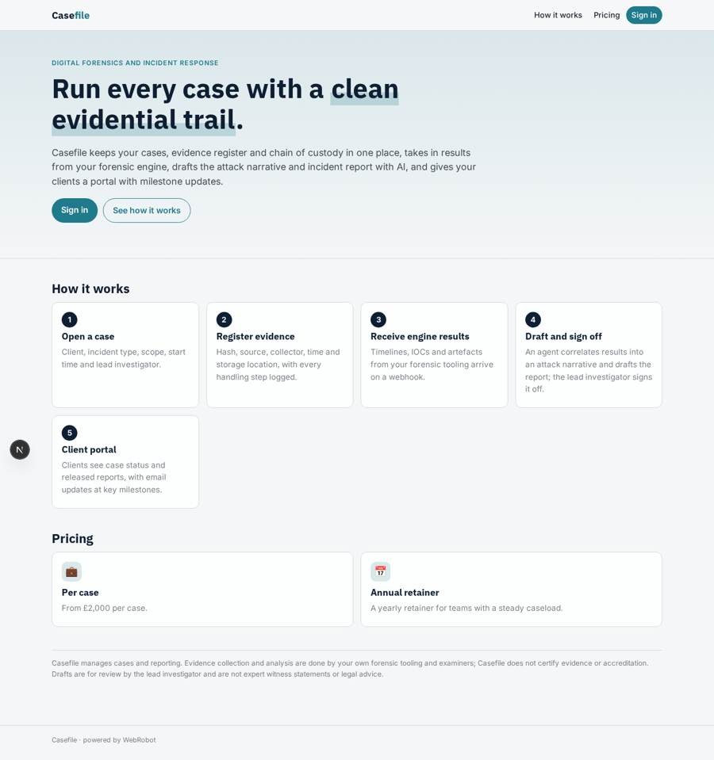
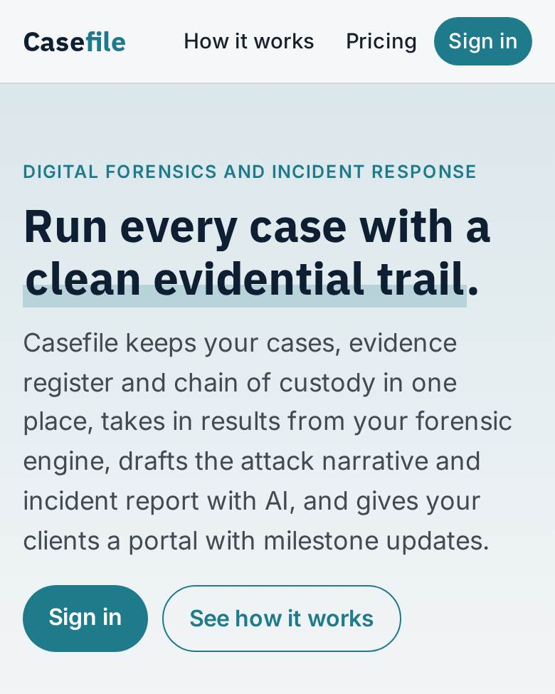
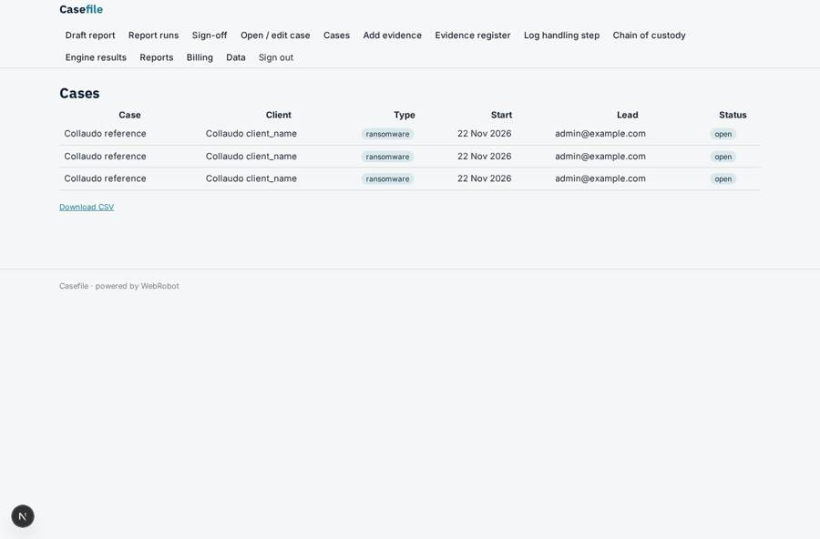
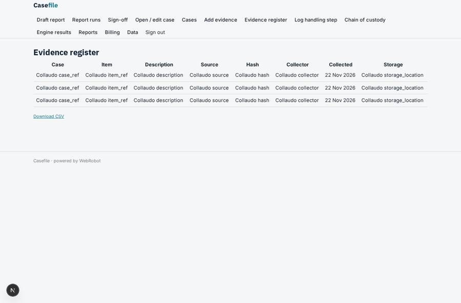
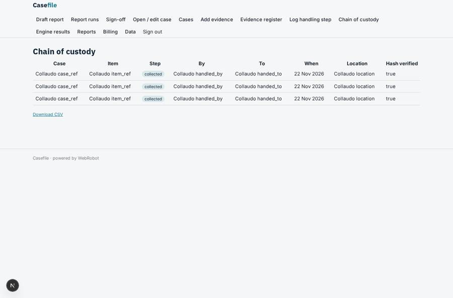
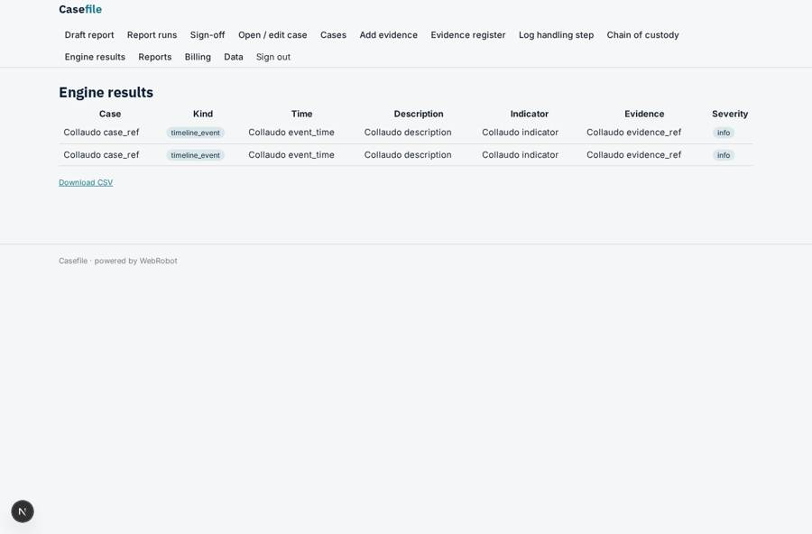

# Casefile

_Case management, chain of custody and incident reporting for DFIR teams._

**Sector:** Data, media, cyber, devtools · **Manifest:** valid (schema + runtime contract) · **Functional test:** passed (42 checks passed)

## Description given to the app builder

I want an app called Casefile to automate digital forensics and incident response work. The core of the real product is forensic collection and analysis from hosts, disk images and memory images, with an evidential chain of custody that can meet UK forensic standards for court; that collection tooling and analysis engine are outside a normal software app, and I need the case management and reporting around them. An incident-response firm or in-house team signs up and opens cases with client, incident type, scope, start time and lead investigator. Investigators add evidence items with hash, source, collector, time collected and storage location, and every handling step is logged for chain of custody. Analysis results from the forensic engine arrive as timelines of events, indicators of compromise and artefacts. An agent correlates them into an attack narrative and drafts the incident report with findings, impact and recommendations. The lead investigator reviews and signs off the report before it goes to the client. Clients have a portal with case status and reports. Email updates notify clients at key milestones. Roles: admin, lead investigator, analyst, client viewer. Pricing: per case from £2,000 or annual retainer. English only.

## Functional test: what did not pass

- **saved record shown where its collection is read** (view portal_reports): a record was saved in reports (by admin-data, admin-data, admin) but the page does not show it (as client_viewer) _(warning)_

## Navigation recording

Signed in as the app's admin, the recorder opened 7 menu page(s): Draft report, Report runs, Sign-off, Open / edit case, Cases, Add evidence, Evidence register.
No issue found.

Empty data pages are mostly expected on the local runtime: agents are mocked there, so the collections they fill stay empty.

## Features not expressible today (spec.extensions)

- **forensic_engine**: Collection and analysis from hosts, disk images and memory images happen in the firm's own forensic tooling. It must post each timeline event, IOC and artefact to POST /api/hooks/engine_results (with the app's hook secret); Casefile does not run or validate that analysis.
- **evidential_integrity**: Casefile records hashes and handling steps but does not itself verify hashes, give tamper-evident (WORM/signed) storage of the custody log, or provide ISO 17025 accreditation. Court-readiness under UK forensic standards depends on the firm's own procedures; entries should be exported (CSV) for the case file.
- **pricing_note**: Pricing 'from £2,000 per case' and the annual retainer are modelled as a credit pack and a yearly plan with indicative amounts; the owner must set final prices and connect Stripe. Client-facing milestone updates are email only (no SMS/WhatsApp).

## Screenshots (interpretive runtime, test data)

### home-anon

### home-mobile

### cases

### evidence_list

### custody_list

### findings_list

