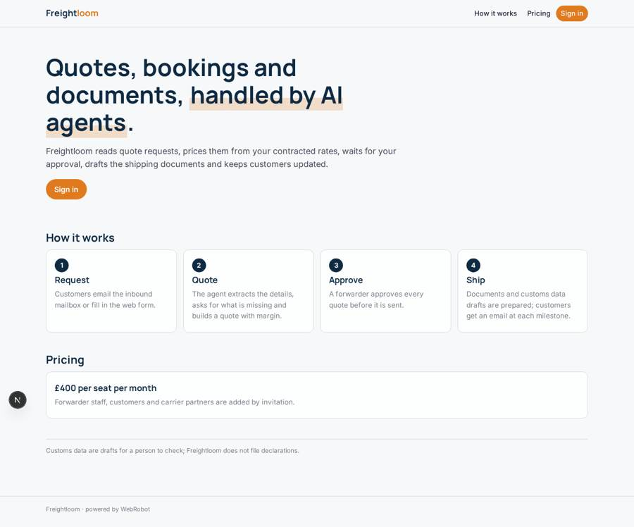
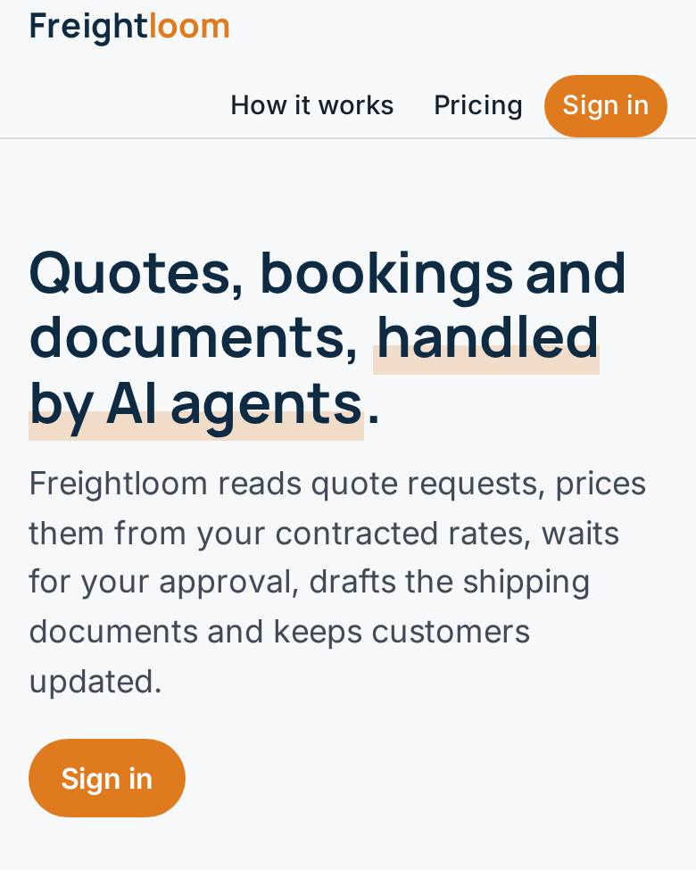
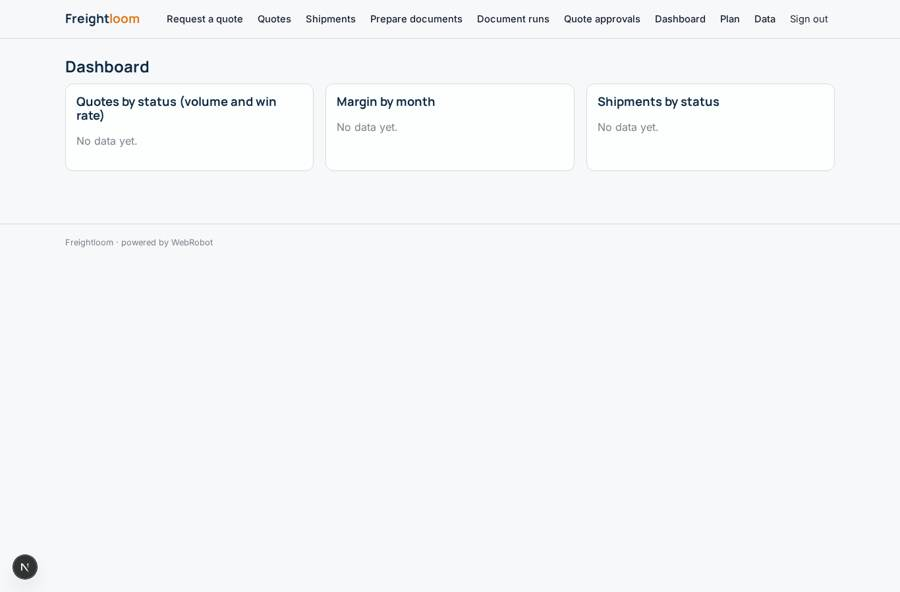
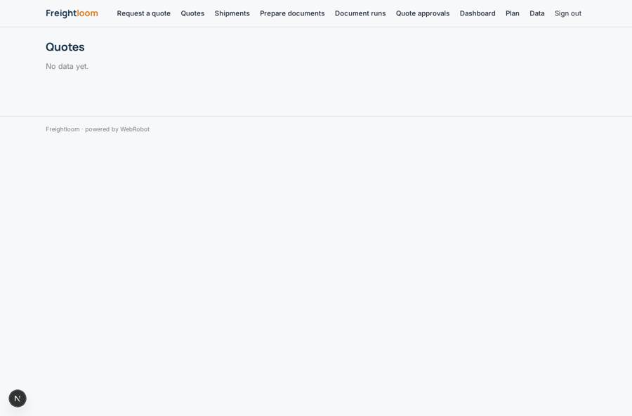
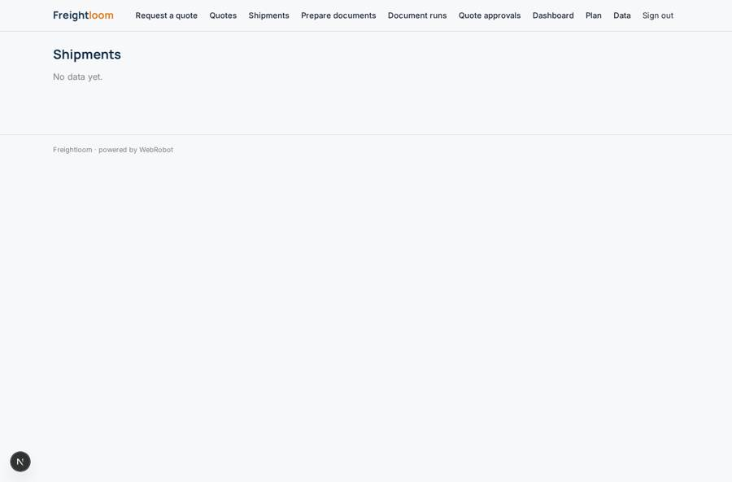
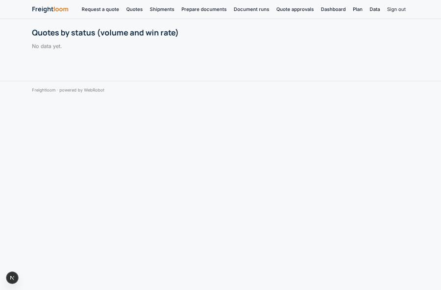

# Freightloom

_AI agents for freight forwarders: quotes, bookings and documents._

**Sector:** Data, media, cyber, devtools · **Manifest:** valid (schema + runtime contract) · **Functional test:** passed (21 checks passed)

## Description given to the app builder

We need an app called Freightloom, a set of AI agents for freight forwarders handling quotes, bookings and documents. A forwarder signs up and adds staff, customers and carrier partners. Quote requests from customers arrive by email in the real product; I want an inbound mailbox the agent reads, plus a web form with origin, destination, cargo type, weight, volume, incoterms and ready date. The agent extracts the details, asks the customer for missing fields, gets rates from carrier and partner APIs under contract, and builds a quote with margin. A forwarder approves every quote before it is sent. On acceptance, the agent prepares the booking and shipping documents such as bills of lading and commercial invoices, extracted from uploaded files. For UK imports and exports it prepares customs data for CDS and ICS2 using HMRC developer APIs, which require registration. The real product also integrates with transport management systems; I want that included. Dashboards show quote volume, win rate, margins and shipment status. Customers get email updates at each milestone. Roles: admin, forwarder, customer. Pricing: £400 a month per seat. English only.

## Navigation recording

Signed in as the app's admin, the recorder opened 7 menu page(s): Request a quote, Quotes, Shipments, Prepare documents, Document runs, Quote approvals, Dashboard.
- data page empty: my_quotes (table)
- data page empty: my_shipments (table)
- agent run did not open: new_docs: the run did not open
- data page empty: doc_history (history)
- data page empty: dashboard (dashboard)

Empty data pages are mostly expected on the local runtime: agents are mocked there, so the collections they fill stay empty.

## Design checks (linter)

- collection shipments: view my_shipments, view shipment_status, tool shipment_read of docs read it, but nothing writes it — add a form view on it (the users fill their own records), an agent tool that writes or appends to it, or a trigger write; or, for a list the admins keep, make it ownedBy shared (admins fill it on the data page)

## Features not expressible today (spec.extensions)

- **carrier_rate_apis**: Live rates from carrier and partner APIs under contract are not available yet: each carrier needs its own host and key. For now admins keep contracted rates in the rates collection (CSV on /admin/data) and the quoter searches it. Carrier hosts can be added later as credentialed http tools.
- **tms_integration**: Transport management system integration is not included: it needs the TMS vendor's API host and API key (credential plus http tools), which were not specified. Shipments are managed in the app meanwhile.
- **hmrc_cds_ics2**: HMRC CDS and ICS2 submission needs HMRC developer registration and OAuth, which is not available yet. The documents agent prepares customs data drafts only; a person files them.
- **per_seat_billing**: Billing is a flat £400 per month plan; per-seat quantity and a multi-forwarder tenant (a forwarder adding their own staff, customers and partners as separate workspace) are not modelled. Admins invite users to the roles forwarder and customer.
- **carrier_partner_role**: Carrier partners are records in the rates collection, not a login role.

## Screenshots (interpretive runtime, test data)

### home-anon

### home-mobile

### dashboard

### my_quotes

### my_shipments

### quote_volume

