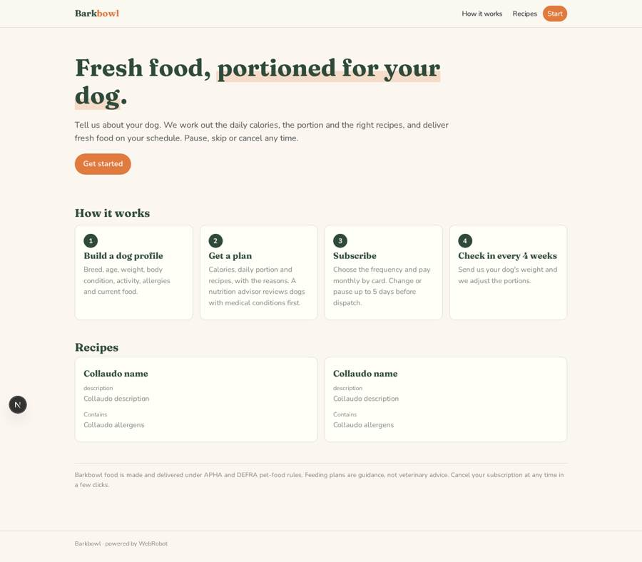
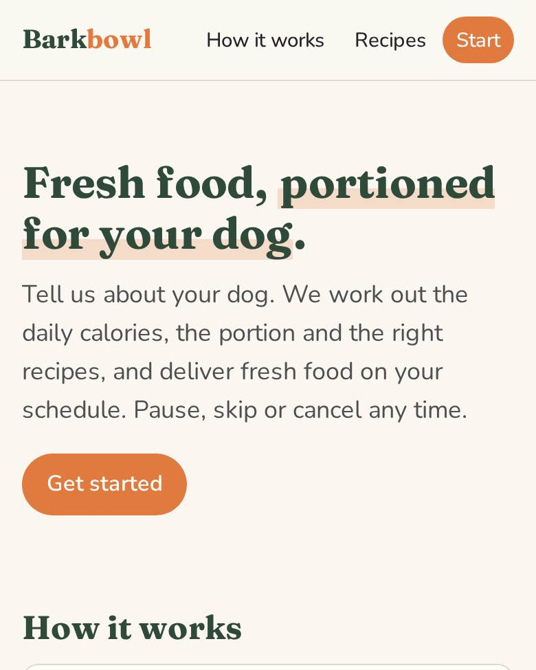
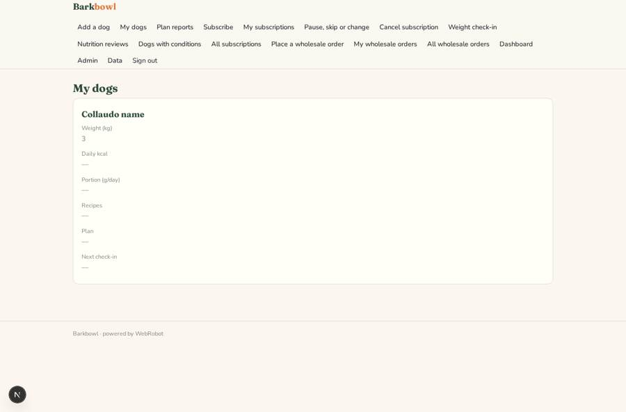
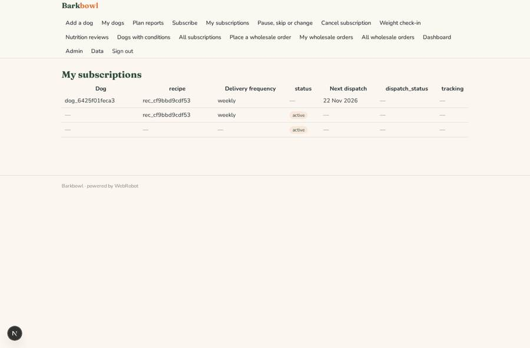
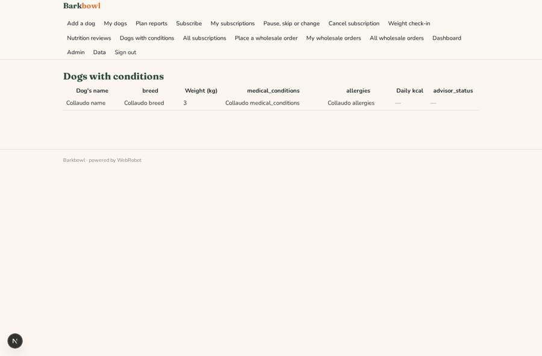
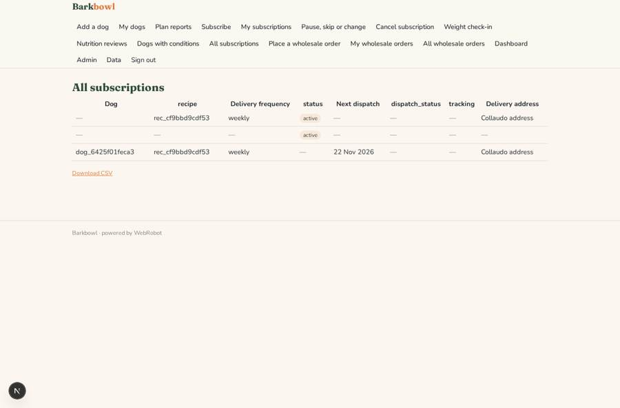

# Barkbowl

_Premium fresh dog food, portioned for your dog._

**Sector:** Consumer, travel, retail · **Manifest:** valid (schema + runtime contract) · **Functional test:** passed (37 checks passed)

## Description given to the app builder

We need a subscription storefront called Barkbowl for premium fresh dog food. Food manufacturing, freezing and delivery logistics are outside the software, run by us and our couriers under APHA and DEFRA pet-food rules; I need the software around it. Owners sign up and complete a dog profile: name, breed, age, weight, body condition, activity level, allergies and current food. An agent calculates daily calories and portion size, recommends recipes and explains the choice; a nutrition advisor reviews any dog with medical conditions before the plan starts. Owners choose delivery frequency, pay a monthly subscription by card and can pause, skip or change recipes up to five days before dispatch, with reminders. The app emails dispatch notices, and weight check-in reminders every four weeks, after which the agent adjusts portions. Retail partners have their own role to place wholesale orders. Customers see only their own dogs and orders; customer service sees all subscriptions; admins see dashboards of active subscribers, churn, revenue and production volumes per recipe for the kitchen. Cancellation must be as easy as signing up, as UK subscription rules require. English.

## Navigation recording

Signed in as the app's admin, the recorder opened 7 menu page(s): Add a dog, My dogs, Plan reports, Subscribe, My subscriptions, Pause, skip or change, Cancel subscription.
- data page empty: plans (history)

Empty data pages are mostly expected on the local runtime: agents are mocked there, so the collections they fill stay empty.

## Features not expressible today (spec.extensions)

- **change_cutoff**: Pause, skip and recipe changes are allowed up to 5 days before dispatch: the app sends a reminder 7 days before dispatch and states the rule, but a hard block of edits inside the 5-day window needs custom logic.
- **revenue_dashboard**: Revenue figures come from Stripe (Connect dashboard); the app does not record payments in a collection yet. The dashboard shows subscribers, churn and production volumes.
- **dispatch_scheduling**: Next dispatch dates and the dispatch status are set by customer service (or the owner when subscribing); automatic date rollover after each delivery is not available.
- **uk_cancellation**: Cancellation is one page (cancel_subscription), reachable in the navigation like sign-up. The billing cancellation of the card plan is done on the account page; ending the Stripe plan automatically on cancellation is not available.
- **sms_push**: SMS, WhatsApp and push messages are not available; all notices are plain-text emails.

## Screenshots (interpretive runtime, test data)

### home-anon

### home-mobile

### my_dogs

### my_subscriptions

### advisor_dogs

### all_subs

