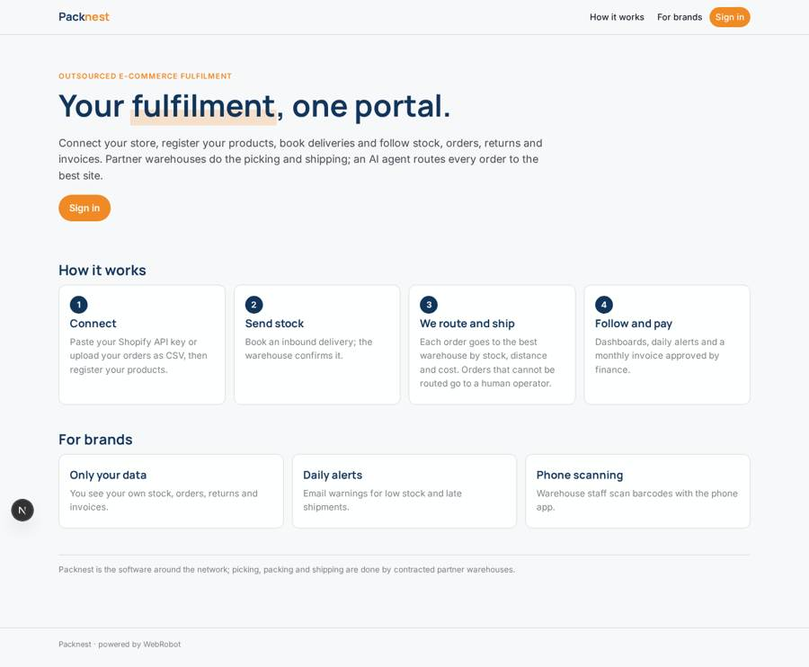
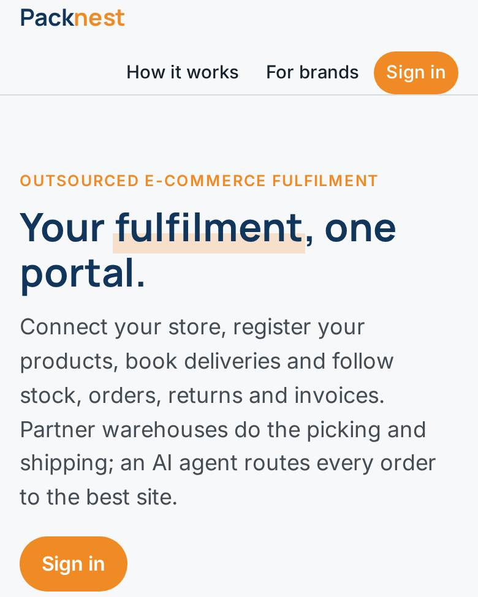
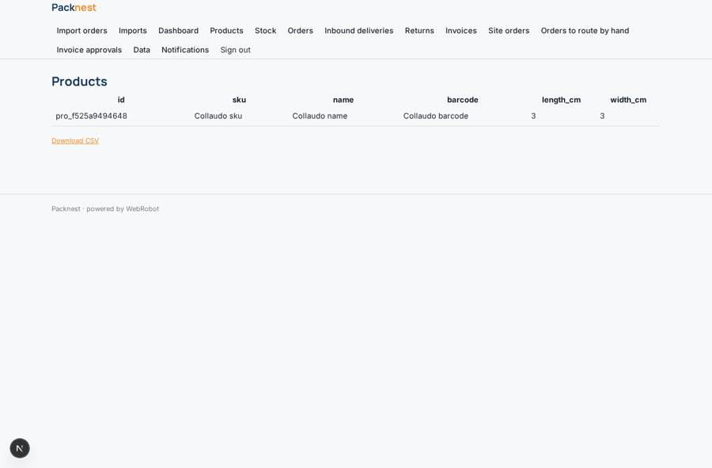
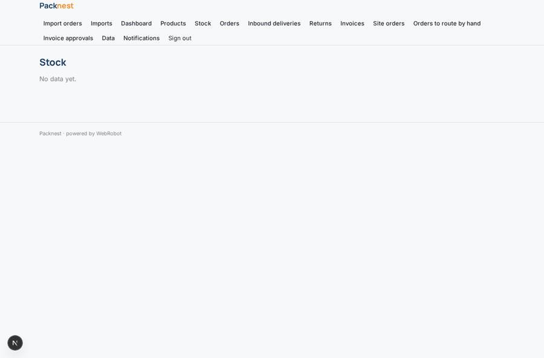
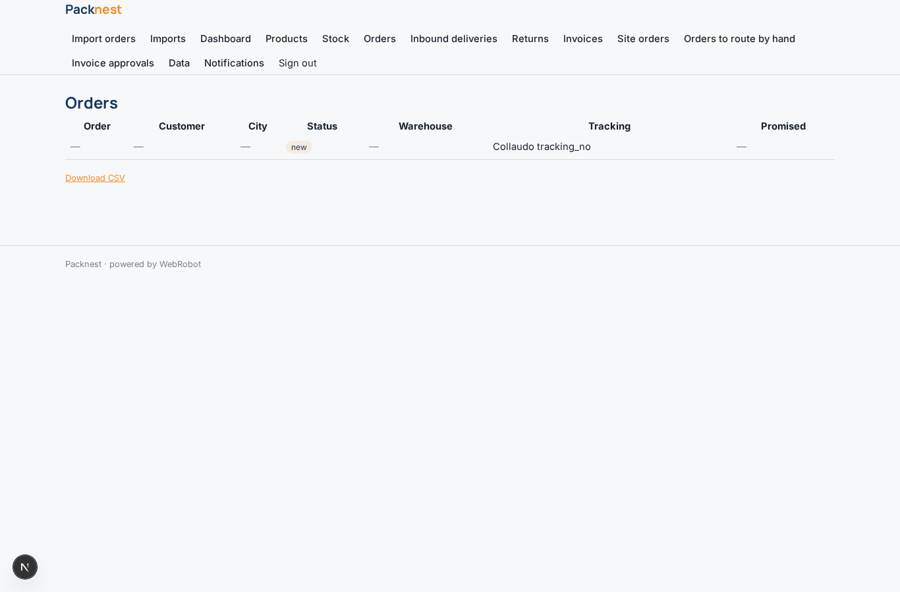
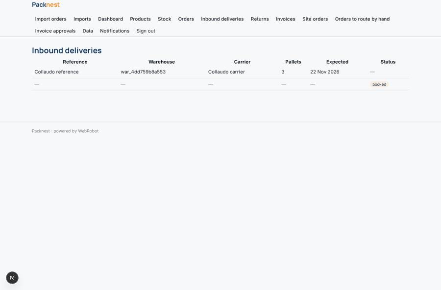

# Packnest

_The client portal for outsourced e-commerce fulfilment._

**Sector:** Consumer, travel, retail · **Manifest:** valid (schema + runtime contract) · **Functional test:** passed (37 checks passed)

## Description given to the app builder

We need a client portal called Packnest for our outsourced e-commerce fulfilment network. The warehouses, picking, packing and shipping are outside the software, run by partner warehouses we contract; I need the software around it. Online brands sign up, connect their store (Shopify OAuth) or upload orders by CSV, and register products (SKU, dimensions, weight, barcodes, storage needs). They book inbound deliveries through a form (carrier, pallets, expected date) and each warehouse confirms. An agent picks the best warehouse for each order by stock, distance and cost, and flags orders it cannot route for a human operator. Warehouse staff have their own role and see only orders for their site; they mark orders picked and shipped with tracking numbers and scan barcodes with a phone. Brands see only their own stock, orders, returns and invoices; admins see all. Scheduled monitors warn brands by email of low stock and late shipments. Monthly invoices are calculated per order, per pallet stored and per return, approved by finance, and paid by card or direct debit. Dashboards: orders shipped, on-time rate, stock days left. English.

## Functional test: what did not pass

- **saved record shown where its collection is read** (view orders): a record was saved in orders (by admin) but the page does not show it (as user) _(warning)_

## Navigation recording

Signed in as the app's admin, the recorder opened 7 menu page(s): Import orders, Imports, Dashboard, Products, Stock, Orders, Inbound deliveries.
- data page empty: stock (table)

Empty data pages are mostly expected on the local runtime: agents are mocked there, so the collections they fill stay empty.

## Features not expressible today (spec.extensions)

- **shopify_oauth**: Shopify OAuth sign-in is not available yet: brands paste a Shopify Admin API access token on the Account page instead (or upload CSV).
- **invoice_payment**: Paying each monthly invoice by card or direct debit is not available as a per-invoice payment yet; invoices are calculated and approved here, and the credits packs only cover agent usage. Payment links or SEPA mandates need a later step.
- **warehouse_systems**: Picking, packing and shipping happen in the partner warehouses; staff report progress in this portal. No direct integration with warehouse systems or carriers' label APIs.

## Screenshots (interpretive runtime, test data)

### home-anon

### home-mobile

### products

### stock

### orders

### inbound

