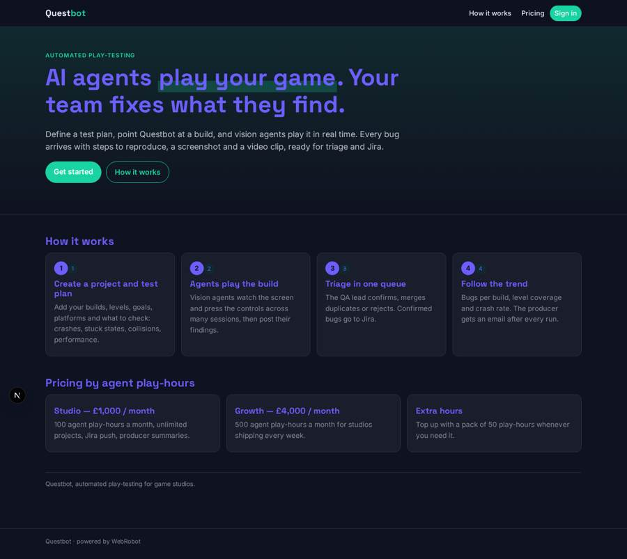
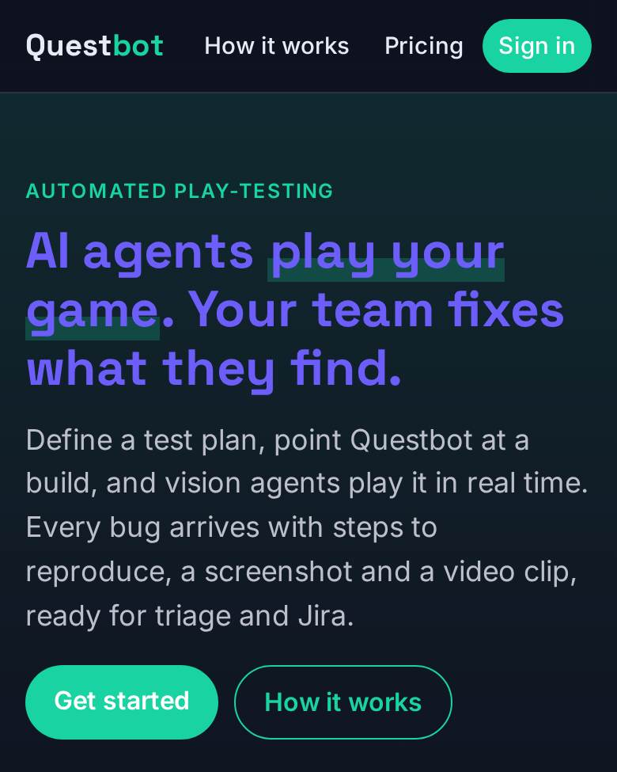
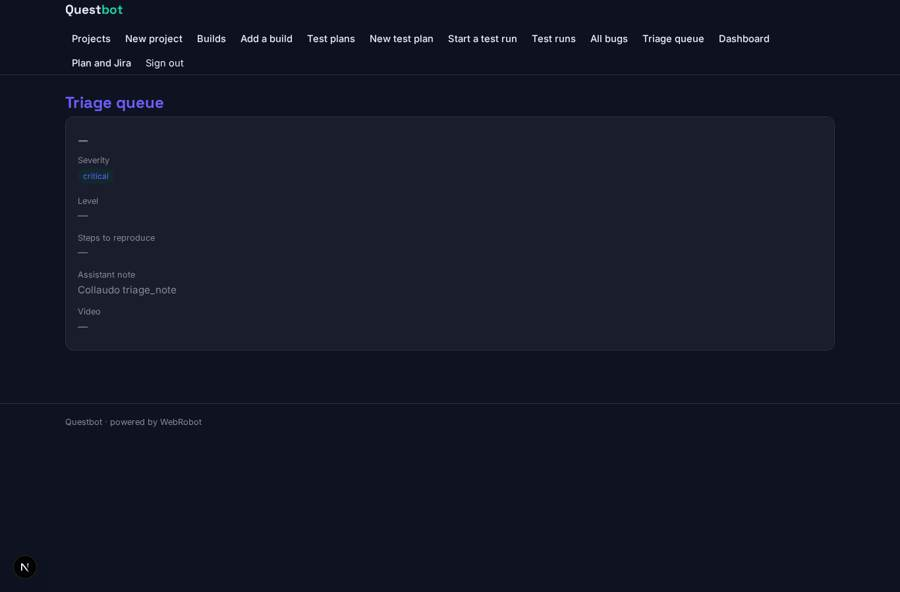
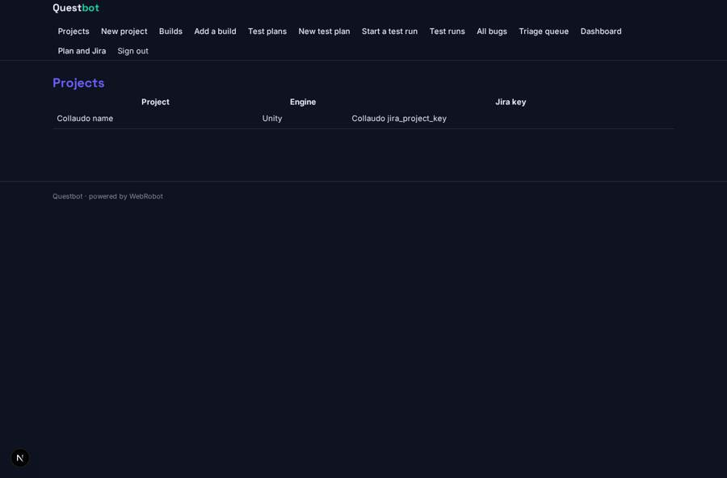
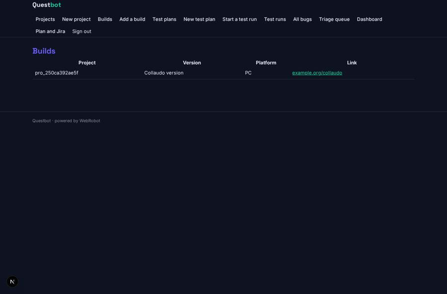
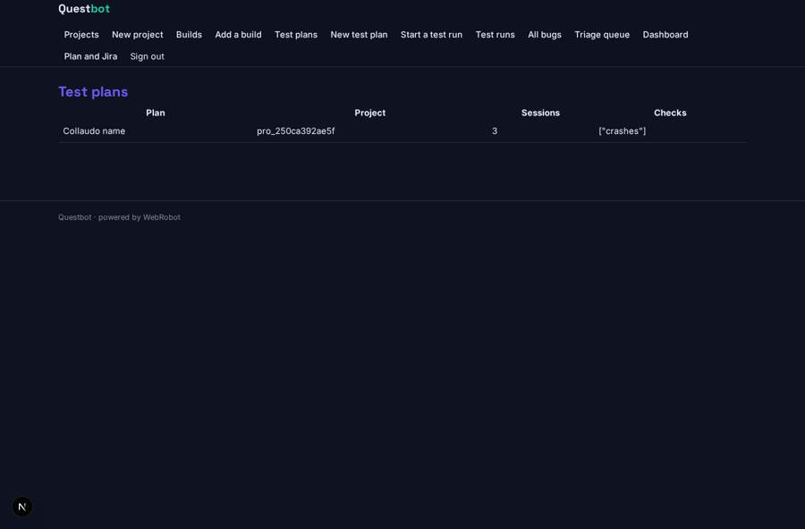

# Questbot

_AI agents play your game builds. You triage the bugs._

**Sector:** Data, media, cyber, devtools · **Manifest:** valid (schema + runtime contract) · **Functional test:** passed (22 checks passed)

## Description given to the app builder

I want an app called Questbot for automated play-testing of video games with AI agents. The core of the real product is vision agents that play game builds in real time, watching the screen and pressing controls, built on proprietary ML; that agent technology and the video processing are outside a normal software app, and I need the studio dashboard and QA workflow around them. A game studio signs up and creates projects, uploads builds or connects its build pipeline, and defines test plans: levels, goals, number of play sessions, platforms and things to check, such as crashes, stuck states, broken collisions or performance drops. Agents play the build and report bugs with a title, steps to reproduce, severity, screenshot and video clip. Each bug enters a triage queue where a QA lead confirms, merges duplicates or rejects it; confirmed bugs can be pushed to Jira. Dashboards show bugs per build, coverage of levels, crash rates and trends. An email summary goes to the producer after each test run. Roles: studio admin, QA lead, developer, producer. Pricing: by agent play-hours, from £1,000 a month. English only.

## Navigation recording

Signed in as the app's admin, the recorder opened 7 menu page(s): Projects, New project, Builds, Add a build, Test plans, New test plan, Start a test run.
No issue found.

Empty data pages are mostly expected on the local runtime: agents are mocked there, so the collections they fill stay empty.

## Features not expressible today (spec.extensions)

- **play_engine**: The vision agents that play the builds (screen capture, controls, video clips, proprietary ML) run outside this app. They read queued records of test_runs and post bugs and run results to the webhooks bug_ingest and run_ingest, including the studio's members list so records belong to the right team.
- **play_hours_metering**: Play-hours are consumed from the plan's credit allowance by the engine's reports; automatic deduction per run from the posted play_hours is not expressed in the manifest yet.
- **build_pipeline**: Connecting a CI/CD pipeline (GitHub Actions, Jenkins) and large build uploads are not available yet: builds are registered as links.
- **studio_isolation**: Team access is by the members emails on each record; invited roles (QA lead, developer, producer) only see records of teams that list their email.

## Screenshots (interpretive runtime, test data)

### home-anon

### home-mobile

### triage_queue

### projects

### builds_list

### plans

