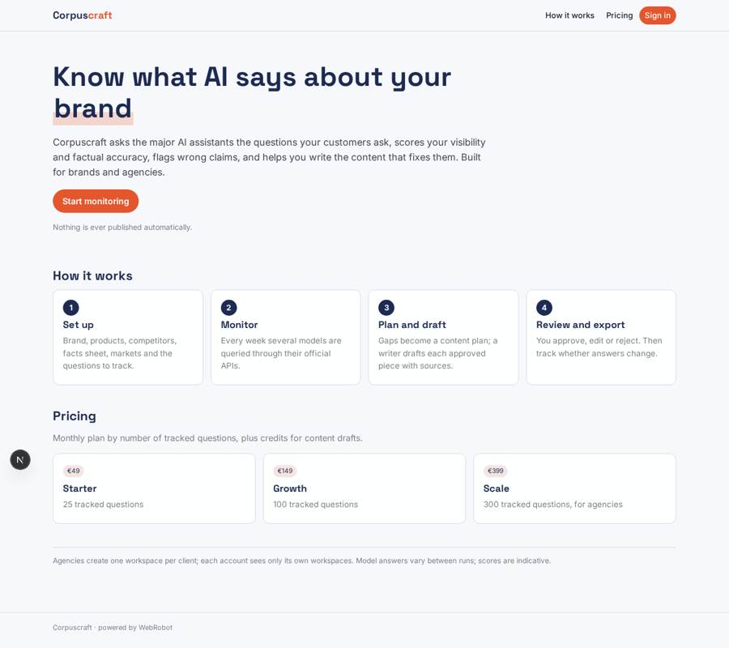
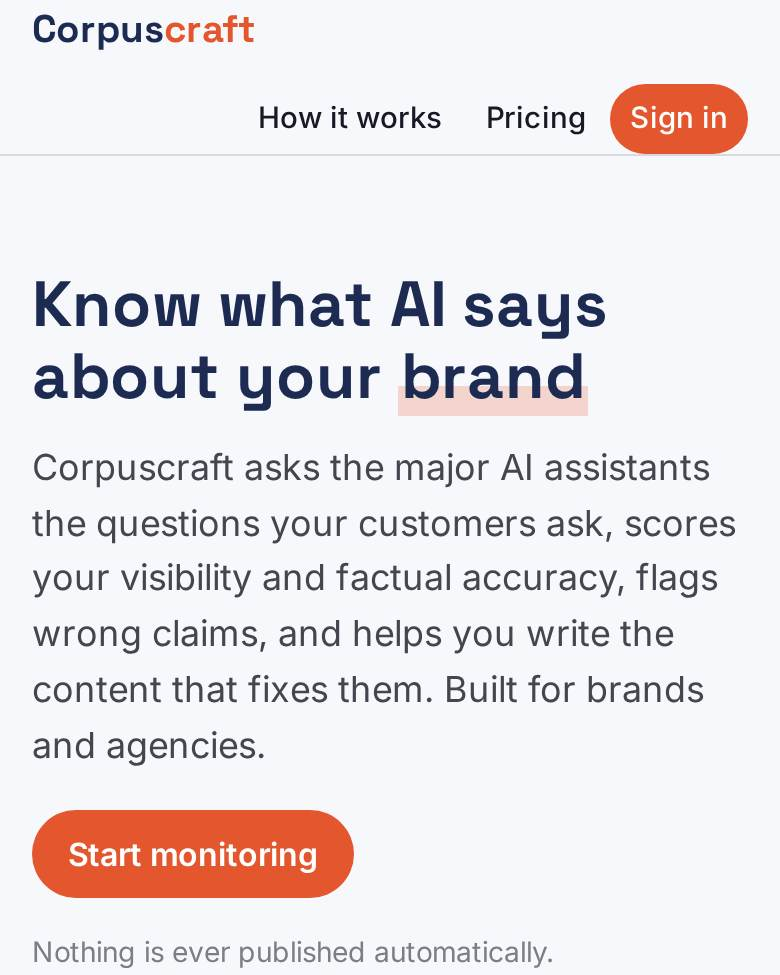
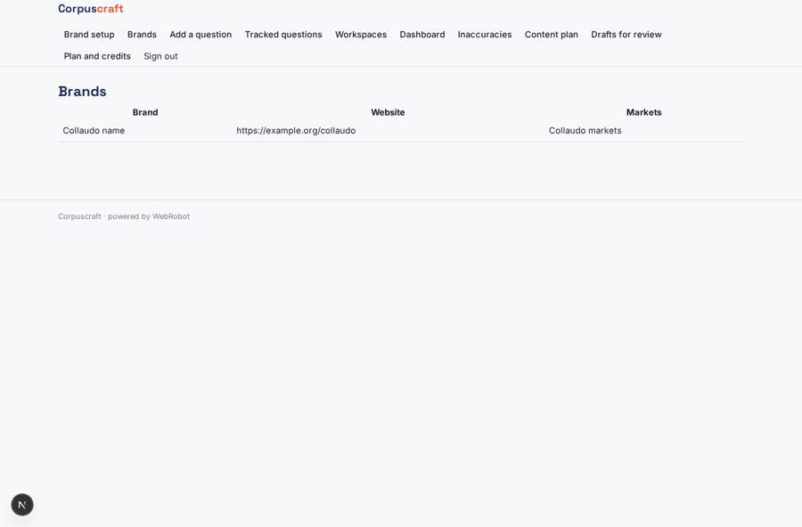
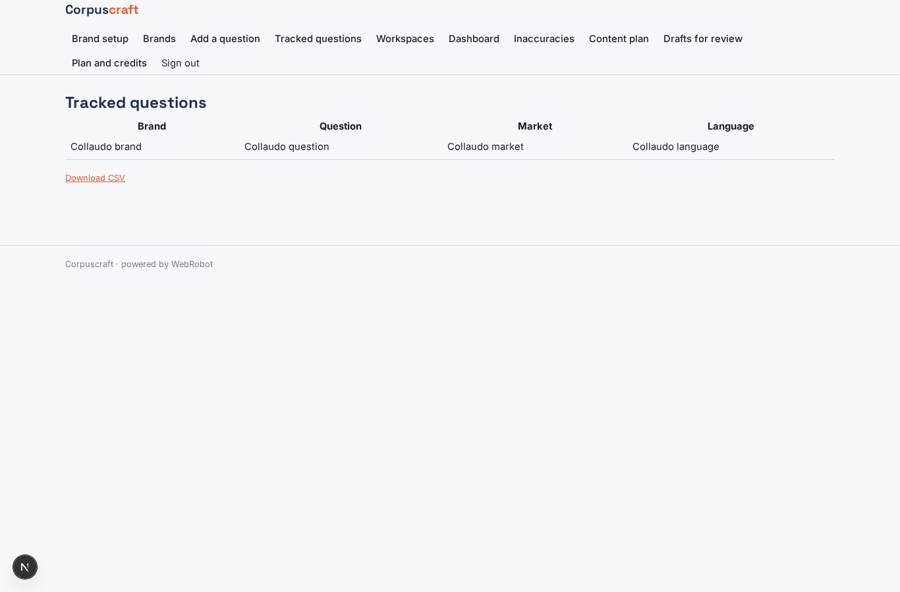
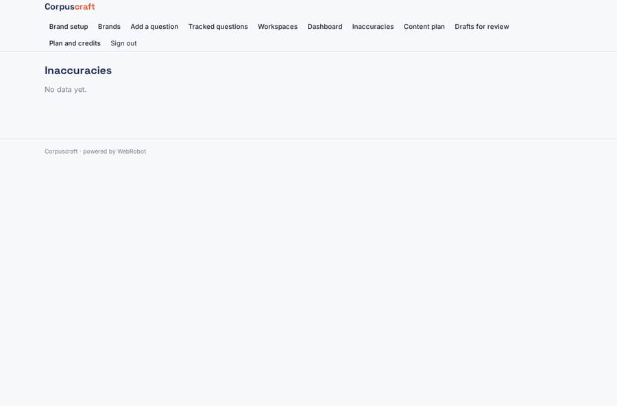
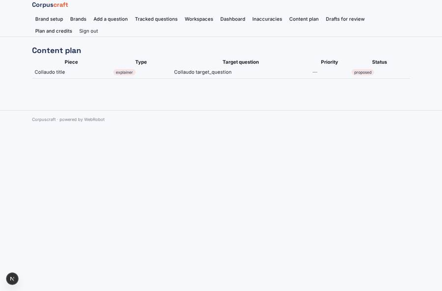

# Corpuscraft

_See how AI assistants talk about your brand, and fix what they get wrong._

**Sector:** B2B AI and SaaS · **Manifest:** valid (schema + runtime contract) · **Functional test:** passed (21 checks passed)

## Description given to the app builder

I want Corpuscraft, a platform that monitors a brand's visibility in AI assistant answers and helps produce content that improves it. Brands and agencies sign up; agencies manage several clients, and clients see only their own workspace. Setup collects brand, products, competitors, target questions and markets. A scheduled agent queries several language models through their official APIs, records mentions, positioning, accuracy of facts about the brand and cited sources, and flags wrong or outdated claims. A gap agent compares what models say with the brand's own facts sheet and with public pages where the site terms allow it, then proposes a content plan: new explainer pages, FAQ entries, product data pages, comparison articles and press material. A writer agent drafts each piece with sources, and an editor approves, edits or rejects before export; nothing is published automatically. After publication the monitor tracks whether answers change. Dashboards show visibility score per model, factual accuracy, content shipped and impact over time. Weekly email digests and alerts on new inaccuracies. Pricing: monthly subscription by number of tracked questions plus credits for content drafts, via Stripe. English.

## Navigation recording

Signed in as the app's admin, the recorder opened 7 menu page(s): Brand setup, Brands, Add a question, Tracked questions, Workspaces, Dashboard, Inaccuracies.
- data page empty: claims (table)

Empty data pages are mostly expected on the local runtime: agents are mocked there, so the collections they fill stay empty.

## Features not expressible today (spec.extensions)

- **agency_client_sharing**: Agencies run one workspace per client under their own account. Giving a client read access to a workspace owned by the agency is not expressed yet; clients who sign up see only their own workspaces.
- **editor_role**: Editing and approval happen through the status field of drafts by the workspace owner; a separate editor role with cross-account access is not modelled.

## Screenshots (interpretive runtime, test data)

### home-anon

### home-mobile

### brands

### questions

### claims

### plan

