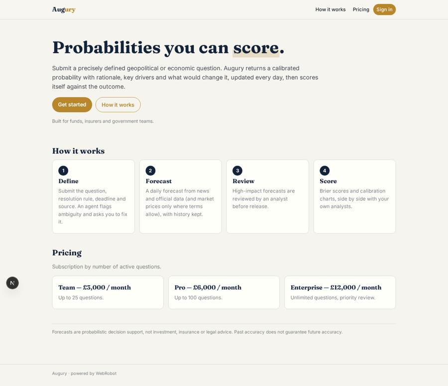
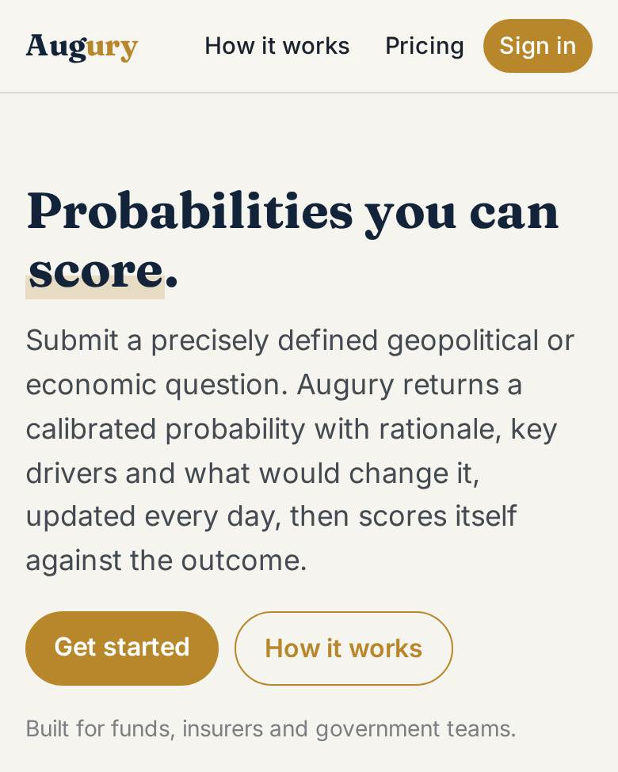
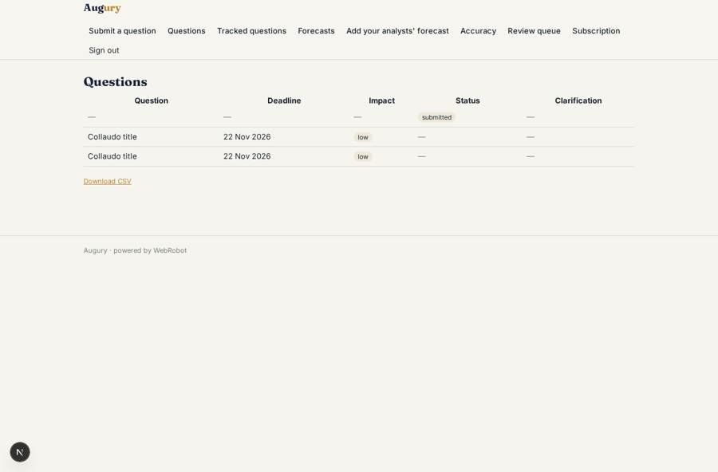
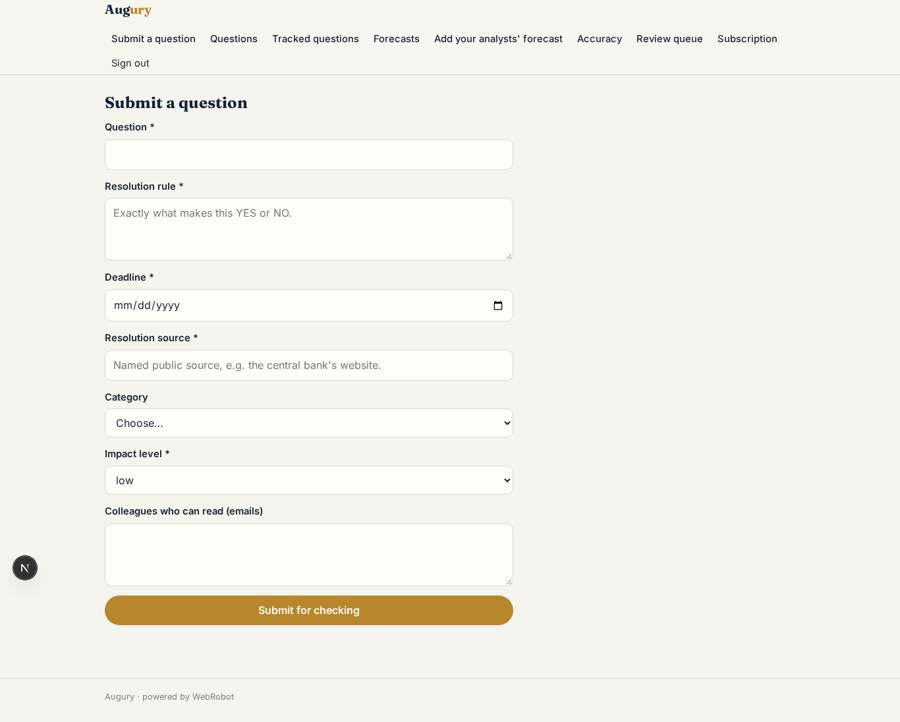
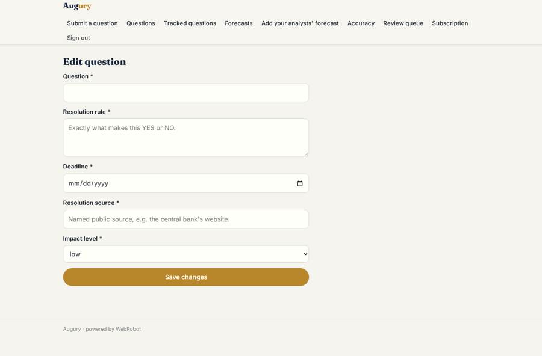
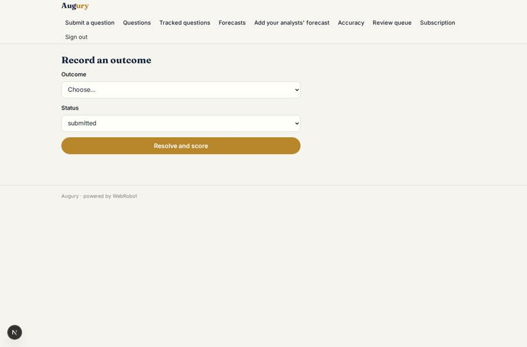

# Augury

_Calibrated probability forecasts for geopolitical and economic questions._

**Sector:** Data, media, cyber, devtools · **Manifest:** valid (schema + runtime contract) · **Functional test:** passed (20 checks passed)

## Description given to the app builder

We need an app called Augury that produces probability forecasts for geopolitical and economic questions. The real value is a proprietary ML forecasting system whose accuracy is the product; that research and model are outside a software app, and I need the platform around them. Clients such as funds, insurers and government teams sign up and submit questions with a clear resolution rule, deadline and source, for example will a given central bank cut rates before a date. An agent checks that each question is well defined and asks the client to fix ambiguity. The forecasting system then gathers news and official data where terms allow, and prediction-market prices only under their terms, and produces a probability with a rationale, key drivers and what would change the forecast. Forecasts update daily and the history is kept. When questions resolve, the app scores accuracy with Brier scores and shows calibration charts. Clients can compare our forecasts with their own analysts' forecasts. Analysts review forecasts above a set impact level before release. Email alerts fire when a probability moves by more than ten points. Roles: admin, client analyst, viewer. Pricing: subscription from £3,000 a month by number of questions. English only.

## Navigation recording

Signed in as the app's admin, the recorder opened 7 menu page(s): Submit a question, Questions, Tracked questions, Forecasts, Add your analysts' forecast, Accuracy, Review queue.
No issue found.

Empty data pages are mostly expected on the local runtime: agents are mocked there, so the collections they fill stay empty.

## Features not expressible today (spec.extensions)

- **proprietary_model**: The proprietary ML forecasting model is outside this app. Today the forecaster agent produces the probability from evidence it gathers; connecting the real model needs an HTTPS API the app can call as an http tool (add its host to egress), or a webhook that writes forecasts.
- **reviewer_role**: Release reviews are decided by admins (Augury's own analysts). A separate reviewer role or per-client reviewers is not modelled; plan prices are indicative and the £3,000 floor should be confirmed.

## Screenshots (interpretive runtime, test data)

### home-anon

### home-mobile

### questions

### ask

### fix_question

### resolve

