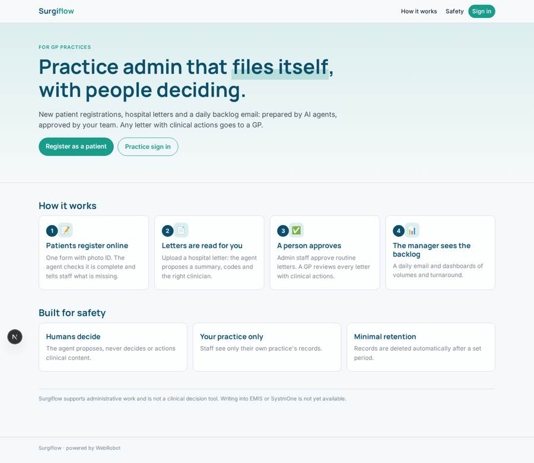
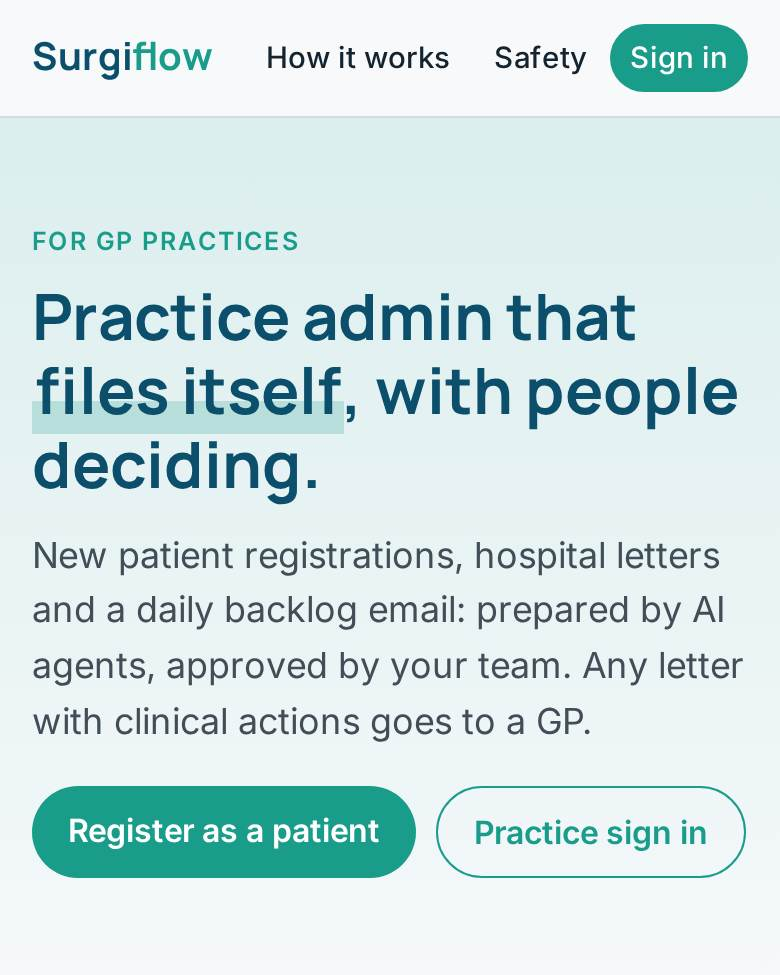
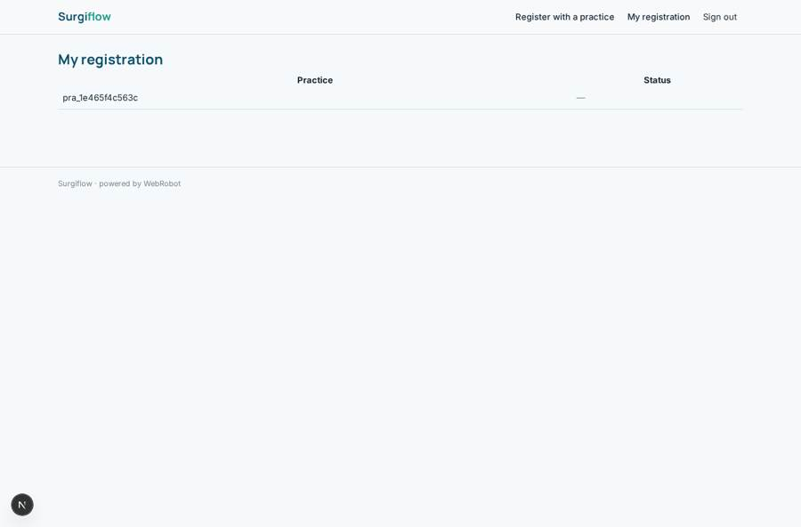
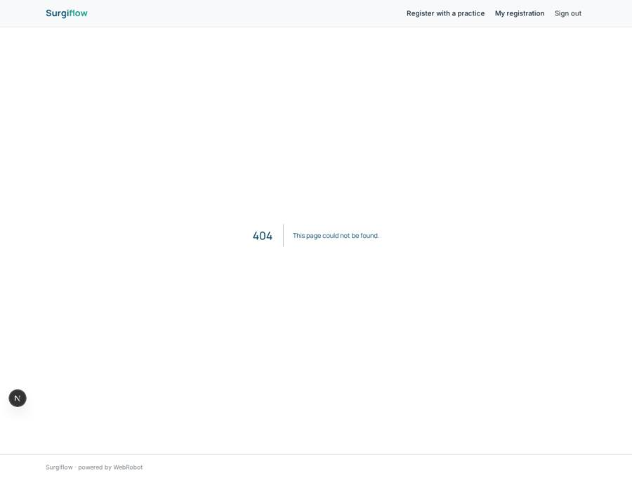

# Surgiflow

_Practice admin that files itself, with people deciding._

**Sector:** Sanità, istruzione, energia, gov · **Manifest:** valid (schema + runtime contract) · **Functional test:** passed (20 checks passed)

## Description given to the app builder

I want Surgiflow, automation for GP practice admin: new patient registrations, clinical document workflow (coding and filing hospital letters), repeat-request routing and recall lists. Patients fill a registration form (name, date of birth, address, previous practice, NHS number if known, medications, allergies, carers) and upload ID; an agent checks completeness, matches against the practice's records and prepares the registration, but the product only works if it writes into EMIS or SystmOne, which needs a supplier partnership, DSPT and DTAC. Those are ours to obtain; I need the software around them. Incoming letters are uploaded, text-extracted and an agent proposes the summary, codes and the clinician who should see it; a practice administrator approves, and any letter with clinical actions goes to a GP, never decided by the agent. Roles: practice manager, admin staff, GP; staff see only their practice. Daily email of backlog and exceptions to the practice manager. Dashboards show volumes processed and turnaround. Pricing per practice list size, about £1 per registered patient per year. English only.

## Functional test: what did not pass

- **form saves a record** (form letter_upload): only role manager may fill it, and the test cannot hold that role _(warning)_
- **template instance created and run** (template practice_digest): reserved to manager _(warning)_

## Navigation recording

Signed in as the app's admin, the recorder opened 0 menu page(s): .
- menu missing after sign-in: no menu after signing in

Empty data pages are mostly expected on the local runtime: agents are mocked there, so the collections they fill stay empty.

## Design checks (linter)

- role admin: the admins see no page in the menu (every menu page names other roles) — add admin to the roles of the pages they run, such as the queues, dashboards and approvals

## Features not expressible today (spec.extensions)

- **clinical_system_write_back**: Writing registrations, codes and filed letters into EMIS or SystmOne, and matching registrations against the practice's existing records (PDS / clinical system), needs supplier partnership; until then the agent prepares data for manual entry.
- **compliance**: DSPT and DTAC compliance are the owner's to obtain; not expressible in the manifest.
- **per_practice_isolation**: Approvals are decided by role, not by practice: if several practices share one app, the approval queue is not filtered per practice. Run one app per practice group or add per-practice approval roles.
- **exact_list_pricing**: Pricing of about £1 per registered patient per year is approximated by yearly plans by list size; exact per-list billing needs a custom invoice.

## Screenshots (interpretive runtime, test data)

### home-anon

### home-mobile

### dashboard

### my_registrations

### registration_queue

### letters

