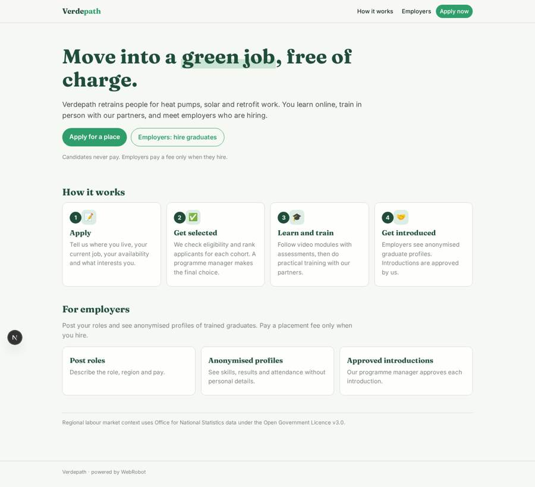
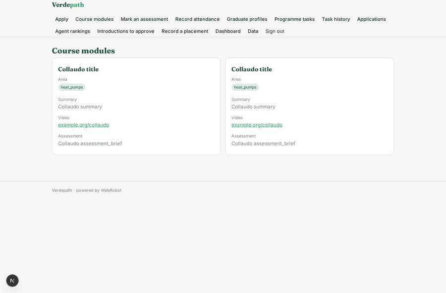
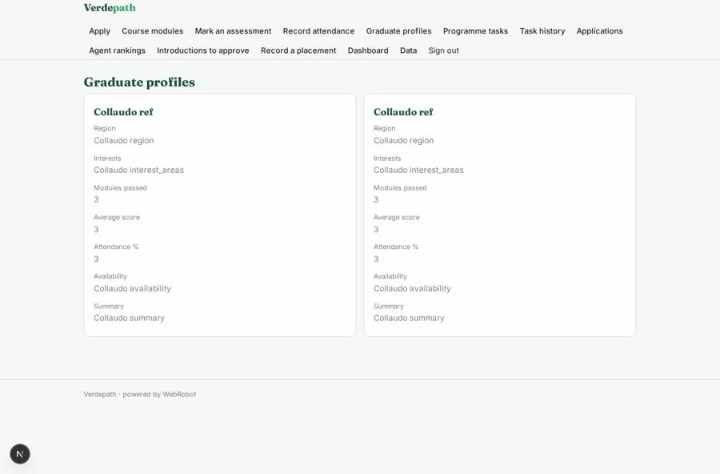
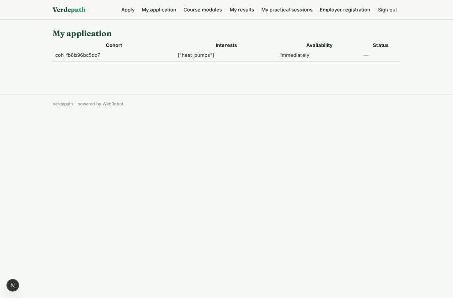
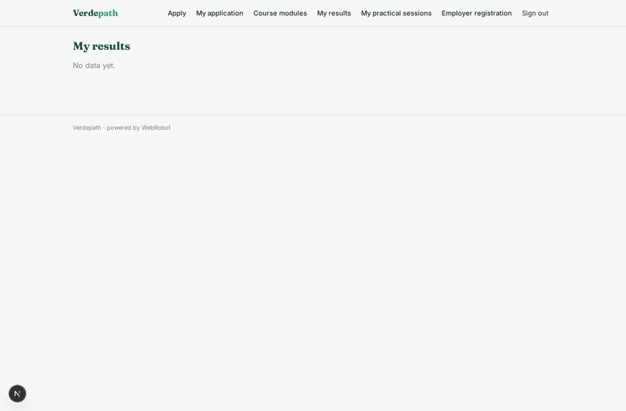

# Verdepath

_From where you are to a green career._

**Sector:** Sanità, istruzione, energia, gov · **Manifest:** valid (schema + runtime contract) · **Functional test:** passed (52 checks passed)

## Description given to the app builder

I want Verdepath, a reskilling programme platform moving people into green jobs, with employer placement. Candidates apply through a form: location, current job, education, availability, interest areas such as heat pumps, solar or retrofit, and a short motivation; an agent checks eligibility and ranks applicants for each cohort, and a programme manager makes the final selection. Selected candidates follow a course catalogue of modules with video content and assessments, plus in-person practical training run by our partners, which is outside the software. Employers sign up in a portal, post roles and see anonymised profiles of graduates; an agent matches candidates to roles and the programme manager approves introductions. Candidates get email updates at each stage. Dashboards show cohort progress, placement rate and wages using ONS labour market data for regional context. Roles: candidate, employer, trainer, programme manager. Employers pay a placement fee; candidates pay nothing. Trainers mark module assessments and record attendance at practical sessions through a simple form. English only.

## Functional test: what did not pass

- **form saves a record** (form post_role): only role employer may fill it, and the test cannot hold that role _(warning)_
- **saved record shown where its collection is read** (view my_results): a record was saved in assessment_results (by admin-data, admin-data, admin) but the page does not show it (as candidate) _(warning)_
- **saved record shown where its collection is read** (view my_attendance): a record was saved in attendance (by admin-data, admin-data, admin) but the page does not show it (as candidate) _(warning)_
- **page opened by a role allowed to** (view trainer_candidates): only role trainer may open it, the test cannot hold it _(warning)_
- **saved record shown where its collection is read** (view my_roles): a record was saved in job_roles (by admin-data, admin-data) but the page does not show it (as employer) _(warning)_
- **saved record shown where its collection is read** (view my_introductions): a record was saved in introductions (by admin-data, admin-data, admin) but the page does not show it (as employer) _(warning)_
- **saved record shown where its collection is read** (view my_placements): a record was saved in placements (by admin-data, admin-data, admin) but the page does not show it (as employer) _(warning)_

## Navigation recording

Signed in as the app's admin, the recorder opened 7 menu page(s): Apply, Course modules, Mark an assessment, Record attendance, Graduate profiles, Programme tasks, Task history.
No issue found.

Empty data pages are mostly expected on the local runtime: agents are mocked there, so the collections they fill stay empty.

## Features not expressible today (spec.extensions)

- **employer_vetting**: The employer role is held by anyone who registers a company profile with their own email. The programme manager should check new employers on the data page before approving introductions; there is no automatic vetting yet.
- **placement_fee_debit**: Employers buy placement-fee credit packs. The debit on each hire is made by the programme manager (credit adjustment) when a placement is recorded; an automatic charge to the employer is not designed yet.
- **learner_gating**: The course catalogue is visible to every signed-in candidate, not only selected ones, because a role cannot be derived from a selection status. The videos should be hosted privately by the programme.
- **practical_training**: In-person practical training is run by partners outside the software. Only trainers' attendance records are kept here.

## Screenshots (interpretive runtime, test data)

### home-anon

### home-mobile

### modules

### graduates

### my_application

### my_results

