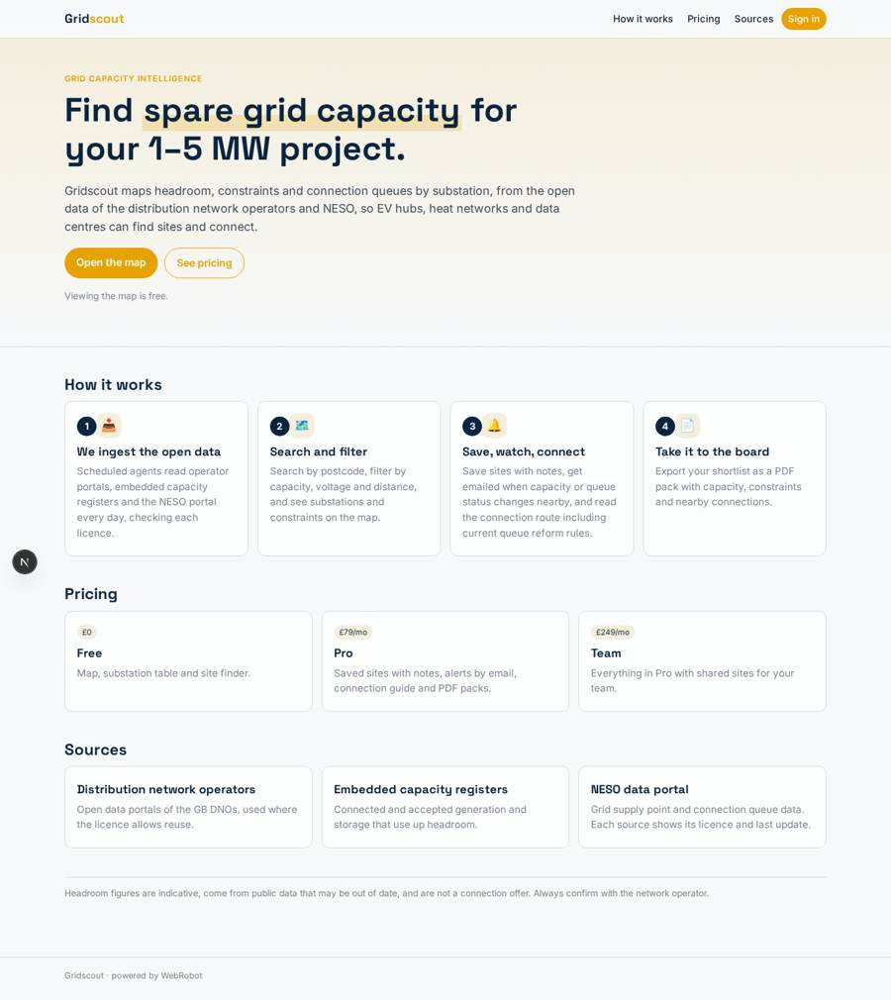
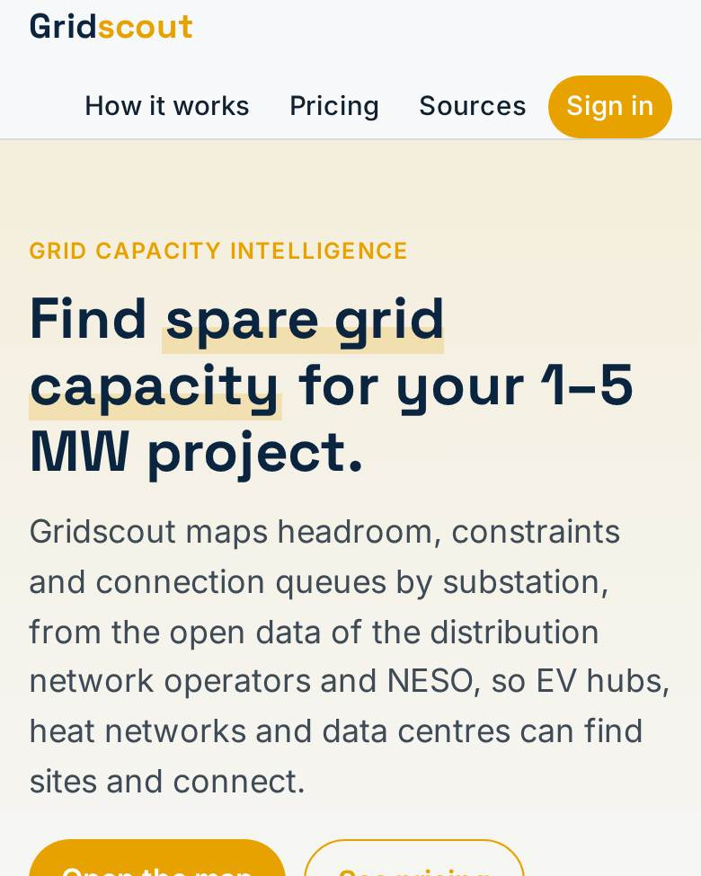
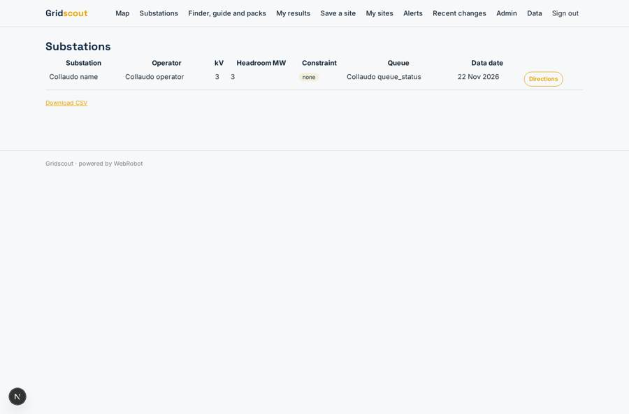
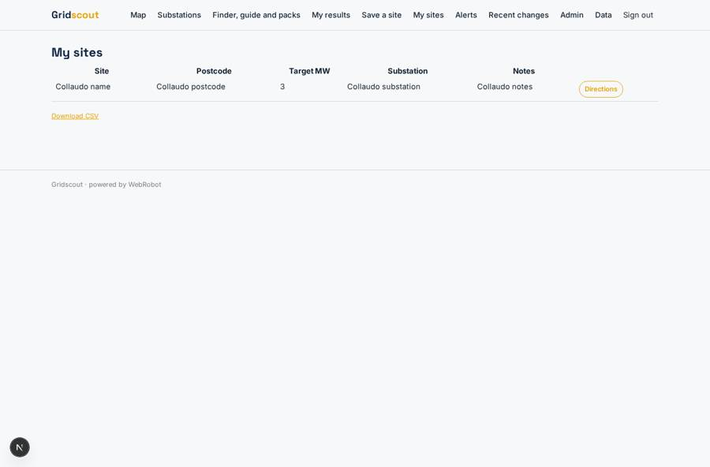
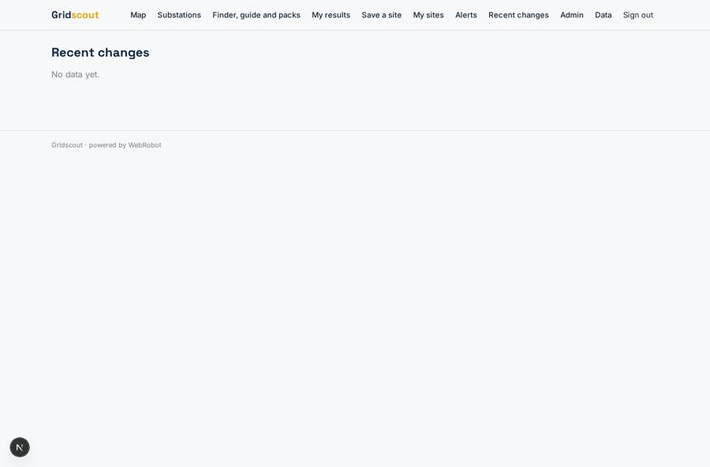
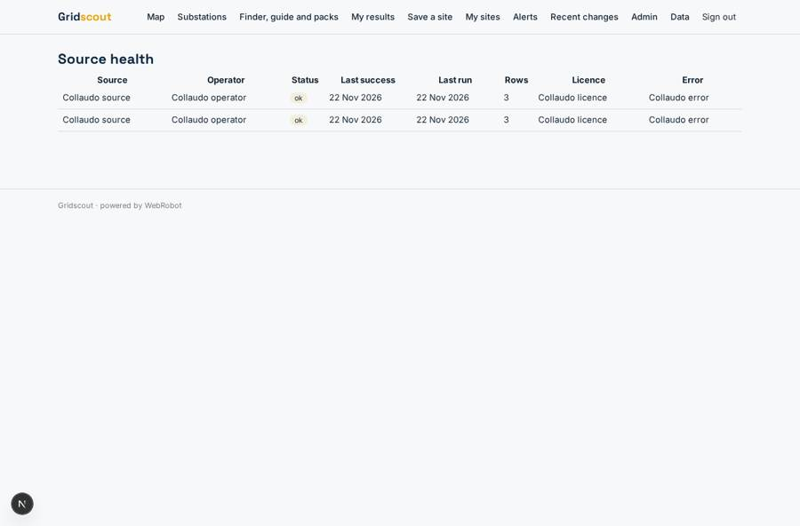

# Gridscout

_Find spare grid capacity for 1–5 MW projects, and connect._

**Sector:** Sanità, istruzione, energia, gov · **Manifest:** valid (schema + runtime contract) · **Functional test:** passed (22 checks passed)

## Description given to the app builder

We need Gridscout, a map of spare electricity grid capacity to help developers of 1 to 5 MW demand projects, such as EV hubs, heat networks and data centres, find sites and connect. Scheduled agents ingest the distribution network operators' open data portals, the embedded capacity registers and the NESO data portal (checking each licence), and update headroom by substation. Users sign up, draw an area or search by postcode, filter by capacity, voltage and distance, and see substations and constraints on a map. They save sites, add notes, and set alerts emailed when capacity or connection queue status changes near a saved site. An agent explains the connection process for a chosen site, including current queue reform rules. Pricing: free view; £79 a month for saved sites and alerts, through Stripe; team plans. Because each operator's portal is different and the data formats change, an admin view shows when each source last updated and flags failed ingestions. Users can export a site shortlist as a PDF pack with capacity, constraints and nearby connections for their board. English only.

## Navigation recording

Signed in as the app's admin, the recorder opened 7 menu page(s): Map, Substations, Finder, guide and packs, My results, Save a site, My sites, Alerts.
No issue found.

Empty data pages are mostly expected on the local runtime: agents are mocked there, so the collections they fill stay empty.

## Features not expressible today (spec.extensions)

- **draw_area_filters**: Drawing an area on the map and live interactive filters (capacity, voltage, distance) on the map itself are not available yet. The site finder (postcode, radius, minimum MW, voltage) and the substations table cover the search for now.
- **plan_gating**: Alerts and saved sites are meant for paid plans only: saved sites are limited by plan (1 free, 200 Pro, unlimited Team); gating alert instances and making the Team plan also pass the Pro requirement for the guide and packs must be checked by the owner. Seat management for teams is done by listing members' emails on each site.
- **pdf_pack**: The PDF pack is the printable report page (browser Save as PDF).

## Screenshots (interpretive runtime, test data)

### home-anon

### home-mobile

### substations

### my_sites

### alerts_feed

### ingestion

