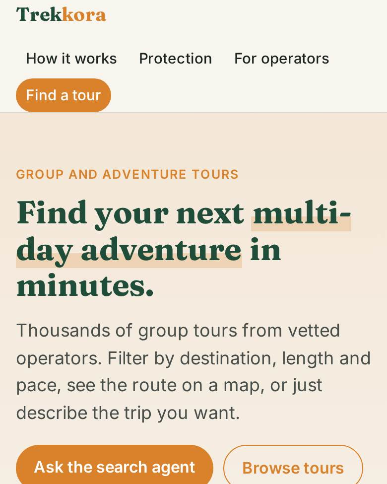
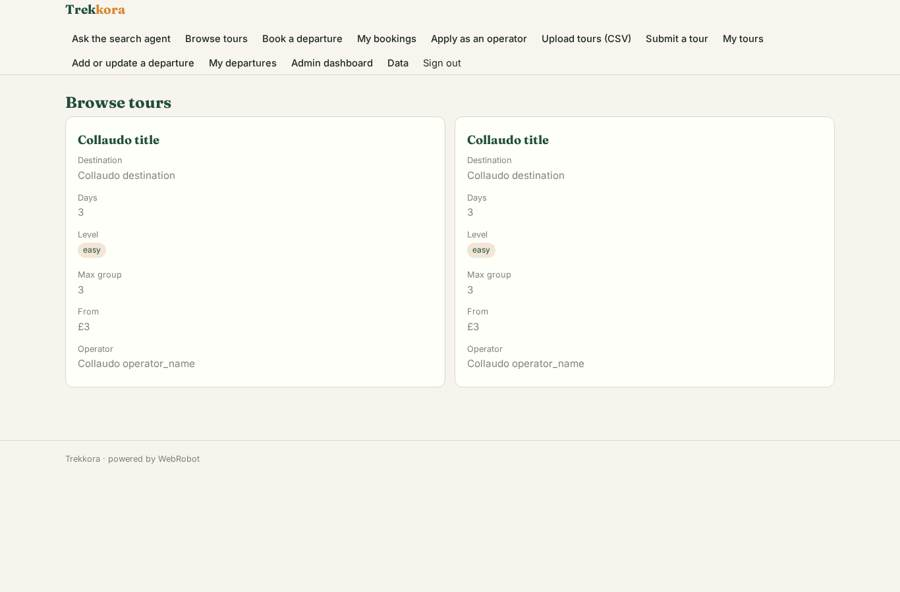
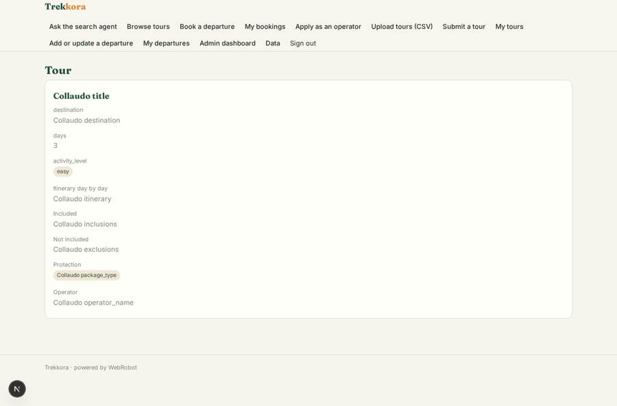
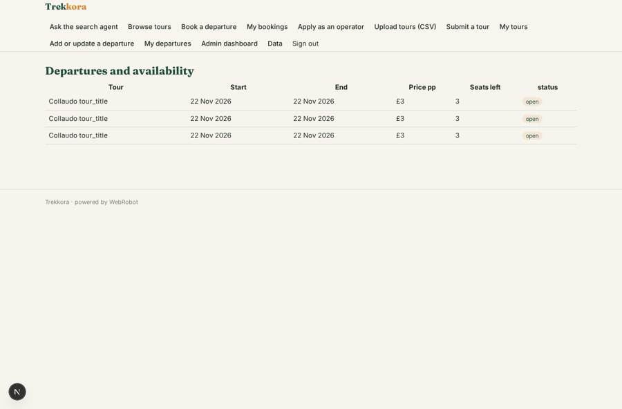
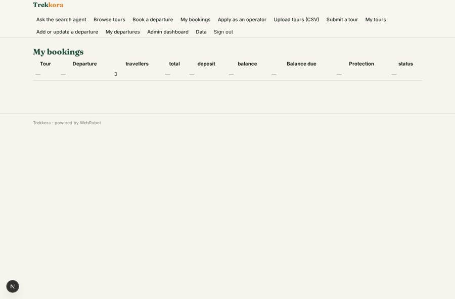

# Trekkora

_Multi-day group and adventure tours from trusted operators._

**Sector:** Consumer, travel, retail · **Manifest:** valid (schema + runtime contract) · **Functional test:** 1 failure(s) (30 checks passed)

## Description given to the app builder

We need a marketplace called Trekkora for multi-day group and adventure tours, with around 15,000 tours from 750 operators. Travellers search with filters (destination, length, activity level, group size, start date, price) and a map of the route, or ask an AI search agent in plain English ("a gentle 7-day walking tour in Portugal in May") which returns matching tours with reasons. Each tour page shows itinerary day by day, inclusions, departures and availability. Operators have their own role: they manage only their own tours, departures and bookings, and can upload tours by CSV. Live availability should come from operator inventory APIs under contract; where an operator has no API, they update departures by hand. Travellers pay a deposit by card and the balance 60 days before departure, with email reminders; we pay each operator their share after departure, so I need payouts to many operators. Where we package travel ourselves we fall under the Package Travel Regulations and ATOL, so the app must show those protections and record which bookings are covered. Admins approve new operators and new tours before they are published. Dashboards for admins: bookings, deposits, commission, top destinations; for operators: their bookings and payouts. Commission per booking. English.

## Functional test: what did not pass

- **visitor sends a form** (form op_apply): visitor: 403 not allowed
- **saved record shown where its collection is read** (view my_bookings): a record was saved in bookings (by user) but the page does not show it (as user) _(warning)_
- **saved record shown where its collection is read** (view op_tours): a record was saved in tour_submissions (by admin-data, admin-data, admin) but the page does not show it (as operator) _(warning)_

## Navigation recording

Signed in as the app's admin, the recorder opened 7 menu page(s): Ask the search agent, Browse tours, Book a departure, My bookings, Apply as an operator, Upload tours (CSV), Submit a tour.
- form not sent: op_import: no field to fill

Empty data pages are mostly expected on the local runtime: agents are mocked there, so the collections they fill stay empty.

## Features not expressible today (spec.extensions)

- **operator_inventory_api**: Live availability from operator inventory APIs under contract is not available yet: each operator has its own host and format. Until then operators update departures by hand (departure form) or in bulk. Departures carry a source field (manual or api) ready for the integration.
- **two_stage_card_payment**: Card deposit at booking and the balance 60 days before departure as two Stripe charges are not expressed by the manifest: the booking status moves from requested to deposit_paid to paid_in_full once payments are confirmed. Reminders are emails.
- **operator_payout_transfer**: Payouts are recorded per booking after departure (gross, commission, amount). The Stripe Connect transfer to each operator is made by the payments side per billing.sellers.
- **faceted_filters**: Interactive filter controls (destination, length, level, group size, start date, price) on the browse page and a route line on the map are not available; the search agent covers filtered search and the map shows route stops.
- **legal_protection**: PTR/ATOL: the app records the package type and ATOL cover per booking and shows the protection. The owner must hold its own ATOL licence and bonding, and have counsel confirm which tours count as Trekkora packages.
- **operator_csv_departures**: CSV upload covers tours; departures are entered by form or by admins on the data page.

## Screenshots (interpretive runtime, test data)

### home-anon

### home-mobile

### tours

### tour

### departures

### my_bookings

