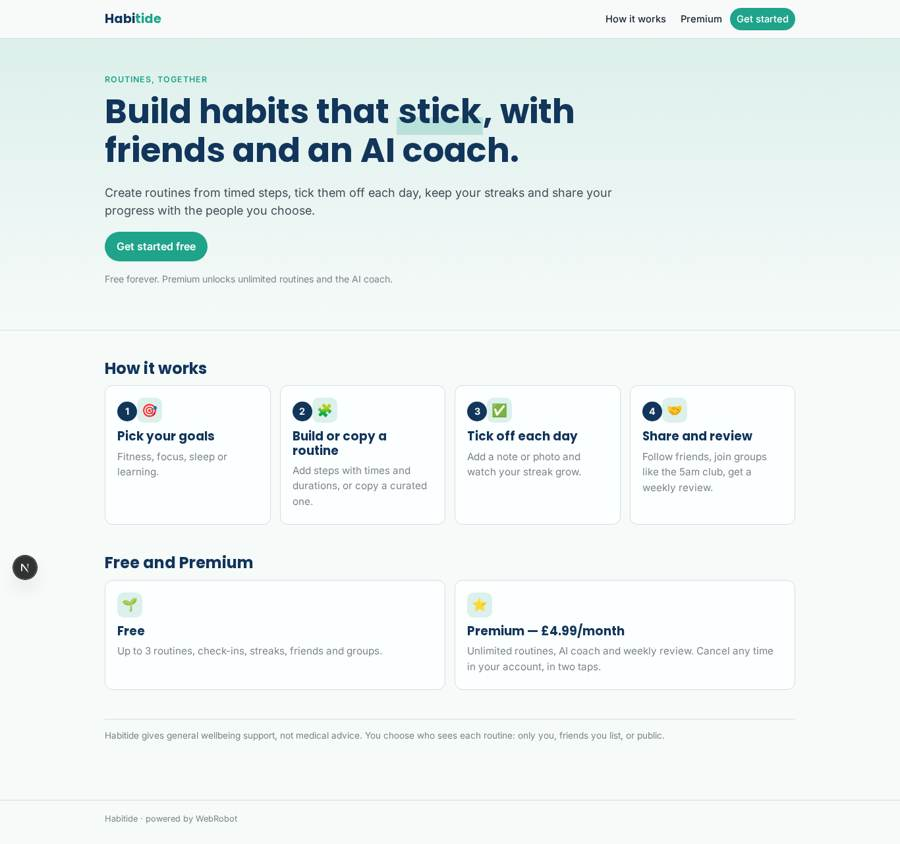
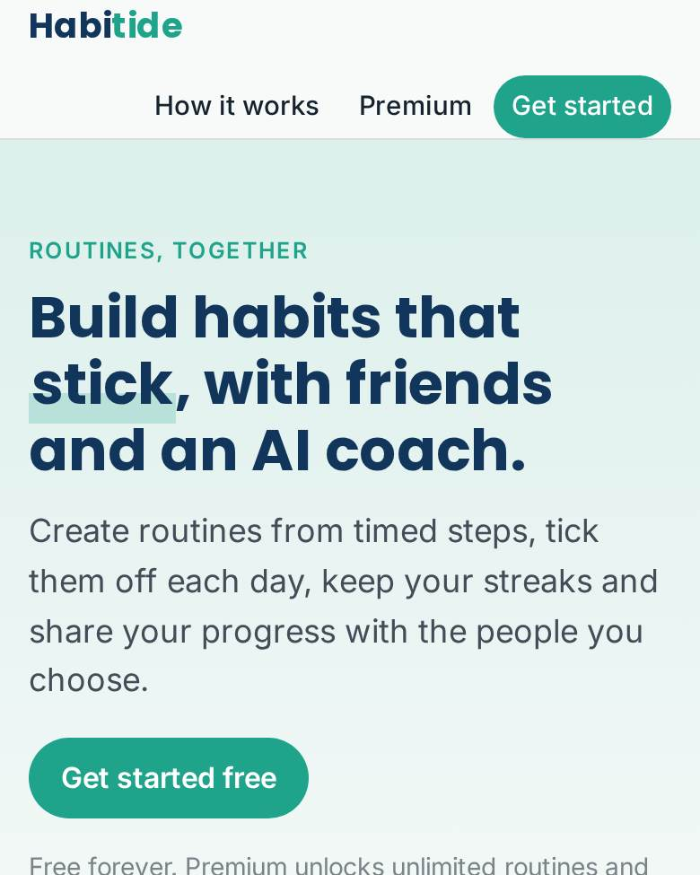
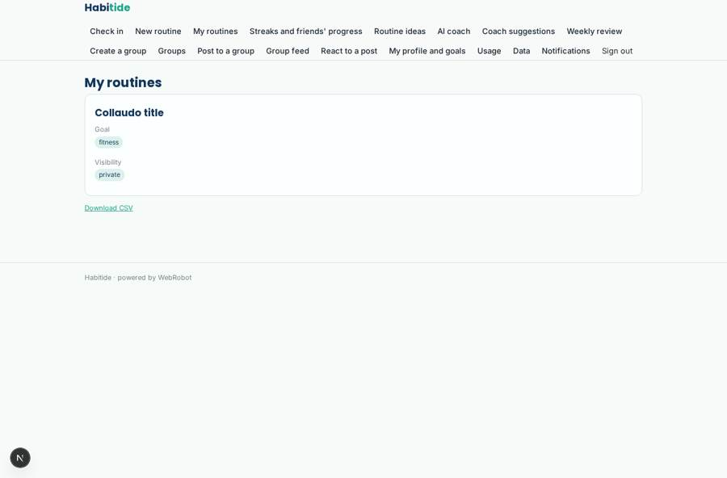
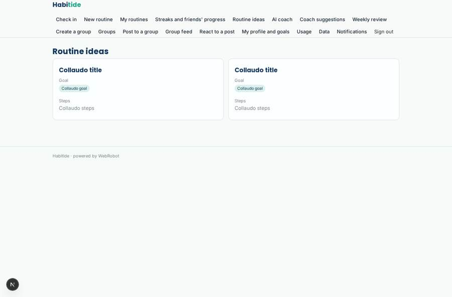
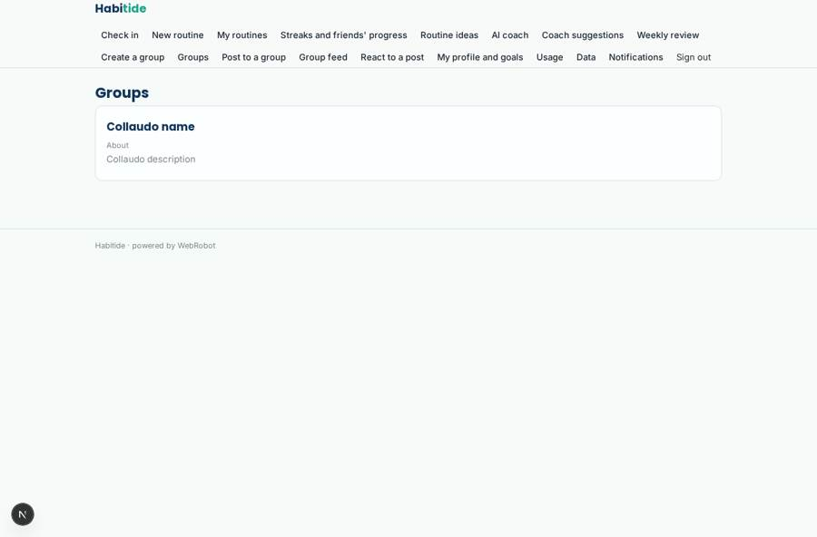
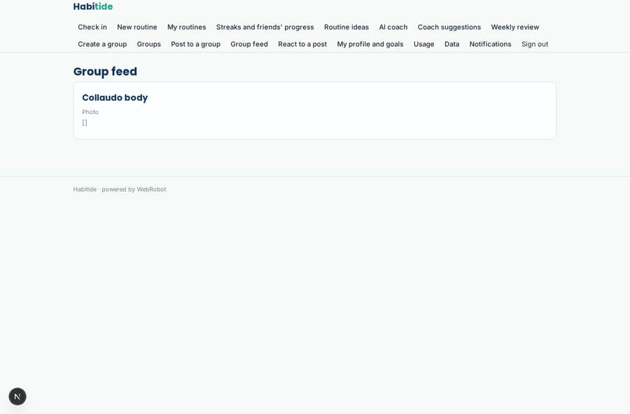

# Habitide

_Build routines, keep streaks, grow together._

**Sector:** Consumer, travel, retail · **Manifest:** valid (schema + runtime contract) · **Functional test:** passed (28 checks passed)

## Description given to the app builder

I want a phone app called Habitide, a productive social network built around routines and habits. Users sign up, choose goals (fitness, focus, sleep, learning) and build routines from steps with times and durations, or copy routines shared by others. Each day they tick off steps, add a note or photo, and keep streaks. An AI coach suggests routines for their goals, notices when they keep skipping a step and proposes changes, and writes a weekly review. Users can follow friends, join shared routine groups (for example a 5am club), see each other's progress and react; group owners can moderate. Push reminders arrive at each step's time, and a gentle nudge if a streak is at risk. Users choose whether each routine is private, friends only or public. Users see their own data and what others share; admins see aggregated usage. Free with a premium monthly subscription for unlimited routines and AI coach features, with clear renewal reminders and easy cancellation under UK subscription rules. English.

## Navigation recording

Signed in as the app's admin, the recorder opened 7 menu page(s): Check in, New routine, My routines, Streaks and friends' progress, Routine ideas, AI coach, Coach suggestions.
- data page empty: streaks_view (table)
- data page empty: suggestions_view (table)

Empty data pages are mostly expected on the local runtime: agents are mocked there, so the collections they fill stay empty.

## Features not expressible today (spec.extensions)

- **step_time_push**: Push reminders at the exact time of each step need on-device scheduled notifications (localNotifications), which are not available yet. The streak-at-risk nudge and group alerts are push; per-step time reminders are a gap.
- **public_and_friends_visibility**: Visibility 'public' (discovery by everyone) and automatic follower lists are not expressible yet. Friends-only works by listing friends' emails per routine; public discovery and a follow graph need a platform extension.
- **renewal_reminder**: A reminder email before each renewal (UK consumer subscription rules) needs the subscription renewal date, not yet exposed as a trigger. The sign-up email states the price and cancellation; the account page cancels the plan. Add a pre-renewal reminder once available.
- **group_join**: Joining a group is done by the owner adding the member's email; self-service join requests are not available yet.

## Screenshots (interpretive runtime, test data)

### home-anon

### home-mobile

### my_routines

### discover

### groups

### group_feed

