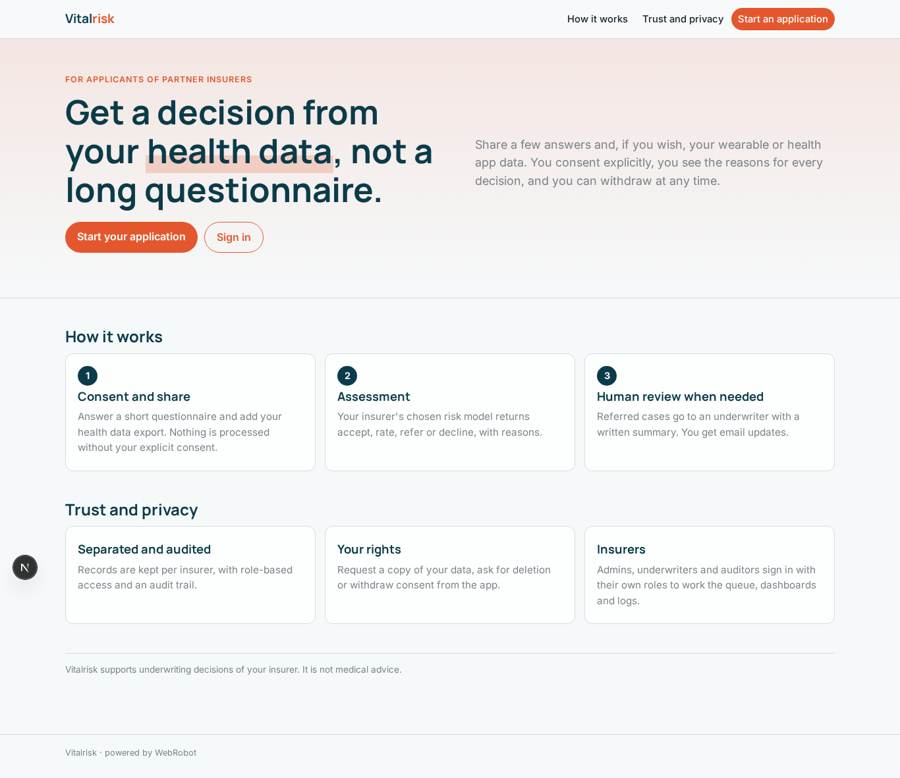
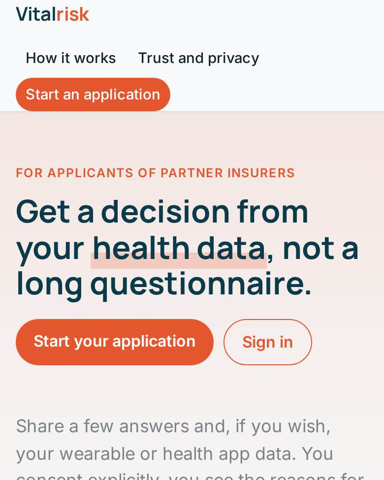
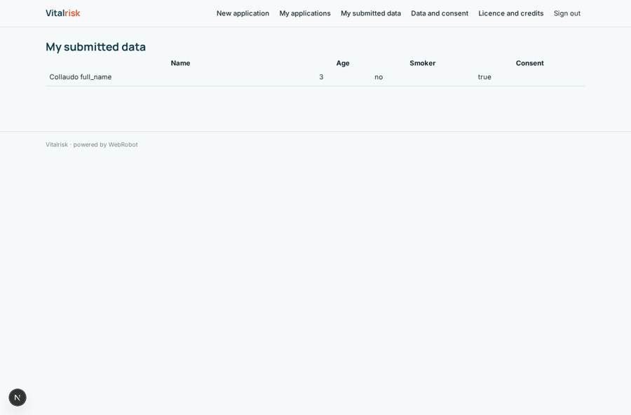
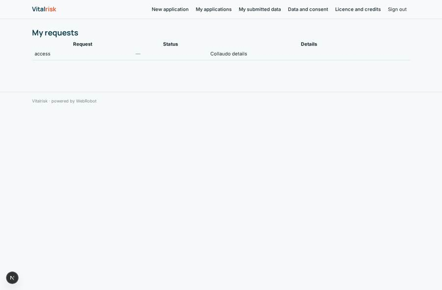
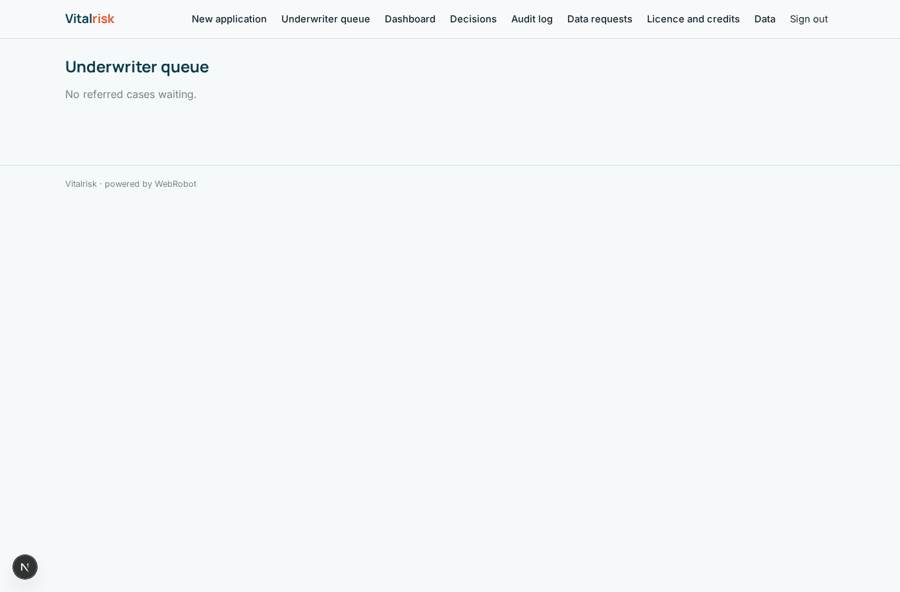
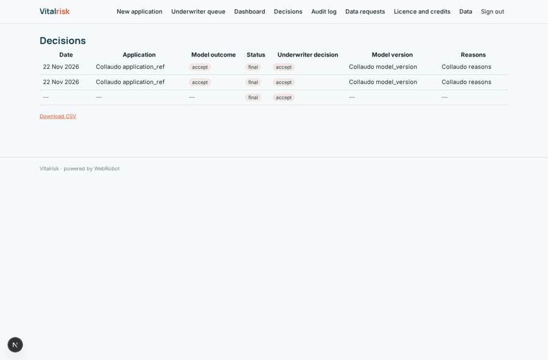

# Vitalrisk

_Underwrite on health data, not long questionnaires._

**Sector:** Fintech, proptech, insurtech · **Manifest:** valid (schema + runtime contract) · **Functional test:** passed (31 checks passed)

## Description given to the app builder

I want Vitalrisk, a platform for life and health insurers to underwrite applicants using health data instead of long medical questionnaires. The actuarial models, the proprietary machine learning and the insurer partnerships are the core of the business and outside what I am asking for here; I need the software around them. Insurers sign up as organisations; applicants arrive from the insurer's application journey, give explicit consent and share health data from wearables and phone health apps through official APIs, plus a short questionnaire: age, smoking, height, weight, medical conditions. The platform runs the insurer's chosen risk model and returns a decision (accept, rate, refer, decline) with reasons. Referred cases go to the insurer's underwriter queue with a summary written by an agent; the underwriter decides. Applicants get email updates and can request their data or withdraw consent. Dashboards for the insurer show volumes, decision mix, straight-through rate and model drift. Data is kept per insurer with strict access control and audit logs. Roles: insurer admin, underwriter, auditor, applicant. Pricing: per application assessed, with annual platform licence. English.

## Navigation recording

Signed in as the app's admin, the recorder opened 7 menu page(s): New application, Underwriter queue, Dashboard, Decisions, Audit log, Data requests, Licence and credits.
No issue found.

Empty data pages are mostly expected on the local runtime: agents are mocked there, so the collections they fill stay empty.

## Features not expressible today (spec.extensions)

- **insurer_tenancy**: Each insurer organisation is deployed as its own app instance so data, roles and audit logs stay separated per insurer; a single instance serving several insurers is not expressible in the manifest.
- **health_api_connections**: Direct connection to wearables and phone health apps through official APIs (Apple Health, Health Connect, Fitbit, Garmin) needs OAuth sign-in to other services, which is not available yet; applicants upload an export file meanwhile.
- **insurer_billed_per_application**: Per-application fees are billed as credits; charging them to the insurer's account instead of the applicant, and the actuarial and proprietary ML models behind the risk_model slot, are outside the manifest.
- **data_request_fulfilment**: Data export, erasure and consent withdrawal requests are tracked and notified; the actual deletion or export is carried out by the insurer admin from /admin/data.

## Screenshots (interpretive runtime, test data)

### home-anon

### home-mobile

### my_data

### my_requests

### queue

### all_decisions

