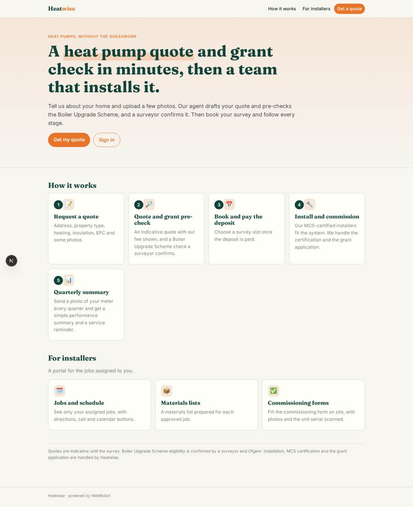
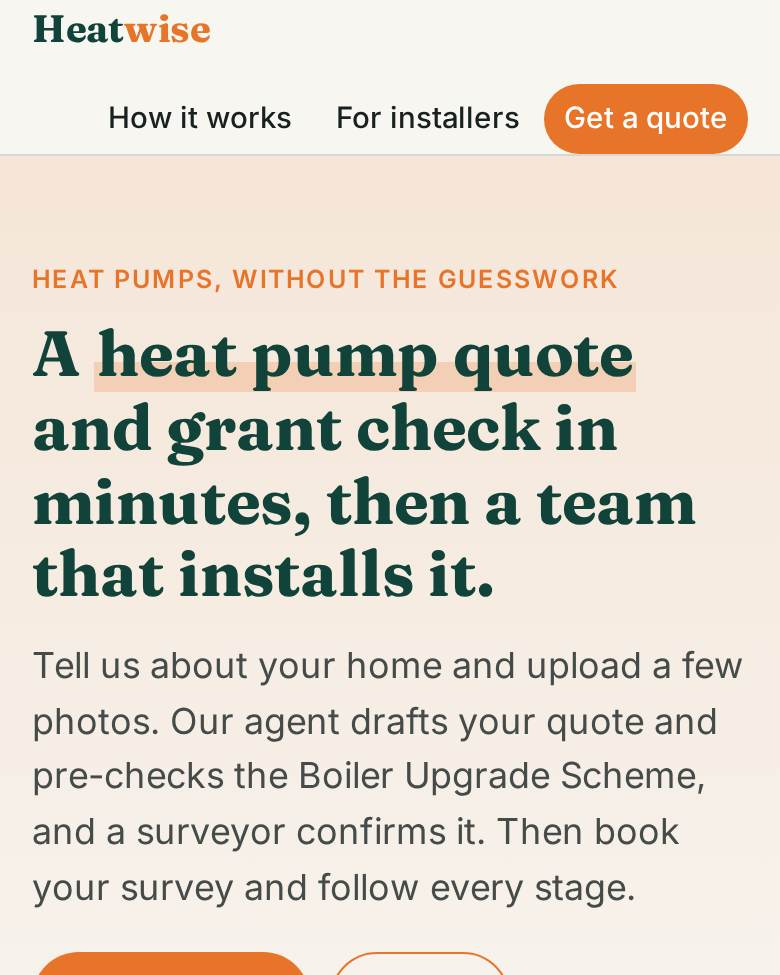
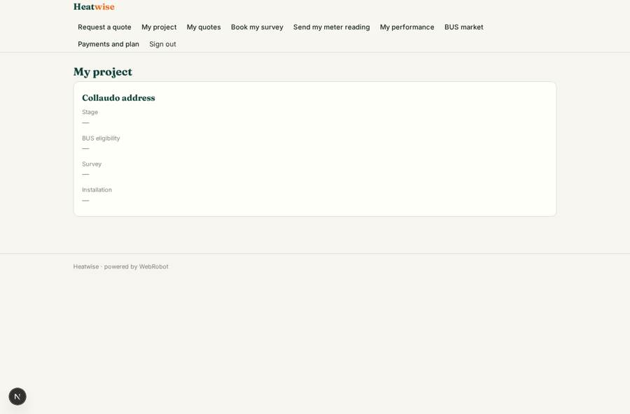
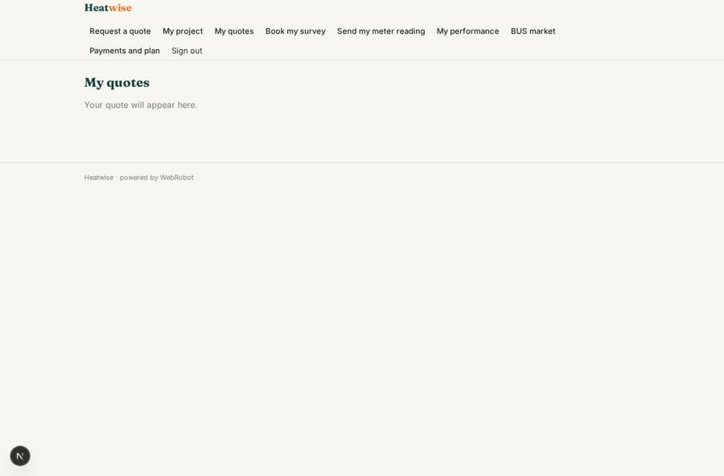
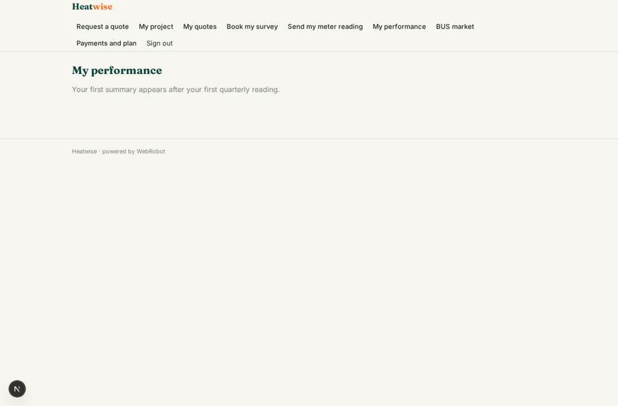
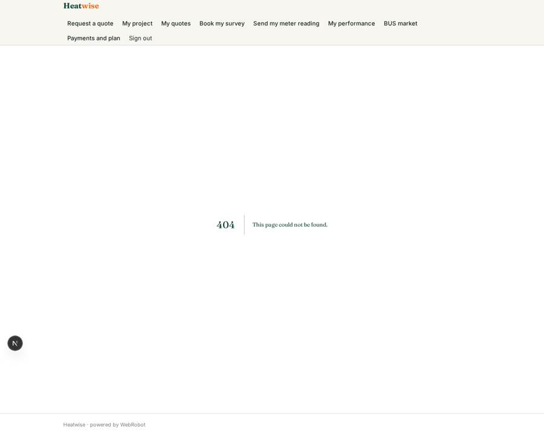

# Heatwise

_Heat pump quotes, surveys and installs, with one place to follow the whole project._

**Sector:** Sanità, istruzione, energia, gov · **Manifest:** valid (schema + runtime contract) · **Functional test:** passed (26 checks passed)

## Description given to the app builder

I want Heatwise, a heat pump installation business plus a platform for installers. Homeowners fill a quote form (address, property type, bedrooms, current heating, insulation, EPC rating) and upload photos; an agent drafts a quote and checks eligibility for the Boiler Upgrade Scheme, which a surveyor confirms. The installations themselves, MCS certification and BUS grant applications are physical and regulated operations run by us; I need the software around them. Customers book a survey slot and pay a deposit through Stripe. Installers have a portal with jobs, schedules, materials lists and commissioning forms. Customers get email updates at each stage. Dashboards use Ofgem BUS statistics for market context. Roles are homeowner, surveyor, installer, operations manager and admin; installers see only jobs assigned to them, homeowners only their own project. After commissioning, homeowners can upload a photo of their meter readings each quarter and get a simple performance summary, with an annual service reminder. Pricing: installation quotes include our fee; installers on the platform pay a monthly subscription. English only.

## Functional test: what did not pass

- **form saves a record** (form commissioning_form): only role installer may fill it, and the test cannot hold that role _(warning)_
- **page opened by a role allowed to** (view installer_jobs): only role installer may open it, the test cannot hold it _(warning)_
- **page opened by a role allowed to** (view commissioning_form): only role installer may open it, the test cannot hold it _(warning)_

## Navigation recording

Signed in as the app's admin, the recorder opened 6 menu page(s): Request a quote, Eligibility checks, Materials lists, All projects, Commissioned systems, BUS market.
- form not sent: request_quote: Current heating is required
- data page empty: materials (table)
- data page empty: commissioned_list (table)

Empty data pages are mostly expected on the local runtime: agents are mocked there, so the collections they fill stay empty.

## Features not expressible today (spec.extensions)

- **regulated_operations**: Installations, MCS certification and Boiler Upgrade Scheme applications are physical and regulated work run by Heatwise outside the app. The app only records stages, dates and reference numbers (MCS reference on the commissioning form).
- **pricing_assumptions**: The survey deposit (GBP 99) and installer subscription (GBP 79 per month) are placeholders: set the real amounts and fill the price book (items and fee percentage) on the data page. Stripe must be connected in the studio.
- **deposit_link**: The deposit pack unlocks the survey booking view; refunds and balance payments are handled in Stripe, not in the app.
- **sms_notifications**: Customer updates go by email only; SMS and WhatsApp are not available yet.

## Screenshots (interpretive runtime, test data)

### home-anon

### home-mobile

### my_project

### my_quotes

### performance

### installer_jobs

