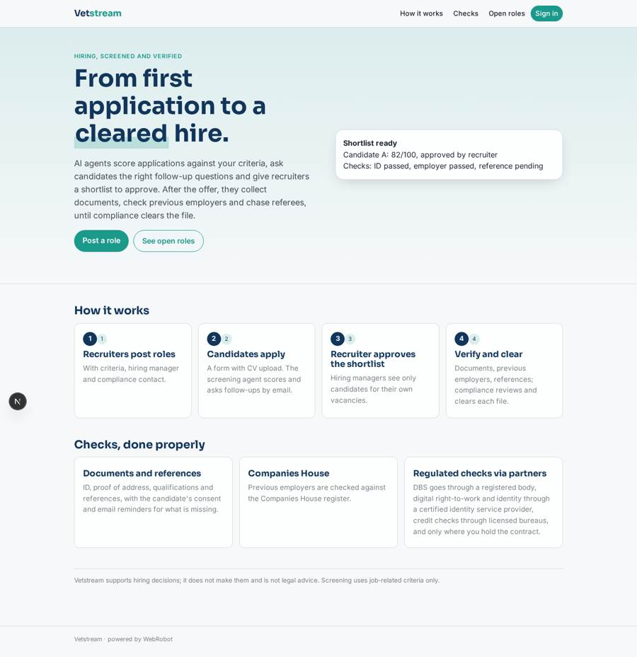
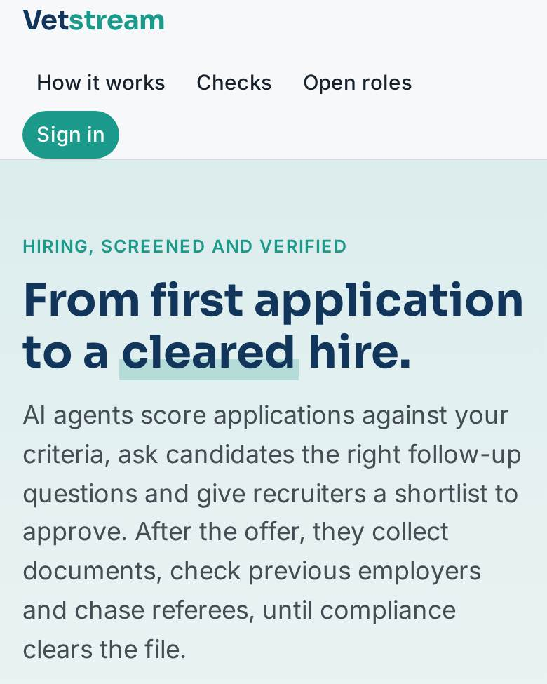
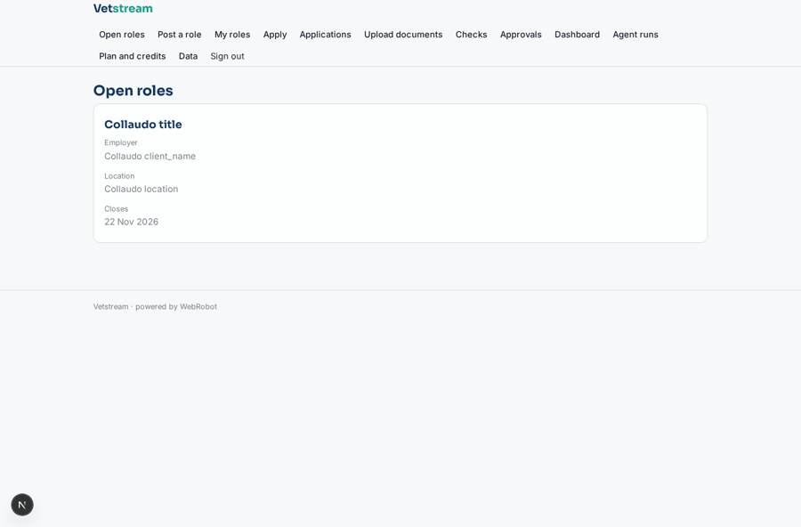
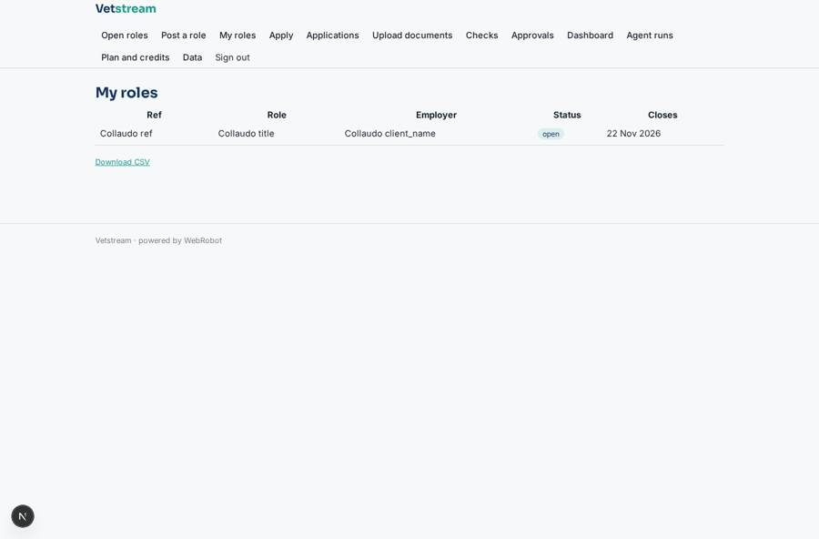
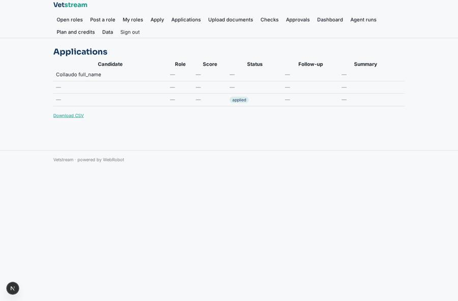
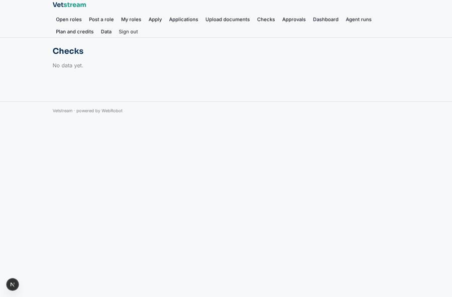

# Vetstream

_AI agents for hiring: from screening to verified, cleared candidates._

**Sector:** B2B AI and SaaS · **Manifest:** valid (schema + runtime contract) · **Functional test:** passed (28 checks passed)

## Description given to the app builder

We need Vetstream, AI agents across the hiring workflow from screening to background verification. Employers and staffing agencies sign up; recruiters, hiring managers and compliance users are the roles, and hiring managers see only candidates for their vacancies. Recruiters post roles and candidates apply through a form with CV upload. A screening agent scores applications against the criteria, asks candidates follow-up questions by email and produces a shortlist the recruiter approves. Once an offer is made, a verification agent collects documents (ID, proof of address, qualifications, references with consent), checks previous employers against the Companies House API, chases referees and tracks status per check. The real product also orders background checks: DBS checks must go through a registered body, digital right-to-work and identity checks through a certified identity service provider, and credit checks through licensed bureaus, used only through those partners and only if the customer has the contracts. Compliance reviews and clears each file. Email reminders to candidates for missing documents, alerts for delays. Dashboard of time to hire, checks pending and failure reasons. Pricing: subscription plus per-check fees. English.

## Navigation recording

Signed in as the app's admin, the recorder opened 7 menu page(s): Open roles, Post a role, My roles, Apply, Applications, Upload documents, Checks.
- data page empty: checks_table (table)

Empty data pages are mostly expected on the local runtime: agents are mocked there, so the collections they fill stay empty.

## Features not expressible today (spec.extensions)

- **partner_ordering**: Ordering DBS checks (registered body), digital right-to-work and identity checks (certified identity service provider) and credit checks (licensed bureau) is not built. The verifier only creates a partner_required check; compliance records the result from the partner the customer has a contract with.
- **per_check_fee**: Per-check fees are modelled as metered credits on agent runs. Charging the employer (not the candidate who owns the records) per individual check needs a dedicated billing rule.
- **compliance_document_viewer**: Compliance sees check results and summaries; opening the candidate's original uploaded files needs a shared access rule on documents.
- **outbound_email_to_candidates**: Follow-up questions and reminders are plain-text platform emails; branded templates, SMS or WhatsApp are not available.

## Screenshots (interpretive runtime, test data)

### home-anon

### home-mobile

### jobs

### my_vacancies

### applications

### checks_table

