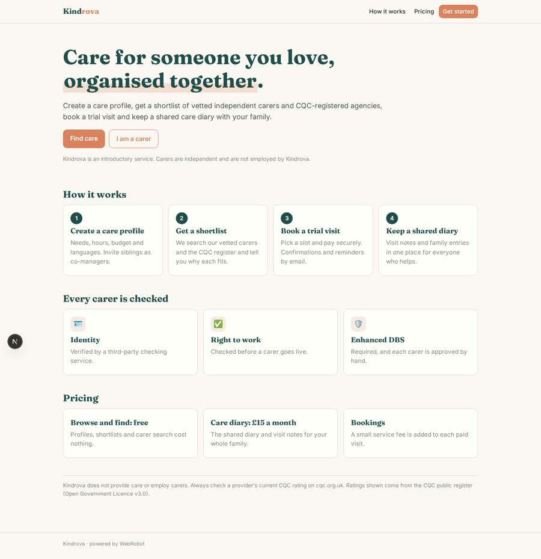
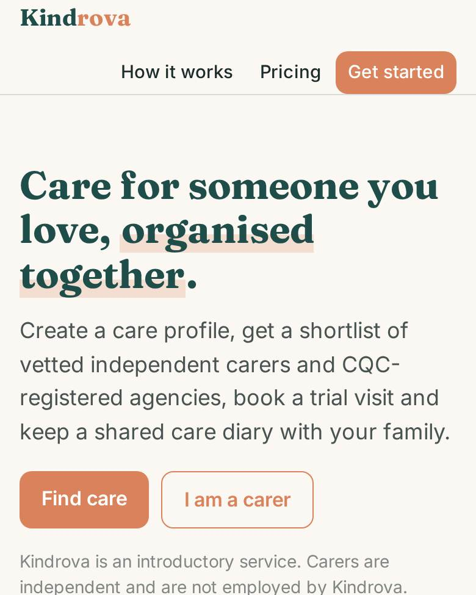
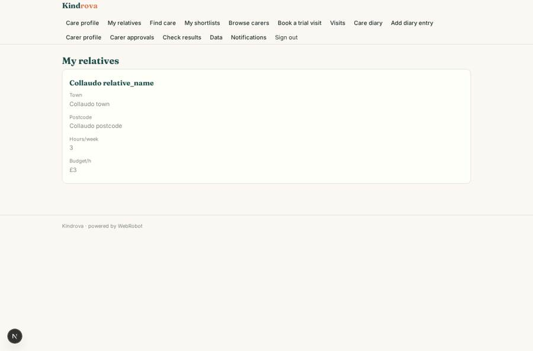
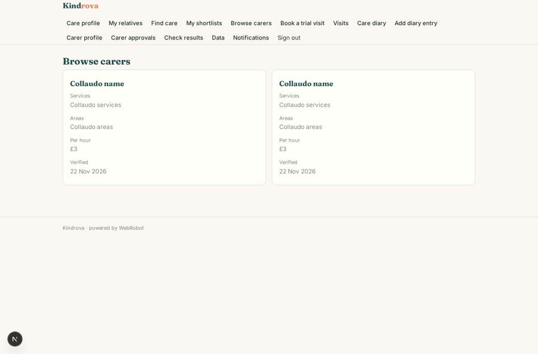
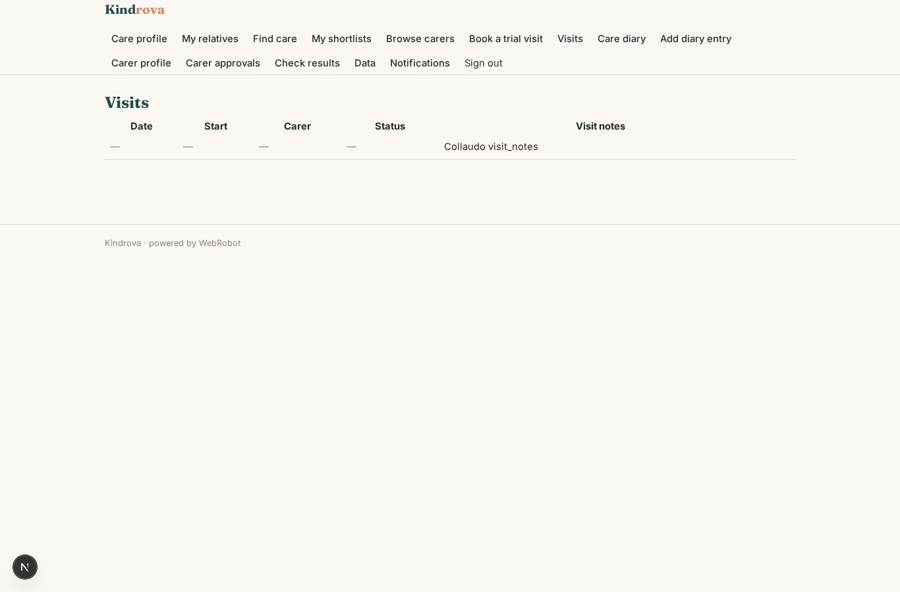
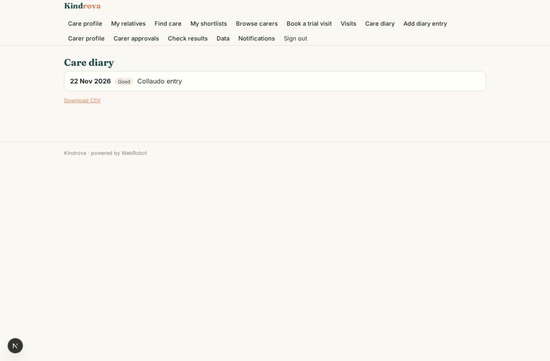

# Kindrova

_Find and organise home care for an older relative, together as a family._

**Sector:** Sanità, istruzione, energia, gov · **Manifest:** valid (schema + runtime contract) · **Functional test:** passed (27 checks passed)

## Description given to the app builder

I want an app called Kindrova that helps families in the UK find and organise home and community care for an older relative. A family member signs up, creates a care profile (relative's town and postcode, mobility, memory, personal-care needs, hours wanted, budget, languages, pets at home) and invites siblings as co-managers. An agent searches the CQC public register API and local authority directories (only where their terms allow) plus our own catalogue of independent carers and helpers, then proposes a shortlist with reasons and the CQC rating where one exists. Carers sign up with a profile: services, areas covered, availability slots, hourly rate, right-to-work and DBS status. We need identity, right-to-work and enhanced DBS checks through a third-party checking API before a carer goes live, and an operator approves each carer by hand. Families book trial visits into carers' slots and pay through Stripe; we take a fee. Carers get booking confirmations and shift reminders by SMS and WhatsApp, families by email; the family sees a shared care diary and visit notes. Carers see only their own bookings, families only their relative, admins everything. Free for families to browse, £15 a month for the care-diary plan. We stay an introductory service; if we ever employ carers directly the CQC registration will be ours, and I need the software ready for that. Mobile app plus web, English only.

## Functional test: what did not pass

- **saved record shown where its collection is read** (view my_bookings): a record was saved in bookings (by admin) but the page does not show it (as user) _(warning)_
- **CSV export** (view diary): export reserved to a plan _(warning)_

## Navigation recording

Signed in as the app's admin, the recorder opened 7 menu page(s): Care profile, My relatives, Find care, My shortlists, Browse carers, Book a trial visit, Visits.
No issue found.

Empty data pages are mostly expected on the local runtime: agents are mocked there, so the collections they fill stay empty.

## Design checks (linter)

- mobile.capabilities: an add-to-calendar button (view my_bookings) needs 'calendar' in the phone app

## Features not expressible today (spec.extensions)

- **sms_whatsapp**: Booking confirmations and shift reminders to carers by SMS and WhatsApp are not available yet. Carers get them by email and by push notification in the phone app.
- **checks_provider**: Identity, right-to-work and enhanced DBS checks come from a third-party checking provider that must be chosen and contracted. Its results reach Kindrova on the checks_result webhook (carer_email, type, result, ref) and show in the Check results table; the provider's API host and key are not set up yet, so ordering a check from inside the app is not available.
- **local_authority_directories**: Local authority care directories are not queried yet: each one's terms of use must be confirmed first.
- **cqc_ready**: Introductory-service model today (carers have engagement = independent). If Kindrova later employs carers, the CQC registration for personal care will be Kindrova's own. The data model already carries an engagement field, and diary entries, visit notes and check results are kept for audit. Rotas, care plans, medication records, incident logs and CQC notifications are not built yet.
- **stripe_connect_carers**: Paying a visit through Stripe with a platform fee needs the operator's Stripe account and each carer onboarded as a Connect seller; the 10% fee is a starting value to confirm.

## Screenshots (interpretive runtime, test data)

### home-anon

### home-mobile

### profiles

### carers

### my_bookings

### diary

