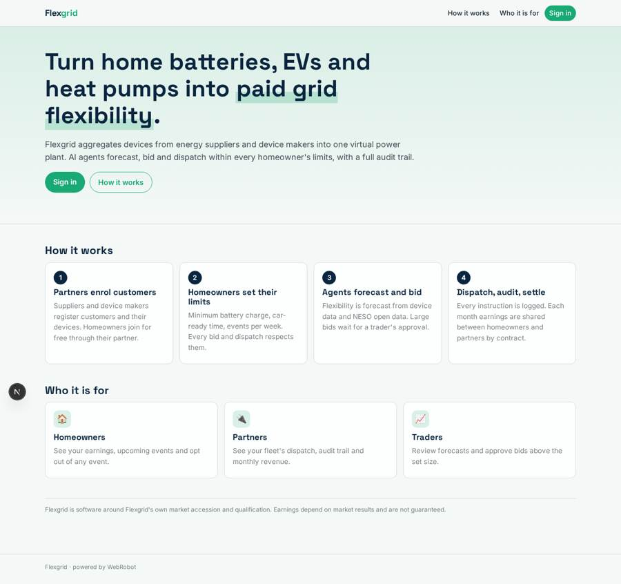
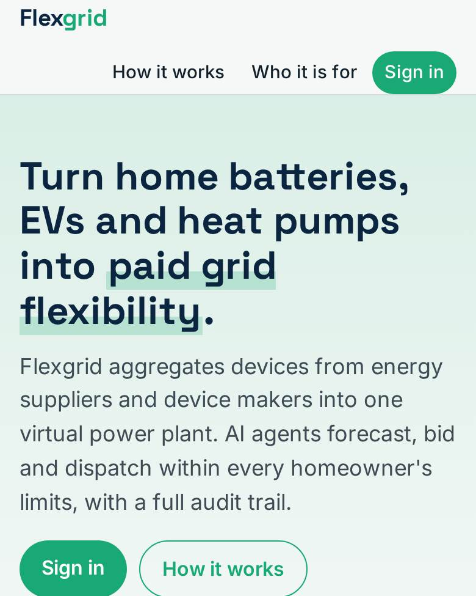
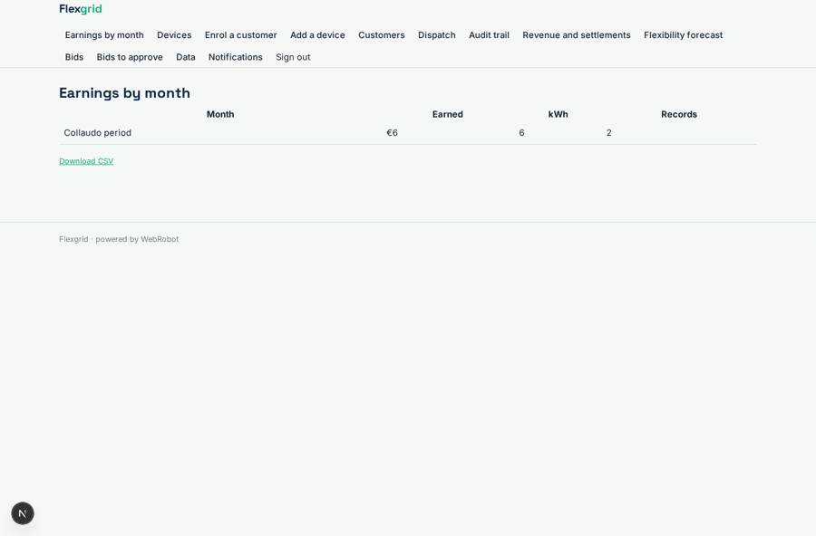
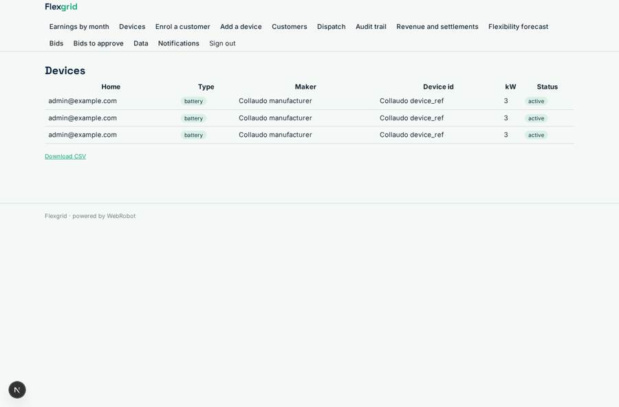
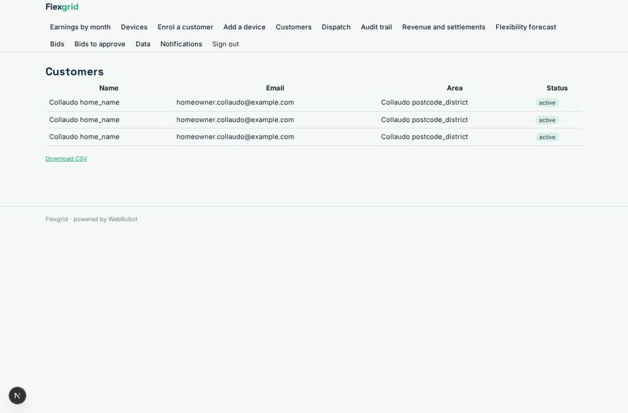
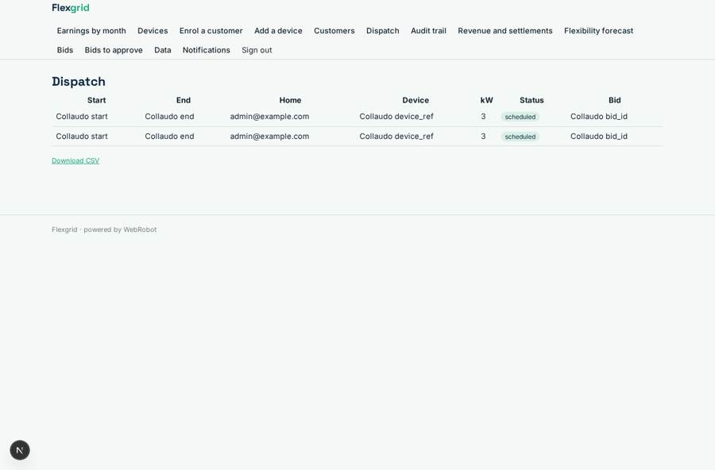

# Flexgrid

_Turn home batteries, EVs and heat pumps into paid grid flexibility._

**Sector:** Sanità, istruzione, energia, gov · **Manifest:** valid (schema + runtime contract) · **Functional test:** passed (36 checks passed)

## Description given to the app builder

We need Flexgrid, virtual power plant software that aggregates home batteries, EVs and heat pumps into flexibility markets. Energy suppliers and device makers sign up as partners; homeowners opt in through them. The core is device control through manufacturers' IoT APIs and access to NESO and distribution network flexibility markets, which require market accession and qualification; those are ours, and I need the software around them. An agent forecasts available flexibility from device data and NESO open data, and bids into markets; a trader approves bids above a set size. Homeowners see their earnings in an app and can opt out of any event; partners see their fleet's dispatch and revenue. Settlement reports each month. Homeowners set limits such as minimum battery charge or car-ready time, and the agent respects them in every bid. Payments to homeowners are shared with partners each month according to their contracts, and we need clear audit trails for every dispatch instruction. Partners pay a revenue share on flexibility income; homeowners join for free through the partner app. English only.

## Functional test: what did not pass

- **form saves a record** (form my_limits): only role homeowner may fill it, and the test cannot hold that role _(warning)_
- **form saves a record** (form optout): only role homeowner may fill it, and the test cannot hold that role _(warning)_
- **trigger has its effect** (trigger bid_needs_approval): email to role:trader: no such recipient in the test (role nobody holds or empty field) _(warning)_
- **saved record shown where its collection is read** (view earnings): a record was saved in earnings (by admin-data, admin-data) but the page does not show it (as homeowner) _(warning)_
- **saved record shown where its collection is read** (view my_devices): a record was saved in devices (by admin-data, admin-data, admin) but the page does not show it (as homeowner) _(warning)_
- **saved record shown where its collection is read** (view customers): a record was saved in enrolments (by admin-data, admin-data, admin) but the page does not show it (as partner) _(warning)_
- **saved record shown where its collection is read** (view dispatch): a record was saved in dispatch_instructions (by admin-data, admin-data) but the page does not show it (as partner) _(warning)_
- **saved record shown where its collection is read** (view audit): a record was saved in dispatch_audit (by admin-data, admin-data) but the page does not show it (as partner) _(warning)_
- **saved record shown where its collection is read** (view revenue): a record was saved in settlements (by admin-data, admin-data) but the page does not show it (as partner) _(warning)_

## Navigation recording

Signed in as the app's admin, the recorder opened 7 menu page(s): Earnings by month, Devices, Enrol a customer, Add a device, Customers, Dispatch, Audit trail.
No issue found.

Empty data pages are mostly expected on the local runtime: agents are mocked there, so the collections they fill stay empty.

## Features not expressible today (spec.extensions)

- **device_control_connector**: Executing 'scheduled' dispatch instructions through each manufacturer's IoT API (and posting readings to the device_reading webhook, updating instruction status sent/acknowledged/completed) is Flexgrid's own connector; the app only holds the instructions and the audit trail.
- **market_submission_connector**: Submitting 'queued_for_submission' bids to NESO and distribution network flexibility markets, and returning awards (bid status awarded/lost) and market statements, uses Flexgrid's own accession; results are loaded into market_results by the admins or the connector.
- **payouts_and_invoicing**: Bank payouts to homeowners, partner invoicing for the revenue share and SMS/WhatsApp event messages are not available; the app computes and publishes the settlement figures and sends email and push notifications.
- **approval_size**: The approval threshold is 1 MW, set in the bidder's instructions; change it there.

## Screenshots (interpretive runtime, test data)

### home-anon

### home-mobile

### earnings

### my_devices

### customers

### dispatch

