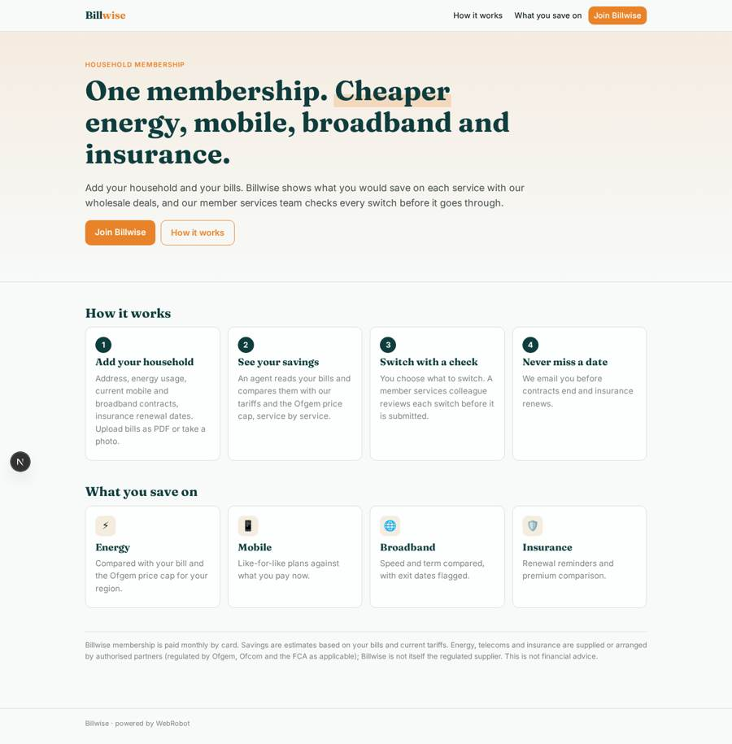
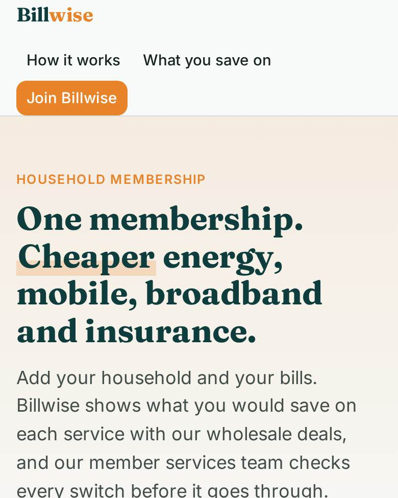
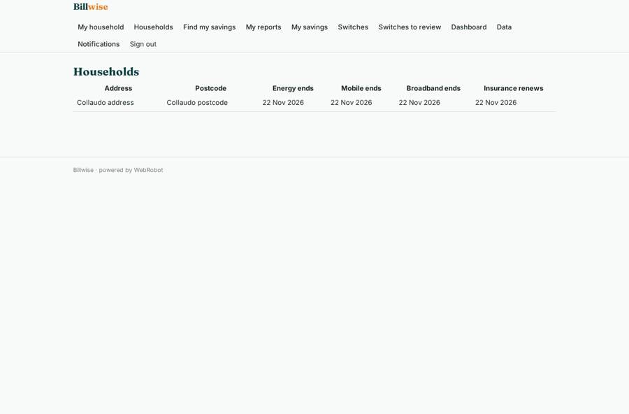
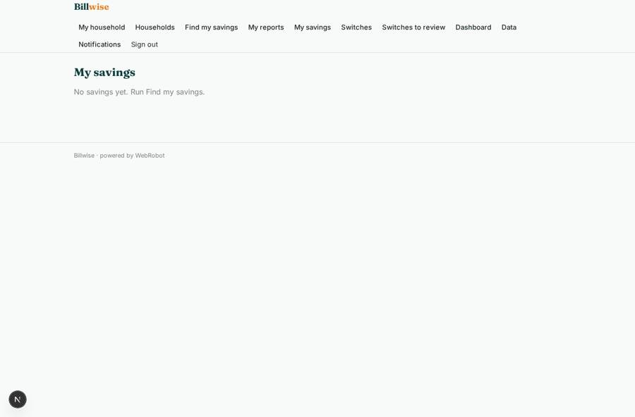
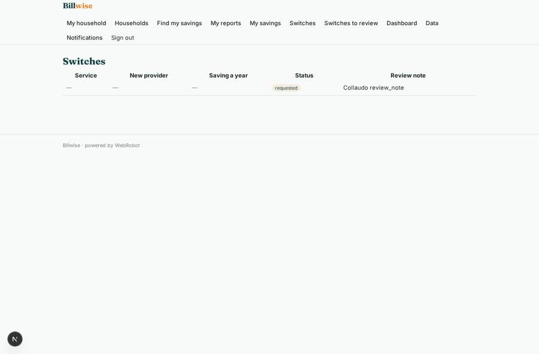
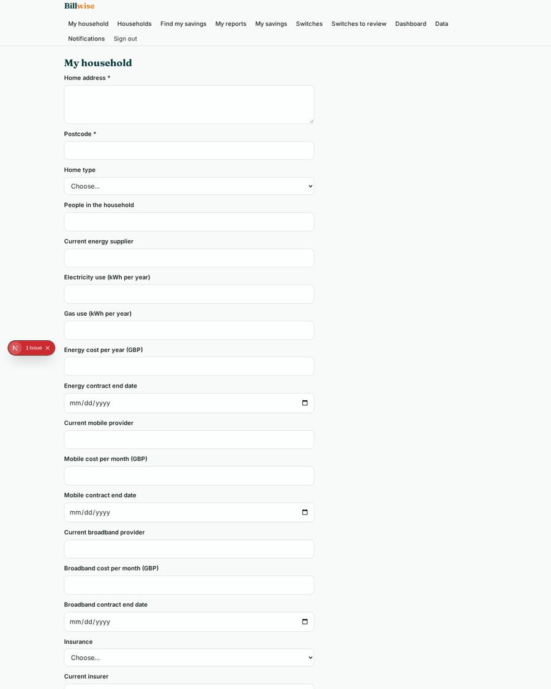

# Billwise

_One membership. Cheaper energy, mobile, broadband and insurance._

**Sector:** Consumer, travel, retail · **Manifest:** valid (schema + runtime contract) · **Functional test:** 1 failure(s) (16 checks passed)

## Description given to the app builder

I want an app called Billwise, a single membership that gets households cheaper energy, mobile, broadband and insurance. The regulated part is outside the software: supplying energy, telecoms and insurance requires authorisation from Ofgem, Ofcom and the FCA for insurance distribution, and our wholesale supply deals are the product; I need the software around it. Members sign up and pay a monthly membership by card, then add their household: address, energy usage or bills uploaded as PDF or photo, current mobile and broadband contracts, insurance renewal dates. An agent reads the bills, compares them with our tariffs (supplied by contract) and Ofgem price-cap public data, and shows the saving for each service. Members choose to switch; a member services agent reviews each switch before it is submitted. Reminders go by email before contract end dates and insurance renewals. Members see only their household; staff see members they handle; admins see dashboards of members, switches, savings delivered and churn. Phone app and web. English.

## Functional test: what did not pass

- **form can be filled (options, uploads)** (form switch_request): required saving (options from collection:savings) has no option to choose
- **saved record shown where its collection is read** (view switches): a record was saved in switches (by admin) but the page does not show it (as user) _(warning)_

## Navigation recording

Signed in as the app's admin, the recorder opened 7 menu page(s): My household, Households, Find my savings, My reports, My savings, Switches, Switches to review.
No issue found.

Empty data pages are mostly expected on the local runtime: agents are mocked there, so the collections they fill stay empty.

## Features not expressible today (spec.extensions)

- **membership_status_sync**: membership_status and cancelled_on are kept by admins on the data page; they are not synced automatically from Stripe cancellations, so the churn chart depends on them.
- **provider_submission**: Approved switches are submitted to the supplier by the member services team outside the app, who then mark the switch completed; there is no automatic provider API integration.
- **staff_assignment**: Admins assign each household to a member services colleague by setting consultant_email on the data page (/admin/data).

## Screenshots (interpretive runtime, test data)

### home-anon

### home-mobile

### my_household

### savings

### switches

### household

