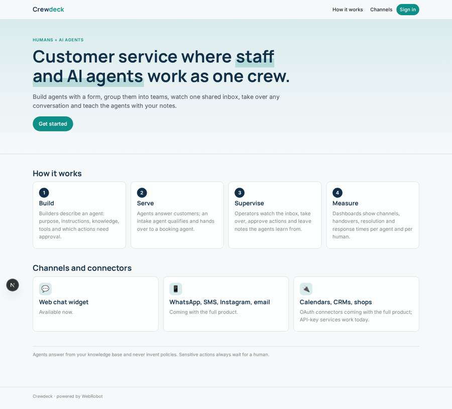
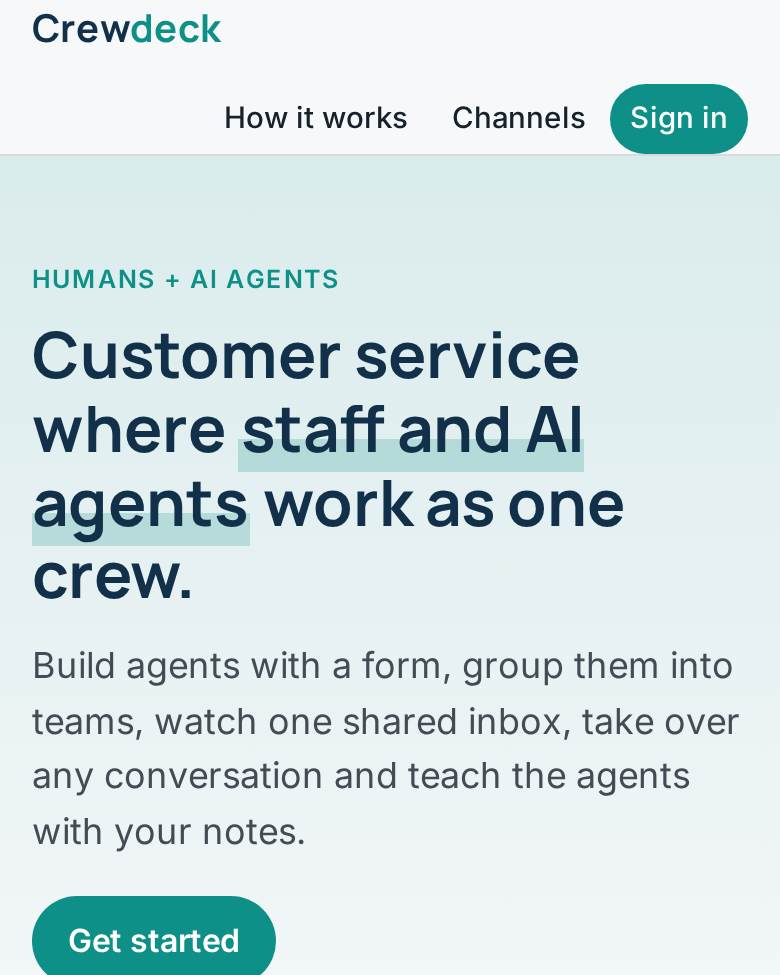
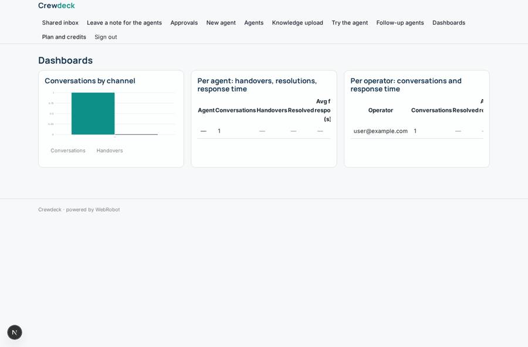
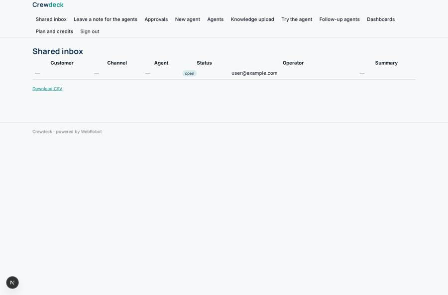
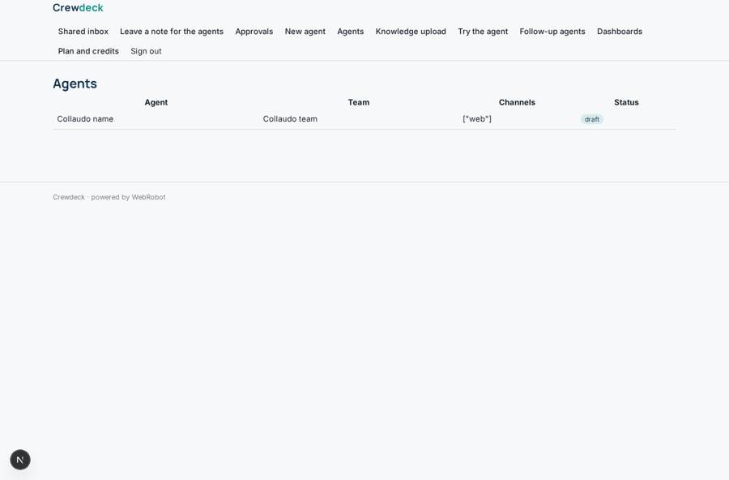
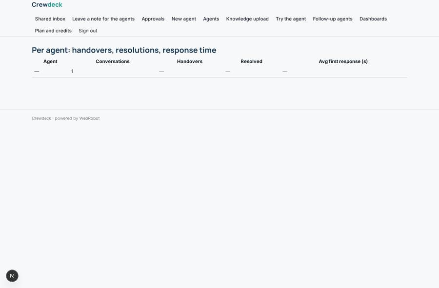

# Crewdeck

_A workspace where your staff and AI agents serve customers together._

**Sector:** B2B AI and SaaS · **Manifest:** valid (schema + runtime contract) · **Functional test:** passed (21 checks passed)

## Description given to the app builder

We need Crewdeck, a workspace where human staff and AI agents collaborate, and agents talk to customers on several channels. A company signs up and invites staff with roles (admin, builder, operator) and each team sees only its agents and conversations. Builders create agents through a form: purpose, instructions, knowledge uploads, tools (HTTP endpoints, MCP servers), which actions need human approval, and which channels they serve. Agents can be grouped into teams, for example an intake agent that qualifies a customer request and hands over to a booking agent, with operators watching a shared inbox where they can take over any conversation, approve actions and leave notes the agent learns from. Customers reach the agents through a web chat widget, and in the real product also through WhatsApp, SMS, Instagram and email, with connectors to calendars, CRMs and shops through OAuth, so include those. Scheduled agents send follow-ups and reminders. Dashboards show conversations by channel, handovers, resolution rates and response times per agent and per human. Email alerts when an approval waits more than ten minutes. Pricing: subscription by number of agents plus message credits. English.

## Functional test: what did not pass

- **saved record shown where its collection is read** (view by_channel): a record was saved in conversations (by user) but the page does not show it (as user) _(warning)_
- **saved record shown where its collection is read** (view agent_perf): a record was saved in conversations (by user) but the page does not show it (as user) _(warning)_

## Navigation recording

Signed in as the app's admin, the recorder opened 7 menu page(s): Shared inbox, Leave a note for the agents, Approvals, New agent, Agents, Knowledge upload, Try the agent.
No issue found.

Empty data pages are mostly expected on the local runtime: agents are mocked there, so the collections they fill stay empty.

## Features not expressible today (spec.extensions)

- **oauth_connectors**: Connectors to calendars, CRMs and shops through OAuth (Google, Microsoft 365, Meta) are not available yet. Services with API keys can be connected through credentials and HTTP tools.
- **messaging_channels**: WhatsApp, SMS, Instagram and email conversations are not available yet; only the web chat is live. Builders can already mark these channels on an agent.
- **public_widget_logging**: The embeddable chat widget for anonymous customers cannot write conversation records yet; conversations are logged for signed-in sessions.
- **builder_publish**: The agent form saves a configuration; turning it into a running agent is done from the App Studio. Real-time live takeover of a chat by a human is a later step: operators reply through the takeover form.

## Screenshots (interpretive runtime, test data)

### home-anon

### home-mobile

### dashboard

### inbox

### agents

### agent_perf

