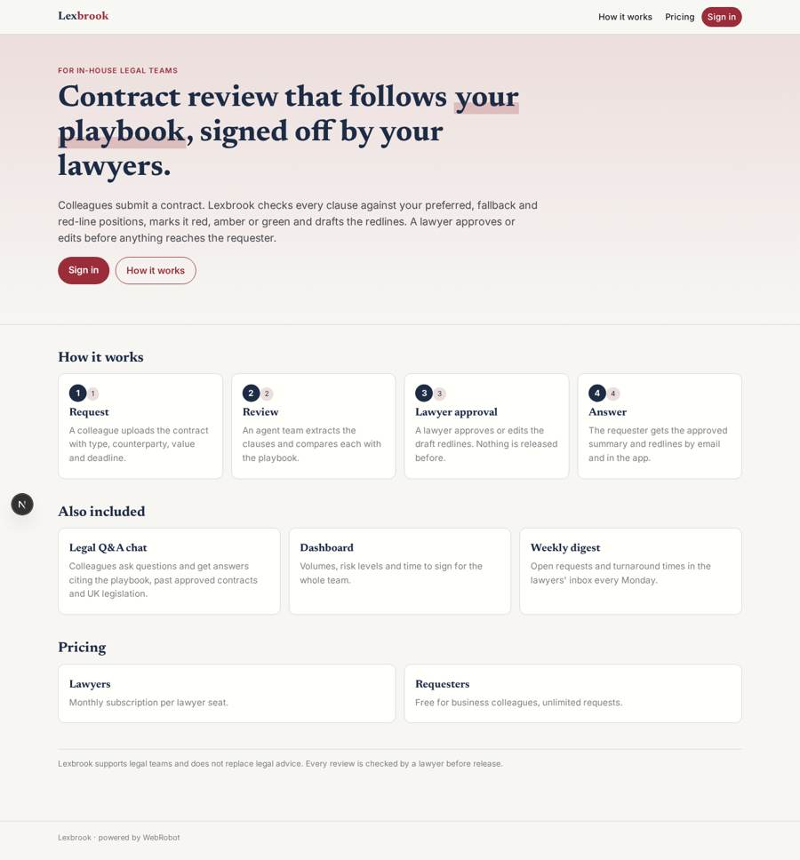
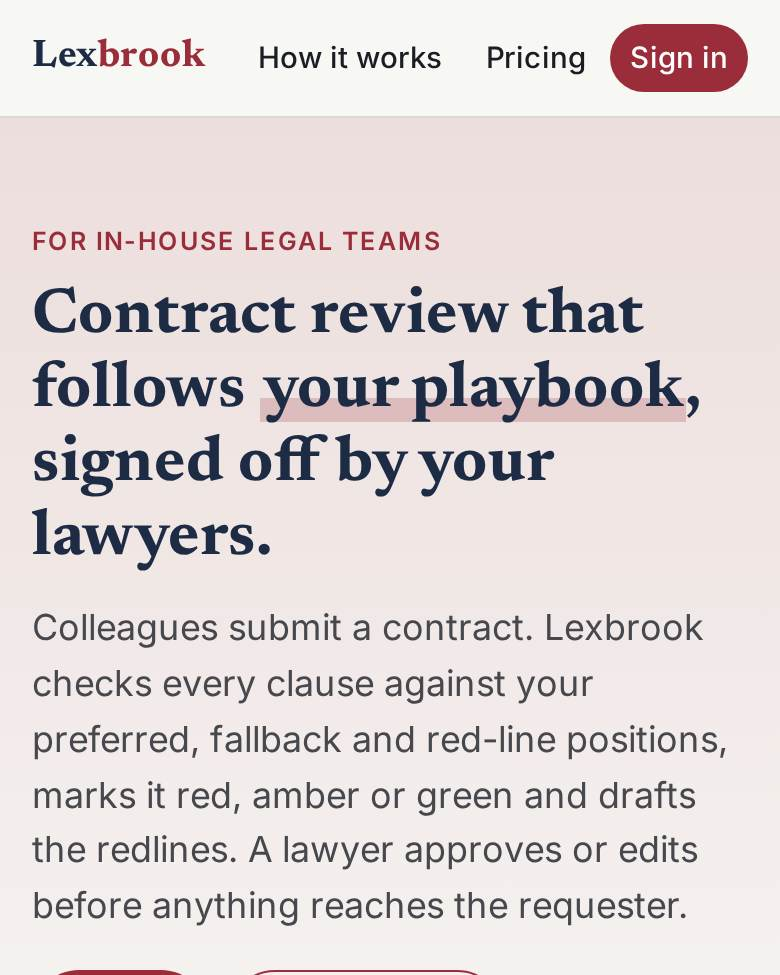
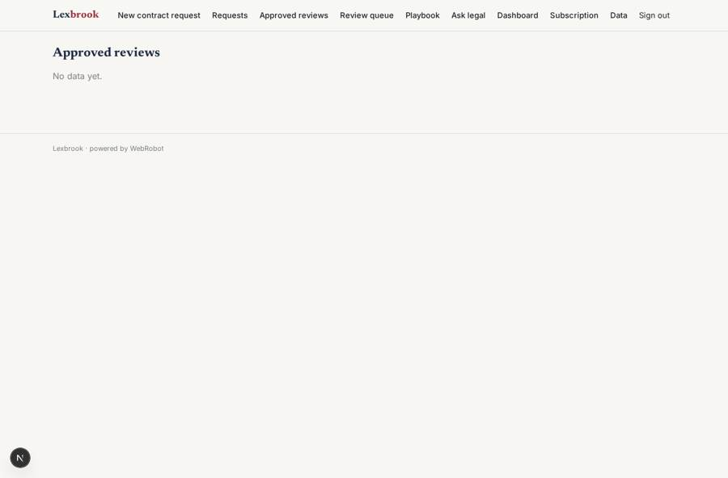
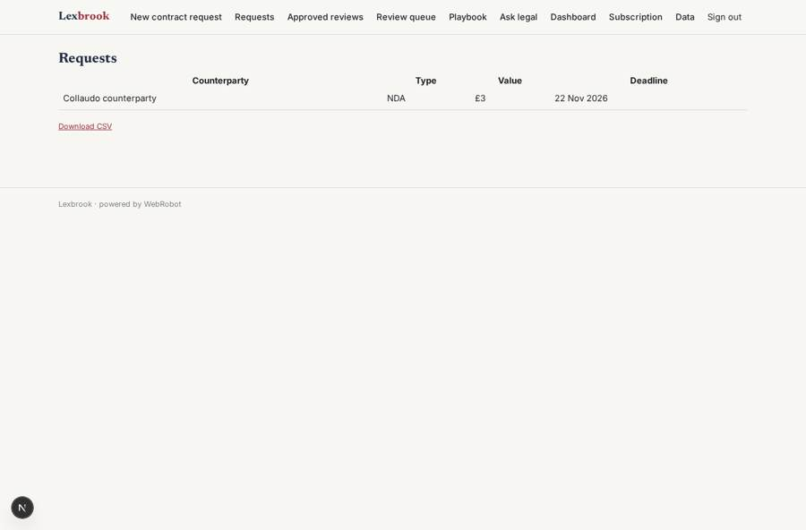
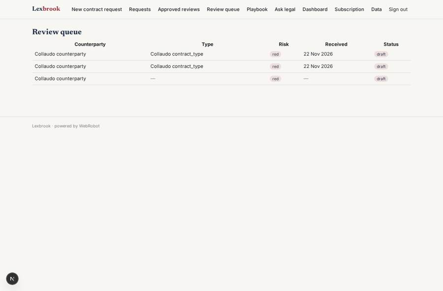
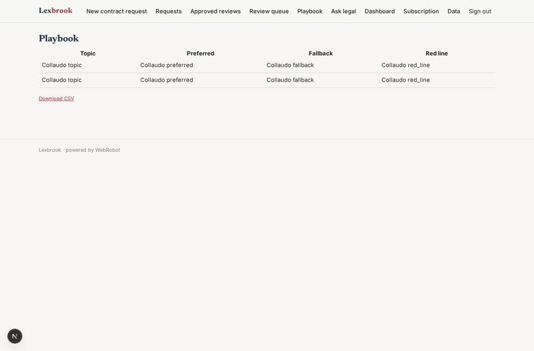

# Lexbrook

_Contract review and legal Q&A for in-house legal teams, with a lawyer's sign-off on everything._

**Sector:** B2B AI and SaaS · **Manifest:** valid (schema + runtime contract) · **Functional test:** passed (25 checks passed)

## Description given to the app builder

I want an app called Lexbrook for in-house legal teams at mid-sized companies. The general counsel signs up the company, invites lawyers as reviewers and business colleagues as requesters; requesters see only their own requests, lawyers see everything in the company, our platform admin sees all tenants. Requesters submit a form with contract type, counterparty, value, deadline and the uploaded contract. An agent team extracts the text, compares each clause with the company's playbook (uploaded by the legal team as preferred, fallback and red-line positions), marks deviations in red, amber or green and drafts redlines with a short reason. A second agent answers legal questions from colleagues in a chat, citing the playbook, past approved contracts and UK legislation from legislation.gov.uk. Nothing goes back to the requester until a lawyer approves or edits it. We also need what the real product offers: answers inside Slack, Outlook and Word, with each user connecting their Microsoft 365 or Slack account by OAuth, and contracts arriving by forwarding to an inbound email address. Weekly email digest of open requests and turnaround times; a dashboard of volumes, risk levels and time to sign. Pricing: per-seat monthly subscription for lawyers, requesters free. English only.

## Functional test: what did not pass

- **trigger has its effect** (trigger new_draft_alert): email to role:reviewer: no such recipient in the test (role nobody holds or empty field) _(warning)_

## Navigation recording

Signed in as the app's admin, the recorder opened 7 menu page(s): New contract request, Requests, Approved reviews, Review queue, Playbook, Ask legal, Dashboard.
- data page empty: my_responses (cards)

Empty data pages are mostly expected on the local runtime: agents are mocked there, so the collections they fill stay empty.

## Features not expressible today (spec.extensions)

- **per_company_tenancy**: One app serves one legal team: reviewers see every request in the app, so several companies in one app cannot be separated by company. Run one app per company, or add a company field later. The platform admin role sees everything.
- **per_seat_billing**: The subscription is one plan bought by each lawyer. A seat count managed by the general counsel for the whole team is not expressible yet.
- **oauth_microsoft_slack**: Connecting a user's Microsoft 365 or Slack account by OAuth is not available yet.
- **slack_outlook_word_assistants**: Answers inside Slack, Outlook and Word (bot and add-ins) are not available yet. The chat view works in the web and phone app.
- **inbound_email_intake**: Contracts forwarded to an inbound email address that become requests are not available yet. Requesters use the request form.
- **playbook_upload**: Playbook positions are entered by admins on the built-in data page (by hand or from a CSV). A dedicated lawyer upload form for a shared catalogue is not allowed.

## Screenshots (interpretive runtime, test data)

### home-anon

### home-mobile

### my_responses

### my_requests

### review_queue

### playbook_view

