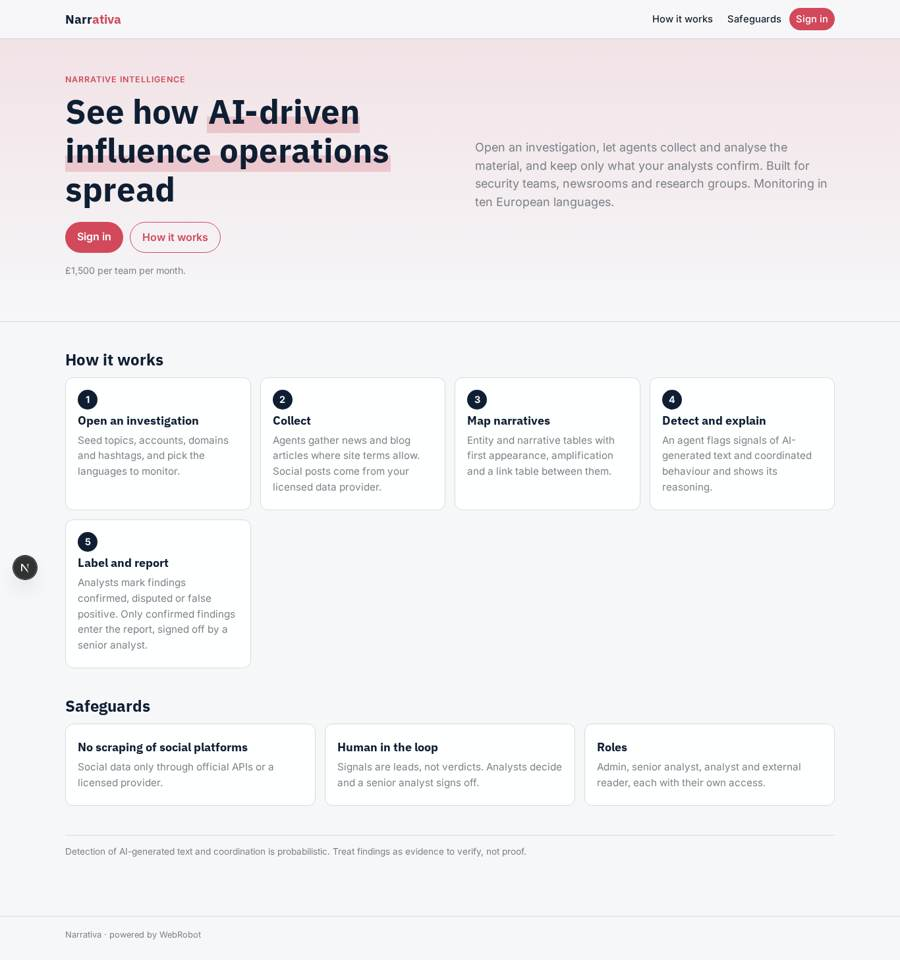
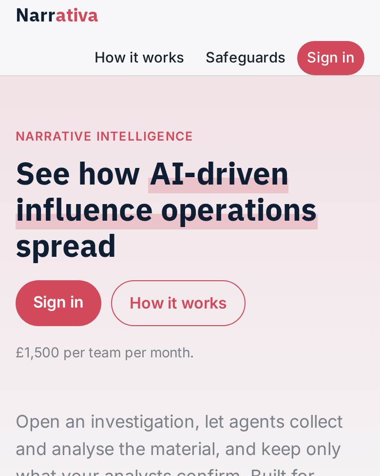
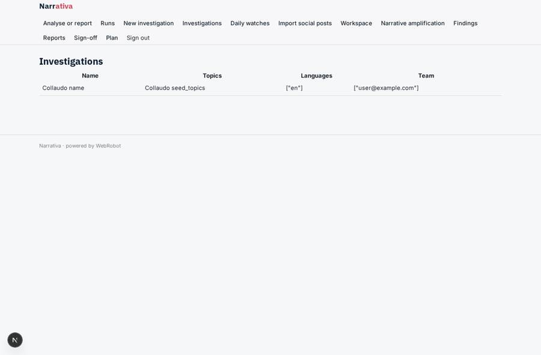
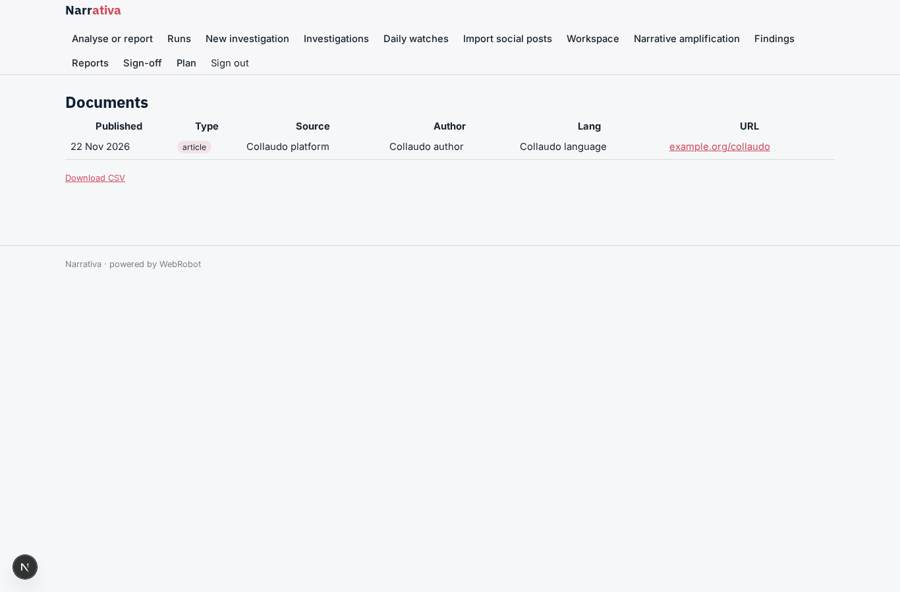
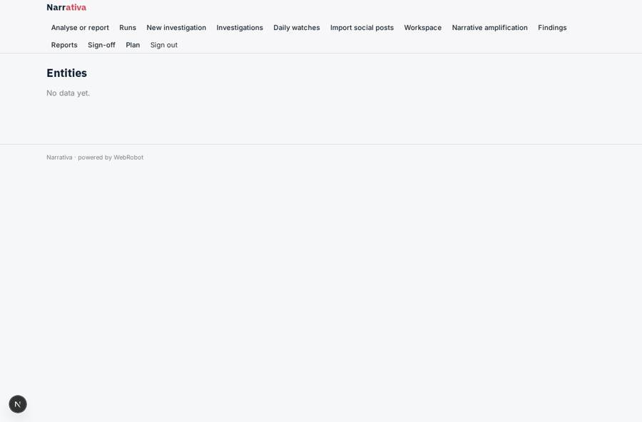
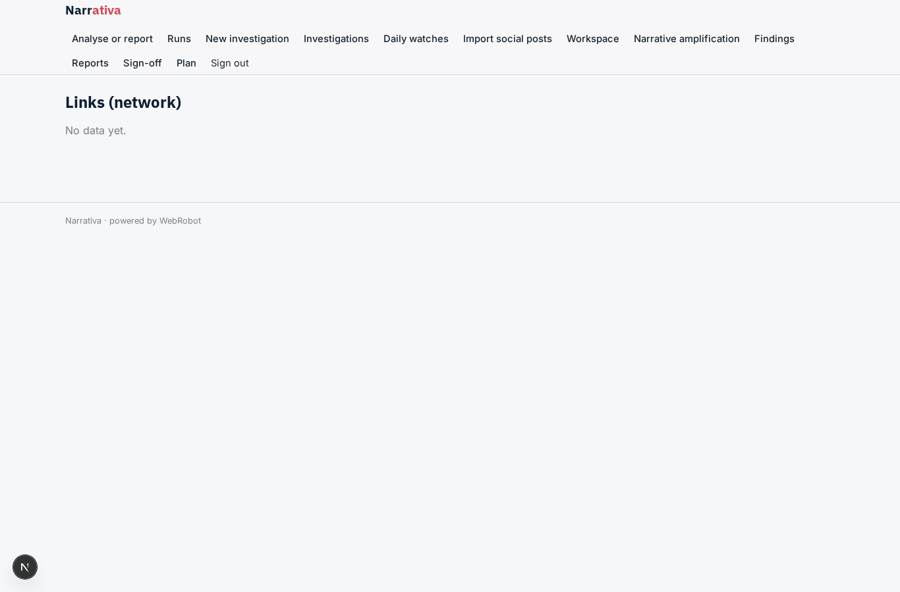

# Narrativa

_Narrative intelligence on AI-driven influence operations._

**Sector:** Data, media, cyber, devtools · **Manifest:** valid (schema + runtime contract) · **Functional test:** passed (26 checks passed)

## Description given to the app builder

We need an app called Narrativa that gives analysts social-media and narrative intelligence about AI-driven influence operations. Analysts at a security team, media outlet or research group sign up and create investigations with seed topics, accounts, domains and hashtags. Collection agents gather articles from news sites and blogs where terms allow, and social posts only through official APIs or a licensed data provider, which the real product uses; no scraping. The real product also handles audio and video posts, transcribing them and checking for synthetic media; I want that included. The app builds entity and narrative tables: accounts, domains, claims, first appearance, amplification, and links between them shown as a network graph. An agent detects signals of AI-generated text and coordinated behaviour and explains its reasoning. Analysts label findings as confirmed, disputed or false positive, and only confirmed findings go into reports. Reports are drafted by an agent and signed off by a senior analyst before export to PDF. Alerts notify the investigation owner when a narrative accelerates. Roles: admin, senior analyst, analyst, external reader. Pricing: £1,500 a month per team. English, with monitoring in ten European languages.

## Navigation recording

Signed in as the app's admin, the recorder opened 7 menu page(s): Analyse or report, Runs, New investigation, Investigations, Daily watches, Import social posts, Workspace.
- agent run did not open: new_run: the run did not open
- data page empty: history (history)

Empty data pages are mostly expected on the local runtime: agents are mocked there, so the collections they fill stay empty.

## Features not expressible today (spec.extensions)

- **audio_video_synthetic_media**: Not available yet: transcribing audio and video posts and checking for synthetic media (deepfakes, cloned voices). The platform cannot ingest audio or video files today. Until then analysts can import a transcript from their provider as a social_post document; no synthetic-media check runs.
- **licensed_social_data_feed**: Not wired: automatic ingestion from a licensed social-data provider. Name the provider, its API host and terms so it can be added as an egress host with an org credential. Until then analysts import posts with the Import social posts form or the admin CSV import. No scraping of social platforms.
- **network_graph_view**: Not available yet: an interactive network graph view. The links table holds the nodes and edges (from, relation, to, weight) and can be exported to CSV for a graph tool.
- **per_team_billing**: The £1,500/month plan is billed per account. Team membership is handled with the members list on each investigation; seat or team-level billing is not modelled.

## Screenshots (interpretive runtime, test data)

### home-anon

### home-mobile

### investigations

### documents_table

### entities_table

### links_table

