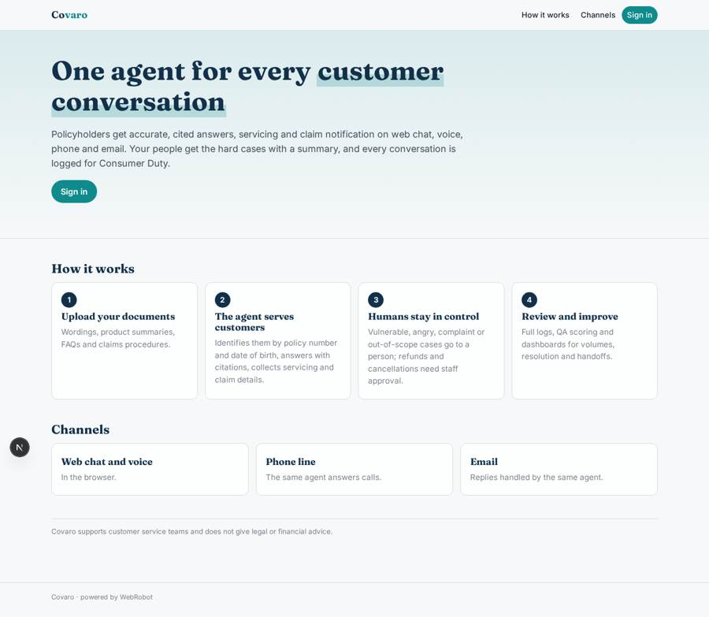
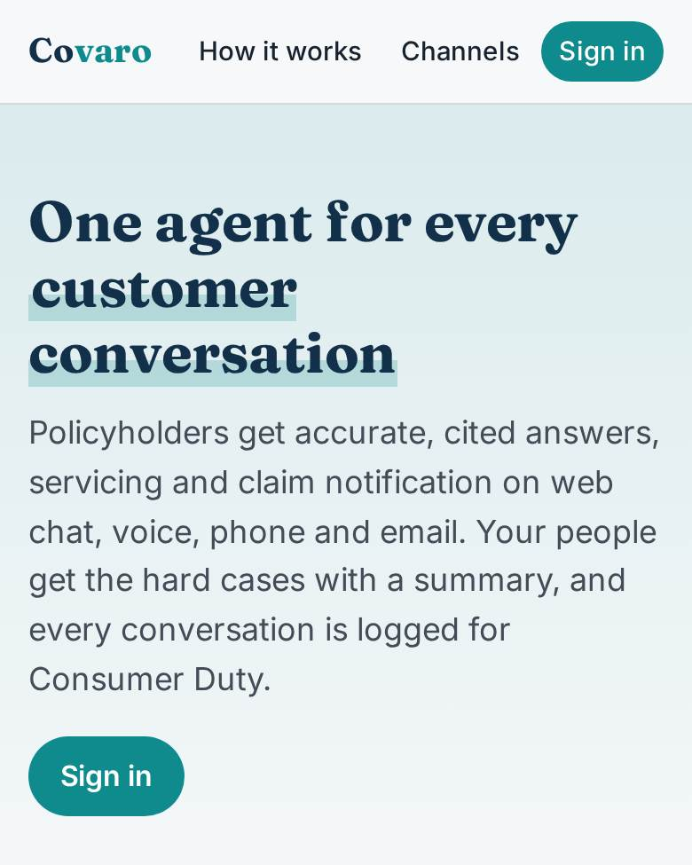
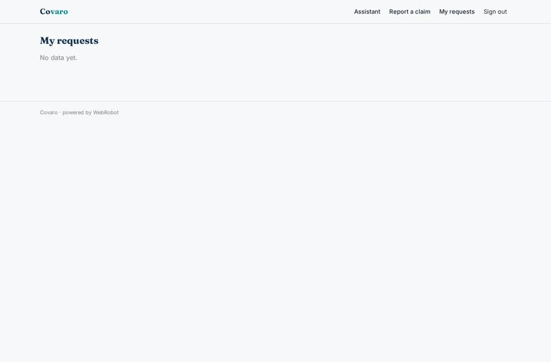
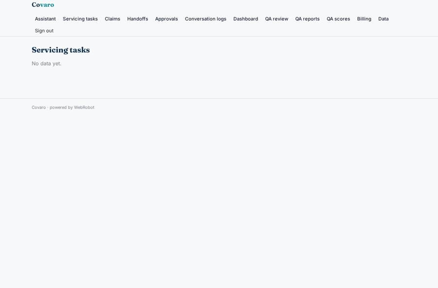
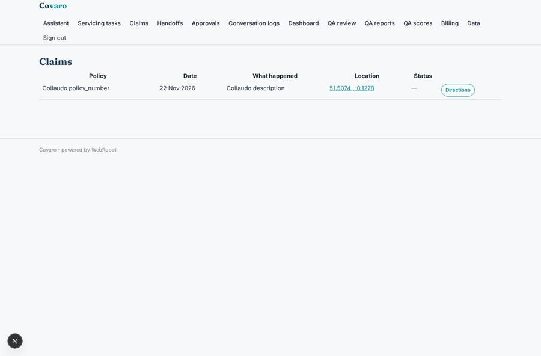
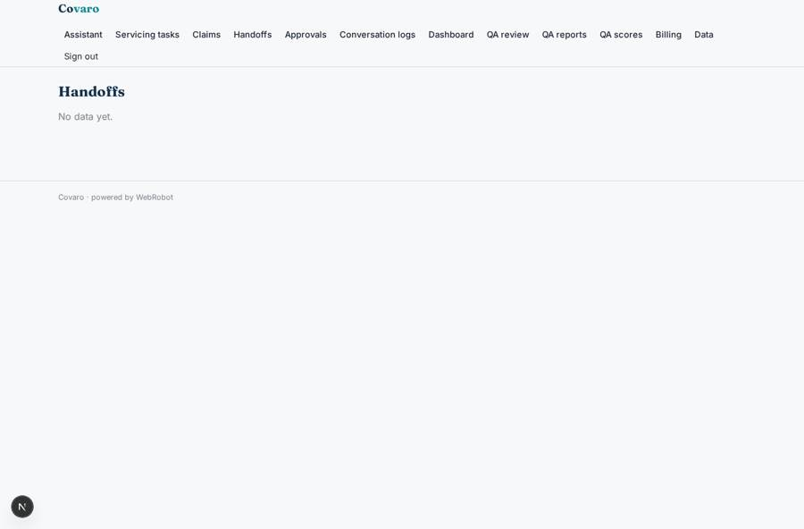

# Covaro

_One AI agent for every customer conversation, on every channel._

**Sector:** Fintech, proptech, insurtech · **Manifest:** valid (schema + runtime contract) · **Functional test:** passed (27 checks passed)

## Description given to the app builder

I want Covaro, an agentic customer experience platform for insurers and MGAs. The insurer signs up and uploads policy wordings, product summaries, FAQs and claims procedures. Policyholders reach the assistant through web chat, voice in the browser, a phone line and WhatsApp, and by email; all channels are handled by the same agent. The agent identifies the customer with policy number and date of birth, answers coverage questions with citations to the wording, handles servicing requests (change of address, adding a driver, cancellation, document copies) by collecting the details in a structured form and creating a task, and helps start a claim with first notification of loss questions and photo uploads. When the customer is vulnerable, angry, asks for a complaint or the request is outside policy, the conversation is handed to a human agent with a summary; refunds and cancellations need staff approval. Every conversation is logged for Consumer Duty and fair treatment reviews, and a QA agent scores samples. Roles: insurer admin, service agent, QA reviewer. Dashboards show volumes, resolution rate and handoffs. Pricing: monthly platform fee plus per-conversation usage. English.

## Navigation recording

Signed in as the app's admin, the recorder opened 7 menu page(s): Assistant, Servicing tasks, Claims, Handoffs, Approvals, Conversation logs, Dashboard.
- data page empty: requests_admin (table)
- data page empty: handoffs (table)
- data page empty: logs (table)

Empty data pages are mostly expected on the local runtime: agents are mocked there, so the collections they fill stay empty.

## Features not expressible today (spec.extensions)

- **whatsapp_channel**: WhatsApp is not available yet: customers reach the agent on web, voice, phone and email only.
- **document_upload**: Documents are added by admins on the built-in data page (pasted text or CSV); direct PDF ingestion into the document library is not available yet.
- **anonymous_channels**: Policyholders sign in with a magic link on the web; phone and email channels depend on the platform's channel identification.

## Screenshots (interpretive runtime, test data)

### home-anon

### home-mobile

### my_requests

### requests_admin

### claims_admin

### handoffs

