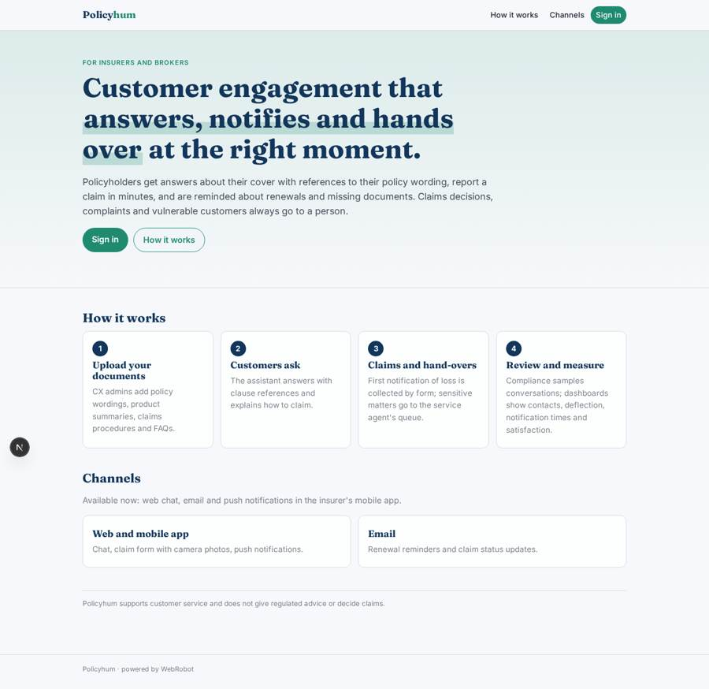
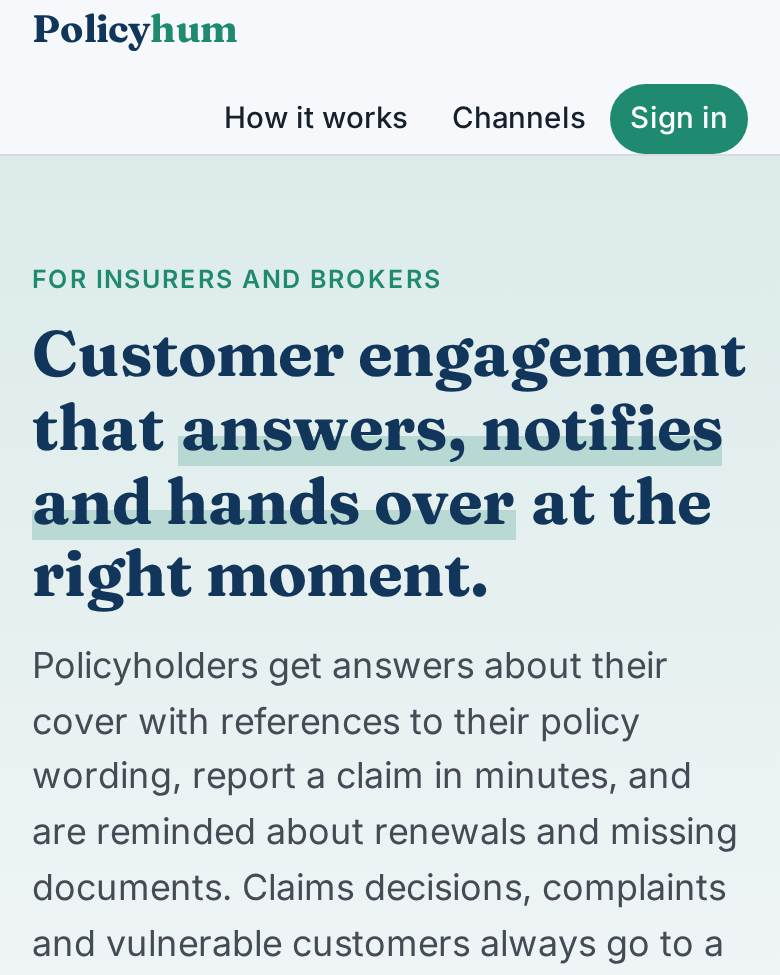
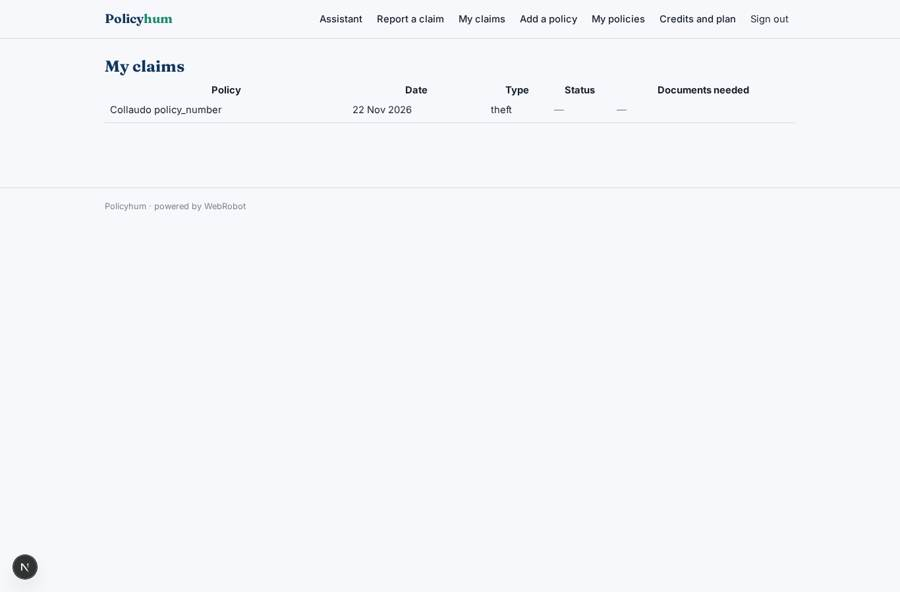
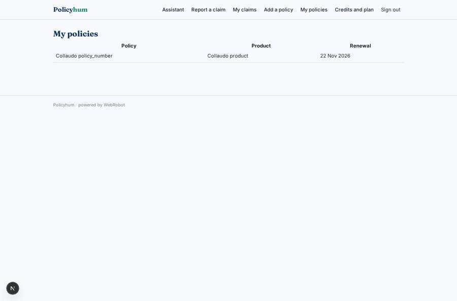
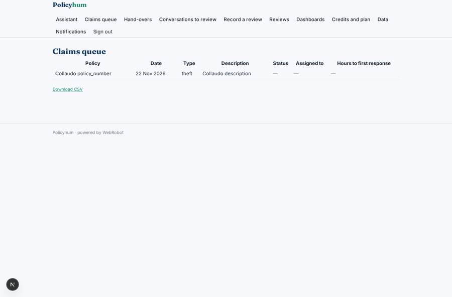
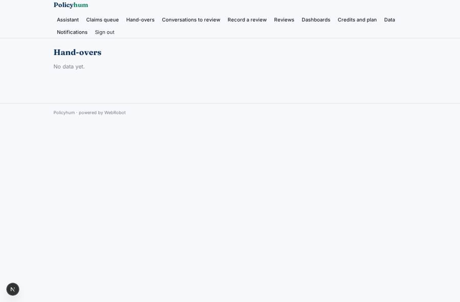

# Policyhum

_Agentic customer engagement for insurers and brokers._

**Sector:** B2B AI and SaaS · **Manifest:** valid (schema + runtime contract) · **Functional test:** passed (26 checks passed)

## Description given to the app builder

We need Policyhum, an agentic customer engagement platform for insurers and brokers. The insurer signs up; roles are CX admin, service agent and compliance reviewer, and agents see only the cases in their queue. The admin uploads policy wordings, product summaries, claims procedures and FAQs. Policyholders talk to an assistant that answers questions about cover with references to their policy wording, explains how to make a claim, collects first notification of loss through a form (date, type of incident, description, photos), and nudges them on renewals and missing documents. Anything about claims decisions, complaints or vulnerable customers goes to a human, and compliance can review samples against the FCA's conduct rules. A proactive agent sends renewal reminders and claim status updates on a schedule. The real product reaches customers on WhatsApp, SMS, email and through push notifications in the insurer's mobile app, and connects to insurers' policy administration and claims systems, so I want those channels and integrations too. Dashboards show contacts by reason, deflection rate, claim notification times and satisfaction. Pricing: platform subscription plus per-conversation charges. English.

## Navigation recording

Signed in as the app's admin, the recorder opened 7 menu page(s): Assistant, Claims queue, Hand-overs, Conversations to review, Record a review, Reviews, Dashboards.
- data page empty: handovers (table)
- data page empty: samples (table)

Empty data pages are mostly expected on the local runtime: agents are mocked there, so the collections they fill stay empty.

## Features not expressible today (spec.extensions)

- **whatsapp_sms**: WhatsApp and SMS channels are not available yet. Customers are reached by email and by push notifications in the mobile app.
- **policy_admin_claims_integration**: Connection to the insurer's policy administration and claims systems is not available yet. Policies are entered by the policyholder and claims are handled in the claims queue; documents are kept by admins on the data page.
- **fca_sampling**: Compliance reviews are done by people on sampled conversations. There is no automatic scoring against the FCA's conduct rules.

## Screenshots (interpretive runtime, test data)

### home-anon

### home-mobile

### my_claims

### policies_list

### queue

### handovers

