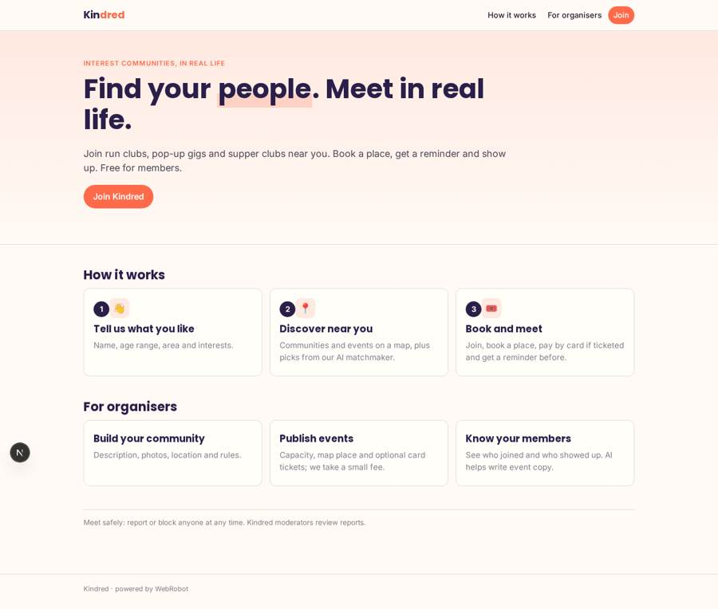
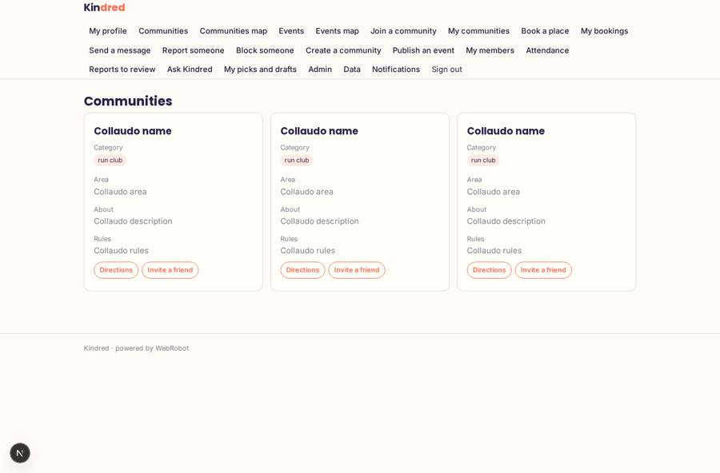
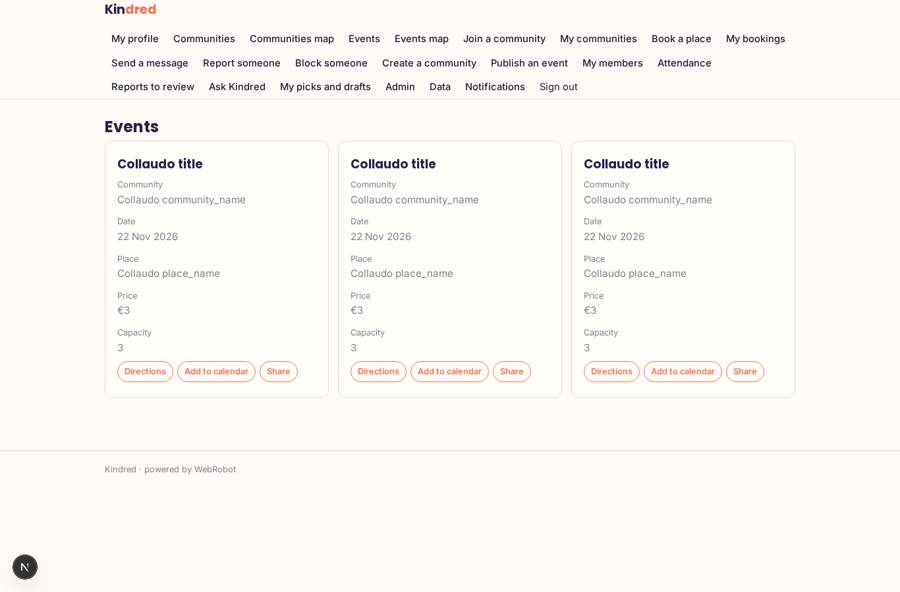
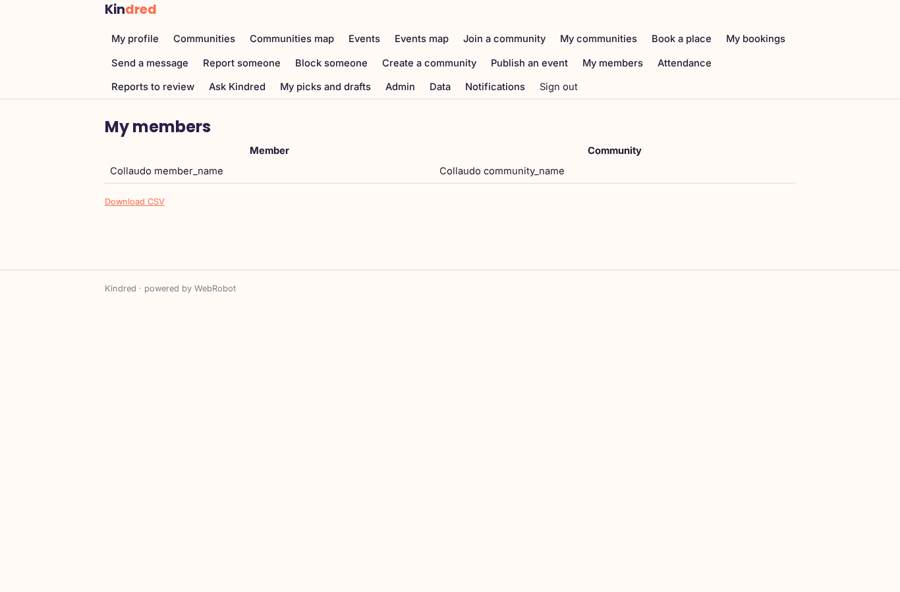
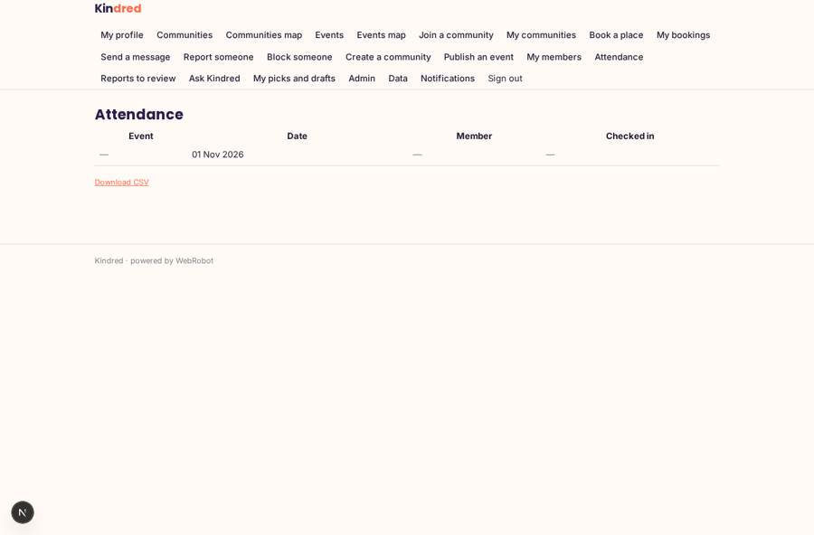

# Kindred

_Find your people. Meet in real life._

**Sector:** Consumer, travel, retail · **Manifest:** valid (schema + runtime contract) · **Functional test:** passed (48 checks passed)

## Description given to the app builder

I want a phone app called Kindred where people join interest communities, such as run clubs, pop-up gigs and supper clubs, and meet in real life. Users sign up with name, age range, area and interests. Organisers create a community with description, photos, location and rules, and publish events with date, place on a map, capacity and optional ticket price paid by card. Members browse communities and events near them on a map using phone location, join, book a place and get a push reminder before the event. Members chat in real time in each community and privately with each other, with reporting and blocking. An agent recommends communities and events from the user's interests and attendance, and helps organisers write event descriptions and check-in messages. Organisers see their members and attendance; moderators review reported messages and can remove users; admins see everything. Organisers get paid their ticket revenue minus our fee. The value is the network, so I want invites by link and a feed of what friends are joining. Free for members, with a fee on paid tickets and a monthly plan for organisers. English.

## Functional test: what did not pass

- **saved record shown where its collection is read** (view attendance): a record was saved in bookings (by user) but the page does not show it (as admin) _(warning)_

## Navigation recording

Signed in as the app's admin, the recorder opened 7 menu page(s): My profile, Communities, Communities map, Events, Events map, Join a community, My communities.
- form not sent: profile: Interests is required

Empty data pages are mostly expected on the local runtime: agents are mocked there, so the collections they fill stay empty.

## Features not expressible today (spec.extensions)

- **realtime_chat**: Real-time chat inside each community and private member-to-member chat is not available yet: messages are saved as records visible to the sender and moderators only. Blocking is stored but not yet enforced on delivery.
- **friend_feed_invites**: Invite-by-link with attribution and a feed of what friends are joining need a friends graph and referral links that the runtime does not provide yet; the Invite a friend button shares the community text only.
- **ticket_checkout**: Card payment of tickets with the organiser's payout (revenue minus 8% fee) needs Stripe Connect onboarding per organiser and a ticket checkout flow; the plan and fee are declared, the per-event checkout is not.
- **moderation_actions**: Removing a user is done by admins on the Users tab; a moderator-only remove action is not available yet. Map views read numeric lat/lon, entered with the location field.

## Screenshots (interpretive runtime, test data)

### home-anon

### home-mobile

### discover

### events_list

### my_members

### attendance

