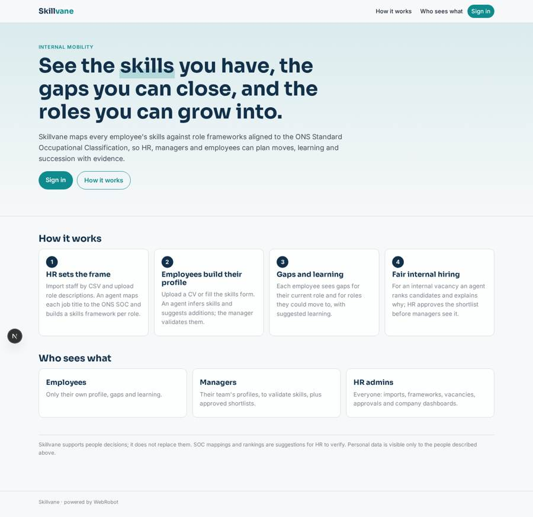
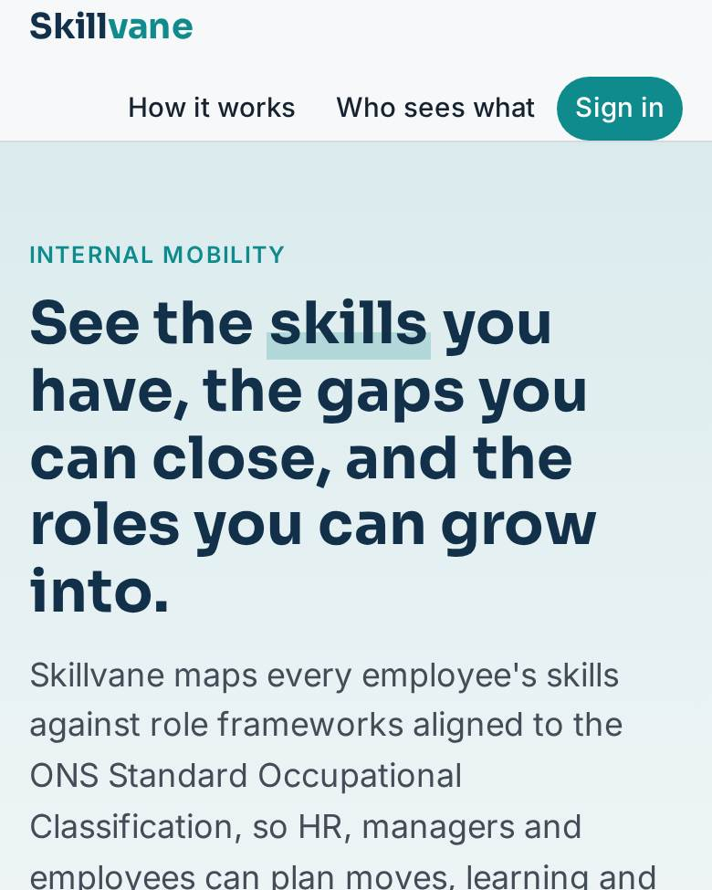
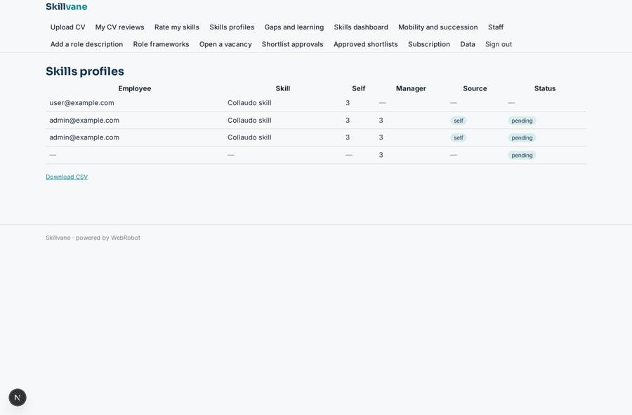
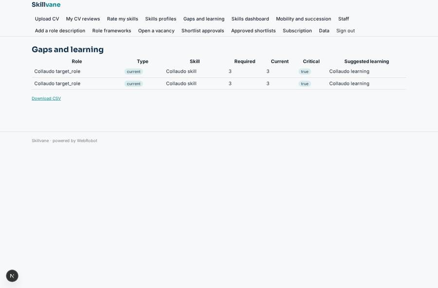
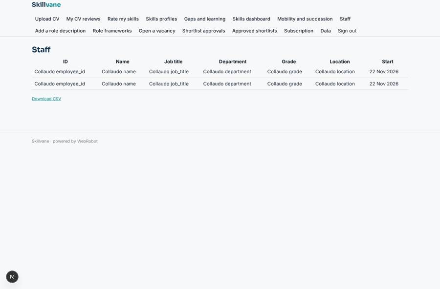
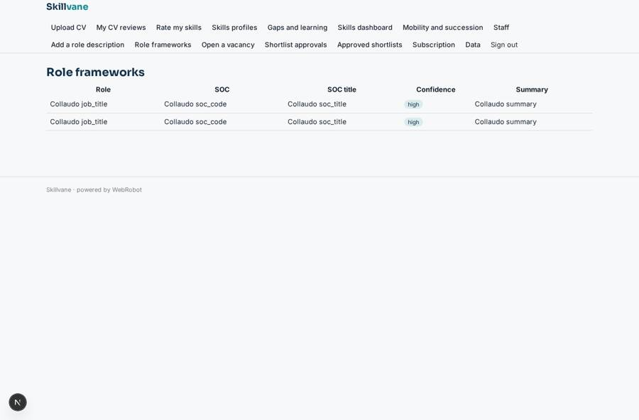

# Skillvane

_Map skills and gaps. Move talent inside._

**Sector:** B2B AI and SaaS · **Manifest:** valid (schema + runtime contract) · **Functional test:** passed (36 checks passed)

## Description given to the app builder

I want Skillvane, which maps employees' skills and gaps to support internal mobility in larger companies. The company signs up; roles are HR admin, manager and employee, employees see only their own profile, managers their team, HR everyone. HR imports staff by CSV (employee ID, job title, department, grade, location, start date) and uploads the company's role descriptions. Each job title is mapped to the ONS Standard Occupational Classification, and an agent builds a skills framework per role. Employees upload their CV or fill a skills form and rate themselves; an agent infers skills from the CV and suggests additions, and the manager validates them. The system then shows each employee their gaps for their current role and for roles they could move to, with suggested learning. When HR opens an internal vacancy, an agent ranks internal candidates by fit and explains why; HR approves the shortlist before managers see it. Quarterly email reminders to update profiles. Dashboards show skills coverage by department, critical gaps, mobility rate and succession readiness. Pricing: annual subscription per employee, billed monthly via Stripe. English.

## Functional test: what did not pass

- **saved record shown where its collection is read** (view my_gaps): a record was saved in skill_gaps (by admin-data, admin-data) but the page does not show it (as employee) _(warning)_

## Navigation recording

Signed in as the app's admin, the recorder opened 7 menu page(s): Upload CV, My CV reviews, Rate my skills, Skills profiles, Gaps and learning, Skills dashboard, Mobility and succession.
- agent run did not open: cv_upload: the run did not open
- data page empty: cv_history (history)

Empty data pages are mostly expected on the local runtime: agents are mocked there, so the collections they fill stay empty.

## Features not expressible today (spec.extensions)

- **per_seat_pricing**: The plan is a flat price; scaling the monthly charge with the number of employees (annual commitment, quantity set from headcount) cannot be expressed yet and must be set up in Stripe by the owner.
- **tenancy**: One Skillvane app per company: the company owner's admins are the HR admins. A shared multi-company deployment is not modelled.
- **soc_lookup**: SOC codes are suggested by the agent from its own knowledge with a confidence flag; HR must verify them. No ONS coding API is called.

## Screenshots (interpretive runtime, test data)

### home-anon

### home-mobile

### skills

### my_gaps

### staff

### frameworks

