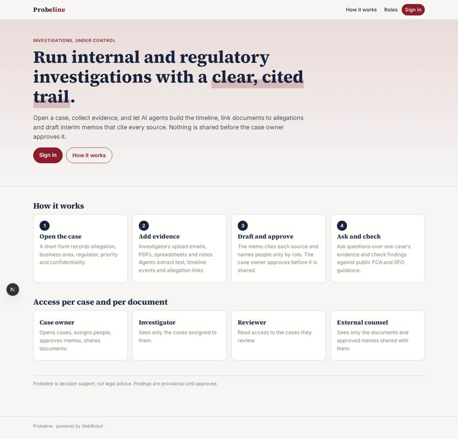
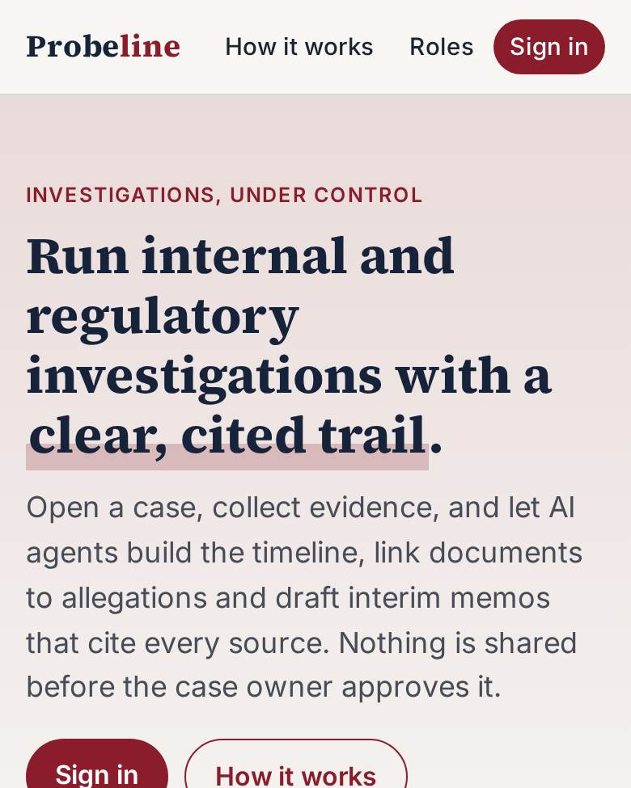
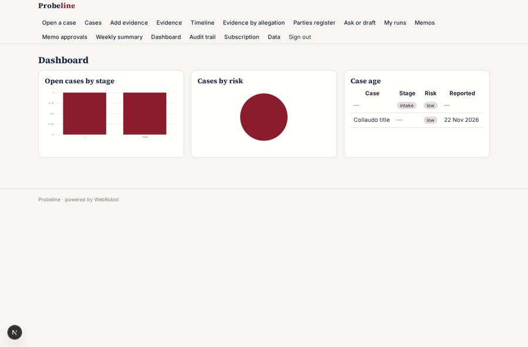
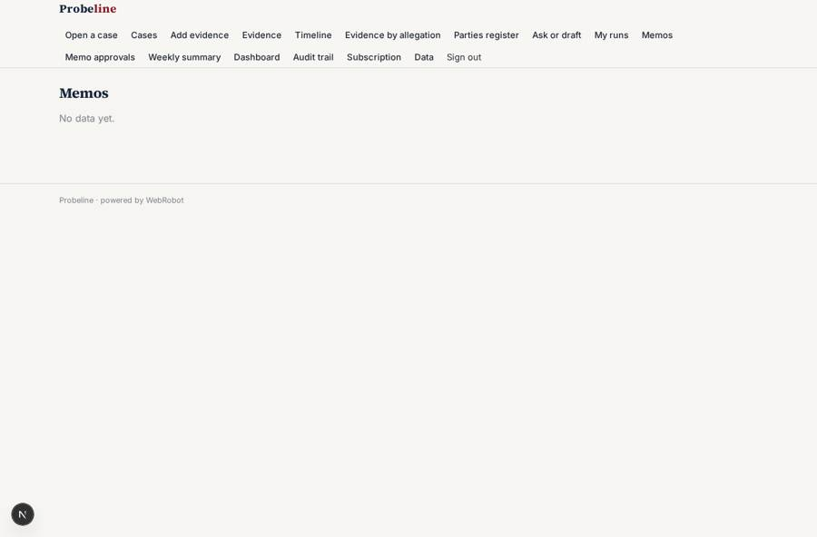
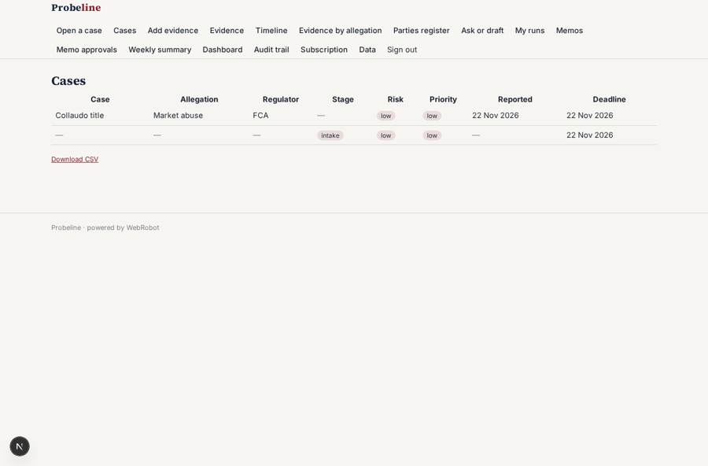
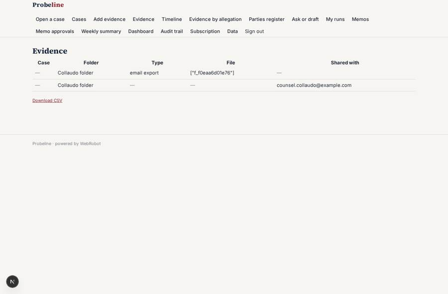

# Probeline

_Case management for internal and regulatory investigations._

**Sector:** B2B AI and SaaS · **Manifest:** valid (schema + runtime contract) · **Functional test:** passed (41 checks passed)

## Description given to the app builder

We need Probeline, a case management system for internal and regulatory investigations at financial firms and corporates. The firm signs up; roles are case owner, investigator, reviewer and external counsel, and access is per case and per document, so an investigator sees only cases assigned to them and external counsel only the folders shared with them. Opening a case is a form: allegation type, business area, regulator involved, date reported, priority, confidentiality level. Investigators upload evidence (emails exported as files, PDFs, spreadsheets, interview notes). An agent extracts text, builds a chronological timeline of events, identifies people and entities as roles rather than names in summaries, links documents to allegations and drafts an interim findings memo citing each source. The case owner approves every memo before it is shared. A second agent answers questions over the evidence of one case only, and checks findings against public FCA and SFO guidance. Email notifications when a document is added, a deadline approaches or a review is due; a weekly summary to the case owner. A dashboard shows open cases by stage, age and risk. Full audit trail of who viewed or changed what. Pricing: annual subscription per organisation with tiers by number of active cases. English.

## Functional test: what did not pass

- **template instance created and run** (template weekly_summary): reserved to case_owner/admin _(warning)_
- **saved record shown where its collection is read** (view documents): a record was saved in documents (by admin, admin) but the page does not show it (as investigator) _(warning)_
- **saved record shown where its collection is read** (view stage_chart): a record was saved in cases (by admin, admin) but the page does not show it (as user) _(warning)_
- **saved record shown where its collection is read** (view risk_chart): a record was saved in cases (by admin, admin) but the page does not show it (as user) _(warning)_
- **saved record shown where its collection is read** (view age_table): a record was saved in cases (by admin, admin) but the page does not show it (as user) _(warning)_

## Navigation recording

Signed in as the app's admin, the recorder opened 7 menu page(s): Open a case, Cases, Add evidence, Evidence, Timeline, Evidence by allegation, Parties register.
- data page empty: timeline (table)
- data page empty: links (table)
- data page empty: parties (table)

Empty data pages are mostly expected on the local runtime: agents are mocked there, so the collections they fill stay empty.

## Features not expressible today (spec.extensions)

- **view_audit**: The audit trail records inserts and updates of cases, documents and memos through triggers. Logging who merely viewed a record, and the acting user's identity on each entry, is not available yet.
- **folder_sharing**: Counsel access is granted per document (counsel email on the document). Sharing a whole folder in one step is not available yet.

## Screenshots (interpretive runtime, test data)

### home-anon

### home-mobile

### dashboard

### memos

### cases

### documents

