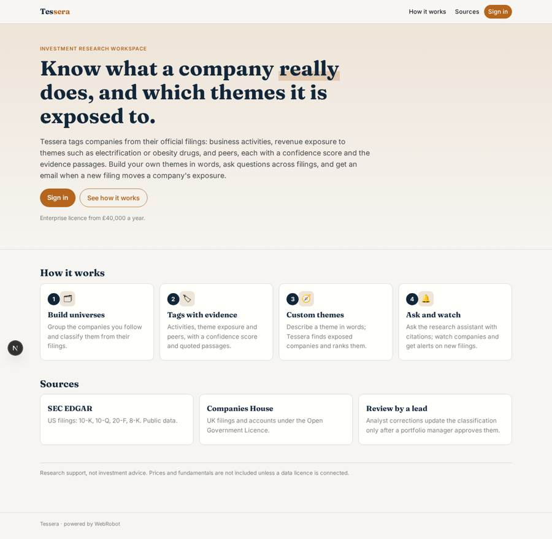
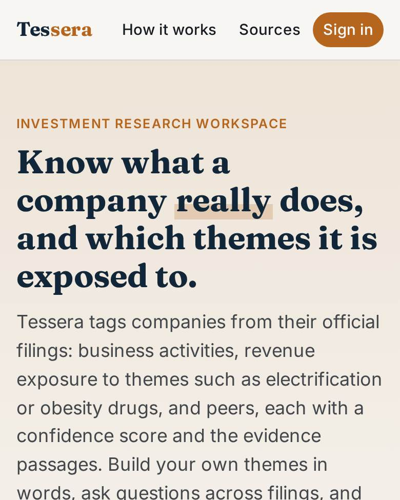
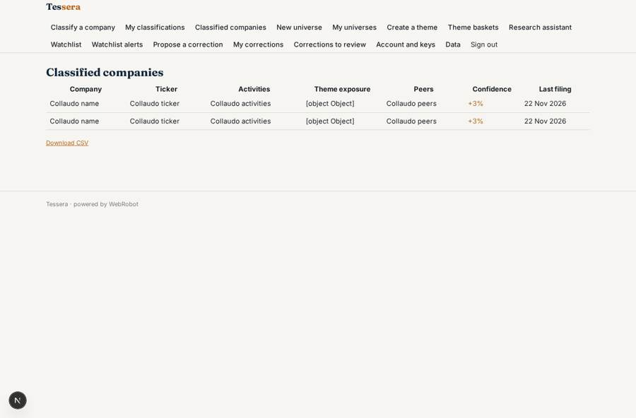
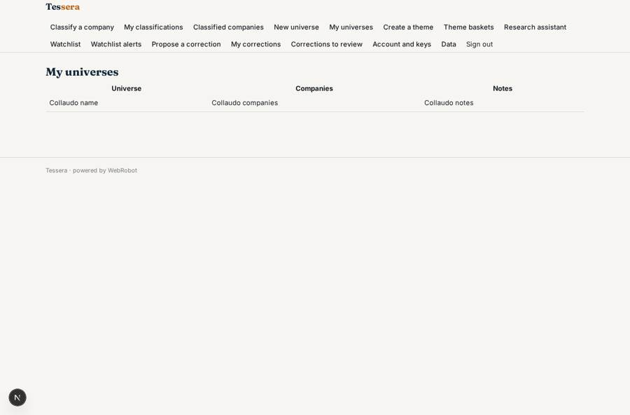
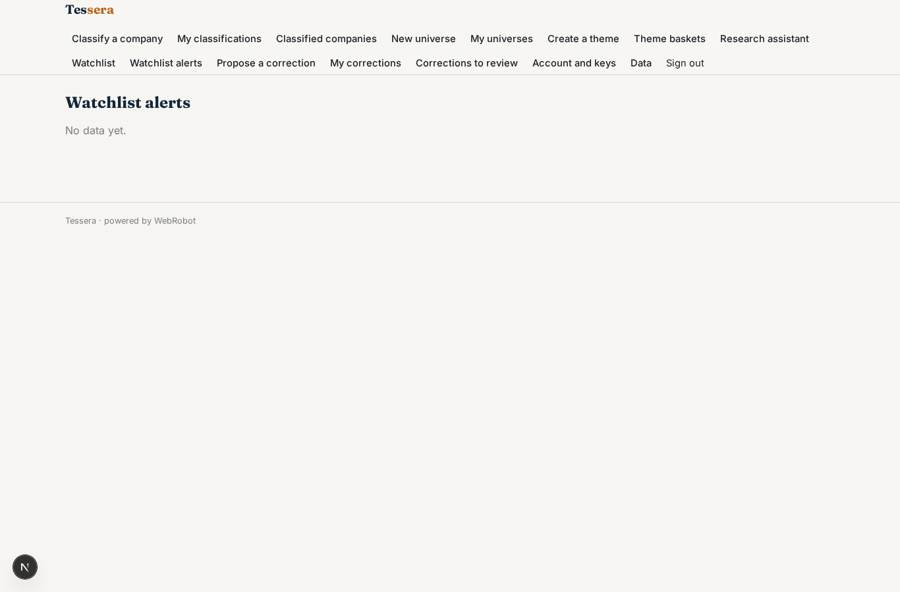
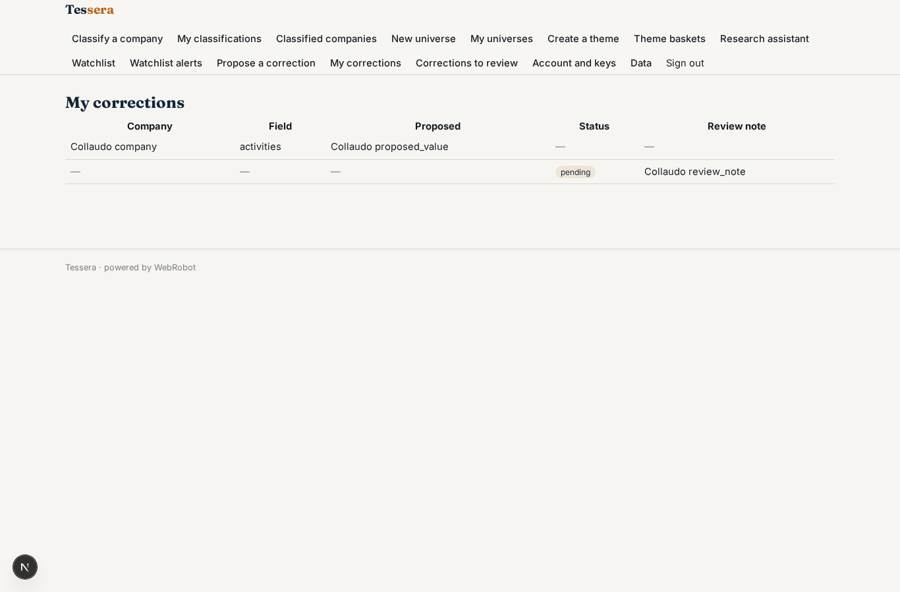

# Tessera

_Investment research workspace: classify companies, build themes, ask the filings._

**Sector:** Data, media, cyber, devtools · **Manifest:** valid (schema + runtime contract) · **Functional test:** passed (27 checks passed)

## Description given to the app builder

We need an app called Tessera for investment research that classifies companies and investment themes. The core of the real product is a proprietary foundation model trained for finance plus licensed market and fundamentals data; that model and licensed data are outside a normal software app, and I need the research workspace around them. Fund managers and analysts sign up and build universes of companies. Filings come from free official sources such as Companies House and SEC EDGAR; prices and fundamentals only if we have a licence. The model tags each company with business activities, revenue exposure to themes such as electrification or obesity drugs, and peers, with a confidence score and evidence passages from filings. Analysts can create custom themes by describing them in words; the system finds exposed companies and ranks them. A research assistant answers questions across filings with citations. Analysts can correct tags, and corrections are reviewed by a lead before they update the classification. Users set watchlists and receive email alerts when a company's exposure changes after a new filing. Dashboards show theme baskets and their composition over time. Roles: admin, portfolio manager, analyst. Pricing: enterprise licence from £40,000 a year. English only.

## Functional test: what did not pass

- **trigger has its effect** (trigger correction_submitted): email to role:portfolio_manager: no such recipient in the test (role nobody holds or empty field) _(warning)_

## Navigation recording

Signed in as the app's admin, the recorder opened 7 menu page(s): Classify a company, My classifications, Classified companies, New universe, My universes, Create a theme, Theme baskets.
No issue found.

Empty data pages are mostly expected on the local runtime: agents are mocked there, so the collections they fill stay empty.

## Features not expressible today (spec.extensions)

- **foundation_model**: The proprietary finance foundation model is outside this app. Classification here is done by general-purpose agents reading official filings; the model can be connected later as an MCP server or HTTP API.
- **licensed_market_data**: Prices and fundamentals need a data licence and are not included. Add them as an org credential and an http tool once a licence exists.
- **enterprise_licence**: The enterprise licence (from £40,000 a year) is contracted offline; the app runs with billing mode free and no credit metering. Per-seat controls are managed by the admins.
- **companies_house_key**: Companies House requires a free API key, set by the admins on the account page (credential companies_house). Review comments on corrections are by email link only; no SMS or chat alerts.

## Screenshots (interpretive runtime, test data)

### home-anon

### home-mobile

### company_list

### universes

### watch_reports

### my_corrections

